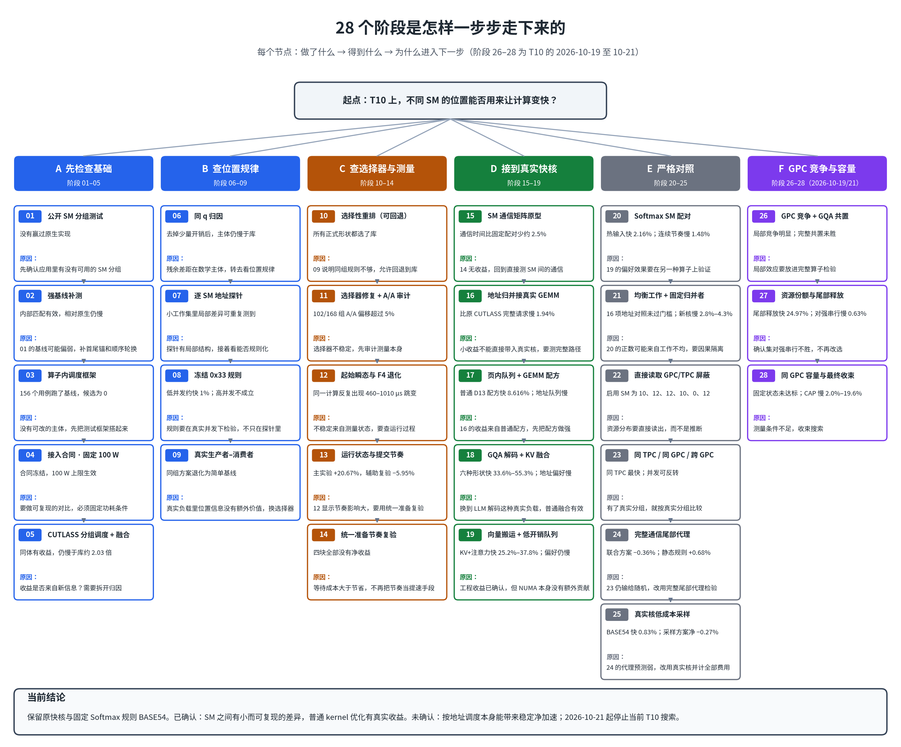

# EXP_NUMA_SM：在 T10 GPU 上测试“按 SM 位置调度”能不能让计算变快

这个仓库记录了一组在单张 Tesla T10 上做的 GPU 实验，共 28 个阶段，时间从 2026 年 10 月 14 日到 21 日。前一天（10 月 13 日）还在 RTX 5080 桌面主机 `ws-X870-AORUS-ELITE-WIFI7-ICE` 上做过四轮尝试，单独放在第六节。该桌面机已核对为 2026-10-21 当前主机，T10 主线使用另一台实验主机。

要回答的问题只有一个：**GPU 里不同 SM 的位置差异，能不能用来让计算变快？**

## 结论（先看这里）

- **有差异，但很小，而且依赖条件。** 早期测到的通信和访问差异约 0.5%–2.5%；后来的局部竞争实验波动更大，但都不能直接当作整个算子的净收益。
- **普通的 kernel 优化是真的有效。** 调好的矩阵乘法配方、把 KV 写入和注意力融合、用 16 字节向量搬运，都明显变快。但这些收益**不是**来自 SM 位置。
- **“按地址调度本身”带来稳定净加速，没有被证明。** 把校准、建表、更新、调度等全部成本算进去以后，它没有稳定地胜过原来的快核。
- **2026 年 10 月 21 日，停止当前的 T10 搜索。** 最终诊断认为，现在没有足够的证据支持再花一轮 GPU 时间。详见 [最终诊断](docs/T10_FINAL_DIAGNOSIS_20261021.md)。

目前保留的是原来的快核，以及一条固定的 Softmax 规则（代号 BASE54）。这不等于证明 GPU 上没有机会，只是这条路线在 T10 实验主机上没有走通。

---

## 一、实验是怎样一步步走下来的



图中每个节点都写了三件事：做了什么、得到什么、为什么进入下一步。阶段 26–28 是 10 月 19 日到 21 日的增量。

| 段落 | 阶段 | 要回答的问题 | 结果一句话 |
|---|---|---|---|
| A | 01–05 | 应用和算子本身有没有调度空间？ | 有普通实现层面的收益，但仍比成熟库慢 |
| B | 06–09 | 小范围内，不同 SM 的访问位置有没有规律？ | 小工作集里有可重复的局部差异，高并发下不成立 |
| C | 10–14 | 选择器和测量方法靠不靠谱？ | 选择器不稳定，测量受运行节奏影响很大 |
| D | 15–19 | 把地址调度接到真实快核上，还有没有用？ | 普通优化有效，地址偏好版本仍比无偏好版本慢 |
| E | 20–25 | 在严格对照下，结论还成立吗？ | 大多数对照下净收益为负，或分辨不出来 |
| F | 26–28 | GPC 竞争、资源份额和容量分工，能不能胜过强基线？ | 局部效应存在，但完整部署的增量没有建立 |

**注意：阶段数不是独立样本数。** 一个阶段里可能有多次运行，它们共用同一块硬件。

---

## 二、三个层次，证据要求逐级提高


判断“SM 位置有没有用”，要分三层看，不能混在一起：

1. **观察到差异**：同一个算子在不同 SM、不同地址上耗时不同。这一层已经有证据，但原因可能是缓存、并发、任务分配或运行节奏，**不等于硬件上的 NUMA 效应**。
2. **控制差异**：用冻结规则、错误地址、打乱标签等对照，检验位置信息有没有额外价值。这一层只部分成立：低并发下约 1% 的收益有效，高并发下分辨不出来。
3. **部署后净加速**：扣掉校准、建表、更新、调度等全部费用，并且胜过已有快核。这一层**还没有建立**。

---

## 三、最值得相信的几条证据

| 结论 | 数据 | 注意什么 |
|---|---|---|
| 这张 T10 上，各 GPC 启用的 SM 数量不一样 | 10、12、12、10、0、12，合计 56/72 | GPC 编号不是几何坐标，只说明资源分布，不说明距离远近 |
| 孤立的通信有小的位置差异 | 同 TPC 约 1160.6 ns，同 GPC 不同 TPC 约 1178.9 ns，跨 GPC 约 1174.3 ns | 不是裸链路延迟；并发时偏好可能反转 |
| 普通 GEMM 配方明显提速 | 调好的普通 CUTLASS 相对 cuBLAS，GPU 时间减少 8.616%（6/6 进程为正） | 来自形状和分块的选择，不是 SM 位置的功劳 |
| GQA 解码快核明显提速 | 六种形状相对预选库，GPU 时间减少 33.6%–55.3% | 来自共享 KV、序列切分和融合；不是整模型的 tokens/s |
| 固定 Softmax 规则略有收益 | 相对旧规则，热输入快 0.83%，重写输入快 0.33%（各 6/6 为正） | 这是固定参数的收益，不证明“按地址调度”有用 |
| 真实核采样没有超过新基线 | 扣掉全部校准费用后，热输入 −0.27%，重写输入 −0.26%（都是 0/6 为正） | 扣费前平均也没有正收益 |
| 尾部释放比固定分组快 24.97% | 对冻结的强串行实现仍慢 0.63%，区间跨零（阶段 27） | 没有胜过最强的串行方案，不能作为部署结论 |


---

## 四、每个正面结果旁边的反例

| 正面结果 | 同时存在的反例 |
|---|---|
| 低并发时冻结规则快约 1% | 高并发时分辨不出来；完整输出的就绪时间也没有净收益 |
| 请求间隔的主实验完成率 +20.67% | 辅助复验 −5.95%；统一准备的四块全部为负 |
| 通信原型减少约 2.5% | 真实 GEMM 里完整请求比原核慢 1.94% |
| GQA 快核大幅变快 | 同一队列里加地址偏好，反而比无偏好慢 0.96% |
| Softmax 热输入配对快 2.16% | 连续 32 次的节奏下，比固定配对慢 1.48% |
| 真实 GPC 屏蔽被直接读出 | 没有测到“同 GPC 总比跨 GPC 快”的稳定规律 |
| 尾部代理的静态规则快 0.68% | 地址感知的联合方案不胜过静态规则 |
| 尾部释放快 24.97% | 对强串行仍慢 0.63%，区间跨零 |
| GPC 容量分工在部分对照上有改善 | 四个 GQA 锚都没有胜过 N19；三档固定状态资格没有通过 |

---

## 五、我们没有证明什么

- 地址的物理归属、物理页映射、链路距离、远端流量都没有直接测到，所以**不能说“物理 NUMA 已被发现”**。
- 目标工作负载、目标并发和真实请求节奏下，优势能否稳定迁移，没有验证。
- 在强快核、同预算的静态选择、错误地址、A/A 对照下，是否仍有净收益，没有完整验证。
- T10 主线仅测单张 T10，未完成跨卡、跨架构复验；RTX 5070 Ti 没有实测。
- 完整大模型的 tokens/s，以及与成熟专用解码库的充分对比，没有做。
- RTX 5080 前史和 T10 主线之间不能合并或互相外推：机器不同，计时边界也不同。

---

## 六、RTX 5080 前史（2026-10-13）

在 T10 主线开始前一天，同样的问题在 RTX 5080 桌面主机 `ws-X870-AORUS-ELITE-WIFI7-ICE` 上试过四轮。2026-10-21 核对历史主机名和 GPU UUID，均与当前主机一致；“另一台”只表示它与 T10 实验主机不同。它们**不计入**上面的 28 个阶段，也不与 T10 的数字合并。

| 轮次 | 做了什么 | 结论 |
|---|---|---|
| R1 | 资源盘点、预注册、CPU 分析工具 | 本地缺 CUDA 工具链和测量 runner，硬件测量 0 次 |
| R2 | 渲染调度的资源复用原型，36 个 session | 候选比原生慢 42.4%，比负载均衡基线慢 26.9% |
| R3 | 84 个 SM × 地址区域的静态采样 | 留出预测 0.331%，低于预注册的 3% 门槛 |
| R4 | 在实际 40/40/4 Green 分组上重新校准地图，与原生、置换和盲选完整配对 | 192 MiB 普通负载慢 1.388%，`.cg` 慢 1.455% |

四轮的共同结论：**在 5080 上、这套配方与预算内，没有找到可部署的 SM 位置收益。** 这**不**等于 5080 上不存在 SM 或 NUMA 差异。R3 恰恰测到了一个弱的正数，只是过不了可行动门槛。完整报告见 [前史报告汇总](docs/RTX5080_STAGE.md)；原始数据和代码不在本仓库。

---

## 七、仓库怎么组织

```
README.md               本页：总览
docs/
  EXPERIMENT_CATALOG.md   各阶段的索引、结果与限制
  FINDINGS_AND_LIMITS.md  结论、反例与未完成的部分
  T10_FINAL_DIAGNOSIS_20261021.md  最终诊断：为什么停止当前搜索
  REPRODUCIBILITY.md      怎样恢复数据、怎样复算
  PROVENANCE.md           来源、署名与保存范围
  RTX5080_STAGE.md        前史（RTX 5080）报告汇总
  rtx5080/                前史四份报告原文与配图
  figures/                本页用到的图
experiments/            各阶段源码、报告、配置与派生数据（保持原字节）
research-final/         28 阶段总档案的 Git 浏览视图
archive/                完整原始记录的清单、校验值与恢复说明
tools/                  归档下载、校验与诊断脚本
```

`experiments/` 下的文件是原始记录，**字节不改**。它们里面的绝对路径和历史“下一步”都保留原样，可能只适用于当时的机器。

---

## 八、硬件与复现边界

- **T10**：单张 Tesla T10，计算能力 7.5，56 个 SM，4 MiB L2，驱动 580.178.04。
- **RTX 5080（前史）**：桌面主机 `ws-X870-AORUS-ELITE-WIFI7-ICE`（已核对与当前主机为同机），单张 GeForce RTX 5080，计算能力 12.0，84 个 SM，驱动 595.99.02。这张卡同时用于桌面显示，不是独占设备。
- **功耗**：T10 实验期间设为 100 W 上限，风扇、过温和看门狗保护保持开启。固定上限不等于固定实际功耗或锁定频率。
- **原始数据**：较大，放在 GitHub Release 中（01–25 阶段的标签是 `records-2026-10-18`，26–28 阶段是 `records-2026-10-21`）。下载和校验方法见 [archive/README.md](archive/README.md) 和 [新发布说明](archive/2026-10-21/README.md)。RTX 5080 前史只保留报告和图，原始数据和归档包不在本仓库。

第三方模型、数据和源码保留其原始来源和许可证。本仓库**没有**把它们重新授权为原创内容。详见 [来源与保存范围](docs/PROVENANCE.md)。
