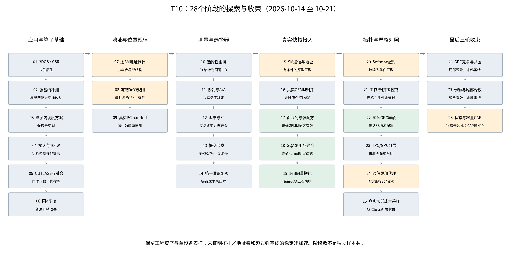
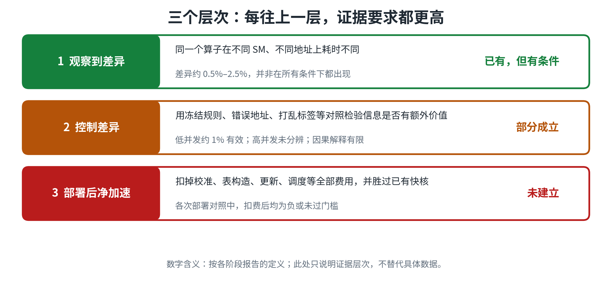
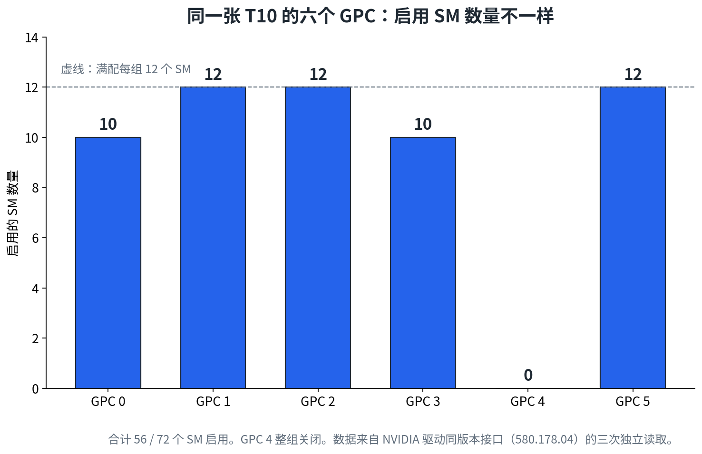

# EXP_NUMA_SM：在 T10 GPU 上测试“按 SM 位置调度”是否有用

这个仓库记录了一组在单张 Tesla T10 上做的 GPU 实验，时间是 2026 年 10 月 14 日至 21 日，共 28 个 T10 阶段；另附前一天在 RTX 5080 上做的四轮前史（见第 0 节）。目标是回答一个问题：**GPU 里不同 SM 的位置差异，能不能用来让计算变快？**

先说结论：

- **差异存在，但高度依赖条件。** 早期通信/亲和效应多在约0.5%–2.5%；后续局部竞争微基准也有更大的变化，但都不能直接当作完整算子的净收益。
- **普通的 kernel 优化是真的有效。** 比如调好的矩阵乘法配方、把 KV 写入和注意力融合、用 16 字节向量搬运，都能明显变快。但这些收益**不是**来自 SM 位置。
- **“按地址调度本身”带来稳定净加速，没有被证明。** 把调度的所有成本算进去（校准、建表、更新、调度开销）之后，它没有稳定胜过原来的快核。

所以，目前保留的是原快核和一条固定的 Softmax 规则（代号 BASE54）。这不等于证明 GPU 上没有机会，只是这条路线在这台机器上没有走通。

> **2026-10-21更新：** [最终诊断](docs/T10_FINAL_DIAGNOSIS_20261021.md)决定收束当前T10搜索；[新发布包](https://github.com/BorderRegion/EXP_NUMA_SM/releases/tag/records-2026-10-21)补齐26–28阶段。[28阶段档案](research-final/README_GITHUB.md)含探索图、证据级别、正负结果和NA。四个GQA锚的CAP配对完整耗时约慢2.0%–19.6%；两动态块只作描述，完整固定状态矩阵未运行。

> 更细的数据请看 [各阶段索引](docs/EXPERIMENT_CATALOG.md)，结论的边界请看 [结论与反例](docs/FINDINGS_AND_LIMITS.md)。

---

## 0. 前史：2026-10-13 在 RTX 5080 上的四轮

在 T10 之前一天，同一组问题在另一台机器（桌面机，RTX 5080）上试过四轮。它们**不属于**下面的 28 个 T10 阶段，也不参与任何合并统计：

| 轮次 | 做了什么 | 结果 | 最终状态 |
|---|---|---|---|
| R1 | 资源盘点与 CPU 分析准备 | 本地缺 CUDA 工具链、测量 runner、renderer；硬件测量 0 次 | `BLOCKED_LOCAL_RESOURCE` |
| R2 | 渲染调度的资源复用原型 | 36 个 session、18,432 帧；候选比原生慢 42.4%，比负载均衡基线慢 26.9% | `NO_INCREMENTAL_OPPORTUNITY_ON_5080` |
| R3 | 84 个 SM × 地址区域的静态采样 | 留出预测 0.331%（区间 0.253–0.382%），低于预注册的 3% 门槛 | `NO_ACTIONABLE_AFFINITY_IN_TESTED_SCOPE` |
| R4 | 把 R3 的地图装进 40/40/4 的 Green 执行器 | 192 MiB 普通负载比 Native 慢 1.388%，`.cg` 慢 1.455%，均 6/6 为负 | `NO_DEPLOYABLE_GAIN_ON_TESTED_GROUPS` |

四轮的共同结论是：**在 5080 上、这套配方与预算内，没有找到可部署的 SM 位置收益；渲染调度原型也没有净加速。** 这**不**等于 5080 上不存在 SM 或 NUMA 差异——R3 恰恰测到了一个弱的正数，只是过不了可行动门槛。四轮的完整报告和结论边界见 [前史报告汇总](docs/RTX5080_STAGE.md)；原始数据与代码不在本仓库。

---

## 1. 我们做了什么



实验分六段推进，每一段都是为了回答上一段留下的问题：

| 段落 | 阶段 | 要回答的问题 | 结果一句话 |
|---|---|---|---|
| A | 01–06 | 应用和算子本身有没有调度空间？ | 有普通实现层面的收益；但仍比成熟库慢 |
| B | 07–09 | 小范围内，不同 SM 的访问位置有没有规律？ | 小工作集里有可复现的局部差异；高并发下不成立 |
| C | 10–14 | 选择器和测量方法靠不靠谱？ | 选择器不稳定；测量受运行节奏影响很大 |
| D | 15–19 | 把地址调度接到真实的快核上，还有没有用？ | 普通优化有效；地址偏好版本仍比无偏好版本慢 |
| E | 20–25 | 在严格对照下，结论还成立吗？ | 大多数对照下净收益为负或无法分辨 |
| F | 26–28 | GPC竞争、份额释放和容量分工能否越过强基线？ | 局部收益保留，完整部署增量未建立；固定状态条件不足 |

**阶段数不是独立样本数。** 一个阶段内可能有多次运行，它们共享同一个硬件，不能把 28 个阶段当成 28 次独立验证。

---

## 2. 三个层次，证据要求逐级提高



判断“SM 位置有没有用”，要分三层来看，不能混在一起：

1. **观察到差异**：同一个算子在不同 SM、不同地址上耗时不同。这一层已经有证据，但原因可能是缓存、并发、任务分配、运行节奏，**不等于硬件上的 NUMA 效应**。
2. **控制差异**：用冻结规则、错误地址、打乱标签等对照，检验位置信息有没有额外价值。这一层只部分成立：低并发下约 1% 的收益有效，高并发下分辨不出来。
3. **部署后净加速**：扣掉校准、建表、更新、调度等全部费用，并且胜过已有快核。这一层**还没有建立**。

---

## 3. 最值得相信的几条证据

| 结论 | 数据 | 注意什么 |
|---|---|---|
| 这张 T10 的 SM 数量在各 GPC 之间不一样 | 启用 SM：10、12、12、10、0、12，合计 56/72 | GPC 编号不是几何坐标；这只说明资源分布，不说明距离远近 |
| 孤立的通信有小的位置差异 | 同 TPC 约 1160.6 ns，同 GPC 不同 TPC 约 1178.9 ns，跨 GPC 约 1174.3 ns | 不是裸链路延迟；并发时偏好可能反转 |
| 普通 GEMM 配方明显提速 | 调好的普通 CUTLASS 相对 cuBLAS，GPU 时间减少 8.616%（6/6 进程为正） | 来自形状和分块的选择，不是 SM 位置的功劳 |
| GQA 解码的快核明显提速 | 六种形状相对预选库，GPU 时间减少 33.6%–55.3% | 来自共享 KV、序列切分和融合；不是整模型的 tokens/s |
| 固定 Softmax 规则略有收益 | 相对旧规则，热输入快 0.83%，重写输入快 0.33%（各 6/6 为正） | 这是固定参数的收益，不证明“按地址调度”有用 |
| 真实核上的采样没有超过新基线 | 扣掉全部校准费用后，热输入 −0.27%，重写输入 −0.26%（都是 0/6 为正） | 扣费前平均也没有正收益 |



---

## 4. 最需要警惕的反例

每一个正面结果，旁边都有一个反例，请一起看：

| 正面结果 | 同时存在的反例 |
|---|---|
| 低并发时，冻结规则约快 1% | 高并发时效果分辨不出来；完整输出的就绪时间也没有净收益 |
| 请求间隔的主实验完成率 +20.67% | 辅助复验 −5.95%；统一准备的四块全部为负 |
| 通信原型减少约 2.5% | 真实 GEMM 里，完整请求比原核慢 1.94% |
| GQA 快核大幅变快 | 同一队列里加上地址偏好，反而比无偏好慢 0.96% |
| Softmax 热输入配对快 2.16% | 连续 32 次的节奏下，比固定配对慢 1.48% |
| 真实 GPC 屏蔽被直接读出 | 没有测到“同 GPC 总比跨 GPC 快”的稳定规律 |
| 尾部代理的静态规则 +0.68% | 地址感知的联合方案不胜过静态规则 |
| LONG尾部释放比固定分组快24.972% | 对冻结强串行仍慢0.633%，区间跨零 |
| GPC容量分工对部分分区对照有改善 | 四GQA锚均未胜N19；三档固定状态资格失败 |

---

## 5. 我们没有证明什么

- 地址的物理归属、物理页映射、链路距离、远端流量——这些都没有直接测到，所以不能说“物理 NUMA 已被发现”。
- 在目标工作负载、目标并发和真实请求节奏下，优势能否稳定迁移。
- 在强快核、同预算的静态选择、错误地址、A/A 对照下，是否仍有净收益。
- 第二块 GPU 或其他架构上的结果——本机只有一张 T10，RTX 5070 Ti 没有实测。
- 完整大模型的 tokens/s，或与成熟专用解码库的充分对比。
- 5080 前史与 T10 主线之间的可迁移性：两台机器、两套计时边界，不能合并，也不能互相外推。

---

## 6. 仓库怎么组织

```
README.md             本页：总览
docs/
  EXPERIMENT_CATALOG.md   28 个阶段的索引、结果与限制
  FINDINGS_AND_LIMITS.md  结论、反例与未完成的部分
  REPRODUCIBILITY.md      怎样恢复数据、怎样复算
  PROVENANCE.md           来源、署名与保存范围
  RTX5080_STAGE.md        2026-10-13 前史的报告汇总
  rtx5080/                前史的四份报告原文与配图
  figures/                本页用到的图
experiments/          各阶段源码、报告、配置与派生数据（保持原字节）
research-final/       28阶段总档案的Git浏览视图；raw/二进制见新Release
archive/              完整原始记录的清单、校验值与恢复说明
tools/                归档下载与校验脚本
```

`experiments/` 下的文件是原始记录，**字节不改**。它们里面的绝对路径和历史“下一步”都保留原样，可能只适用于当时的机器。

---

## 7. 硬件与复现边界

- 设备：单张 **Tesla T10**，计算能力 7.5，56 个 SM，4 MiB L2，驱动 580.178.04。
- 前史设备：单张 **RTX 5080**（另一台桌面机），计算能力 12.0，84 个 SM，报告 64 MiB L2，驱动 595.99.02；GPU 同时承担桌面显示，不是独占设备。
- 功耗：实验期间设置为 100 W 上限，风扇、过温和看门狗保护保持开启。固定上限不等于固定实际功耗或锁定频率。
- 完整原始数据较大，放在 GitHub Release 中，用 `archive/README.md` 里的脚本下载和校验（01–25标签 `records-2026-10-18`，26–28见[新发布说明](archive/2026-10-21/README.md)）。5080 前史只保留报告与配图，原始数据、源码和归档包不在本仓库。

第三方模型、数据和源码保留其原始来源与许可证。本仓库**没有**把它们重新授权为原创内容。详见 [来源与保存范围](docs/PROVENANCE.md)。
