# EXP_NUMA_SM：T10 上的拓扑、地址亲和与算子优化实验档案

这是 BorderRegion 的完整研究记录，覆盖 **2026-10-14 至 2026-10-18、25 个探索阶段**。保留原始数据、源码与冻结配置、失败/修复日志、分析脚本、报告、图表以及原始任务/评审包。此仓库记录已经做过的工作，不把任务书中的计划当成已执行结果。

**截至本次归档：真实的非均匀 SM 屏蔽已确认，部分局部访问差异可以复现；普通 GEMM/GQA kernel 优化有明确收益，但尚未建立“拓扑与地址亲和调度本身带来稳定净加速”的证据。** 当前保留 Softmax 固定规则 BASE54，停止在这条 Softmax 路线上继续做相似搜索。这不等于证明所有 GPU 或其他部件都没有机会。

[全部 25 阶段与报告](docs/EXPERIMENT_CATALOG.md) · [结论与反例](docs/FINDINGS_AND_LIMITS.md) · [完整原始记录与恢复方法](archive/README.md) · [复现说明](docs/REPRODUCIBILITY.md)

## 我们怎样一路探索到这里

图中数字对应完整索引。箭头表示研究问题的演进，**不表示前一个阶段的正数已经证明了后一个机制**。

```mermaid
flowchart TD
  subgraph A["01–06：先检查应用和算子内调度"]
    A1["01 公开 SM 资源分组<br/>3DGS / CSR 未胜 Native"] --> A2["02 强基线补测<br/>内部匹配不等于部署净收益"]
    A2 --> A3["03 原生基线、候选尚未实现"]
    A3 --> A4["04 接入合同 / 固定100W"]
    A4 --> A5["05 CUTLASS grouped + 融合<br/>同体有收益，仍输库"]
    A5 --> A6["06 同 q 归因<br/>q=1退化，主体差距仍在"]
  end
  subgraph B["07–09：先问位置与地址规律是否存在"]
    B1["07 逐 SM 地址探针<br/>小工作集局部结构"] --> B2["08 冻结规则<br/>低并发约1%，高并发未证实"]
    B2 --> B3["09 真实 producer–consumer GEMM<br/>同组方案退化为简单基线"]
  end
  A6 --> B1
  subgraph C["10–14：追查选择器和测量状态"]
    C1["10 选择性重排<br/>冻结规则全部回退LIB"] --> C2["11 修复V2<br/>A/A仍大幅失稳"]
    C2 --> C3["12 瞬态 / F4<br/>同一计算反复跳变"]
    C3 --> C4["13 改提交节奏<br/>主实验+20.67%，复验−5.95%"]
    C4 --> C5["14 统一准备复验<br/>四块净收益均为负"]
  end
  B3 --> C1
  subgraph D["15–19：把地址调度接到真实快核"]
    D1["15 SM通信矩阵<br/>地址相关原型有小收益"] --> D2["16 真实GEMM归并<br/>比原CUTLASS慢"]
    D2 --> D3["17 页内队列 / 强GEMM配方<br/>普通D13配方有效，亲和无净收益"]
    D3 --> D4["18 GQA decode + KV融合<br/>普通kernel提速"]
    D4 --> D5["19 向量搬运 / 低开销队列<br/>再获工程收益，地址偏好仍更慢"]
  end
  C5 --> D1
  subgraph E["20–25：冻结快核，用真实拓扑做严格对照"]
    E1["20 Softmax配对<br/>热输入有正数，连续节奏反转"] --> E2["21 均衡工作 / 固定归并者<br/>新完整核更慢"]
    E2 --> E3["22 直接读RM屏蔽分布<br/>10 / 12 / 12 / 10 / 0 / 12"]
    E3 --> E4["23 同TPC / 同GPC / 跨GPC<br/>孤立小差异，并发可反转"]
    E4 --> E5["24 完整通信尾部代理<br/>亲和未过关；固定规则+0.68%"]
    E5 --> E6["25 真实原核低成本采样<br/>固定规则复现，调度净收益为负"]
  end
  D5 --> E1
  E6 --> Z["当前结论：保留固定快核与完整证据<br/>未实现地址亲和本身的稳定净加速"]
  classDef hardware fill:#e0f2fe,stroke:#0284c7,color:#0c4a6e;
  classDef engineering fill:#dcfce7,stroke:#16a34a,color:#14532d;
  classDef unresolved fill:#fff7ed,stroke:#ea580c,color:#7c2d12;
  class E3 hardware;
  class D3,D4,D5 engineering;
  class B2,C2,C4,E1,E4,E5,E6,Z unresolved;
```

## 最值得保留的证据

| 命题 | 当前证据 | 不能推出什么 |
|---|---|---|
| T10 的 SM 屏蔽不是逐 GPC 均匀发生 | 同版本 RM 三次独立读取：物理 GPC 0–5 启用 SM 为 **10、12、12、10、0、12**，合计56/72 | 非均匀屏蔽本身不证明 NUMA、物理距离或可加速空间 |
| 孤立通信存在小的拓扑差异 | 页17往返：同TPC约1160.6 ns，同GPC不同TPC约1178.9 ns，跨GPC约1174.3 ns | 不是裸链路单向延迟；高并发偏好可反转 |
| 普通算子工程可以明显提速 | D13普通GEMM配方相对cuBLAS时间减少8.616%；GQA共享KV/向量搬运/融合有正收益 | 不归功于NUMA，也不是整模型或SOTA结论 |
| 固定 Softmax 规则值得保留 | 上轮约+0.68%；本轮相对旧固定规则，热输入速度比改善 **+0.8318%**、逐次重写 **+0.3346%**，均6/6进程正 | 固定参数收益不证明目标地址校准有用 |
| 低成本真实核采样没有超过新基线 | 全部校准与更新收费后，热输入 **−0.2728%**、重写输入 **−0.2563%**，两者0/6净正 | 不应只展示胜弱静态对照的数值；未扣校准平均也没有正毛收益 |

数值的比较对象、计时边界、区间和失败范围在各阶段报告中逐项保留。不同阶段的收益不能相加，独立统计单位也不是数百万次 kernel 调用。

## 档案如何组织

- `experiments/`：保持原相对路径和字节内容的源码、报告、图表、配置与可直接阅读的派生数据。
- `archive/manifests/`：完整快照的逐文件 SHA-256、大小、修改时间、权限及归档路径；若文件同时在 Git 中，另列 `git_path`。
- `archive/INDEX.json` 与 `archive/SHA256SUMS`：全部完整数据包、文件数、体积与校验值。大体积 raw、二进制、模型/依赖、原始交付包单独保存为 release assets，不用摘要代替原数据。
- `docs/`：阶段索引、结论边界、复现与来源说明；`tools/`：归档校验/恢复辅助脚本。

原报告里的绝对路径和历史“下一步”保留原样，可能只适用于当时主机；本页与索引提供可在 GitHub 使用的相对链接。历史报告的作者/生成痕迹不被改写；本次整理提交使用 BorderRegion 身份。

## 环境与可复现边界

实际设备为 **单张 Tesla T10，cc7.5、56 SM、4 MiB L2，驱动580.178.04**；RTX 5070 Ti 始终没有本机实测。早期存在125/100 W保护切换，后续固定100 W上限，保留风扇、过温和watchdog保护。固定上限不等于固定实际功耗或锁频。

本次仅归档与校验，不追加GPU实验，不删掉负结果，不重写冻结方案，不用新的汇总修饰旧结果。完整历史数据仍有各自记录的实现缺项、A/A偏差、种子重用、计量边界和sanitizer范围限制。

第三方模型、数据和源码保留其原始来源及许可证；此仓库没有把它们重新许可为我们的原创。详见 [来源与保存范围](docs/PROVENANCE.md)。
