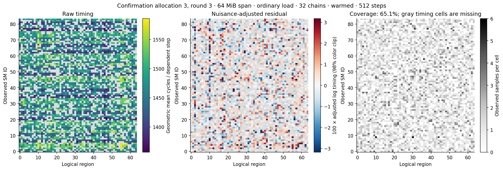
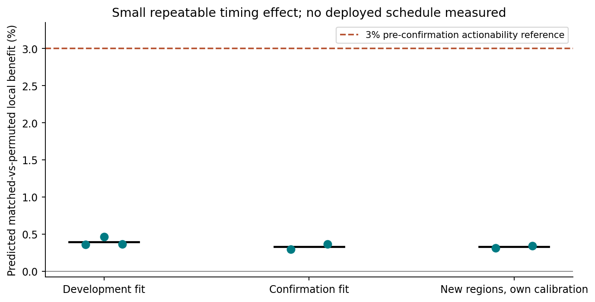
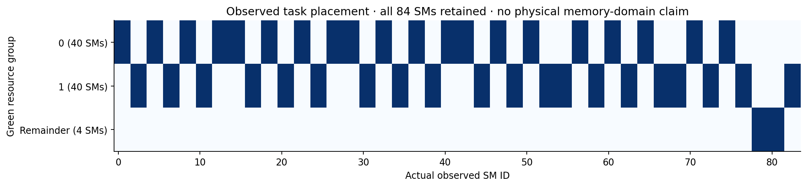
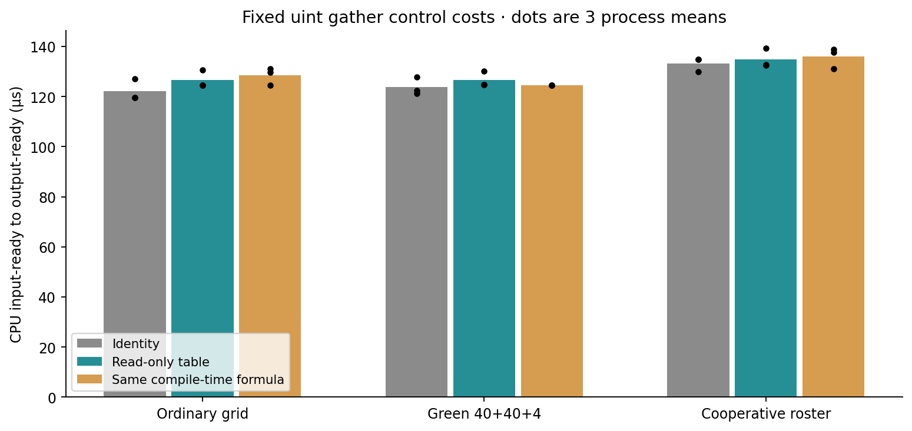

# RTX 5080 static affinity and specialization experiment

Completed 2026-10-13. Run `static_affinity_20261013`.

The selected map produced a **0.331% predicted local timing benefit** on two fresh confirmation allocations, with an exploratory allocation/round bootstrap interval of **0.253–0.382%**. This is a small positive timing effect. It did not meet the 3% actionability gate frozen before confirmation, and it is not a measured application speedup. The application branch is closed for this campaign as **NO_ACTIONABLE_AFFINITY_IN_TESTED_SCOPE**.

That label is an operational decision about this recipe and budget. The result does **not** show absence of affinity, NUMA, memory domains, or possible gains on other workloads. In particular, the effect is above the arithmetic-control proxy (absolute 95th percentile 0.057%); it should not be described as literally zero or indistinguishable from that proxy. The package's no-improvement wording is narrower than this observed weak-positive case; the implemented, pre-confirmation 3% gate explains the stop. No net gain of a deployed affinity map was measured.

## Questions answered

| Question | Current evidence and boundary |
|---|---|
| RQ1: position × region interaction | Same owned address chains observed on all 84 SMs; broad coverage complete, denser windows partly missing. A weak positive held-out timing prediction survives nuisance adjustment. |
| RQ2: effective control | Public Green Context groups and a supported cooperative roster execute correct work. Green placement uses all 84 SMs. The learned 83-SM grouping was **not** deployed or equated with Green groups; correct-map versus shuffled-map causal execution remains unmeasured. |
| RQ3: zero online costs | The tested control loops have no online planner, task-claim queue, or extra scheduling kernel. Table loads, indexing, three Green launches/context changes, and the roster/barrier remain real costs. |
| RQ4: renderer benefit | UNKNOWN. No snapshots or dynamic 3DGS frames were run in this campaign after the affinity gate failed. |
| RQ5: lifetime and amortization | Two new allocations confirm a small prediction, with their own early-round calibration. Full generation guards, scene/capacity changes and deployment break-even are UNKNOWN. |
| RQ6: contribution beyond strong baselines | No such increment established. This is a reproducible bounded measurement and executor qualification, not a paper-level scheduling result. |

## Scope, provenance and environment

The human request was “go” with the supplied static-specialization ZIP. The attached documents were treated as the proposed experimental specification, not as independent proof of authorization, prior results, or hardware capability. SHA-256 of the input archive is `9794e3df30ebed5899e1b2ef204298ea2a1d0cc47af571ac20bf984db97af988`; all 16 manifest entries verified. The supplied CPU plan check and 32 helper tests passed.

Actual device: RTX 5080, 84 SMs, compute capability 12.0, 64 MiB reported L2. Driver 595.99.02, CUDA compiler 13.2.51 and runtime/driver API 13020. The existing Ubuntu 26.04/GCC 15 setup was locally qualified; no official OS-certification claim follows. Existing toolchain, sanitizer and Python plotting libraries were reused read-only. No network, purchase, privilege, driver, clock, power or system change was made.

The old `affinity-render-5080` experiment was kept separate. Its CPU-assisted queue scheduler results were not pooled with this campaign. Renderer commit `59f5f77e3ddbac3ed9db93ec2cfe99ed6c5d121d` and Train/Bonsai/Truck assets remain present; their current sizes match prior locks. Assets were not consumed or retuned here, and prior asset hashes are labeled prior checks, not new rehashes. See `RESOURCE_INVENTORY.json`.

Local CUDA headers and actual API calls provided the control evidence. The installed headers expose Green Context and cooperative APIs; no `LOCALITY_DOMAIN` declaration was found, which says nothing conclusive about underlying hardware. The package's paper summaries and external links were retained as supplied references. Full research papers and those web pages were not independently retrieved or verified in this offline run. No systematic novelty or publication-status claim is made from them.

## E1 measurement and independence

Five fresh processes allocate their own 256 MiB pool and 192 MiB eviction scratch, with generation-specific 1–5 MiB padding. Each uses 16, 64 and 256 MiB spans of that pool, ordinary and `.cg` memory-load recipes, and 1 or 32 active dependent chains per 32-thread CTA: **60 real strata**. Each stratum has three cache-preparation recipes × two sampling recipes × six chronological rounds. An arithmetic-only recurrence is a separate control, not a third memory recipe.

There are 3,240 formal dispatches (2,160 memory, 1,080 arithmetic) and 40,279,680 timer/checksum records. These records include repeated chains and reference samples; they are not independent load observations. The independent experimental units for confirmation are the two allocation processes, with held-out rounds nested within them. Processes can reuse physical storage, so fresh allocation is not proof of independent physical pages.

The pool contains 64 non-overlapping virtual regions. Identical region/lane-dependent chains are sampled across observed SMs. Broad coverage uses 64 regions per CTA and 64 dependent steps; denser accesses use four regions per CTA and 512 steps. The latter uses 16 × 84 CTAs. Region order and case order are shuffled reproducibly; `blockIdx` selects a cyclic starting region and is never treated as an SM binding. `%smid` is sampled at both ends. A repeated region-0 reference is interleaved and retained for drift diagnostics, but excluded from the interaction fit.

Cache labels mean preparation recipes: NONE, a full-pool touch, and reads of an owned 192 MiB scratch allocation. None guarantees cache residency, global eviction, cold DRAM, or zero contention. No physical addresses or private mappings were accessed. Final disassembly distinguishes ordinary `LDG.E` from `.cg`'s `LDG.E.STRONG.GPU`; it does not measure hit rates or traffic.

**Pool span is not sampled working set.** Exact chain enumeration is in `SAMPLED_FOOTPRINT.csv`. At the selected 64 MiB span / 512 steps / 32 chains, 1,015,030 unique words occupy 25.148 MiB of virtual 32-byte sectors or 55.244 MiB of virtual 128-byte lines. At the largest 256 MiB span the corresponding proxies are 30.102 and 100.758 MiB. These are address unions, not measured transaction sizes or physical cache occupancy. Thus this experiment does not establish a consumer footprint exceeding 64 MiB at a 32-byte sector granularity. DRAM-dominated behavior remains unresolved.

Every formal broad-coverage dispatch observes all 84 × 64 cells. The denser recipe observes at least 65.104% per dispatch, with at least 33 regions per SM and 45 SMs per region. Across early/later rounds the frozen map's joint cell coverage is 90.25–92.21%. Missing cells stay NaN; they are not assigned zero cost or inferred coverage. SM 79 lacked a complete feature row for the selected training slice and was omitted from the learned map, leaving 83 SMs (42/41 groups), although the experiments observed all 84.

The displayed confirmation dispatch shows raw geometric cycles per dependent step, adjusted residuals and counts separately. Gray timing cells are missing. The color scale clips at the 98th absolute residual percentile for display only; numerical analysis keeps all valid observations. These contended CTA intervals are not isolated memory latencies.

Analysis uses log(ticks/steps), jointly removing categorical SM, region, slot and block-index-cohort means by alternating demeaning. The cohort is `blockIdx / 84`, a nuisance proxy, **not an observed hardware execution wave**. “block-wave” in the original freeze/derived metadata names this proxy. Main-effect adjustment cannot establish a physical cause or remove every launch/time confound. An additive synthetic-model check leaves residual below 1e-8.

K=2/4 balanced SM grouping is fitted on regions 0–31 and rounds 0–2 of development allocations 0–2; K=1 is the zero-benefit null. The selected condition maximizes later-development benefit minus twice its allocation standard deviation. A balanced greedy region assignment is compared with cyclic group-label permutations preserving task counts. The selected K=2 map uses the 64 MiB span, ordinary loads, 32 chains, warmed preparation, and 512 steps. Development benefit is 0.396%, SD 0.059%.

`MAP_FREEZE.json` was written at 19:16:37 +08 before allocation 3 or 4. It freezes SM groups, recipe and the 3% gate. Per-allocation early-round region-home calibration remains necessary. The original selection source is retained as `select_map_at_freeze.py`; a later equivalent array-loading optimization is disclosed and hashed. No confirmation result selected a new map.

| Confirmation allocation | Fit-region prediction | New-region prediction, own initialization | Fit-region stale-home prediction |
|---|---:|---:|---:|
| 3 | 0.297% | 0.313% | 0.278% |
| 4 | 0.364% | 0.342% | 0.390% |

New regions 32–63 did not select the SM map, but their own early measurements choose homes; this is not calibration-free transfer. Stale-home predictions apply old logical region labels only to newly owned memory, never to freed pointers. Early/later residual rank correlations are only 0.108–0.132. The 20,000-replicate bootstrap (seed 2026101304) samples allocation then round, and its 0.253–0.382% interval is exploratory with only two allocations. This is a prediction from grouped timing matrices, not a controlled execution of the selected assignment.

## E2 control capability and costs

The public resource API reports 84 SMs, minimum partition 8 and co-scheduling alignment 8. Splitting gives 40, 40 and a 4-SM remainder; all three contexts were created successfully. The retained placement CSVs for the full workload observe all 84 SMs in disjoint groups of 40/40/4, including the remainder. Those are actual execution groups, not inferred physical memory domains or the learned K=2 grouping.

The cooperative path launches 84 workers within the reported capacity (12 resident blocks/SM for the checked kernel). Workers record observed SM-derived membership and use one supported `grid.sync()`, followed by deterministic group/rank strides. Missing groups redirect to an active group. No cross-SM spin barrier, persistent cross-frame launch, work stealing, global task-claim atomic or retry pass is used. Per-worker roster details are not retained in the CSVs; exact ownership/output checks and the source support correctness, while a learned-map placement confusion matrix is UNKNOWN.

The cost control processes 4,096 logical tasks over 16 MiB of uint data, 128 threads and 16 gathers per thread. All policies use the same arithmetic and output indices. Identity, a read-only permutation table and the identical compile-time formula `(index * 17) & (N-1)` are compared. This is a static illustrative permutation, not an affinity-trained layout. Table and formula are bijective; Green group task counts are 1,950 / 1,950 / 196. No Gaussian data or evaluator is involved.

Three fresh process blocks run nine policies each, each with 32 warmups and 128 measured replays: 27 sessions / 3,456 timed replays. The table below averages process means; ratios are geometric means of paired process ratios, with their three observed values' range. Replays are subsamples, not 128 independent repetitions. Order uses a fixed shuffle rotated over three positions, so nine-position temporal balance was not achieved. No confirmatory p-value or general runtime upper bound is claimed.

| Backend | Mode | CPU ready ms | Event span ms | Paired CPU ratio to ordinary identity | Process ratio range |
|---|---|---:|---:|---:|---:|
| Ordinary grid | Identity | 0.122085 | 0.117691 | 1.0000 | 1.0000–1.0000 |
| Ordinary grid | Table permutation | 0.126579 | 0.122347 | 1.0370 | 0.9801–1.0930 |
| Ordinary grid | Compile-time permutation | 0.128438 | 0.123653 | 1.0522 | 0.9797–1.0968 |
| Green 40+40+4 | Identity | 0.123885 | 0.120336 | 1.0149 | 1.0066–1.0235 |
| Green 40+40+4 | Table permutation | 0.126589 | 0.122958 | 1.0371 | 0.9829–1.0881 |
| Green 40+40+4 | Compile-time permutation | 0.124570 | 0.120986 | 1.0208 | 0.9800–1.0419 |
| Cooperative roster | Identity | 0.133147 | 0.128868 | 1.0909 | 1.0222–1.1273 |
| Cooperative roster | Table permutation | 0.134854 | 0.130474 | 1.1047 | 1.0438–1.1648 |
| Cooperative roster | Compile-time permutation | 0.135910 | 0.130849 | 1.1133 | 1.0838–1.1614 |

Green identity adds a mean 1.800 µs to the ordinary identity path; the paired ratio is +1.49% (range +0.66 to +2.35%). Roster identity adds 11.061 µs; the paired ratio is +9.09% (range +2.22 to +12.73%). These costs cannot simply be subtracted from the unrelated pointer-chase prediction to estimate a renderer outcome.

| Compile-time minus same-plan table | Mean delta µs | Paired process delta range µs | Paired ratio |
|---|---:|---:|---:|
| Ordinary grid | +1.859 | -1.050 to +6.681 | 1.0147 |
| Green | -2.019 | -5.527 to -0.166 | 0.9842 |
| Roster | +1.056 | -8.179 to +6.278 | 1.0078 |

There is no consistent general advantage from compiling the table permutation into arithmetic. Green's three blocks favor the formula, while the other backends change sign. This is descriptive, workload-specific evidence, not a new algorithm result.

CPU timing brackets start-event record/wait, launches, complete stream/device joins, and end-event record/wait. Event span includes host submission and idle gaps and is **not GPU busy time**. Each task still writes its SM position in every policy, a common diagnostic perturbation. Diagnostic hit-count atomics run only during qualification; the measured path disables them. Final output copies/comparisons are outside timing and common across policies. There was no instrumentation-free sensitivity run.

Read-only table storage is 16,384 bytes. Group bounds, SM-group lookup and roster require 16 + 1,024 + 336 bytes. Total explicit full-control allocations are 16,844,128 bytes including data, outputs, visits and position diagnostics, before CUDA context/runtime overhead (not measured). All modes keep these allocations, so formula timing does not prove a memory saving. Green uses three launches and three stream joins with explicit context selection; roster computes group ranks and performs one grid barrier inside the timed launch.

Eight candidate template combinations (two task sizes × two specialization levels × two kernel shapes) were compiled, plus four identity instantiations and an initializer. Final resource dumps show 33 registers / zero stack bytes for direct kernels and 40 registers / 24 stack bytes for roster kernels; reported shared storage is 1,040 / 1,064 bytes. Probe register counts are ordinary 30, `.cg` 28 and arithmetic 24. These are compiled resource declarations, not measured occupancy or spill traffic.

CPU-only rebuilds after GPU completion took 1.668 s for the probe and 2.628 s for the control executable on a warm filesystem. Original executable sizes are 1,211,480 and 1,441,144 bytes, including host/runtime components; they are not isolated cubin sizes. Original cold compile time and per-variant code-size deltas were not captured. Rebuilt binaries were not substituted into the measurements.

## Correctness, failures and health

All formal probe checksums match the separately computed CPU recurrence; no sampled SM migration was observed. These checksums cover all lane final values but are not a proof that every intermediate load is identical. Fixed gather qualification compares every uint output against an independent CPU summation and checks every logical task is visited exactly once, including forced single-active-group cases. Each full timing policy ends with a complete CPU output comparison. Formal output/ownership errors are zero.

Existing Compute Sanitizer was used on bounded small cases. Probe memchecks passed, including the final indexing variant. Initial control memcheck returned 12 host API errors: a Green stream was launched/waited/destroyed with the wrong current context. The failing source, executable and logs are retained. The repair explicitly selects the corresponding converted Green Context, then restores the primary context. **Final memcheck, synccheck and racecheck all reported zero errors.** This is small-case qualification, not an exhaustive proof for every input. Initial synccheck ran after that API-only memcheck failure; no device memory fault or Xid occurred.

The exploratory eight-region pressure scout reached 3.236 ms, above the preferred 2 ms target but below the 20 ms stop guard. Before the formal freeze it was reduced to four regions/CTA. All formal atlas kernels were at most 1.671 ms. Final recovery action is None, kernel journal is readable and shows no new Xid since worker start. Historical faults from the old campaign are outside this run. No GPU fault stop file exists for this campaign.

## Baselines, missing experiments and lifecycle

The control workload supplies ordinary identity and same-mechanism identity baselines. It does not instantiate the application N/I/S/L/A/T/K/P matrix; B* was never selected, no camera split was consumed, and no application plan was frozen. E2 is complete for control capability/cost but **partial for affinity matching**. E3–E6 are explicitly NOT_RUN after the pre-confirmation gate; their caps are conditional, not obligations to fill with substitute tests.

| Stage | Actual / planned cap | Status and reason |
|---|---|---|
| E1 | 60/60 strata, five allocations | Completed with explicit coverage and cache-scope limits |
| E2 | Two controlled backends + ordinary reference; 27 cost sessions | Capability/cost complete; correct-map versus shuffled execution not run |
| E3 full mechanism | 0/270 sessions | Gate not met; E2's 27 controls are not replacement E3 cells |
| E4 fixed render snapshots | 0/320 | No actionable candidate taken to renderer |
| E5 dynamic pipeline | 0/180 | Prerequisite not met |
| E6 Truck holdout | 0/30 | Not used as another tuning target |
| E6 1440p | 0/18 | No main application result |
| E6 lifecycle events | 0/45 | No deployed plan; generation guard only has CPU helper tests |
| Negative application substitute | 0/36 | No deployed affinity map or qualifying fixed-task result |
| E7 hardware counter profiles | 0/6 | No app gain to explain; cache traffic and native occupancy UNKNOWN |

No dynamic frame metrics, upstream/render decomposition, Gaussian-ID inverse-layout check, image comparison, scene/capacity fallback timing or application tail analysis can be reported. Their fields are null/NOT_RUN, not measured zeros. Reallocation tests in E1 measure logical timing transfer only; they do not validate a production lifetime contract.

Control initialization reports 2.999 / 2.625 / 2.619 ms including allocations, CPU reference construction, context creation and observed placement. It omits some process/CUDA startup and cannot isolate incremental deployment initialization. Probe `init_ms` covers pool initialization only, not full affinity calibration, sampling, fitting and compilation. Complete C_device / C_allocation / C_scene / deployment C_compile are UNKNOWN. The full research reservation and measured rebuild costs are recorded separately.

For N = 1, 100, 1,000 and 10,000 application frames, total lifecycle cost and break-even remain UNKNOWN. The required equation is C_extra + N × T_candidate versus N × T_reference; neither a deployed T_candidate nor validated incremental C_extra is available. No fictional amortization curve or finite break-even is presented.

## Contribution and disposition

This run adds real SM × same-region sampling, observed-cell residuals, independent allocation confirmation, public control qualification and a reproducible cost ledger to the local evidence. It establishes neither a deployable affinity advantage nor gains over spatial/static-load baselines. The package itself identifies prior static task/data placement work; that literature summary was not independently verified here. The defensible contribution is experimental infrastructure and a bounded opportunity result. A paper claim of a novel zero-cost scheduler is unsupported.

The campaign used **0.477 GPU-worker hours of the separate 24-hour cap** (18:57:35–19:26:12 +08), including intervening development/idle time. Paid spend is zero. CPU analysis, warm rebuilds and packaging followed after release; command durations are subsets of worker reservation, not extra hours. The old budget was not reused. All raw records, derived matrices, source, freezes, failed-run evidence and figure sources are retained and indexed.

This request is complete on the bounded stop-and-report branch. Any later attempt to establish wider cache-pressure coverage, map-to-executor matching, or rendering benefit is new work with a new hypothesis/contract, not an unreported continuation or automatic cache-only pivot.

## Evidence navigation

- `../MEASUREMENT_FREEZE.json`, `../MAP_FREEZE.json`: recipes, split and frozen decision.
- `../results/derived/CONFIRMATION.json`, `CONTROL_COSTS.json`, `CONTROL_BLOCK_MEANS.csv`, `SAMPLED_FOOTPRINT.csv`: numeric results.
- `../results/raw/commands.jsonl`: exact invocations, times, status and Xid checks.
- `../EXPERIMENT_MATRIX.csv`, `../plan_manifest.json`, `../allocations.jsonl`, `../control_runs.jsonl`, `../init_costs.jsonl`: machine-readable scope/contracts.
- `ZERO_ONLINE_COST_LEDGER.md`, `STATIC_PLAN_CARD.md`, `CONTRIBUTION_CARD.md`, `SUPERVISOR_BRIEF.md`: claim boundaries.
- `../FILE_MANIFEST.json`, `../FINAL_AUDIT.json`, `../BUDGET.json`: integrity and completion audit.
- `../README.md`: binary sample schema and CPU-only reproduction.
