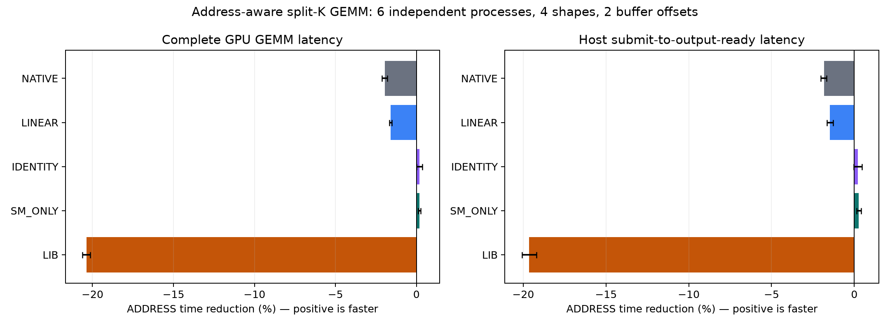
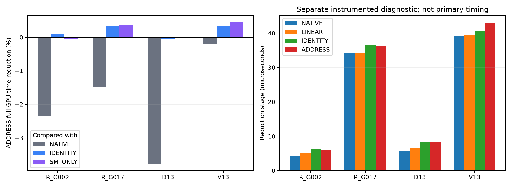
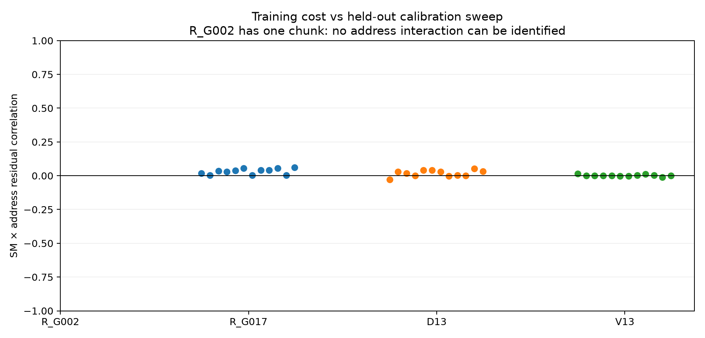

# T10：地址感知调度接入真实 split-K GEMM（2026-10-17）

本轮已实现、运行并复验真实 GEMM；以下正数表示 ADDRESS 用时减少，负数表示用时增加。所有结果均保留，不按速度剔除请求或进程。

全尺寸等权汇总：相对原版 CUTLASS split-K，完整 GPU 时间变化 **-1.943%**，CPU 提交至输出就绪变化 **-1.828%**；相对同一归并核的固定分配，GPU 时间变化 **+0.179%**；相对 cuBLAS，GPU 时间变化 **-20.359%**。

明确结论：当前 ADDRESS 实现不应作为默认 GEMM 路径。对原版 NATIVE 的净收益在六个进程全部为负；同一归并核内部约 0.18% 的小优势，尚不足以证明稳定的地址优化机制，也抵不过实际执行代价。

这不是完整 LLM 或渲染应用测试，而是既有尺寸上的完整矩阵乘法。数据为有固定种子的 FP16 输入、FP32 累加和输出，四个输入槽轮换；形状取自已有实验目录，不能宣称新任务泛化。

## 实际改了什么

原有 CUTLASS Tensor Core 乘法 `n0/n2` 二进制未改，仍直接产生标准布局的 split-K 中间结果。新归并核使用同样顺序的 FP32 求和，以 2048 个输出元素为一个任务；对当前中间结果的实际地址，逐 SM 测量任务成本，按累积负载的最小最大值分配任务。每一轮匹配有精确求解和和最小的平局处理，但多轮顺序规划不是全局最优调度证明。

实际消费者定位由 `%smid`、56 个协作 CTA、每 CTA 48 KiB 动态共享内存以及起始 grid sync 实现。occupancy API 验证每 SM 只能驻留一个 CTA，独立诊断验证全 56 SM 覆盖、无迁移、每个任务实际落在计划 SM。共享内存用于限制驻留，**没有用来存储部分和**；限制驻留和同步的费用完全在被测 GEMM 内。

不存在额外 packing、拷贝、转置或 CPU 数据搬运来伪装收益。A/B/C/D 与中间结果均留在 GPU。CPU 计时包括 C++ 调用内提交到流同步返回；不包括 Python 调用开销、输入 H2D、结果 D2H、校准或建图。GPU 主计时覆盖完整图：P 乘法 → R 归并 → 输出完成，所有策略都使用同一事件包围方法。

[CUDA 协作启动文档](https://docs.nvidia.com/cuda/cuda-driver-api/group__CUDA__EXEC.html)规定了协作网格的驻留上限；这里另外对具体 T10 的 occupancy 与实际 SM 覆盖进行了验证。

## 固定方案与对照

| 案例 | M×N×K | split-K | CUTLASS recipe | 归并任务数 |
|---|---|---:|---:|---:|
| R_G002 | 1×1024×16384 | 4 | 0 | 1 |
| R_G017 | 32×8192×4096 | 8 | 2 | 128 |
| D13 | 48×2048×6144 | 4 | 2 | 48 |
| V13 | 224×2560×10240 | 4 | 2 | 280 |

每个案例使用 0、69632 字节两个 workspace 偏移；每个新进程重新分配内存、记录 VA、校准并冻结表。两偏移不是不同物理地址域或物理 NUMA 节点的证明。

| 策略 | 作用 |
|---|---|
| NATIVE | 原版 CUTLASS producer + 原版 reducer |
| LINEAR | 原 producer + 新归并计算体，由普通 CUDA CTA 调度 |
| IDENTITY | 新归并核，任务按 SM 编号固定分配 |
| RANDOM | 同核、固定种子随机分配 |
| SM_ONLY | 同核，只保留每 SM 和每任务的平均成本，去掉交互项 |
| ADDRESS | 同核，使用 SM×当前实际地址任务的成本矩阵 |
| SHUFFLED | 同核，保留主效应但置乱地址交互项 |
| LIB | cuBLAS Tensor Core GEMM，保留强基线 |

R_G002 只有一个归并任务，因此 ADDRESS、SM_ONLY、SHUFFLED 在该案例上不能区分“地址交互项”；它主要检验小负载的调度开销，不能把它的任何胜负解释为地址拓扑收益。

六个新进程，每个地址条件 24 个随机对照块，每策略每块 8 次独立同步请求；另保留 NATIVE 前后 A/A 锚点。正式请求 **92160**，条件化请求 **109432**。每次请求单独测输出就绪，不用批量吞吐代替单次延迟。

校准每个 SM 和任务 3 轮，每任务 4 次；只使用前两轮的首次重复周期数拟合，第三轮不参与建表。首次重复已在 producer 之后，但不保证物理冷缓存；同一轮不同任务也会影响缓存状态。校准是孤立单 SM 的真实归并计算体，不是同时运行的所有 SM 的直接测量。成本还包含加载、求和、输出写入和 CTA 同步，不能称为纯链路延迟。

## 完整耗时结果

按块取 8 次请求中位数，再在每个进程内平均对数比，最后让六个进程等权。95% 区间对进程重采样；同一进程内大量请求不是独立复验。未做多重比较校正；仅一块 T10，不外推到其他 GPU。

| ADDRESS 相对 | GPU 时间减少 | 95% 进程 bootstrap 区间 | GPU 获益进程 | 主机时间减少 |
|---|---:|---|---:|---:|
| NATIVE | -1.943% | [-2.128%, -1.805%] | 0/6 | -1.828% |
| LINEAR | -1.601% | [-1.683%, -1.525%] | 0/6 | -1.474% |
| IDENTITY | +0.179% | [+0.005%, +0.370%] | 5/6 | +0.205% |
| RANDOM | +0.102% | [-0.083%, +0.233%] | 5/6 | +0.074% |
| SM_ONLY | +0.192% | [+0.101%, +0.264%] | 5/6 | +0.263% |
| SHUFFLED | +0.146% | [-0.002%, +0.259%] | 5/6 | +0.247% |
| LIB | -20.359% | [-20.618%, -20.129%] | 0/6 | -19.649% |

| 案例 | 相对 NATIVE | 相对 IDENTITY | 相对 SM_ONLY | 相对 LIB |
|---|---:|---:|---:|---:|
| R_G002 | -2.358% | +0.085% | -0.052% | -33.779% |
| R_G017 | -1.477% | +0.351% | +0.378% | -12.800% |
| D13 | -3.764% | -0.062% | -0.005% | +1.533% |
| V13 | -0.205% | +0.343% | +0.445% | -41.228% |

绝对时间是全部正式块中位数的描述性中位数；百分比按上述配对方法计算，两者不必能直接互相相除复原。

| 案例 | NATIVE µs | LINEAR µs | IDENTITY µs | ADDRESS µs | LIB µs |
|---|---:|---:|---:|---:|---:|
| R_G002 | 156.440 | 157.528 | 160.192 | 159.888 | 120.440 |
| R_G017 | 439.352 | 440.432 | 448.440 | 446.928 | 405.440 |
| D13 | 157.712 | 159.776 | 163.968 | 163.824 | 166.008 |
| V13 | 1114.648 | 1113.968 | 1124.544 | 1124.112 | 793.512 |

## 归并阶段与模型是否能复现

下表来自单独增加阶段事件的诊断图；事件会改变执行时序，**不能用它替代无阶段事件的正式结果**。

| 案例 | NATIVE 的 P µs | NATIVE 的 R µs | IDENTITY 的 R µs | ADDRESS 的 R µs |
|---|---:|---:|---:|---:|
| R_G002 | 145.600 | 4.128 | 6.192 | 6.080 |
| R_G017 | 315.488 | 34.304 | 36.528 | 36.304 |
| D13 | 126.560 | 5.728 | 8.192 | 8.192 |
| V13 | 487.424 | 39.168 | 40.688 | 43.040 |

模型检验先去掉每 SM 与每任务的平均值，再看训练与未使用的第三轮之间的相关性。这个残差指标才更接近可复现的“SM×地址交互”，原始相关性会被任务大小和普遍快慢掩盖。

| 案例 | 残差相关性中位数 | 最小—最大 |
|---|---:|---|
| R_G002 | 不可识别：仅一列 | 不适用 |
| R_G017 | 0.0355 | 0.0022—0.0605 |
| D13 | 0.0239 | -0.0272—0.0536 |
| V13 | 0.0002 | -0.0111—0.0162 |

上轮微基准中的稳定地址效应不能自动迁移到这里。本轮 workspace 布局、批量读取宽度、并发数、缓存状态和实际生产者都不同。即使一个孤立任务在某 SM 上更快，全归并也可能受并发带宽、驻留限制和最长任务影响；完整 GEMM 又还包括乘法。因此必须同时看 ADDRESS 对 IDENTITY/SM_ONLY 的增量和对 NATIVE/LIB 的净收益。

## 首次使用与摊销

测得的热态调用不含校准和建表。下面把实际费用列出；其中建表包含 ADDRESS、SM_ONLY、SHUFFLED 三个对照的 Python 求解，图构造包含全部策略/输入槽，不冒充一个精简生产实现的首次延迟。当前实现没有后台校准或隐形缓存。

| 案例 | 校准中位数 ms | 三种表求解 ms | 全部表上传 ms | 全策略建图 ms |
|---|---:|---:|---:|---:|
| R_G002 | 44.326 | 1542.109 | 0.431 | 32.772 |
| R_G017 | 401.255 | 6514.171 | 0.440 | 2.799 |
| D13 | 141.056 | 1774.726 | 0.432 | 5.481 |
| V13 | 604.365 | 12766.248 | 0.446 | 2.794 |

随后增加了可选的 C++ CPU 建表加速器。它在全部 240 个已执行任务表上逐元素一致，并另做 10 个不同尺寸/数值类型的直接对照；**没有重新计算或改写 GPU 实验结果**。纯 CPU 建表中位数由 4163.465 ms 降至 24.901 ms。这解决的是宿主建表成本，不能挽回热态 GEMM 退化。原 GPU 实验仍按实记录慢版建表耗时。

每个地址条件另有 69632 字节 workspace 偏移余量；没有增加数据打包 pass。GPU 的一个调度表仅 56×waves×4 字节。数据生成、分配、引擎初始化和各图构造时间在 `derived/setup.csv` 与原始 `graphs.json` 中保留。无热态净收益的条件不存在靠重复次数摊平首次成本的可能；局部的微小正数也不能跨条件使用。

## 波动、正确性和负结果保留

- gpu_us：1152 个 A/A 锚点，绝对变化 >5% 的有 146 个；绝对变化中位数 0.602%，P95 9.136%，最大 27.792%。未据此删数据。

- host_us：1152 个 A/A 锚点，绝对变化 >5% 的有 152 个；绝对变化中位数 0.720%，P95 10.078%，最大 45.153%。未据此删数据。

正式数值检查 3072 次全部通过，完整输出对 FP32 参考并检查预先固定的 FP64 子块；SM 与任务定位检查 1920 次通过。另有 18 个包含边界尺寸和非默认 α/β 的检查；compute-sanitizer 的 memcheck、synccheck 均为 0 errors。实际 GPU-worker 461.730 秒 / 1800 秒上限，含程序初始化、CPU 求解等待、失败进程与检查；采样温度 [62, 69]°C，功耗上限始终 100W。保留系统过温保护。

初版正式进程 `formal_0` 因短任务的纳秒诊断值为 0 中止；周期模型本身不使用这个字段。已保留中断前 R_G002/offset0 的完整结果、日志、部分目录和账本。修复只放宽纳秒非零断言并增加每轮原始数据落盘；CUDA 二进制、匹配算法、案例和重复次数均未变。六个正式进程使用 `formal_v2_0..5`，不把不完整初版混作一个完整复验。初版失败时的内存中最后一轮未及时落盘，明确列为缺失，不补造。

[PTX 官方说明](https://docs.nvidia.com/cuda/parallel-thread-execution/index.html#special-registers-globaltimer-globaltimer-lo-globaltimer-hi)明确 `%globaltimer` 的行为与目标架构有关。本轮保留实际 0 值，不把其单位“纳秒”理解为必有 1 ns 分辨率。

补充保留的非正式/不完整结果：

| 阶段 | 案例/偏移 | ADDRESS 相对 NATIVE | 相对 IDENTITY |
|---|---|---:|---:|
| formal_0 | R_G002/0 | -1.878% | +0.168% |
| smoke | R_G002/0 | -0.943% | +2.380% |
| smoke | R_G017/0 | -0.528% | +0.257% |

修复后的原始校准数据共有 158 个 0 纳秒诊断样本，而周期值全部为正，进一步说明不能强制短区间的纳秒差值非零。

试跑、初版部分结果、校准三轮、所有随机次序、正负计时、A/A 锚点、每进程遥测、输出校验摘要、实际 SM 任务表、编译日志、SASS、完整执行命令和哈希全部保留。数值校验摘要包含完整输出 SHA256，但没有保存所有巨大的完整输出矩阵。

## 可用范围与后续决策

当前代码是可复现的真实算子实验实现。若相对固定分配、去地址模型或原版都不能稳定降低完整时间，应保留 NATIVE/LIB 路径，不把 ADDRESS 默认上线；历史微基准的正结果也不能作为上线依据。

下一步应优先解决低成本定位与并发归并的成本预测：减少为指定 SM 付出的驻留/同步代价，用真实并发归并的未参与选择的数据验证模型，再考虑与乘法 epilogue 融合来缩短中间结果路径。仅继续精修孤立链路延迟矩阵，不足以证明实际 GEMM 可加速。本轮未实现 producer–reducer 融合，也未对其收益作承诺。

## 文件与复算

- `src/address_kernels.cu`：真实归并核、逐 SM 校准、SM 定位验证。
- `src/backend.cu`：原乘法与新归并组合成同一完整 GEMM 图，C++ 同步请求计时。
- `src/schedule.py`：独立 CPU 匹配编译器。
- `freeze/PROTOCOL.json`、`freeze/EXECUTION_SHA256.json`：冻结协议与执行文件哈希。
- `runs/*/formal_v2_*/`：六个进程的全部原始证据。
- `derived/RESULTS.json`：完整可机器读取结果。
- `src/recompute.py`：纯 CPU 从原始数据重新生成 240 个任务表，独立穷举验证小矩阵匹配，并重算所有结果。

CPU 复算：`python3 src/recompute.py`（需要 NumPy，不需要 GPU、PyTorch、CUTLASS）。执行目录由本包的 `CURRENT_RUN.txt` 的 basename 解析，因此解压后可复算。绘图另需 Matplotlib。GPU 重跑需要本机现有 PyTorch/CUDA/cuBLAS 环境、56-SM T10、100W 限额，并应新建运行目录及账本；本包不会自动启动新实验。

可用 `src/compile_plan.py --calibration <calibration.npz> --metadata <map_metadata.json> --out plan.json` 离线编译真实 GEMM 的地址任务表。表仅在原始分配的生命周期中有效；释放后即使 VA 相同也不能视为有效，必须重新校准。`--portable` 使用纯 Python；默认尝试可选 CPU 加速器。

原乘法 cubin 连同原 CUDA 源文件快照已保存。编译宿主适配器还需现有 CUTLASS 源码 `op-fused/vendor/cutlass`，历史 commit `f7b19de32c5d1f3cedfc735c2849f12b537522ee`；本包未重复打包整份 CUTLASS。
