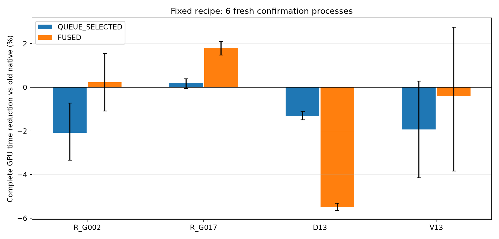
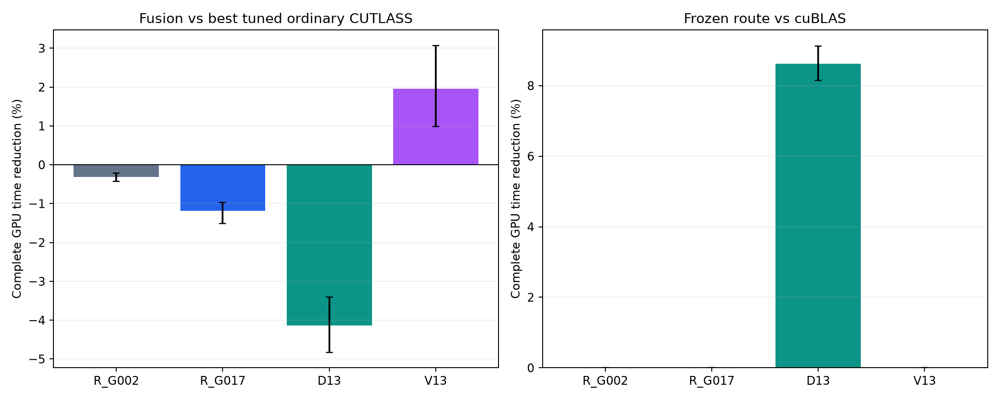
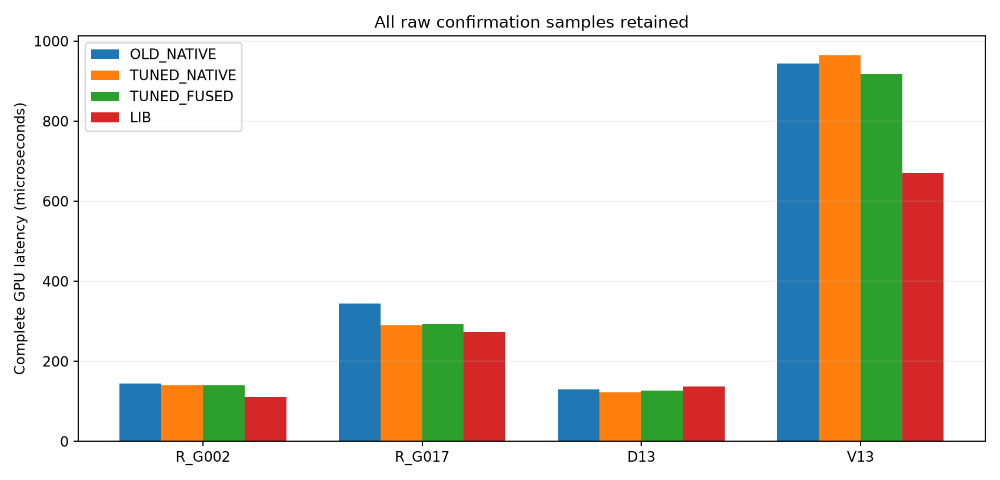

# T10：页内地址队列、末到达块融合与强基线复验

本轮已经执行完毕。所有百分比表示“时间减少”：正值更快，负值更慢。GPU 主计时始终覆盖完整 GEMM 到输出完成；主机同时测 C++ 提交到同步返回。校准、建表、建图和输入传输不在热态区间内，另列实际费用。

实用结果：D13（48×2048×6144）的调优普通 CUTLASS 相对 cuBLAS，GPU 用时减少 **+8.616%**，六进程 6/6 获益；R_G017 的调优普通版相对旧配方减少 **+16.154%**。这属于形状和 split-K 配方选择收益，**不是 SM 地址拓扑的证明**。

融合在旧 R_G017 配方上确有 +1.803% 的完整 GPU 时间优势，六进程全部为正，但该优势必须继续与调优普通版比较。地址队列全尺寸相对原版为 -1.278%；相对不看 SM 地址偏好的同队列为 -0.234%，没有形成可靠净收益。

## 新实现与因果对照

1. **页内队列**：从上轮 8 KB 任务改成 2 KB/4 KB 任务。workspace 按 4 KB 对齐，避免单个任务在第一份 partial 内跨页；其他 split 的地址类别仍需逐一核查，不能假定相同。普通 CUDA CTA 根据历史 SM 偏好先领取一类任务，空了再从另一类领取。去掉全网格同步和每 SM 48 KiB 的驻留限制。两个领取计数器由乘法核的首 CTA 重置，不增加单独清零核。所有原子操作、任务查表、重置和启动费用均包含在完整 GEMM 内。

2. **融合**：保留 CUTLASS Tensor Core MMA，每个输出 tile 的最后一个 split producer 完成有序 FP32 归并，省去独立 R 核。各生产线程先发布自己的 partial，CTA 同步后由线程 0 做 GPU 范围 acquire/release 到达计数；最后一个 CTA 用 `.cg` 读取 partial，归并完后复位该 tile 的计数器。没有自旋等待。输入为 FP16、累加/输出 FP32；alpha/beta 只在最终输出应用一次。

3. **普通直接归并**：同一向量归并计算体由普通 CUDA 网格直接处理，作为没有队列的对照。队列另设不看 SM 偏好、正向、反向、打乱地址标签控制；独立保存实际 SM/任务领取结果。

历史类别规则仅是待检验假设：`SM%10∈{4,5,6,7}` 与其他 SM 分成两类，地址用 `parity((VA>>12)&0x33)`。VA 位不是物理 home 节点；当前实验会测试两个方向并在真正并发的完整 GEMM 上选择方向，不能据此声称发现 GPU 物理 NUMA。

[CUDA 内存栅栏说明](https://docs.nvidia.com/cuda/archive/13.2.1/cuda-c-programming-guide/index.html#memory-fence-functions)说明了最后一个 block 归并所需的发布顺序与可见性要求；本实现额外使用显式 GPU 范围到达原子操作和绕过 L1 的读取。racecheck 主要检查共享内存危险，不能替代跨 CTA 全局内存协议的推理。

## 开发与确认分离

第一阶段用两个开发进程，在 chunk=512/1024 个 float、grid=56/112 个 CTA 的四种组合里固定选择了 **chunk=1024、grid=112**。之后六个新进程确认，每个新分配的地址只用 12 个校准块选择正向或反向，随后的 30 个随机测试块不参与选择；每块每策略 8 次独立同步请求。四个既有形状、两个偏移 0/69632 字节、四个输入槽。

第二阶段在两个额外开发进程中有限搜索：recipe 0（32×64 tile）/recipe 2（64×128 tile），split-K 2/4/8/16，普通与融合分别选最优配方。再用六个额外新进程验证，保留同配方普通版、独立调优普通版、旧版和 cuBLAS。选择器在确认数据产生之前冻结。所有形状在此前实验中已经见过，D13/V13 是人工设计尺寸，不是模型 trace；新进程复验不等于新模型任务泛化。

**输入隔离限制**：事后源码审计发现，两个阶段各自的开发进程 0/1 与确认进程 0/1 使用相同输入种子；64 对同配方输出 SHA256 也确认重合。`tuning.py` 冻结版顶部声称输入不重合的注释不准确，实际代码和原注释原样保留，不能据此称六进程全部为新输入。确认进程 2–5 的种子不在开发集中。以下仍完整报告六进程主结果，另列按种子是否重合划分的事后敏感性复算，没有依据时间选择或删除进程；该复算不是新增实验。

| 形状 | 普通最佳 recipe/S | 融合最佳 recipe/S | 开发阶段冻结的使用路径 |
|---|---|---|---|
| R_G002 | [0, 8] | [0, 16] | LIB |
| R_G017 | [0, 2] | [0, 2] | LIB |
| D13 | [0, 2] | [0, 2] | TUNED_NATIVE |
| V13 | [2, 4] | [2, 4] | LIB |

## 旧配方上的完整耗时

| 案例 | 地址队列 vs 原版 | 地址队列 vs 无偏好队列 | 融合 vs 原版 | 融合获益进程 |
|---|---:|---:|---:|---:|
| R_G002 | -2.083% | +0.006% | +0.228% | 2/6 |
| R_G017 | +0.201% | +0.151% | +1.803% | 6/6 |
| D13 | -1.314% | +0.069% | -5.488% | 0/6 |
| V13 | -1.933% | -1.169% | -0.405% | 3/6 |

`QUEUE_SELECTED` 使用前置校准冻结的方向，结果取自之后实际测到的对应队列核；不是在测试数据中取两方向的最小值。`FROZEN_ROUTE` 同样取开发阶段预选路径的实际测试记录。两者是已测路径的归属统计，没有伪造额外执行次数；选择在图构建时完成，热态 C++ 调用不增加逐请求搜索。

## 更强基线下，收益还剩多少

| 案例 | 调优普通 vs 旧普通 | 调优融合 vs 同配方普通 | 调优融合 vs 最佳普通 | 调优普通 vs cuBLAS | 冻结路径 vs cuBLAS |
|---|---:|---:|---:|---:|---:|
| R_G002 | +3.765% | -0.170% | -0.318% | -25.572% | +0.000% |
| R_G017 | +16.154% | -1.287% | -1.187% | -4.554% | +0.000% |
| D13 | +4.175% | -3.713% | -4.135% | +8.616% | +8.616% |
| V13 | -0.085% | +0.697% | +1.954% | -40.956% | +0.000% |

| 案例 | 旧普通 µs | 调优普通 µs | 调优融合 µs | cuBLAS µs |
|---|---:|---:|---:|---:|
| R_G002 | 144.408 | 139.448 | 139.776 | 110.776 |
| R_G017 | 344.304 | 290.648 | 293.712 | 273.568 |
| D13 | 129.680 | 122.856 | 126.888 | 136.832 |
| V13 | 943.616 | 964.560 | 917.360 | 670.912 |

绝对时间为描述性中位数，百分比使用配对对数比，不能简单相除来替代配对结果。

同一旧 R_G017 配方的融合优势在第二阶段为 +2.120%，六进程全部为正，说明约 2% 的局部收益并非只出现一次。但换成调优配方后，融合比调优普通版更慢。V13 第二阶段融合相对调优普通版为 +1.954%，相对 cuBLAS 仍为 -38.202%；第一阶段 V13 为负且区间宽，两阶段都保留，不称为稳定通用收益。V13 的 OLD_NATIVE/TUNED_NATIVE/SAME_NATIVE 实际配方相同，标签之间的差异是不同测试位置的观测差异。

| 重点比较 | GPU 时间减少 | 95% 进程 bootstrap | 主机时间减少 |
|---|---:|---|---:|
| R_G017: TUNED_NATIVE/OLD_NATIVE | +16.154% | [+15.832%, +16.454%] | +15.897% |
| D13: TUNED_NATIVE/LIB | +8.616% | [+8.147%, +9.121%] | +8.336% |
| R_G017: TUNED_FUSED/TUNED_NATIVE | -1.187% | [-1.511%, -0.967%] | -1.178% |

统计单位是新进程；进程内先对每个随机块的重复取中位数，再平均配对对数比，六个进程等权。Bootstrap 以进程重采样，未做多重比较校正。单板 T10 的多个进程不是多块硬件复验，结果不外推到其他架构。

| 事后敏感性复算，仅确认进程 2–5 | GPU 时间减少 | 95% 进程 bootstrap | 获益进程 |
|---|---:|---|---:|
| ALL: QUEUE_SELECTED/NATIVE | -1.592% | [-2.242%, -0.935%] | 0/4 |
| D13: TUNED_NATIVE/LIB | +8.932% | [+8.429%, +9.383%] | 4/4 |
| R_G017: TUNED_NATIVE/OLD_NATIVE | +16.407% | [+16.251%, +16.564%] | 4/4 |

这些结果由全部原始请求重新聚合，限定依据是输入种子规则，不是性能。四进程样本仍很小；它确认本轮 D13 收益没有依赖那两个重复种子，但不能消除单卡、已见形状和固定分布的限制。审计明细在 `derived/CONFIRMATION_AUDIT.json`。

## 波动、校准成本与适用边界

- 页内队列/融合确认 gpu_us：1440 对 A/A，绝对变化 >5% 共 302 对，P95 为 63.443%；全部保留，没有排除慢态或离群请求。

- 页内队列/融合确认 host_us：1440 对 A/A，绝对变化 >5% 共 319 对，P95 为 63.133%；全部保留，没有排除慢态或离群请求。

- 配方确认 gpu_us：1440 对 A/A，绝对变化 >5% 共 241 对，P95 为 25.409%；全部保留，没有排除慢态或离群请求。

- 配方确认 host_us：1440 对 A/A，绝对变化 >5% 共 252 对，P95 为 25.159%；全部保留，没有排除慢态或离群请求。

整体 A/A 波动很大，不能只用六进程区间忽略运行状态。进一步按形状检查第二阶段 GPU A/A，并在不删数据的条件下更换 cuBLAS 参照：

| 案例 | A/A >5% 次数 / 360 | A/A 绝对变化 P95 | 调优普通 vs 块前 cuBLAS | vs 块后 cuBLAS | vs 按位置插值的 cuBLAS |
|---|---:|---:|---:|---:|---:|
| R_G002 | 6 | 1.425% | -25.213% | -25.751% | -25.477% |
| R_G017 | 28 | 13.270% | -3.163% | -5.653% | -4.285% |
| D13 | 10 | 2.107% | +9.145% | +8.442% | +8.700% |
| V13 | 197 | 48.564% | -24.016% | -15.982% | -20.040% |

插值仅是事后敏感性分析，不能假定真实漂移一定线性。D13 三种锚点参照均为正，按随机执行位置分层也均为正。V13 的锚点、块内位置影响明显；其融合小优势和精确百分比不应写成稳定论文结论，状态根因仍未关闭。完整位置分层结果见审计 JSON，原始数据一条未删。

各次队列方向校准、列表/图构造和数据初始化实际费用在 `derived/RESULTS.json` 的 setup 中。方向校准需要真实 GEMM 重复执行，不能视为免费。

- R_G002：方向校准中位数 27.326 ms，全部策略列表/图构建中位数 33.832 ms。

- R_G017：方向校准中位数 74.569 ms，全部策略列表/图构建中位数 3.798 ms。

- D13：方向校准中位数 26.538 ms，全部策略列表/图构建中位数 6.886 ms。

- V13：方向校准中位数 185.387 ms，全部策略列表/图构建中位数 4.329 ms。

页内任务并不保证所有 split 的部分结果属于同一地址类。原始 `mapping.json` 保存了每任务类别以及所有 split 同类的比例。识别一次孤立访问的差异，与在高并发 GEMM 中找到可复现的调度增益，是两件分别验证的事。本轮没有得到后者的可靠正证据。

## 实际可复用代码

`src/dispatch.py` 已把开发阶段冻结的路径接入既有 Engine/Data/Job 接口：D13 使用 recipe 0、split-K 2 的普通 CUTLASS；其余三个已测形状及未知形状使用 cuBLAS。构造接口只做形状查表和建图，执行复用既有 C++ 完整 GEMM 路径。`required_workspace_words` 返回所需私有中间缓冲区大小，`build_deployed` 生成可运行的 Job。四个已测形状与一个未知形状、两个输入槽均实际运行并通过输出检查。

没有把地址队列或融合默认开启。融合实验要求计数器与 workspace 在并发调用间独立；同一个缓冲区只支持本实验这种有序流重放。所有接口沿用本仓库的 GPU 输入已就绪约定；完整时间不含输入 H2D、结果 D2H 或 Python 框架调用开销。未知形状的 cuBLAS 回退通过了功能检查，但未声称已做广泛性能验证。

## 正确性、失败和账本

- development：测试请求 30720；数值检查 4096，全部通过。

- confirmation：测试请求 115200；数值检查 3072，全部通过。

- tune_development：测试请求 14592；数值检查 2176，全部通过。

- tune_confirmation：测试请求 92160；数值检查 2304，全部通过。

第一阶段另有 560 次任务领取/最后到达 SM 诊断。逐任务覆盖恰好一次、偏好/队列标签一致；融合每 tile 的到达序号是 0..S-1 的排列，最后写者与最终归并 SM 一致。每次有序重放后计数器复位检查通过。

首轮边界/alpha beta/重放检查 240 项通过；新增 split-K 2/16 检查 32 项通过。全量 memcheck、synccheck 均 0 errors。全量 racecheck 在 180 秒上限未完成，明确不是通过；后续小矩阵四次新增核定点 racecheck 完成，0 errors、0 warnings。第一次定点工具调用参数格式错误，在 CUDA 执行前被拒绝，日志和账本保留。以上均未改变性能代码或删改慢数据。

新账本实际 622.861 秒 / 1800 秒 GPU-worker 上限，包含失败检查、初始化与 CPU 等待；采样温度 [62, 76]°C，功耗上限始终 100W，保留风扇和过温保护。旧轮账本未追加。

完整原始请求、条件化与校准记录、所有四种队列配置、所有 16 种普通/融合配方、正负结果、冻结选择、二进制/SASS、编译日志、实际图、校验摘要和输出 SHA256 均保留。未保存所有完整输出矩阵；数值检查包括完整 FP32 参考和预先固定的 FP64 子块。

## 结论与下一步

现在可以复用的是有限形状上的 GEMM 配方选择。地址队列这条实现没有成功；融合在旧配方上的小优势不能脱离更强普通配方和 cuBLAS 单独宣传。论文若以 NUMA/SM 地址拓扑为主张，仍缺少真实并发成本的可复现预测及强基线下的净收益，不能用本轮配方调优结果补上这个证据缺口。

后续应先把新的强基线固定下来，再考虑更能重复使用局部中间结果的融合算子，或有可控数据分区的 producer–consumer 链。继续寻找单次最佳延迟不足以支持论文结论。

纯 CPU 复算：在解压目录运行 `python3 src/recompute.py`，需要 NumPy，不需要 CUDA/PyTorch；它重建地址类别与实际任务覆盖，重新计算开发选择、校准方向和全部结果。绘图另运行 `src/figures.py`，需要 Matplotlib。GPU 重跑需要本机现有 CUDA/PyTorch/cuBLAS、CUTLASS 和 T10 环境，并另建运行目录；本包不自动追加实验。
