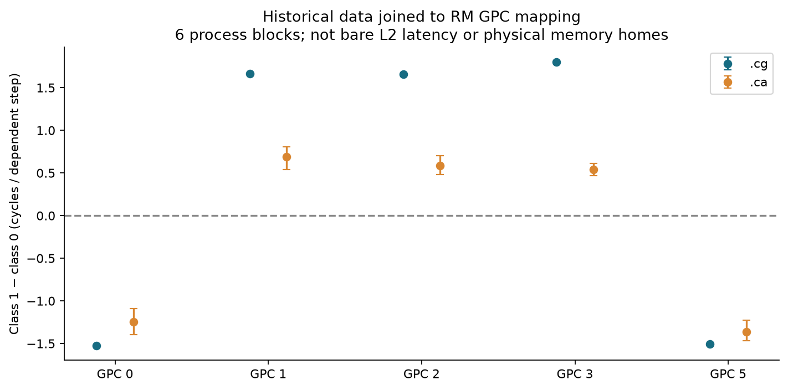
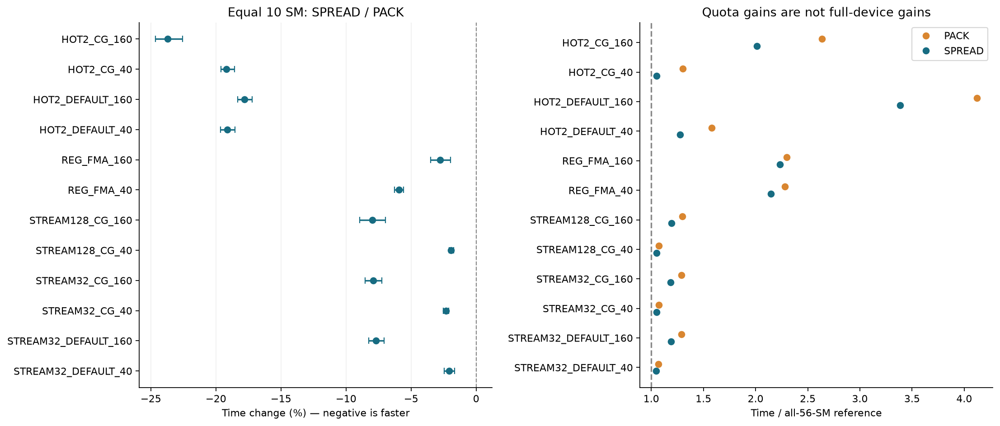
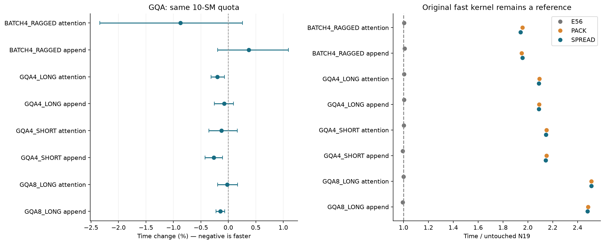
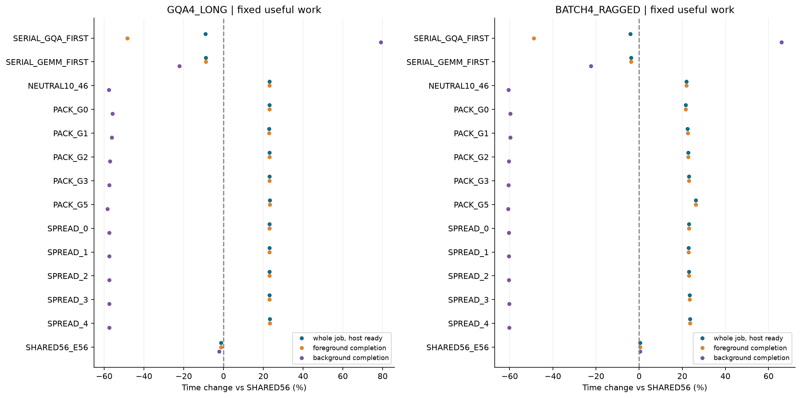

# T10 真实 GPC 竞争与 GQA 实验报告

运行 `20261019T041515Z`；本机 T10 单卡。实验依据附件 20261019 版，E0–E5 的实际完成情况与缺项见审计。

本轮不能把同配额下的分散优势，直接升级为已经成立的全资源稳定净加速。原生并发、串行参考与前后台结果必须一起看；没有按事后最快点改变默认方案。

## 先说本轮的直接结论

**实测到了 GPC 放置相关的机制差异，但本轮没有得到 GQA 拓扑/地址亲和调度的净加速。**

- 旧热依赖读取按 GPC 聚合后，`.cg` 的 class1−class0 为：GPC0 −1.522、GPC1 +1.662、GPC2 +1.658、GPC3 +1.800、GPC5 −1.506 周期/步；各 GPC 六块方向一致。`.ca` 在 GPC 聚合层也同方向，但这不等于原 `.ca` 整张残差图已稳定，更不证明两个物理 memory home。
- E2 批量视图的十二个等10SM条件中，分散家族平均均较集中快，下降1.92%–23.70%；热读取约17.79%–23.70%，流式读取约1.92%–7.99%，寄存器FMA约2.77%–5.92%。所有条件六块方向一致，但有明显锚点跳变，弱效应的因果强度需要保留意见。
- E3 同配额放置差异收缩到 −0.874%～+0.372%；三个批量比较区间虽不跨零，幅度仅约0.15%～0.27%，而全资源锚点存在更大漂移。不能包装成新的稳健算子收益。10SM分散相对原N19全资源慢94.0%～151.0%，原有并行能力损失远大于局部收益。E56/N19平均差额在−0.708%～+0.795%之间。
- E4 分散家族相对未分区并发，LONG整项任务耗时 **+23.111%**，RAGGED **+23.234%**。背景完成时间分别下降57.51%、60.34%，但前景完成时间增加约23%，尾部由前景决定。对两个串行参考也更慢。这是资源份额改变后的取舍，不能叫整体加速。分散相对集中，整项任务变化只有+0.028%、+0.002%。

直白地说：把同样十个工人分散到几个区域，在特定读数据测试里确实更有效；但把原来能用五十六个工人的GQA限制成十个，这笔损失没有补回来。让其余工人做GEMM会使GEMM更早结束，却没有让整份工作更早结束。新证据适合支持“存在GPC相关竞争、效果取决于负载和配额”的机制边界，尚不支持新的NUMA地址调度加速算法。

## 一、读数字的方法与完整范围

本轮统一用 `r = T_candidate / T_reference`，时间变化为 `100 × (r − 1)`，**负数更快，正数更慢**。表内区间均为 95% 探索性整进程块 bootstrap；枚举 6^6 种经验重采样。六块包含事前 TPC 排除轮换，仍只是一张卡，不是六张卡。没有对全部条件或历史 25 阶段作全局多重比较校正。

每个家族先对五种放置取平均 log 时间，再做六块统计；没有用最慢 PACK 作唯一基线。单次 output-ready 与 Graph 批量分列，不把均摊时间叫交互请求 p99。主 phase 各视图保留 64 次完整请求；辅助锚点至少 16 次。每条路径预热至少 32 次且主机执行区间累计至少 50 ms。四输入槽逐个轮换，所有候选使用相同批量长度。所有长尾和负结果均保留。

| 阶段 | 已完成主 phase | 说明 |
|---|---|---|
| E2 | 792 | 720 PACK/SPREAD + 72 同体全资源参考；另存单次/批量两视图 |
| E3 | 576 | 四形状 × 两模式 × 12 策略 × 六块 |
| E4 | 168 | 两前景 × 14 安排 × 六块；另有 12 个 E56 主体控制 |
| E1 | CPU 重分析 | 六个历史进程、每进程两轮、两缓存配方；不重新采样旧矩阵 |

## 二、实际资源控制与工程差额

本次 RM GET 与历史快照一致：GPC0–5 启用 SM 为 10/12/12/10/0/12。可选 `GR_GET_PHYS_GPC_MASK` 仍返回权限不足，其输出未用于结论；其他成功接口与 CUDA/逐 SM 表交叉核验。没有写私有 RM SET、改屏蔽或改驱动。

公开 CUDA Green API 枚举 28 个两 SM 单元，诊断读取实际 SM 后再按成员合并。66 个轮换/NEUTRAL 集合均核对前景 10 SM、互补背景 46 SM，无交集并覆盖全部 56 SM；各个正式进程重新枚举核验。每块五 PACK 与五 SPREAD 覆盖同样的 50 SM、各出现一次。没有占位 CTA、48 KiB 驻留伪分区或按 blockIdx 猜位置。

原 N19 的未改二进制保留。它的通用源码即便选 DIRECT/BLIND 仍保留无用的 SM 读取/偏好分支；为满足本轮正式路径不读 SM/clock 的约束，新 E56 只移除此未使用路由，保留数学体、网格、W、16B 搬运、归并/写入/复位。新旧入口都测全资源，不能把这个编译/入口差额归为放置收益。正式 32 个 decode 模板的 SASS 未含 SMID/clock，Trace 变体只用于独立诊断。

BLIND 原有双队列和其既有页顺序原样保留并计费；没有启用 MATCH/INVERT/SHUFFLE，也没有新建 task→SM 表。微基准默认向量加载为 `LDG.E.128.SYS`，`.cg` 为 `LDG.E.128.STRONG.GPU`；这不证明某级缓存必命中。

## 三、E1：历史地址方向与真实 GPC

详细有符号差、不同加权、每 SM/轮次/地址及通信的源/目标主效应见 [GPC_ADDRESS_REANALYSIS.md](GPC_ADDRESS_REANALYSIS.md)。天然 34/22 偏好与旧冻结的 28/28 平衡组是两个对象，未互相改写。历史 region 的 0x33 类只用于原条带依赖读取，**没有赋给邮箱地址或本轮 KV 页**。

## 四、E2：相同 10 SM 的集中/分散

下表是批量 GPU 完整核耗时变化；`SPREAD/PACK` 控制活跃配额和成员总覆盖。最后两列显示资源规模代价，不能把 10 SM 的内部优势称为全卡收益。全部单次 GPU/主机结果在派生表。

| 工作/CTA | SPREAD/PACK | PACK/E56 | SPREAD/E56 |
|---|---|---|---|
| HOT2_CG_160 | -23.695% [-24.648, -22.555]；6/6 快 | +163.793% [+158.171, +169.691]；0/6 快 | +101.287% [+98.853, +104.214]；0/6 快 |
| HOT2_CG_40 | -19.208% [-19.621, -18.569]；6/6 快 | +30.114% [+28.761, +31.264]；0/6 快 | +5.122% [+4.555, +5.602]；0/6 快 |
| HOT2_DEFAULT_160 | -17.794% [-18.330, -17.227]；6/6 快 | +312.085% [+304.416, +321.025]；0/6 快 | +238.759% [+234.092, +244.094]；0/6 快 |
| HOT2_DEFAULT_40 | -19.140% [-19.650, -18.528]；6/6 快 | +57.873% [+56.856, +58.900]；0/6 快 | +27.655% [+26.434, +28.942]；0/6 快 |
| REG_FMA_160 | -2.768% [-3.504, -1.971]；6/6 快 | +129.674% [+124.657, +134.945]；0/6 快 | +123.316% [+119.528, +127.582]；0/6 快 |
| REG_FMA_40 | -5.919% [-6.279, -5.588]；6/6 快 | +128.182% [+125.924, +130.051]；0/6 快 | +114.676% [+112.344, +116.767]；0/6 快 |
| STREAM128_CG_160 | -7.989% [-8.943, -6.979]；6/6 快 | +29.856% [+26.497, +32.841]；0/6 快 | +19.481% [+17.543, +21.162]；0/6 快 |
| STREAM128_CG_40 | -1.918% [-2.080, -1.710]；6/6 快 | +7.097% [+6.887, +7.302]；0/6 快 | +5.042% [+4.824, +5.183]；0/6 快 |
| STREAM32_CG_160 | -7.896% [-8.518, -7.231]；6/6 快 | +28.884% [+25.901, +31.579]；0/6 快 | +18.708% [+16.812, +20.407]；0/6 快 |
| STREAM32_CG_40 | -2.302% [-2.514, -2.125]；6/6 快 | +7.392% [+7.094, +7.751]；0/6 快 | +4.920% [+4.586, +5.293]；0/6 快 |
| STREAM32_DEFAULT_160 | -7.702% [-8.249, -7.073]；6/6 快 | +28.961% [+25.729, +31.868]；0/6 快 | +19.029% [+16.843, +21.052]；0/6 快 |
| STREAM32_DEFAULT_40 | -2.086% [-2.468, -1.664]；6/6 快 | +6.856% [+6.305, +7.410]；0/6 快 | +4.627% [+4.066, +4.956]；0/6 快 |

HOT2 每次读 2 MiB 唯一输入并复用 16 遍；逻辑读量不是实测显存流量。STREAM32/128 完整单遍；REG_FMA 是八条独立 FP32 FMA 链，不是 Tensor Core 代理。计算控制也可能受分布影响，因此本结果不能只凭读负载就定位 L2/互连瓶颈。

## 五、E3：原向量 GQA 主体上的迁移

四种旧已见形状使用新输入与页表种子；offset 按块交替 0/65536。原冻结配置：SHORT DIRECT/W32/fused；LONG BLIND/W32/非融合；GQA8 BLIND/W32/非融合；RAGGED DIRECT/W16/非融合。没有为了 10 SM 缩小 CTA 网格。

`_0` 为 Attention-only；`_1` 为变化 K/V 的固定长度末位更新 + Attention。后者四个新值槽循环变化，原始 KV 在方法之间恢复，非目标缓存内容检查不变。不是逐 token 增长/COW/完整模型推理。

| 形状/模式 | SPREAD/PACK | E56/N19 | PACK/N19 | SPREAD/N19 |
|---|---|---|---|---|
| BATCH4_RAGGED_0 | -0.874% [-2.342, +0.259]；4/6 快 | +0.364% [-0.857, +1.621]；3/6 快 | +95.755% [+91.760, +99.746]；0/6 快 | +94.045% [+90.204, +97.824]；0/6 快 |
| BATCH4_RAGGED_1 | +0.372% [-0.196, +1.094]；3/6 快 | +0.795% [-0.741, +2.229]；2/6 快 | +94.956% [+93.167, +96.645]；0/6 快 | +95.681% [+93.486, +97.518]；0/6 快 |
| GQA4_LONG_0 | -0.199% [-0.317, -0.073]；5/6 快 | +0.359% [-0.324, +1.540]；4/6 快 | +109.292% [+104.062, +114.588]；0/6 快 | +108.876% [+103.496, +114.363]；0/6 快 |
| GQA4_LONG_1 | -0.077% [-0.254, +0.095]；4/6 快 | +0.539% [-0.699, +1.605]；3/6 快 | +109.015% [+103.703, +114.413]；0/6 快 | +108.853% [+103.275, +114.571]；0/6 快 |
| GQA4_SHORT_0 | -0.126% [-0.354, +0.165]；4/6 快 | +0.180% [-0.531, +1.053]；3/6 快 | +114.944% [+111.191, +118.903]；0/6 快 | +114.674% [+111.369, +118.393]；0/6 快 |
| GQA4_SHORT_1 | -0.267% [-0.424, -0.105]；5/6 快 | -0.708% [-1.454, -0.198]；5/6 快 | +114.997% [+112.438, +118.460]；0/6 快 | +114.423% [+111.798, +118.014]；0/6 快 |
| GQA8_LONG_0 | -0.023% [-0.195, +0.167]；4/6 快 | +0.038% [-1.399, +1.235]；3/6 快 | +151.076% [+147.484, +154.682]；0/6 快 | +151.018% [+147.248, +154.535]；0/6 快 |
| GQA8_LONG_1 | -0.147% [-0.224, -0.067]；6/6 快 | -0.643% [-2.371, +1.629]；5/6 快 | +148.423% [+146.235, +150.839]；0/6 快 | +148.059% [+145.977, +150.259]；0/6 快 |

这些是完整算子 GPU 区间，但不包含 CPU 框架、输入 H2D/输出 D2H、缓存分配和初次建图。单请求主机 output-ready 同样保存。新旧数学顺序可相同的 DIRECT 非融合资格要求逐位相等；原 BLIND/最后到达融合允许已有非确定性，沿用原 `3e-4 + 3e-3×|ref|` 与相对 Frobenius ≤2e-3、第一头 FP64 检查，不放宽容差。

## 六、E4：全资源有用共置

每份任务含 32 次变化值的 GQA 更新+Attention，以及固定数量的 FP16 输入/FP32 累积输出 cuBLAS GEMM（1024×2048×4096）。背景次数在任何 E4 放置性能出现前，按原生 pilot 冻结：LONG 为 7 次，RAGGED 为 9 次。所有策略处理相同输入序列、输出和工作量。两 stream 统一起点、末尾同时 join，没有中间 CPU 等待或无限背景压力。

SHARED56 是普通未分区两 stream 并发；两串行参考保留。PACK/SPREAD/NEUTRAL 给前景 10 SM、背景确切互补 46 SM。“覆盖全资源”不代表每个 SM 每刻都满载。SHARED56_E56 是辅助主体控制：原生两 stream 上用 E56 主体，帮助单独看编译/入口差额；它不参与 14 个主安排的计数。

前景/背景完成时间从同一个 job 起点计算；串行第二任务包含等待第一任务的时间，不是纯 kernel 服务时间。主机总时间等待两个输出都就绪。下表以 SHARED56 为参照，保留所有组，不把事后最优组当预先冻结算法。

### GQA4_LONG

| 安排 | 整份 job 主机就绪 | 前景完成 GPU 区间 | 背景完成 GPU 区间 |
|---|---|---|---|
| SERIAL_GQA_FIRST | -9.080% [-9.425, -8.715]；6/6 快 | -48.455% [-48.666, -48.234]；6/6 快 | +79.135% [+78.465, +79.842]；0/6 快 |
| SERIAL_GEMM_FIRST | -8.984% [-9.278, -8.695]；6/6 快 | -8.988% [-9.280, -8.700]；6/6 快 | -22.293% [-22.546, -22.065]；6/6 快 |
| NEUTRAL10_46 | +23.081% [+20.680, +25.876]；0/6 快 | +23.095% [+20.697, +25.890]；0/6 快 | -57.581% [-58.449, -56.611]；6/6 快 |
| PACK_G0 | +23.112% [+20.825, +25.859]；0/6 快 | +23.125% [+20.837, +25.875]；0/6 快 | -55.867% [-56.649, -54.939]；6/6 快 |
| PACK_G1 | +22.958% [+20.605, +25.824]；0/6 快 | +22.968% [+20.615, +25.835]；0/6 快 | -56.175% [-56.985, -55.198]；6/6 快 |
| PACK_G2 | +23.045% [+20.687, +25.864]；0/6 快 | +23.059% [+20.700, +25.882]；0/6 快 | -57.125% [-57.932, -56.186]；6/6 快 |
| PACK_G3 | +23.024% [+20.619, +25.921]；0/6 快 | +23.037% [+20.632, +25.936]；0/6 快 | -57.547% [-58.353, -56.583]；6/6 快 |
| PACK_G5 | +23.243% [+20.845, +26.109]；0/6 快 | +23.257% [+20.858, +26.127]；0/6 快 | -58.322% [-59.156, -57.350]；6/6 快 |
| SPREAD_0 | +23.117% [+20.747, +25.943]；0/6 快 | +23.130% [+20.758, +25.960]；0/6 快 | -57.536% [-58.360, -56.532]；6/6 快 |
| SPREAD_1 | +23.069% [+20.761, +25.933]；0/6 快 | +23.081% [+20.771, +25.946]；0/6 快 | -57.531% [-58.309, -56.553]；6/6 快 |
| SPREAD_2 | +23.074% [+20.680, +25.862]；0/6 快 | +23.087% [+20.693, +25.876]；0/6 快 | -57.567% [-58.414, -56.610]；6/6 快 |
| SPREAD_3 | +23.105% [+20.725, +25.995]；0/6 快 | +23.117% [+20.737, +26.009]；0/6 快 | -57.530% [-58.368, -56.502]；6/6 快 |
| SPREAD_4 | +23.191% [+20.907, +25.982]；0/6 快 | +23.204% [+20.920, +25.999]；0/6 快 | -57.391% [-58.197, -56.397]；6/6 快 |
| SHARED56_E56 | -1.282% [-1.968, -0.620]；6/6 快 | -1.284% [-1.969, -0.622]；6/6 快 | -2.226% [-2.873, -1.594]；6/6 快 |

家族均值与强参照：

| 比较 | 整份 job 主机就绪变化 |
|---|---|
| PACK/SHARED56 | +23.076% [+20.716, +25.915]；0/6 快 |
| PACK/SERIAL_GQA_FIRST | +35.368% [+33.060, +38.158]；0/6 快 |
| PACK/SERIAL_GEMM_FIRST | +35.225% [+32.944, +37.906]；0/6 快 |
| PACK/NEUTRAL10_46 | -0.004% [-0.113, +0.094]；3/6 快 |
| PACK/SHARED56_E56 | +24.674% [+22.959, +26.920]；0/6 快 |
| SPREAD/SHARED56 | +23.111% [+20.764, +25.957]；0/6 快 |
| SPREAD/SERIAL_GQA_FIRST | +35.406% [+33.132, +38.209]；0/6 快 |
| SPREAD/SERIAL_GEMM_FIRST | +35.263% [+32.996, +37.951]；0/6 快 |
| SPREAD/NEUTRAL10_46 | +0.024% [-0.091, +0.130]；2/6 快 |
| SPREAD/SHARED56_E56 | +24.709% [+23.016, +26.962]；0/6 快 |

### BATCH4_RAGGED

| 安排 | 整份 job 主机就绪 | 前景完成 GPU 区间 | 背景完成 GPU 区间 |
|---|---|---|---|
| SERIAL_GQA_FIRST | -4.007% [-4.877, -3.234]；6/6 快 | -48.803% [-49.273, -48.385]；6/6 快 | +66.051% [+64.540, +67.403]；0/6 快 |
| SERIAL_GEMM_FIRST | -3.818% [-4.634, -3.112]；6/6 快 | -3.821% [-4.637, -3.114]；6/6 快 | -22.320% [-22.982, -21.752]；6/6 快 |
| NEUTRAL10_46 | +21.941% [+21.248, +22.611]；0/6 快 | +21.947% [+21.254, +22.621]；0/6 快 | -60.655% [-60.877, -60.460]；6/6 快 |
| PACK_G0 | +21.618% [+20.873, +22.389]；0/6 快 | +21.628% [+20.882, +22.399]；0/6 快 | -59.685% [-59.865, -59.503]；6/6 快 |
| PACK_G1 | +22.476% [+21.864, +23.025]；0/6 快 | +22.488% [+21.876, +23.036]；0/6 快 | -59.705% [-59.882, -59.550]；6/6 快 |
| PACK_G2 | +22.767% [+21.961, +23.487]；0/6 快 | +22.772% [+21.964, +23.493]；0/6 快 | -60.375% [-60.571, -60.205]；6/6 快 |
| PACK_G3 | +23.021% [+22.249, +23.765]；0/6 快 | +23.032% [+22.260, +23.776]；0/6 快 | -60.539% [-60.778, -60.320]；6/6 快 |
| PACK_G5 | +26.327% [+26.147, +26.494]；0/6 快 | +26.337% [+26.158, +26.503]；0/6 快 | -60.688% [-60.806, -60.549]；6/6 快 |
| SPREAD_0 | +23.103% [+22.797, +23.426]；0/6 快 | +23.113% [+22.805, +23.436]；0/6 快 | -60.358% [-60.436, -60.261]；6/6 快 |
| SPREAD_1 | +22.967% [+22.022, +23.766]；0/6 快 | +22.978% [+22.030, +23.776]；0/6 快 | -60.375% [-60.615, -60.163]；6/6 快 |
| SPREAD_2 | +23.097% [+22.646, +23.513]；0/6 快 | +23.106% [+22.653, +23.522]；0/6 快 | -60.367% [-60.497, -60.259]；6/6 快 |
| SPREAD_3 | +23.463% [+22.889, +23.938]；0/6 快 | +23.474% [+22.902, +23.948]；0/6 快 | -60.315% [-60.472, -60.179]；6/6 快 |
| SPREAD_4 | +23.539% [+22.761, +24.282]；0/6 快 | +23.549% [+22.772, +24.290]；0/6 快 | -60.272% [-60.510, -60.034]；6/6 快 |
| SHARED56_E56 | +0.443% [+0.079, +0.980]；0/6 快 | +0.436% [+0.074, +0.973]；0/6 快 | +0.434% [+0.070, +0.972]；0/6 快 |

家族均值与强参照：

| 比较 | 整份 job 主机就绪变化 |
|---|---|
| PACK/SHARED56 | +23.231% [+22.715, +23.721]；0/6 快 |
| PACK/SERIAL_GQA_FIRST | +28.376% [+27.724, +29.031]；0/6 快 |
| PACK/SERIAL_GEMM_FIRST | +28.123% [+27.550, +28.723]；0/6 快 |
| PACK/NEUTRAL10_46 | +1.059% [+0.802, +1.278]；0/6 快 |
| PACK/SHARED56_E56 | +22.688% [+21.830, +23.385]；0/6 快 |
| SPREAD/SHARED56 | +23.234% [+22.707, +23.688]；0/6 快 |
| SPREAD/SERIAL_GQA_FIRST | +28.378% [+27.704, +29.055]；0/6 快 |
| SPREAD/SERIAL_GEMM_FIRST | +28.126% [+27.463, +28.792]；0/6 快 |
| SPREAD/NEUTRAL10_46 | +1.061% [+0.771, +1.245]；0/6 快 |
| SPREAD/SHARED56_E56 | +22.690% [+21.916, +23.350]；0/6 快 |

## 七、成本、噪声、审计与缺项

主结果是准备完成后的固定混合 job，不是从进程启动算起的冷启动净账单。原始记录单列资源创建、Graph 构建、cuBLAS handle/workspace 和包含诊断的阶段准备时间。E2/E3 仅有直接测得的输入/Graph 设置成本，公共 CUDA/资源枚举与各重叠资源创建未完全分离，记为未独立计时，不补成 0。准备期可能含数值/位置诊断，不把整个研究准备当作生产最小必需成本。未作“无限请求可摊回本”的保证。

原始 N19 与 E56 的同体全资源差异、A/A、首尾锚在 `derived/ANCHORS_AA.json` 和 `ALL_PHASES.json`。对照顺序是预定交错/正反轮换，不是 10/14 动作的完全 carryover 平衡。未对时钟回归校正，也未删长尾。

目前账本 GPU-worker 18.509 / 180 分钟（含对应 worker 的 CPU 准备/资格，非纯 GPU busy）。实测遥测温度 61–77°C；100 W 上限和已有保护保持，82°C worker 停止阈值；未锁频、桌面进程仍存在。新下载、安装、SSH、付费、驱动/屏蔽/保护修改均为 0。墙时与完整最终校验见 `FINAL_AUDIT.json`。

已保存的工程事件：初始编译因默认旧 driver 头文件缺 Green 声明失败，改用本地已有匹配头；最初 CPU 重分析误把 28/28 平衡图当自然 34/22 图，断言失败后按历史报告定义修正。没有为此重跑 GPU 或重新拟合方向。E4 的准备计时在第一正式块前补齐并保留前版冻结文件。一次试图追加“每个正式 phase 的 Graph 审计”被运行状态断言阻止，没有改正在运行的正式程序；实际 Graph 审计另在独立诊断中完成。具体事件见 `ENGINEERING_NOTES.json`。

同体 GQA 页任务轨迹与 GEMM Graph 的独立诊断、有限 sanitizer 的实际范围、四次 CUPTI 活动结果以各自原日志和 `FINAL_AUDIT.json` 为准。诊断不进入主性能统计，不把一个代表的通过说成所有请求逐个检查。没有硬件内存/互连流量计数。未确认本地有可直接复用且范围匹配的专用 paged-decode 后端性能结果，不声称 N19 是所有专用库中的最优。

## 八、这轮能归因到哪里

1. E1 是原构造下的 GPC 相关经验地址亲和；旧数据的后验硬件连接仍需承认缺少当时同时采集的 RM 表。当前 boot 早于两轮，UUID 和当前/历史 RM 表一致，但未独立排除中途驱动重载。
2. E2/E3 的 PACK/SPREAD 干预控制同配额、同成员暴露和数学体，可以说明分布与有效执行代价关联。无 counter 时不能唯一定位共享 L2、互连、前端或频率机制。
3. 若普通分散即解释收益，这属于普通资源放置/竞争控制，不能重新命名成新的地址 NUMA 算法。E4 才讨论全资源固定有用工作的表现，仍不是线上 SLA 或整模型 tokens/s。
4. 不将本轮正数与旧 25 阶段百分比相加。也不因局部正结果扩搜、改 worker 数、挑最快 GPC 或在线训练选择器。
5. 默认 N19/既有快核及先前 BASE54 不因本轮事后最优点自动替换。是否继续，应围绕这里仍未解释的对照差额，另立固定规则与跨日独立验证；本轮不保证论文新颖性或可发表。

## 九、交付与复算

同目录有 `GPC_ADDRESS_REANALYSIS.md`、四组 PNG/PDF、最终审计、完整阶段与请求数据索引。主矩阵全部块级原值在 `derived/ALL_PHASES.json`；全策略、全部指标在 `ALL_POLICIES.json`，没有只打包正数。完整新 raw 留在当前运行目录，小包提供主比较原值、请求样本/数据、源码、冻结协议与复算入口。`recompute.py` 只做 CPU 复算，不启动 GPU、不执行历史方案中的命令。

## 十、噪声敏感性、绝对时间与成本补表

### 噪声不能藏在附件中

E2 的 STREAM128_CG_40，首个 A/A 的块间几何平均变化 −11.947%，首尾变化 −10.968%；HOT2_CG_40 某一块首尾变化达到 −30.943%。E3 的 BATCH4_RAGGED 更新模式，首尾平均变化 +6.685%，LONG 更新模式尾部 A/A 平均 −5.287%。E4 首尾平均变化约 +1.42%～+2.16%。这些变化均保留，没有剔除样本、时钟回归或改写原比较。短锚点的采样量比主phase小，不能精确定位状态变化原因。交错顺序和成员覆盖减轻了部分混淆，但不是完整carryover平衡。尤其不能因六块bootstrap区间很窄，就忽略系统性顺序和状态误差。

下面改用四个原始锚点作参照，只检查E4结论是否依赖单个参考时刻，不对主结果作漂移校正：

| 前景 | 分散/头锚 | 分散/头AA | 分散/尾锚 | 分散/尾AA |
|---|---|---|---|---|
| GQA4_LONG | +24.165% | +23.434% | +21.535% | +22.035% |
| BATCH4_RAGGED | +24.539% | +24.331% | +22.795% | +22.917% |

换参照后整项任务仍慢约21.5%～24.5%，本轮“未回本”的结论不依赖只取头锚或尾锚。所有阶段的同类敏感性和块级比值在 `derived/DESCRIPTIVE_AUDIT.json`；不用上述检查把微小正值升级为稳健收益。

### 完整混合任务的绝对时间

以下为六块几何平均，单位ms；前后台均从统一job起点计。全部策略均列出，SHARED56本身也给出原值：

| 前景 | 安排 | 整项就绪ms | 前景完成ms | 背景完成ms |
|---|---|---|---|---|
| GQA4_LONG | NEUTRAL10_46 | 20.2422 | 20.2331 | 3.5385 |
| GQA4_LONG | PACK_G0 | 20.2474 | 20.2381 | 3.6815 |
| GQA4_LONG | PACK_G1 | 20.2219 | 20.2122 | 3.6558 |
| GQA4_LONG | PACK_G2 | 20.2363 | 20.2272 | 3.5766 |
| GQA4_LONG | PACK_G3 | 20.2329 | 20.2236 | 3.5413 |
| GQA4_LONG | PACK_G5 | 20.2688 | 20.2597 | 3.4767 |
| GQA4_LONG | SERIAL_GEMM_FIRST | 14.9687 | 14.9596 | 6.4821 |
| GQA4_LONG | SERIAL_GQA_FIRST | 14.9529 | 8.4724 | 14.9431 |
| GQA4_LONG | SHARED56 | 16.4462 | 16.4370 | 8.3418 |
| GQA4_LONG | SHARED56_E56 | 16.2355 | 16.2259 | 8.1561 |
| GQA4_LONG | SPREAD_0 | 20.2481 | 20.2390 | 3.5423 |
| GQA4_LONG | SPREAD_1 | 20.2403 | 20.2308 | 3.5426 |
| GQA4_LONG | SPREAD_2 | 20.2410 | 20.2318 | 3.5397 |
| GQA4_LONG | SPREAD_3 | 20.2461 | 20.2367 | 3.5427 |
| GQA4_LONG | SPREAD_4 | 20.2602 | 20.2510 | 3.5543 |
| BATCH4_RAGGED | NEUTRAL10_46 | 24.4294 | 24.4195 | 4.5544 |
| BATCH4_RAGGED | PACK_G0 | 24.3649 | 24.3556 | 4.6666 |
| BATCH4_RAGGED | PACK_G1 | 24.5367 | 24.5278 | 4.6644 |
| BATCH4_RAGGED | PACK_G2 | 24.5950 | 24.5847 | 4.5868 |
| BATCH4_RAGGED | PACK_G3 | 24.6459 | 24.6368 | 4.5678 |
| BATCH4_RAGGED | PACK_G5 | 25.3082 | 25.2986 | 4.5506 |
| BATCH4_RAGGED | SERIAL_GEMM_FIRST | 19.2690 | 19.2595 | 8.9919 |
| BATCH4_RAGGED | SERIAL_GQA_FIRST | 19.2311 | 10.2521 | 19.2212 |
| BATCH4_RAGGED | SHARED56 | 20.0339 | 20.0247 | 11.5755 |
| BATCH4_RAGGED | SHARED56_E56 | 20.1226 | 20.1120 | 11.6258 |
| BATCH4_RAGGED | SPREAD_0 | 24.6624 | 24.6529 | 4.5888 |
| BATCH4_RAGGED | SPREAD_1 | 24.6352 | 24.6259 | 4.5868 |
| BATCH4_RAGGED | SPREAD_2 | 24.6611 | 24.6515 | 4.5878 |
| BATCH4_RAGGED | SPREAD_3 | 24.7344 | 24.7252 | 4.5938 |
| BATCH4_RAGGED | SPREAD_4 | 24.7498 | 24.7403 | 4.5987 |

### 一次性准备与诊断范围

以下成本跨两种前景的12个主phase汇总，单位ms；Graph构建为四个输入槽，背景handle含workspace。包括位置探测的研究准备不是生产最低成本。SHARED56的resource为0表示本phase不创建显式分区，不表示进程初始化免费。

| 安排 | 成本项 | 最小ms | 中位ms | 最大ms |
|---|---|---|---|---|
| PACK_G0 | resource_setup_ms | 3.167 | 3.550 | 4.226 |
| PACK_G0 | graph_setup_ms | 68.767 | 78.227 | 88.430 |
| PACK_G0 | gemm_handle_workspace_setup_ms | 0.239 | 0.271 | 0.418 |
| PACK_G0 | phase_setup_including_diagnostics_ms | 74.440 | 84.482 | 95.042 |
| SHARED56 | resource_setup_ms | 0.000 | 0.000 | 0.000 |
| SHARED56 | graph_setup_ms | 29.708 | 37.104 | 45.067 |
| SHARED56 | gemm_handle_workspace_setup_ms | 0.252 | 0.311 | 0.387 |
| SHARED56 | phase_setup_including_diagnostics_ms | 30.674 | 38.278 | 46.350 |
| SPREAD_0 | resource_setup_ms | 3.259 | 3.550 | 4.225 |
| SPREAD_0 | graph_setup_ms | 68.839 | 78.349 | 88.756 |
| SPREAD_0 | gemm_handle_workspace_setup_ms | 0.236 | 0.258 | 0.345 |
| SPREAD_0 | phase_setup_including_diagnostics_ms | 74.825 | 84.956 | 146.118 |

全部放置的准备成本均保留。本轮热态job已经更慢，因此不能用摊销初始化成本把结果说成正收益。E2/E3缺少独立资源创建计时，列为NA及明确原因，不能据此给出冷启动净成本。

独立GQA轨迹480次通过；GEMM的72份独立Graph均为 `turing_s1688gemm_fp16_256x128_ldg8_stages_32x1_nn`，grid=8×8×2、block=256、动态shared=16384字节。四份CUPTI时间线都有真实前后台重叠，但profile开销较大，不能替代主计时。memcheck和synccheck各覆盖24个微基准launch及8个分页尾部GQA调用，均报告0错误；这不是对所有正式请求逐一做sanitizer。

本地Python环境的 flashinfer、vllm、flash_attn、xformers 模块查找均不存在；旧18/19阶段报告也仅给出SDPA/BMM等对照，未确认可直接运行的专用paged-decode后端。因此本项记NA，本轮没有联网安装或移植；该盘点不代表穷尽所有可能独立二进制。

### 尚未解决与下一步边界

现有证据没有分开物理memory home、具体共享资源瓶颈、频率/前端效应；没有跨日/跨卡复验，也没有真实模型动态KV生命周期和专用decode强对照。固定10/46配额的结果不能代表所有配额都失败，但也不授权据此无边界搜索新配额。若后续另立任务，应先选真实有用的混合工作与预先固定的份额，要求完整job击败未分区及串行，再讨论放置增量；目前不替换默认快核、不扩大Softmax/地址mask/在线选择器搜索。
