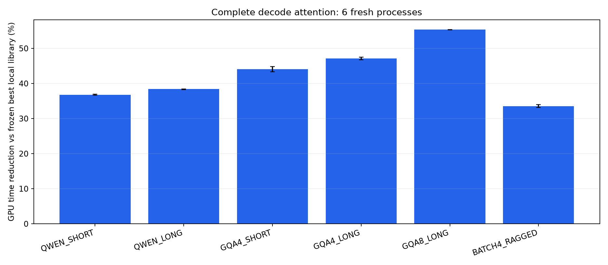
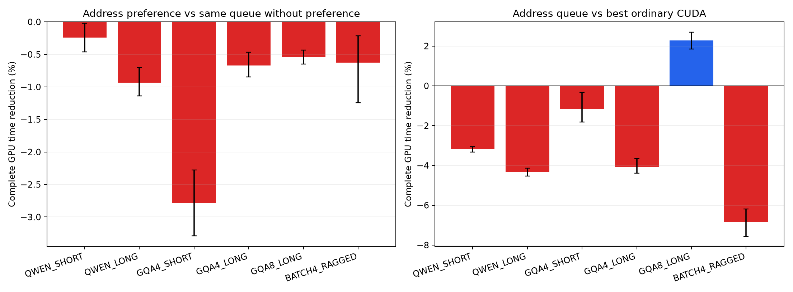
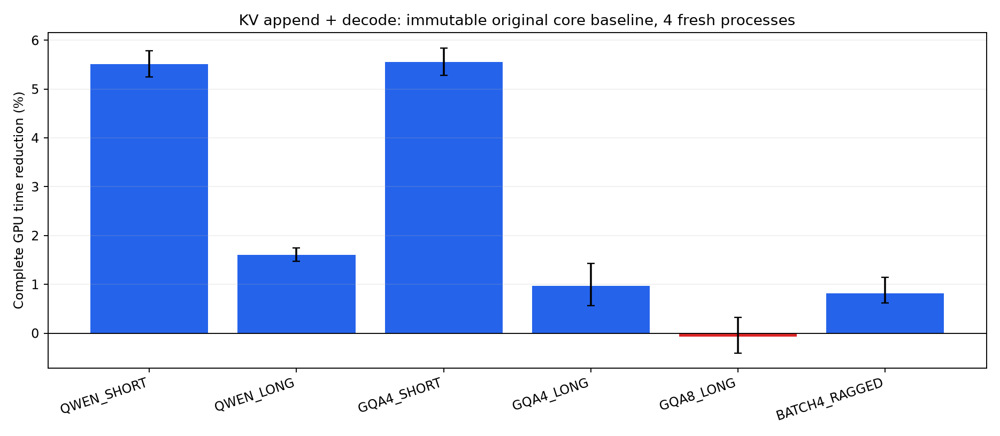
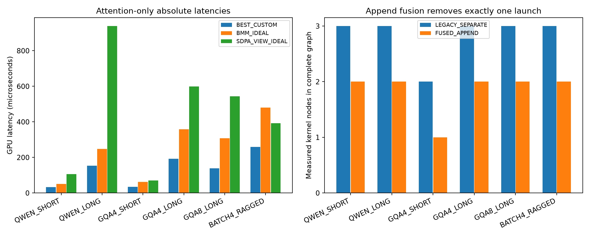

# T10：GQA 解码 Attention、KV 复用与写入融合实测

本轮已完成实现、实测、强基线复验与可调用接口。所有百分比表示完整 GPU 区间的**用时减少**，正值更快，负值更慢。Attention 核心与 KV 写入融合是不同实验阶段，百分比不能相加，跨阶段绝对耗时也不能直接相减。

六组 Attention 尺寸相对开发阶段选出的较快本机库实现，分别减少 33.554%～55.323%，每组均为 6/6 新进程获益；等权几何汇总 +43.042%，95% 进程 bootstrap [+42.953%, +43.127%]。主机 C++ 提交至输出就绪汇总 +41.636%。

单独检查‘KV 写入 + Attention’：融合写入相对**原始 Attention 二进制 + 独立写入核**，四新进程汇总 +2.427%。五组尺寸获益，GQA8_LONG 为 -0.065%、区间跨零；接口对此保留原核与独立写入。

地址偏好本身未成功：相对同队列不看 SM 偏好的控制，汇总 -0.962%；相对最佳普通 CUDA 核为 -2.848%。本轮可用收益来自 KV 复用、沿 KV 序列增加并行度和谨慎融合，不能归因于物理 NUMA。

## 为什么选择这个 LLM 部件

GQA 解码中，多个 query head 共享同一 KV head 的历史缓存。它在每个新 token 到来时读取较长 KV 序列，适合把会复用的数据放在同一 CTA 的共享内存中，并把长序列分给更多 CTA。相比上一轮 GEMM 的短归并尾部，这里有更大的可减少访存量，也有更明确的融合边界。

本机 GGUF 头部记录的完整 Attention 层为 8 query heads、2 KV heads、head dimension 256，提供 QWEN_SHORT/LONG 的头部尺寸；每 4 层一次完整 Attention，其余层不是本算子。其余四组为人为设计的 GQA 维度。输入为有哈希与种子的合成 FP16 Q/K/V；没有运行实际模型权重或报告整模型 token/s。RoPE、投影和其他层不在本算子内。

[FlashInfer 的递归 Attention 说明](https://docs.flashinfer.ai/tutorials/recursive_attention.html)介绍了沿 KV 序列分区并合并注意力状态的既有方法；[vLLM Paged Attention 设计](https://docs.vllm.ai/en/v0.8.1/design/kernel/paged_attention.html)说明了分页 KV 访问及线程布局。这些是已有技术，本轮不把 split-KV、共享内存复用或合并 softmax 状态本身宣称为新算法。

## kernel 实现与开销边界

- Cache 布局为 `[physical_pages, KV_heads, 16, D]`，页表在运行时读取。每个 CTA 固定负责一个 KV head，CTA 内每个 warp 负责一个 query head，共享读取的 K/V 页；Q 保存在寄存器，稳定 softmax 的 max、sum 和输出在页间累计。共享内存行加入 padding。

- 普通版本让多个 CTA 静态分担一个 KV head 的页，然后合并 FP32 attention 状态；整个 Attention 为 2 个 kernel。最后到达 CTA 原子计数版本可降为 1 个 kernel，使用发布栅栏和 GPU acquire/release 到达原子操作，没有自旋等待。

- 地址版本使用两个领取队列，按历史假设 `SM%10∈{4,5,6,7}` 和 `parity((VA>>12)&0x33)` 选择偏好，空队列后偷取另一类。保留正向、反向、无偏好、打乱标签和同参数普通版本。实际页领取与 SM 分别记录，覆盖检查要求每页恰好一次；带 trace 的运行不用于主性能统计。

- 队列计数器在已有归并核或最后完成的 CTA 中复位，首次初始化只发生在建 plan 时。热态没有单独清零 kernel，也没有每请求 CPU 调度或重建映射。所有队列原子、查表、栅栏、归并、清零及启动都计入测量。

- 新 token 的 K/V 写入由其所属最后一页的唯一 CTA 完成，再在同 CTA 内使用该页。不同 CTA 处理不同逻辑页/头，末尾写入页需满足正常分页缓存的私有/COW 约定。与独立 append 相比少一个 kernel；仍需要两阶段归并的形状为 3→2，GQA4_SHORT 为 2→1。

完整 GPU 区间由同一个 C++ CUDA Graph event 包装器计时，主机区间为提交到同步返回。Q、新 K/V、页表和长度已经位于 GPU；一次性缓存构造、图构建、CPU Python 调用、输入 H2D 和输出 D2H 不在热态区间。初始化与校准时间单独保存，不称为免费。正式写入实验固定每条件的有效长度，在 `length-1` 位置重放一次追加操作；长度增长与尾页行为另做功能验证，不代表完整逐 token 模型运行。

## 选择与复验

第一版资格检查后做探索 smoke，发现并行度不足。保留最初源码、二进制和 smoke 摘要，再将 workers/KV head 扩到 8/16/32/64/128，并加入不复制 KV 的零步长 SDPA 对照。修改发生在正式开发/确认冻结之前。

两个开发进程对 50 种自写配置和 3 个库路径做完整随机块比较。普通与融合的 worker 数分别选择，队列参数另选；方向只用每个确认分配的 12 个前置校准块选择。随后六新进程、两地址偏移、四 Q 输入槽、30 个随机块×8 次请求确认。开发/确认种子区间不同，并通过全部 Q/K/V 哈希验证不重合。

| 尺寸 | B / Hq / Hkv / D / 最大 L | 普通 W | 融合 W | 预选较快库 | 预选普通/融合核 |
|---|---|---:|---:|---|---|
| QWEN_SHORT | 1 / 8 / 2 / 256 / 1024 | 64 | 64 | BMM_IDEAL | DIRECT |
| QWEN_LONG | 1 / 8 / 2 / 256 / 8192 | 64 | 64 | BMM_IDEAL | DIRECT |
| GQA4_SHORT | 1 / 32 / 8 / 128 / 1024 | 32 | 32 | BMM_IDEAL | FUSED |
| GQA4_LONG | 1 / 32 / 8 / 128 / 8192 | 32 | 32 | BMM_IDEAL | DIRECT |
| GQA8_LONG | 1 / 32 / 4 / 128 / 8192 | 32 | 64 | BMM_IDEAL | DIRECT |
| BATCH4_RAGGED | 4 / 32 / 8 / 128 / 4096 | 16 | 16 | SDPA_VIEW_IDEAL | DIRECT |

BATCH4_RAGGED 的四条有效长度为 4096、3073、2049、1027。

## 与更强库基线比较

库对照包括：零步长 K/V 视图的 PyTorch efficient SDPA；按 GQA 分组的 cuBLAS BMM→softmax→BMM（FP32 logits/accumulation）；带实际分页 gather 的 SDPA。主比较使用前两者在开发阶段的较快者，二者的连续 KV 已事先准备，因此不给自写分页核计入‘对照必须额外 gather’的便利。两种库的单独结果和实际图全部保留。没有安装/移植并比较所有 vLLM、FlashInfer 等专用 decode 实现，不能声称超过它们或达到 SOTA。

| 案例 | 最佳自写核 vs 预选较快库 | 95% 进程 bootstrap | 获益进程 | 自写核中位 µs | BMM 中位 µs | SDPA 中位 µs |
|---|---:|---|---:|---:|---:|---:|
| QWEN_SHORT | +36.794% | [+36.682%, +36.905%] | 6/6 | 32.464 | 51.200 | 105.680 |
| QWEN_LONG | +38.388% | [+38.289%, +38.473%] | 6/6 | 152.720 | 247.056 | 938.800 |
| GQA4_SHORT | +44.086% | [+43.310%, +44.805%] | 6/6 | 34.800 | 61.608 | 70.136 |
| GQA4_LONG | +47.174% | [+46.761%, +47.530%] | 6/6 | 191.928 | 357.968 | 598.464 |
| GQA8_LONG | +55.323% | [+55.276%, +55.359%] | 6/6 | 138.104 | 308.416 | 544.328 |
| BATCH4_RAGGED | +33.554% | [+33.108%, +34.028%] | 6/6 | 259.040 | 480.016 | 392.360 |

百分比先对随机块内重复取中位数，再计算配对对数比，最后进程等权；绝对时间为描述性中位数，两者不能用简单相除替代。Bootstrap 按进程重采样，未做多重比较校正。同卡多个进程并不是多块硬件复验。

## 地址偏好与融合的负结果

| 案例 | 地址 vs 无偏好同队列 | 地址 vs 最佳普通核 | 调优融合 vs 最佳普通核 |
|---|---:|---:|---:|
| QWEN_SHORT | -0.241% | -3.183% | -5.790% |
| QWEN_LONG | -0.933% | -4.345% | -1.189% |
| GQA4_SHORT | -2.786% | -1.156% | +5.634% |
| GQA4_LONG | -0.669% | -4.069% | -0.910% |
| GQA8_LONG | -0.538% | +2.281% | -13.993% |
| BATCH4_RAGGED | -0.625% | -6.856% | -0.464% |

D=128 的任务每份 K/V 恰好 4 KiB，单独汇总地址相对无偏好仍为 -1.150%。D=256 的一页为 8 KiB，会混合地址类别，不能假设首地址代表全部访问。K/V 起点对齐让两者地址类别相容，但它只是 VA 假设，不是物理 home 节点证明。GQA8_LONG 的无偏好动态领取也优于静态普通核，地址标签没有在它之上继续改善；不能把动态负载均衡收益计为拓扑收益。

融合不是越多越快：GQA8_LONG 的开发阶段预选归并融合版，相对最佳普通核在确认阶段明显更慢，接口未采用该版本。所有负例与未选配置均保存。

## 控制 KV 写入融合的真实开销

第一轮四进程把融合写入与同一修改后内核的独立写入版本比较，汇总 +2.789%。这仍可能隐藏修改内核本身的额外代价。因此补做另四新进程，用未修改的原始 Attention 二进制加独立 append 作强控制，参数不变，保留修改后内核作为额外对照。

| 案例 | 融合写入 vs 原核+独立写入 | 95% 进程 bootstrap | 获益进程 | 原图→融合图 kernel 数 | 推荐 |
|---|---:|---|---:|---|---|
| QWEN_SHORT | +5.515% | [+5.246%, +5.784%] | 4/4 | 3→2 | 融合写入 |
| QWEN_LONG | +1.609% | [+1.475%, +1.744%] | 4/4 | 3→2 | 融合写入 |
| GQA4_SHORT | +5.561% | [+5.277%, +5.843%] | 4/4 | 2→1 | 融合写入 |
| GQA4_LONG | +0.966% | [+0.561%, +1.425%] | 4/4 | 3→2 | 融合写入 |
| GQA8_LONG | -0.065% | [-0.406%, +0.321%] | 2/4 | 3→2 | 保留原核+独立写入 |
| BATCH4_RAGGED | +0.816% | [+0.615%, +1.147%] | 4/4 | 3→2 | 融合写入 |

GQA8_LONG 的修改后 Attention-only 核相对原始核为 -1.324%，这项开销吃掉了原先看起来的写入融合收益。仅看到‘少一个 kernel’不足以判断变快。寄存器及 spill 数见编译日志；D=128 普通核为 79→80 registers/thread，D=256 为 127→127，所编译核没有 spill；这些数值不能单独证明延迟变化原因。

## 波动与范围限制

| 案例 | Attention A/A >5% / 360 | A/A P95 | 自写核 vs 块前库 | vs 块后库 |
|---|---:|---:|---:|---:|
| QWEN_SHORT | 4 | 1.362% | +36.906% | +36.735% |
| QWEN_LONG | 24 | 5.653% | +38.762% | +38.419% |
| GQA4_SHORT | 8 | 1.940% | +44.274% | +44.021% |
| GQA4_LONG | 182 | 15.398% | +49.495% | +48.495% |
| GQA8_LONG | 76 | 10.649% | +56.186% | +55.592% |
| BATCH4_RAGGED | 227 | 19.400% | +38.613% | +38.214% |

长序列和批量条件仍有明显运行状态波动，未过滤慢态或离群请求。更换前后锚点后，Attention 核心的大幅收益仍为正，但精确百分比受工作组合影响。写入融合小收益也保留前后锚点、主机时间及所有进程结果。GPU 仅固定功耗，未宣称锁定频率。两阶段的条件化负载不同，跨阶段绝对时间差不能解释为单个新增 kernel 的成本。

## 可调用接口与验证

`src/optimized_decode.py` 提供 `OptimizedPagedDecode`。传入已有 GPU Q、分页 K/V、页表、有效长度及可选新 K/V；构造时查表并分配私有 workspace，`launch()` 使用调用者当前 PyTorch stream，不分配显存、不做 CPU 地址校准，可放进 CUDA Graph。Attention-only 调用原始快核；有新 KV 时五组尺寸融合写入，GQA8_LONG 保留原核+独立写入。未知尺寸必须显式给 workers，归并融合选择可选；路由按最大页容量匹配，并未证明同容量下任意有效长度都具有同样性能。

接口的融合/不融合推荐是在确认结果后作出的部署选择，不能把同一批结果再称为独立路由测试集。最终接口用六个已测形状及一个未知尾页形状、两个输入槽、auto/none 两种模式实际捕获执行了 28 项检查；图中的 kernel 数与选择一致。原始 `kernel_api.py` 提供显式实验模式，推荐使用上面的封装。

| 阶段 | 正式测试请求 | 数值检查 |
|---|---:|---:|
| development | 63360 | 10176 |
| confirmation | 207360 | 5760 |
| append_confirmation | 57600 | 1152 |
| append_strong | 80640 | 1920 |

核心两版资格检查各 264 项、20 次任务定位检查；写入融合有 144 项检查，逐位验证整个 cache 除指定位置外不变，覆盖长度增长、尾页、workers 超过页数和重复执行。另有 24 项零 logits/尖锐 logits 检查。FP16 输出对完整 FP32 GQA 参考要求相对 Frobenius ≤2e-3、逐元素误差 ≤3e-4+3e-3×|ref|，并检查第一 batch/head 全序列 FP64 参考。原始输出哈希保留，未保存所有完整输出张量。

核心和写入版本 memcheck/synccheck 完成且均 0 errors；核心定点 racecheck 0 errors、0 warnings。定点工具通过不等于证明任意并发协议，API 要求每个并发调用独立 workspace，终端可写页满足 COW。新增写入版本未单独做全量 racecheck。最初 CUDA 头文件编译错误与一次 CPU 分析重复字段错误已留档；两者都没有改写测量结果。

本轮账本 916.995/1800 GPU-worker 秒，包含资格、sanitizer、初始化与 CPU 等待。温度采样 [62, 73]°C，功耗上限 100 W；风扇与过温保护保留。旧轮账本未改写，没有后台实验。租赁费 0 元，电费未计量。

## 对论文主张的约束与后续

已得到可复用的 T10 解码 Attention kernel，以及有强控制的 KV 写入融合收益。这足以作为下一轮算子实现的基线。若论文主张仍是 SM 地址拓扑驱动优化，本轮没有补上这一因果证据；地址队列的负结果必须一起展示。

下一步应在真实模型解码链中接入该接口，并加入可在 T10 上运行的成熟专用 paged-decode 实现作对照，再验证不同长度、batch、页共享和请求节奏下的收益。不能只凭本轮 synthetic-shape 部件结果主张整模型提速或算法新颖性。

复算入口：完整包解压后 `python3 src/recompute.py`，只需要 NumPy，不需要 CUDA/PyTorch；重算源码锁、输入隔离、所有统计、任务覆盖、实际 kernel 数和正确性摘要。GPU 复验需另建目录/账本，不能覆盖已完成原始数据。
