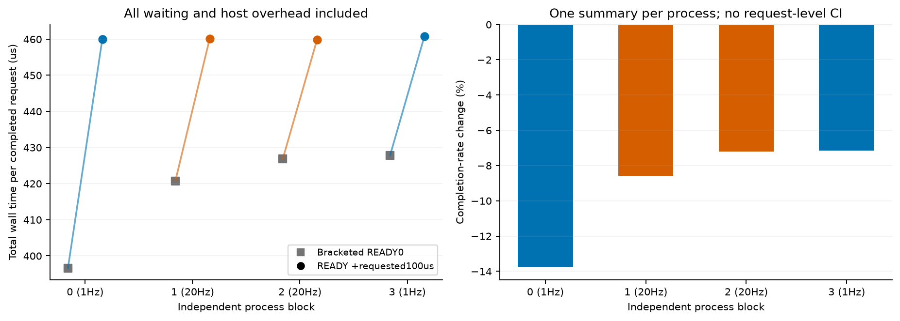
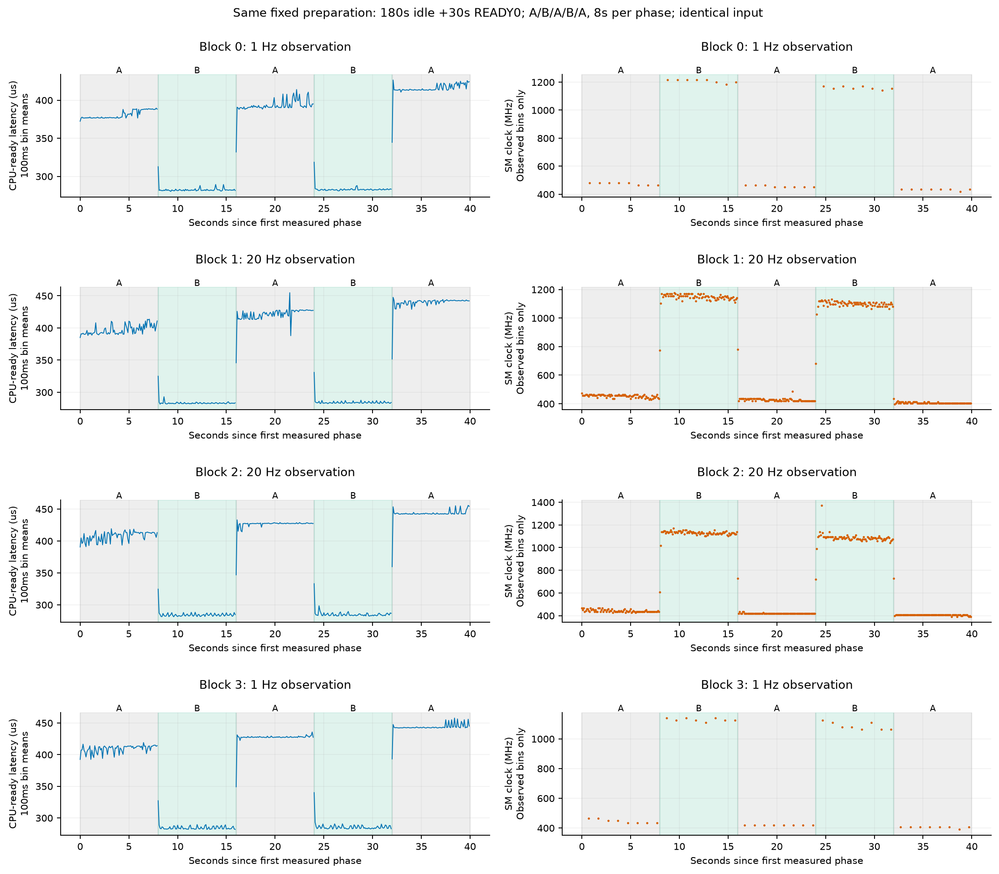
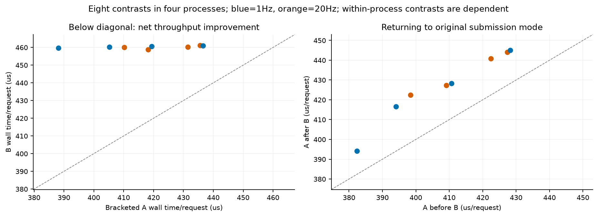
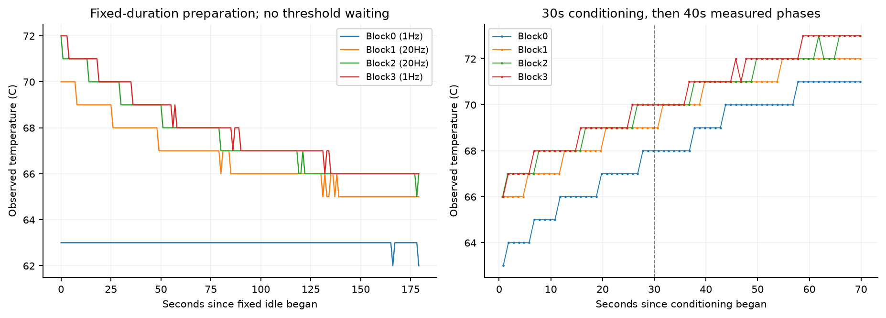

# T10 统一准备流程下的请求节奏复验

run `20261017T105920Z`；2026-10-17。上一轮收益主块+20.67%、辅助确认-5.95%，本轮专门缩小准备条件差异，检查1Hz/20Hz监测条件下的A/B结果。

本轮四块均未观察到净吞吐收益。短暂停顿是否缩短单次处理，与把等待算进去后是否获益，是两个独立需要报告的问题。

四个进程各先固定空闲180秒，随后30秒连续提交conditioning，测量A→B→A→B→A，各8秒。监测频率顺序1/20/20/1Hz；所有进程shape=[32, 8192, 4096]、seed=940000、四槽输入与权重哈希相同。使用前轮完全相同的backend.so/cubin和宿主state_run；没有重新编译数学程序。

实际worker启动温度依次为[62, 65, 66, 66]°C。流程相同不等于硬件状态完全相同；残留温度差异与整卡历史仍限制监测频率的因果解释。

本轮加间隔B的逐进程完整周期仅459.90–460.84us，连续提交A参照为396.62–427.85us。四块单请求ready汇总变化-31.71%，但包含等待的完成率变化-9.22%；等待成本超过了本轮省下的处理时间。

A=连续READY0；B=输出完成、读完事件后请求sleep100us。实际间隔和完整阶段墙钟均保留，不用名义100us替代实测成本。

|块|监测|连续提交参照周期us|加间隔总周期us|单请求ready变化|完成率变化|
|---|---:|---:|---:|---:|---:|
|0|1Hz|396.62|460.02|-28.43%|-13.78%|
|1|20Hz|420.72|460.17|-32.24%|-8.57%|
|2|20Hz|426.79|459.90|-33.00%|-7.20%|
|3|1Hz|427.85|460.84|-33.09%|-7.16%|

每次B以相邻两段A的几何均值作参照，两次B比较再汇总成一个进程结果。周期/比值使用一致的几何均值口径；两个B共享中间A，不算两个独立进程。

|监测层|进程数|A总周期us|B总周期us|ready变化|完成率变化|
|---|---:|---:|---:|---:|---:|
|1Hz|2|411.94|460.43|-30.80%|-10.53%|
|20Hz|2|423.75|460.03|-32.62%|-7.89%|

每个监测层只有两个进程，不给请求级显著性或置信区间，不把几十万相关请求当作独立样本。

## 这一轮能比较什么

本轮新四块之间统一了输入、空闲时长、预热时长、阶段时长与A/B顺序，指定改变的因素是监测频率。实际温度、设备残留状态和时间顺序仍可能有差异，以下完整报告。固定空闲180秒不是保证所有隐藏状态已复位；没有根据温度阈值延长等待，也没有按跑分快慢筛选。

它不是旧七段协议的原样复现：旧主块还包含1000us间隔C和BURST64的D，且没有每块相同的180秒空闲准备。本轮去掉C/D，集中看A/B。因此新旧收益差不能单独归因于监测频率；当前四块之间的比较才是监测条件的有限对照。

“独立进程”描述进程重建，不意味着整卡热历史、其他客户端或所有硬件状态统计独立。ABBA顺序减少简单顺序偏差，不能保证消除它。

## 原始阶段与返回参照

|块|B阶段|前A周期us|B周期us|后A周期us|B完成率变化|返回A周期变化|
|---|---:|---:|---:|---:|---:|---:|
|0|1|382.40|459.76|394.09|-15.57%|+3.06%|
|0|3|394.09|460.28|416.65|-11.96%|+5.73%|
|1|1|398.37|460.09|422.40|-10.84%|+6.03%|
|1|3|422.40|460.25|440.79|-6.25%|+4.35%|
|2|1|409.16|458.70|427.34|-8.84%|+4.44%|
|2|3|427.34|461.10|444.06|-5.53%|+3.91%|
|3|1|410.68|460.63|428.22|-8.96%|+4.27%|
|3|3|428.22|461.05|444.99|-5.32%|+3.92%|

本轮A阶段均值约381–443us，每阶段超过850us的请求比例不超过0.11%，没有充分复现旧实验中大量约970–1000us请求构成的慢态。因此四块净收益为负并不等于已经解释或消除了旧跳变；它只是再次表明，在较快基线下固定暂停成本不划算。

所有conditioning和正式阶段的请求均保存。100ms桶仅作描述，未丢弃开头或异常点；时钟图只画真实包含在桶内的查询，不补插值。650/850us快慢描述沿用前轮界线，不用于筛选、检验或调度。

## 准备流程、温度与观察成本

|块|监测|实际空闲s|worker启动温度°C|worker温度范围°C|空闲结束到conditioning开始ms|NVML平均查询耗时ms|
|---|---:|---:|---:|---|---:|---:|
|0|1Hz|180.138|62|[62, 71]|2349.8|19.18|
|1|20Hz|180.126|65|[65, 72]|2531.0|7.69|
|2|20Hz|180.119|66|[66, 73]|2512.1|7.47|
|3|1Hz|180.107|66|[66, 73]|2377.8|19.95|

空闲准备只运行CPU/NVML读取，不创建CUDA上下文、不占用GPU-worker锁，因此单列墙钟时间；worker内部的初始化、数值验证、conditioning、测量和导出全部计入GPU-worker账本。

20Hz条件仅密集读SM时钟/降频原因，完整功耗温度计数约1Hz；1Hz条件只做完整查询。监测频率在启动遥测进程前设置，整个worker保持一致，阶段之间没有更改监测设置或同步NVML插入。

## 监测频率的有限对照

按每层两个进程汇总，20Hz相对1Hz：连续提交A的完整周期变化+2.87%，加间隔B变化-0.09%；B相对A的吞吐比再变化+2.96%。这是小样本描述，不是已分离全部硬件状态的因果效应。

|块|阶段|模式|CPU-ready均值us|实际ready到下次开始us|SM读数中位MHz|power计数占比|覆盖阶段比例|thermal计数占比|
|---|---:|---|---:|---:|---:|---:|---:|---:|
|0|0|A|380.84|1.56|480.0|100.00%|87.54%|0.000%|
|0|1|B|282.49|177.27|1215.0|0.00%|87.50%|0.000%|
|0|2|A|392.53|1.56|450.0|100.00%|87.56%|0.000%|
|0|3|B|283.02|177.26|1155.0|0.00%|87.51%|0.000%|
|0|4|A|415.09|1.56|435.0|100.00%|87.51%|0.000%|
|1|0|A|396.75|1.62|450.0|100.00%|87.85%|0.000%|
|1|1|B|283.53|176.56|1155.0|0.00%|87.48%|0.000%|
|1|2|A|420.76|1.64|420.0|100.00%|87.58%|0.000%|
|1|3|B|284.45|175.80|1095.0|0.58%|87.59%|0.000%|
|1|4|A|439.19|1.60|405.0|100.00%|87.52%|0.000%|
|2|0|A|407.56|1.60|435.0|100.00%|87.59%|0.000%|
|2|1|B|284.51|174.18|1125.0|0.00%|87.77%|0.000%|
|2|2|A|425.73|1.61|420.0|100.00%|87.75%|0.000%|
|2|3|B|285.22|175.88|1080.0|7.17%|87.89%|0.000%|
|2|4|A|442.45|1.61|405.0|100.00%|87.72%|0.000%|
|3|0|A|409.07|1.60|442.5|100.00%|87.37%|0.000%|
|3|1|B|284.67|175.96|1125.0|0.00%|87.25%|0.000%|
|3|2|A|426.62|1.60|420.0|100.00%|87.58%|0.000%|
|3|3|B|285.78|175.26|1080.0|3.41%|87.51%|0.000%|
|3|4|A|443.42|1.57|405.0|100.00%|87.53%|0.000%|

计数只在完整落于阶段内的样本之间取差，整卡范围、非单kernel归因。violationTime单位ns、referenceTime单位us。观察频率不等于传感器真实刷新频率；同样读数不等于有效时钟真正固定。

## 已完成与仍未完成

已完成本轮有界的统一准备流程四进程复验、全部数值验证、原始重建和四张图；输入、代码、二进制、前轮交付完整性都可核查。

未完成：锁频因果对照、硬件缓存/访存计数器、无其他GPU客户端的完整调度隔离、冷热状态全因子矩阵、未见输入和真实应用的自适应策略验证。当前sudo非交互权限仍不可用，未使用历史口令。没有更改时钟/功耗设置或关闭保护。

下一步需要有控制地复现旧慢态，并在相同输入与阶段安排下比较稳定低频和原动态时钟。若没有成功触发旧慢态，单纯增加冷却后重复次数不能关闭它的根因。当前没有证据证明固定180秒空闲、移除C/D、温度或某个单独因素是慢态少见的原因。

本轮不新增NUMA算法，不把运行时间变化当作物理SM/内存拓扑证据。下一步若要继续，应先取得可用的保守锁频对照；再决定是否需要缓存/调度诊断。只有状态可控后空间差异仍可重复且真实负载净收益成立，才支持原NUMA优化命题。

论文角度需要的是可重复的机制、可提前使用的决策和独立负载上的净收益。当前这轮提供的是纠正比较条件与缩小解释范围的证据，不能单凭一个正百分比宣布论文方案成立。

## 预算、失败记录与复算

本轮GPU-worker 5.288289/5.75分钟；继承323.953793分钟，累计329.242082/330分钟。固定空闲准备单列720.490秒。数值检查40条通过。

成功worker原始请求699,053条，其中正式测量369,091条、正式conditioning 325,214条。smoke单列，不混入四块比较。

账本状态：[('M0_SMOKE', 'COMPLETED'), ('M1_block_0', 'COMPLETED'), ('M1_block_1', 'COMPLETED'), ('M1_block_2', 'COMPLETED'), ('M1_block_3', 'COMPLETED')]。所有失败若存在也保留并计账；没有为增加样本量自动续跑。

解压后执行根目录recompute.py，使用Python+NumPy从raw重建派生结果并核对，不需要CUDA/Torch或原工程目录。源码快照、输入哈希、各字段查询起止、准备阶段遥测和数学二进制都在包内。前轮完整raw不重复，保留其交付哈希与摘要作为上下文。独立解压QA见外部交付索引。
