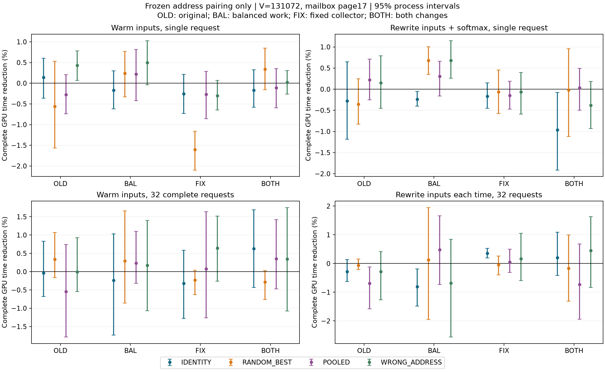
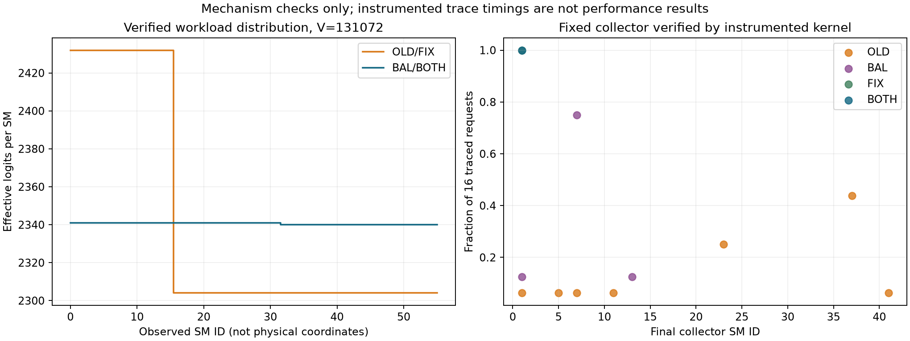

# T10：均衡工作与固定归并者后的地址亲和因果复验

运行 `20261018T050207Z`。百分比统一为 `100×(1−T_MINIMAX/T_control)`，正数表示完整耗时减少。下表默认95%进程bootstrap区间；预定义16项主要对照另保存99.6875%区间。

## 结论范围

本轮已完成。预定义主条件是 **131072词表、邮箱页17、均衡工作且固定SM1归并（BOTH）**。16项主要地址对照全部通过保守区间的判定为 **未通过**；四种运行条件下同时快于上一轮两个快核对照的判定为 **未通过**。默认不启用实验映射；不能把均衡布局或归并结构本身的收益记为地址亲和收益。

严格主条件的地址配对相对同内核固定配对，热输入点估计为 **-0.172%**，每次重写输入为 **-0.963%**。新完整内核在四种条件下相对原快核固定配对都退化约 **2.8%–4.3%**。后4次调用的事后敏感性分析也没有改变这一结论，原快核继续保留。

上一轮的局部热输入正数不作为本轮结论。这里使用新输入、新进程、独立开发选出的最强随机方案，并同时保留单次、输入重写和连续运行结果。当前没有物理SM屏蔽坐标、通用NUMA域或整模型tokens/s的结论。

## 实现与因果对照

| 变体 | logits工作分布 | 最终归并者 |
|---|---|---|
| OLD | 原128元素条带 | 最后抵达的消费者 |
| BAL | 连续分区，尽量等量 | 最后抵达的消费者 |
| FIX | 原128元素条带 | 固定SM1 |
| BOTH | 连续分区，尽量等量 | 固定SM1 |

131072词表的原布局每SM处理2304或2432个元素；均衡后为2340或2341。额外129024尺寸能完全均分，每SM2304个元素，用作机制控制。均衡同时改变了访存分布/对齐，故BAL相对OLD的变化并非纯粹的负载均衡因果证据；每个变体内部的配对比较保持工作分配不变。

四变体维持56个cooperative CTA、每CTA128线程、48KiB动态共享内存保留，运行时要求occupancy为1，并以trace验证56个SM各出现一次且起止一致。SM1固定归并需等待28个消费者完成，等待成本全部计时。相同变体的策略只改变常量参数中的配对，不增减计算或通信消息，不在热态建表/上传/分配。一个完整配对Softmax仍为一个kernel；fresh多一个真实copy；32次连续条件保留全部32次初始化、同步、复位和launch间隙。

131072未插桩版本的寄存器数为OLD 70、BAL 75、FIX 72、BOTH 79；编译日志均为0字节stack/spill。occupancy仍由48KiB共享内存保留限制为1，额外地址指令和等待仍可能有成本，不归因于某一项单独原因。详见 `derived/RESOURCES.json`。

未插桩OLD的131072版本以及普通两阶段partial/finish，与上轮机器指令逐项相同；原二进制另作为BASE_IDENTITY、BASE_MINIMAX直接对照。由此把编译变化和基线退化的风险显式纳入核验。

## 主要结果：131072，BOTH，预选页17

| 运行条件 | 固定配对 | 开发选出的最强随机 | 忽略地址的 pooled | 错误地址 |
|---|---|---|---|---|
| 热输入，单次 | -0.172% [-0.578, +0.325] | +0.339% [-0.158, +0.847] | -0.110% [-0.594, +0.352] | +0.020% [-0.266, +0.307] |
| 重写输入→Softmax，单次 | -0.963% [-1.913, -0.074] | -0.016% [-1.117, +0.960] | +0.030% [-0.500, +0.493] | -0.381% [-0.929, +0.182] |
| 热输入，32次连续 | +0.628% [-0.432, +1.688] | -0.282% [-0.763, +0.032] | +0.349% [-0.469, +1.418] | +0.348% [-1.074, +1.750] |
| 每次重写输入，32次连续 | +0.208% [-0.411, +1.093] | -0.163% [-1.313, +0.999] | -0.728% [-1.936, +0.677] | +0.453% [-0.837, +1.636] |

主结果16项的99.6875%区间、六个进程各自符号和完整统计在 `derived/DECISION.json` 与 `reports/RESULTS_COMPACT.json`。RANDOM_BEST是每条件在两个开发进程中从12套随机映射选出的最快者；确认前冻结，测试后不再换赢家。POOLED使用旧三个地址训练矩阵的均值拟合一张共用映射；WRONG_ADDRESS使用其它地址的冻结映射。随机平均也完整保留，但不替代最强随机对照。

## 是否快过上一轮完整快核

| 条件 | MINIMAX µs/次 | 原快核固定配对 µs/次 | 相对原快核固定配对 | 相对原快核地址配对 |
|---|---:|---:|---|---|
| 热输入，单次 | 11.4873 | 11.0900 | -3.590% [-4.054, -3.203] | -3.985% [-4.282, -3.686] |
| 重写输入→Softmax，单次 | 15.7380 | 15.3077 | -2.801% [-3.788, -1.786] | -2.709% [-3.514, -1.909] |
| 热输入，32次连续 | 7.1131 | 6.8208 | -4.282% [-5.522, -3.037] | -3.502% [-3.892, -2.960] |
| 每次重写输入，32次连续 | 10.1528 | 9.8141 | -3.368% [-4.726, -1.964] | -2.598% [-3.601, -1.237] |

绝对时间栏是块内中位数的算术平均；百分比来自配对几何比，不直接由两栏均值相除。批量绝对时间为完整batch事件时间除32，含每次收尾与初始化、kernel间隙；它是平均吞吐代价，不能冒充单token响应延迟。即使同一慢内核内部出现配对增量，也只有超过完整旧快核才有工程净收益。普通两阶段NATIVE也保留；普通融合差额不算NUMA。

指令相同的OLD与原二进制还保留了性能层面的一致性诊断（单独函数入口/地址和Graph可能不同；这不是新增调参）：

| 条件 | OLD固定配对/原二进制固定配对 | OLD地址配对/原二进制地址配对 |
|---|---|---|
| 热输入，单次 | +0.835% [+0.411, +1.315] | +0.353% [-0.368, +1.029] |
| 重写输入→Softmax，单次 | +0.244% [-0.040, +0.511] | +0.230% [-0.559, +1.049] |
| 热输入，32次连续 | -0.482% [-1.353, +0.106] | +0.288% [-0.987, +1.394] |
| 每次重写输入，32次连续 | -0.835% [-1.491, -0.288] | +0.132% [-0.130, +0.470] |

这里不是严格同一二进制的A/A：函数入口、参数元数据、代码位置和Graph不同，差异来源尚未隔离，不能直接称为纯计时噪声。这些差异不能凭“机器指令一样”自动当成零；原二进制作为强基线直接保留。主性能比较没有按此诊断校正或删样。

## 四变体拆分与完全均分控制

131072词表：

| 条件 | 内核变体 | 相对固定配对 | 相对最强随机 |
|---|---|---|---|
| 热输入，单次 | OLD | +0.137% [-0.360, +0.604] | -0.563% [-1.565, +0.529] |
| 热输入，单次 | BAL | -0.172% [-0.621, +0.296] | +0.237% [-0.328, +0.765] |
| 热输入，单次 | FIX | -0.257% [-0.732, +0.215] | -1.602% [-2.098, -1.161] |
| 热输入，单次 | BOTH | -0.172% [-0.578, +0.325] | +0.339% [-0.158, +0.847] |
| 重写输入→Softmax，单次 | OLD | -0.276% [-1.186, +0.649] | -0.354% [-0.831, +0.244] |
| 重写输入→Softmax，单次 | BAL | -0.238% [-0.402, -0.051] | +0.681% [+0.352, +1.002] |
| 重写输入→Softmax，单次 | FIX | -0.171% [-0.455, +0.150] | -0.066% [-0.573, +0.456] |
| 重写输入→Softmax，单次 | BOTH | -0.963% [-1.913, -0.074] | -0.016% [-1.117, +0.960] |
| 热输入，32次连续 | OLD | -0.037% [-0.682, +0.833] | +0.335% [-0.166, +1.072] |
| 热输入，32次连续 | BAL | -0.235% [-1.732, +1.029] | +0.290% [-0.859, +1.659] |
| 热输入，32次连续 | FIX | -0.322% [-1.276, +0.588] | -0.234% [-0.623, +0.041] |
| 热输入，32次连续 | BOTH | +0.628% [-0.432, +1.688] | -0.282% [-0.763, +0.032] |
| 每次重写输入，32次连续 | OLD | -0.279% [-0.621, +0.135] | -0.064% [-0.210, +0.154] |
| 每次重写输入，32次连续 | BAL | -0.806% [-1.485, -0.184] | +0.128% [-1.950, +1.947] |
| 每次重写输入，32次连续 | FIX | +0.354% [+0.190, +0.527] | -0.040% [-0.399, +0.263] |
| 每次重写输入，32次连续 | BOTH | +0.208% [-0.411, +1.093] | -0.163% [-1.313, +0.999] |

129024完全均分尺寸：

| 条件 | 内核变体 | 相对固定配对 | 相对最强随机 |
|---|---|---|---|
| 热输入，单次 | OLD | -0.892% [-1.621, -0.114] | -0.364% [-1.168, +0.434] |
| 热输入，单次 | BAL | -0.879% [-1.271, -0.442] | -0.852% [-1.334, -0.351] |
| 热输入，单次 | FIX | -0.493% [-0.894, -0.003] | -1.031% [-1.176, -0.887] |
| 热输入，单次 | BOTH | -1.425% [-1.737, -0.966] | -0.551% [-0.977, -0.059] |
| 重写输入→Softmax，单次 | OLD | -1.169% [-1.484, -0.878] | +0.192% [-0.521, +1.093] |
| 重写输入→Softmax，单次 | BAL | -1.017% [-1.404, -0.606] | +0.210% [-0.285, +0.670] |
| 重写输入→Softmax，单次 | FIX | +0.000% [-0.290, +0.252] | +0.185% [-0.261, +0.862] |
| 重写输入→Softmax，单次 | BOTH | -0.463% [-0.814, -0.092] | +0.456% [+0.019, +0.926] |
| 热输入，32次连续 | OLD | -0.780% [-1.572, -0.172] | -0.222% [-0.740, +0.140] |
| 热输入，32次连续 | BAL | +0.303% [-1.005, +1.530] | +0.554% [-0.355, +1.463] |
| 热输入，32次连续 | FIX | -0.279% [-1.602, +1.030] | -0.986% [-1.858, -0.240] |
| 热输入，32次连续 | BOTH | +0.709% [+0.630, +0.794] | -0.037% [-0.458, +0.355] |
| 每次重写输入，32次连续 | OLD | +0.267% [-0.363, +1.200] | -0.069% [-0.612, +0.617] |
| 每次重写输入，32次连续 | BAL | -0.065% [-1.804, +1.838] | -1.046% [-1.564, -0.495] |
| 每次重写输入，32次连续 | FIX | +0.152% [-1.077, +1.066] | +0.110% [-1.091, +1.202] |
| 每次重写输入，32次连续 | BOTH | -0.132% [-1.049, +0.698] | -0.988% [-1.778, -0.266] |

129024是诊断尺寸，没有声称运行了使用该词表的真实LLM。BOTH在地址页0、257的全部额外控制同样保留于紧凑结果；邮箱页17沿用前轮训练预选，没有依据本轮计时重新选址。

## 补充：忽略地址的SM模型是否更有效

用户目标也包括一般SM拓扑调度，因此额外保留POOLED和开发选出的随机策略本身的比较。这项分析在确认执行中、尚未读取确认耗时估计时补充，属于探索性分析，不更改原16项主要判定或使用确认数据选策略。全部条件的随机赢家结果保存在 `derived/SECONDARY.json`，随机搜索收益不能归为地址或拓扑因果。

| 条件 | 变体 | POOLED/固定配对 | POOLED/最强随机 | POOLED/原快核固定配对 |
|---|---|---|---|---|
| 热输入，单次 | OLD | +0.414% [-0.036, +0.902] | -0.285% [-1.208, +0.541] | +1.245% [+0.847, +1.691] |
| 热输入，单次 | BAL | -0.393% [-0.968, +0.272] | +0.017% [-0.754, +0.795] | -0.542% [-1.286, +0.194] |
| 热输入，单次 | FIX | +0.015% [-0.330, +0.300] | -1.326% [-1.676, -0.971] | -3.287% [-3.688, -2.692] |
| 热输入，单次 | BOTH | -0.062% [-0.299, +0.163] | +0.449% [-0.042, +1.049] | -3.477% [-3.971, -2.919] |
| 重写输入→Softmax，单次 | OLD | -0.496% [-1.332, +0.213] | -0.574% [-1.279, -0.093] | -0.251% [-1.109, +0.406] |
| 重写输入→Softmax，单次 | BAL | -0.547% [-0.796, -0.187] | +0.375% [-0.090, +0.793] | -0.583% [-1.027, -0.025] |
| 重写输入→Softmax，单次 | FIX | -0.021% [-0.481, +0.392] | +0.083% [-0.374, +0.517] | -1.677% [-2.114, -1.207] |
| 重写输入→Softmax，单次 | BOTH | -0.993% [-1.858, -0.101] | -0.046% [-0.889, +0.857] | -2.832% [-3.793, -1.873] |
| 热输入，32次连续 | OLD | +0.508% [-0.041, +1.261] | +0.877% [-0.269, +1.975] | +0.028% [-1.198, +1.107] |
| 热输入，32次连续 | BAL | -0.470% [-1.928, +0.778] | +0.057% [-0.840, +1.072] | -2.661% [-3.533, -2.155] |
| 热输入，32次连续 | FIX | -0.402% [-1.808, +0.790] | -0.313% [-1.827, +1.058] | -2.836% [-4.570, -1.489] |
| 热输入，32次连续 | BOTH | +0.280% [-0.235, +1.098] | -0.634% [-1.498, -0.154] | -4.647% [-6.034, -3.275] |
| 每次重写输入，32次连续 | OLD | +0.410% [-0.366, +1.345] | +0.623% [+0.033, +1.445] | -0.422% [-0.952, +0.099] |
| 每次重写输入，32次连续 | BAL | -1.291% [-2.202, -0.427] | -0.353% [-1.303, +0.384] | -1.722% [-2.641, -0.826] |
| 每次重写输入，32次连续 | FIX | +0.301% [-0.096, +0.578] | -0.093% [-0.281, +0.075] | -2.321% [-2.648, -1.996] |
| 每次重写输入，32次连续 | BOTH | +0.929% [+0.134, +1.764] | +0.560% [-0.803, +1.763] | -2.622% [-3.942, -1.345] |

## 主机、输入与初始化开销

| 条件 | 主机区间相对固定配对 | 主机区间相对最强随机 |
|---|---|---|
| 热输入，单次 | +0.030% [-0.776, +0.965] | +0.664% [-0.140, +1.583] |
| 重写输入→Softmax，单次 | -0.783% [-1.715, +0.043] | -0.748% [-2.409, +0.784] |
| 热输入，32次连续 | +0.670% [-0.366, +1.705] | -0.248% [-0.687, +0.064] |
| 每次重写输入，32次连续 | +0.133% [-0.445, +0.929] | -0.169% [-1.370, +1.050] |

GPU起止事件与计算子图位于同一张CUDA Graph，沿用旧二进制计时包装器；实际执行图的节点数和顺序另外核验。主机计时为C++提交至stream-ready，不含Python调用包装、输入H2D/输出D2H。fresh是实际copy当前输入再执行Softmax，未模拟LM-head矩阵乘法；四份随机logits轮换，每个block内多次请求使用同一份内容。没有运行真实权重、完整生成或top-k/top-p。

每个实验Job的建图中位数（含两次热身，不含Data分配、模型校准和冷启动CUDA）如下，不能当成完整一次性初始化成本：

| 条件 | MINIMAX建图 ms | IDENTITY建图 ms | 原快核固定配对建图 ms |
|---|---:|---:|---:|
| 热输入，单次 | 46.023 | 46.849 | 46.539 |
| 重写输入→Softmax，单次 | 46.268 | 46.274 | 46.243 |
| 热输入，32次连续 | 46.996 | 47.089 | 48.756 |
| 每次重写输入，32次连续 | 48.943 | 47.269 | 50.419 |

旧设备模型直接离线复用，本轮没有在每个新workspace上重新校准。模型以相对邮箱页和SM身份为索引，没有解析物理home；2MiB虚拟对齐不能证明物理home相同。本轮两个词表Data同时驻留，分配顺序也不同于上一轮，因此本轮跨分配迁移失败不能被解释成“任何地址相关性都不存在”。各条件内部所有策略仍共享同一输入/输出和邮箱地址；实际部署若要求重校准，应另计成本。逻辑邮箱2MiB，为对齐分配4MiB。原快核仍保留，实验夹具不是成熟推理框架API。

## 插桩诊断与机制核验

131072、热输入、MINIMAX，每组16次：

| 变体 | 每SM有效元素范围 | 观测归并者SM | 本地计算中位数 ns | 消费者交接段中位数 ns | 归并者等待中位数 ns |
|---|---|---|---:|---:|---:|
| BAL | 2340–2341 | [1, 7, 13] | 1824.0 | 1936.0 | 128.0 |
| BOTH | 2340–2341 | [1] | 1824.0 | 1872.0 | 384.0 |
| FIX | 2304–2432 | [1] | 1808.0 | 1912.0 | 320.0 |
| OLD | 2304–2432 | [1, 5, 7, 11, 23, 37, 41] | 2000.0 | 1936.0 | 0.0 |

诊断另编译带时间戳/存储的trace版本，正式计时不含它。交接段包含邮箱等待、数据归并、原子fan-in等；它不等于单向物理链路时间。时间戳和trace写入改变调度，thread0阶段也不是整个CTA完成时刻，因此这些数值只用于机制核验和定位，不用于分摊正式收益的纳秒因果贡献。

工作均衡和固定归并者并没有抹平所有因素：相同元素数不保证相同抵达时刻，原子fan-in、最终通知、缓存、时钟和物理页复用依然存在。SMID仅为调度身份，不是芯片坐标，见[NVIDIA PTX SMID说明](https://docs.nvidia.com/cuda/parallel-thread-execution/index.html#special-registers-smid)。消息发布/获取使用GPU范围release/acquire和原子同步，内存排序语义见[NVIDIA PTX内存模型](https://docs.nvidia.com/cuda/parallel-thread-execution/index.html#memory-consistency-model)。本轮没有调用未公开SM屏蔽接口。

## 首次调用与连续调用的事后敏感性分析

首尾锚点并非同样的热态条件：后续块的前锚点发生在上一块CPU处理/落盘之后，后锚点紧随一段GPU请求。第一轮请求比后续请求慢，不能把它全部称为随机漂移，也不能在没有额外控制时只归因于时钟。主条件各scope中，策略内第1次计时相对后4次中位数，中位数约高7.1%、12.7%、8.0%、8.3%。

原定主统计仍使用完整8次的中位数，不删除任何样本。下面只用已有数据做事后敏感性分析，考察后4次的连续热态结果；批量条件下的一次计时指含32个完整请求的整组Graph，后4次也指后4组Graph。它不是冷启动/首次请求延迟，也不替代主结果：

| 条件 | 主结果全部8次：相对固定配对 | 仅后4次敏感性：相对固定配对 | 仅后4次：相对原快核 |
|---|---|---|---|
| 热输入，单次 | -0.172% [-0.578, +0.325] | -0.028% [-0.364, +0.470] | -3.444% [-4.118, -2.734] |
| 重写输入→Softmax，单次 | -0.963% [-1.913, -0.074] | -0.954% [-1.868, +0.041] | -3.205% [-3.838, -2.548] |
| 热输入，32次连续 | +0.628% [-0.432, +1.688] | +0.667% [-0.368, +1.715] | -4.258% [-5.500, -3.013] |
| 每次重写输入，32次连续 | +0.208% [-0.411, +1.093] | +0.186% [-0.437, +1.079] | -3.392% [-4.754, -1.988] |

完整新内核相对旧快核的退化仍存在。未来若继续讨论不到1%的增量，需把首次调用、固定提交间隔和连续稳态分别设计，避免让CPU落盘间隙或不同编译入口混入拓扑解释。

## 统计、稳定性及完整性

先取随机块内计时中位数，再计算同块配对log比，最后按进程等权聚合。30000次bootstrap以整个进程重采样，保留95%和针对16项主要对照的99.6875%区间。六个进程来自同一卡同一天，区间不覆盖整个连续研究历史，也不是跨硬件置信度。所有开发、确认、负数、错误地址、较弱随机和异常锚点原样保留，没有删样或事后换映射。

- 热输入，32次连续：1152 对首尾锚点中，1084 对变化超过3%；不据此删除任何样本。
- 重写输入→Softmax，单次：1152 对首尾锚点中，1125 对变化超过3%；不据此删除任何样本。
- 每次重写输入，32次连续：1152 对首尾锚点中，1129 对变化超过3%；不据此删除任何样本。
- 热输入，单次：1152 对首尾锚点中，1118 对变化超过3%；不据此删除任何样本。

共 14 个worker，累计 2073.490/2400 GPU-worker秒（含CPU准备与落盘）。开发计时 82944 条、独立确认 663552 条；实际算子请求分别 1368576 和 10948608 次。57308 项数值检查、6912 项实际Graph核验通过，输入哈希跨进程/阶段不重合。数值包含随机、全零、单峰和极端有限logits，参考为FP64 Softmax；没有声称支持NaN/全负无穷输入。

memcheck/synccheck和定点racecheck通过；racecheck不独立证明全部全局内存并发正确性。采样温度63–69°C，100W上限及保护保持，未锁频、CPU未独占，桌面进程存在。

确认前的CPU核对发现开发与原计划确认种子会重叠，已在任何确认启动前把确认种子移到独立区间；原协议、新协议哈希和修正时刻保存在 `freeze/SEED_AMENDMENT.json`，全量哈希审计验证没有实际输入重叠。

保存了两次工程问题：最初源码生成误改到普通partial模板导致编译失败（未启动GPU）；首次sanitizer路径缺少注入库而退出，换成已有完整工具后通过。初版源码、错误日志和失败worker均保留，未记为成功样本。本轮确认完成后不追加映射或变体搜索。
