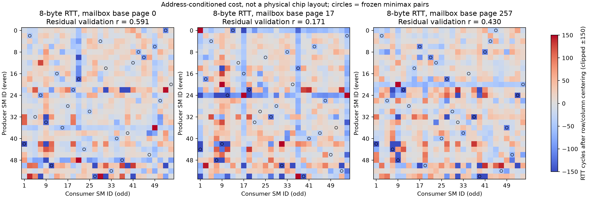
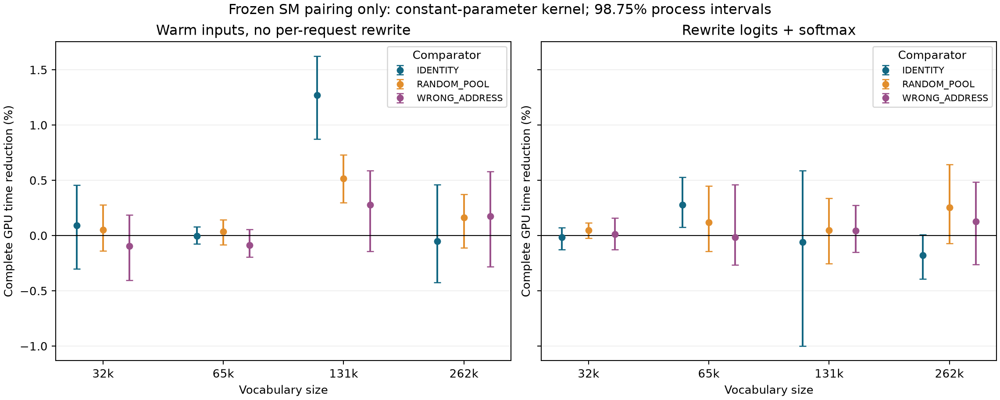

# T10：冻结快核后的地址亲和与 SM 归并调度

本轮运行 `20261018T025123Z`，本地日期 2026-10-18。所有百分比都是 `100×(1−T_method/T_control)`：正数表示完整 GPU 时间减少；默认方括号为 95% 进程 bootstrap 区间。大幅普通融合收益与很小的 SM 配对增量分开报告。

## 最关键的结果

原 Attention 快核已按 SHA256 原样冻结并保留。一次领取整组页面的地址调度相对该快核汇总 **-8.918% [-9.049, -8.781]**，相对同开销盲调度 **-0.136% [-0.240, -0.061]**。它没有实现用户要求的收益，未替换原实现。

得到一个**受限的单核正结果**：131072 词表、只按训练微测预选的邮箱页 17、输入已经预热且本次不重写。只改变同一常量参数 kernel 的配对，MINIMAX/IDENTITY 为 **+2.157% [+1.317, +2.921]**，相对 12 套随机配对为 **+1.024% [+0.347, +1.710]**，相对错误地址配对为 **+1.403% [+0.671, +2.233]**；这三项各 6/6 新进程为正，区间已按四个词表作 98.75% 修正。

但该正结果**没有稳定延续到每次重写 logits 的条件或连续批量节奏**。因此本轮结论是“找到了条件性的 SM/地址配对增量”，不是“已经获得可通用部署的 NUMA 净加速”。下文保留了缩小、消失和反向的结果，默认接口仍不启用该映射。

转到真实计算的 FP32 单 token 词表 Softmax 后，最终常量参数版只改变 SM 配对：跨四个词表、三个邮箱位置等权，MINIMAX/IDENTITY 为 **+0.329% [+0.189, +0.470]**，MINIMAX/12 套随机配对几何平均为 **+0.192% [+0.130, +0.262]**。重写 logits 的完整“copy→Softmax”条件下，MINIMAX/IDENTITY 为 **+0.006% [-0.185, +0.134]**。原二进制与同一张映射表地址的独立控制为 **+0.482% [+0.436, +0.537]**；32 次完整算子批量计时控制为 **+0.541% [+0.017, +1.080]**。

这几组控制分别检验配对、映射表本身的存放位置、输入写入后的缓存状态及计时粒度。不能用其中一张正表覆盖另一张负表。最终逐形状判定见 `derived/DEPLOYMENT_GATE.json`；该 gate 是测试后明确列出的使用限制，不是又一个独立验证过的自动路由策略。API 默认 NATIVE，MINIMAX 必须显式指定。

这里的工作是合成但实际执行的 LLM 尺寸部件；没有运行模型权重、完整生成、top-k/top-p 采样或输出投影。小词表可能输给普通方案；大词表相对普通两阶段实现的收益主要来自单 kernel 归并融合，不能全部算作 NUMA。

## 1. 保持什么不变，究竟改变什么

Attention 保持上一轮向量读取、共享 KV、写入融合及 W/归并配置；对照的 `build/baseline/vector.so`、`vector_append.so` 与上一轮逐字节相同。新候选提前把页按历史地址类分成完整 worker job，每 CTA 最多两次队列领取，不再逐页做原子操作。保留 CA/CG 两种加载、盲选、匹配、反向、打乱及静态控制；仅在两个开发进程选择 CA/CG，然后六新进程复验。资格 trace 显示匹配策略约九成任务被送到其假设偏好的 SM 类，而盲调度约一半，所以本轮失败不能简单归因于“没有真的改变任务位置”。这也不证明原地址规则适用于快核的实际访问路径。

Softmax 的每个 SM 固定读取同一组 logits、做同样的 max/sum/exp 工作；56 个 SM 分成 28 个偶数 ID 生产者和 28 个奇数 ID 消费者。生产者的 8 字节 `(max,sum)` 固定写到自己的邮箱。只改变哪一个消费者读取哪一个生产者，随后最后一个消费者完成全局归并并通知所有 SM 写出完整概率向量。没有在真实算子里添加反复 ping-pong 来放大收益。

这里“固定各 SM 的工作”不等于所有 SM 的有效元素数完全相等：这些词表尺寸不能整除 56×128，尾部有效元素分布保持固定。配对改变仍可能改变计算尾部与通信等待的重叠；最后归并者也未固定。因此通过的对照支持**配对安排的净效果**，尚不能将全部增量唯一归因于物理链路延迟。下一轮需在均衡每 SM 有效工作量、固定最终归并者之后再验证通信关键路径。

所有配对执行同一个编译内核、同样的网格、线程数、48 KiB 动态共享内存保留、轮询、计数和输出；配对改变会影响到达顺序及最后归并者，这是调度效果的一部分。初始化、全网格同步、等待、收尾与计数复位全部在计时区间。普通 NATIVE 是同精度的全 GPU 两阶段 Softmax；另保留 torch.softmax 和同一融合 kernel 的固定/随机配对。没有宣称超过所有现有优化 Softmax 或采样实现。

固定 56 个 cooperative CTA，每 CTA 128 线程，运行时 occupancy 检查要求每 SM 最多一个 CTA；诊断 trace 要求实际 SM 0–55 各一次、起止不变。48 KiB 动态空间加少量静态空间需要显式 opt-in，初版遗漏造成的 launch 失败已保存，修复后重新资格检查。这里的资源保留和同步成本均被计入；不能把它当成免费绑核。

最终 `softmax_const.cu` 将 56 个映射整数作为 kernel 参数按值传入。SASS 包含从同一参数偏移 `c[0x0][R+0x160]` 的 LDC，所有配对使用同一个参数位置；不再因策略不同而换全局映射表地址，热态不建表、不上传、不分配显存。编译日志保留寄存器及 spill 信息。原全局表版和独立“同一表地址、只换内容”控制仍完整保留。

## 2. 拓扑证据是什么

重测实际使用的 8 字节消息，而非沿用 64 字节结果。对 28×28 有向生产者/消费者组合，在邮箱基址相对页 0、17、257 分别测量；每个固定生产者的邮箱位于 `2MiB-aligned base+(page+producer_index)*4096`。四个进程各 4704 个孤立 pair launch，两个开发、两个独立校验；每次含 16 次预热和 128 次有效往返，内容、序号、SM 和超时全部验证。计时由同一生产者的 clock64 完成，不相减不同 SM 的时钟。

训练周期矩阵作最小最大成本完美匹配，并用总成本打破平局；还保留最小和、最大和、固定及随机映射。模型在任何 Softmax 开发测量之前冻结。邮箱位置 17 是常量参数实验前只根据训练矩阵最小预测最大 RTT 选出的，三个位置的全部数据仍保留。

`derived/softmax_topology.json` 给出独立校验矩阵和去行列主效应后的相关性；这次三个地址位置的残差相关约 0.591、0.171、0.430，弱于以前的部分 64 字节结果。图表示特定地址、消息和加载条件下的经验往返代价，**不表示芯片平面坐标、物理 NUMA 节点、单向跳数或被屏蔽 SM 的几何形状**。当前只校准 even→odd 部分；旧完整 56×56 结果在上轮 `sm-topology-t10`，不能冒充本轮全矩阵。

[NVIDIA PTX 对 SMID 的定义](https://docs.nvidia.com/cuda/parallel-thread-execution/index.html#special-registers-smid)不保证 ID 连续或在调度变化中恒定，因此本机实测 roster 是必要约束，编号大小不是距离。[CUDA Cooperative Groups 文档](https://docs.nvidia.com/cuda/cuda-programming-guide/04-special-topics/cooperative-groups.html)提供公开的协作启动和网格同步机制；本轮没有使用未公开 SM 掩码接口。

## 3. Attention：失败也完整保留

| 条件 | MATCH/FAST | MATCH/BLIND | MATCH/INVERT | MATCH/SHUFFLE |
|---|---|---|---|---|
| ALL | -8.918% [-9.049, -8.781] | -0.136% [-0.240, -0.061] | +0.036% [-0.042, +0.102] | -0.024% [-0.220, +0.166] |
| GQA4_SHORT | -2.993% [-3.180, -2.793] | -0.322% [-0.533, -0.115] | -0.003% [-0.126, +0.102] | -0.049% [-0.207, +0.105] |
| GQA4_LONG | -1.565% [-1.880, -1.197] | -0.314% [-0.415, -0.229] | -0.062% [-0.214, +0.063] | -0.433% [-0.673, -0.200] |
| GQA8_LONG | -30.527% [-30.716, -30.340] | -0.072% [-0.200, +0.042] | +0.139% [+0.037, +0.280] | -0.198% [-0.329, -0.067] |
| BATCH4_RAGGED | -3.071% [-3.381, -2.746] | +0.163% [-0.137, +0.389] | +0.070% [-0.157, +0.308] | +0.579% [+0.171, +0.970] |

GQA8 的较大退化显示减少原子数并不足以抵消整组领取带来的负载与资源代价；本轮没有用硬件计数器隔离出唯一原因。trace 约九成地址匹配是实现证据，不是快核成功证据。

## 4. Softmax：全局映射表版及更严格控制

第一轮六进程、所有地址等权：

| 条件 | MINIMAX/FAST | MINIMAX/IDENTITY | MINIMAX/RANDOM | MINIMAX/WRONG_ADDRESS |
|---|---|---|---|---|
| ALL | +14.708% [+14.539, +14.903] | +0.877% [+0.836, +0.922] | +0.608% [+0.508, +0.712] | +0.028% [-0.056, +0.112] |
| VOCAB_32768 | -14.026% [-14.382, -13.647] | +0.700% [+0.595, +0.823] | +0.801% [+0.741, +0.856] | +0.078% [+0.037, +0.117] |
| VOCAB_65536 | +3.314% [+3.069, +3.524] | +0.850% [+0.698, +1.016] | +0.516% [+0.412, +0.616] | -0.035% [-0.222, +0.105] |
| VOCAB_131072 | +22.724% [+22.464, +22.956] | +1.654% [+1.435, +1.868] | +0.595% [+0.296, +0.882] | -0.159% [-0.380, -0.008] |
| VOCAB_262144 | +37.882% [+37.806, +38.005] | +0.299% [+0.130, +0.474] | +0.522% [+0.210, +0.762] | +0.227% [+0.009, +0.405] |

每地址 12 套随机配对的独立六进程面板：

| 条件 | MINIMAX/IDENTITY | MINIMAX/RANDOM_POOL | MINIMAX/WRONG_ADDRESS |
|---|---|---|---|
| ALL | +0.729% [+0.650, +0.799] | +0.297% [+0.245, +0.350] | +0.076% [+0.020, +0.131] |
| VOCAB_32768 | +0.651% [+0.508, +0.831] | +0.347% [+0.256, +0.436] | +0.022% [-0.068, +0.103] |
| VOCAB_65536 | +0.519% [+0.349, +0.673] | +0.250% [+0.140, +0.343] | -0.037% [-0.135, +0.057] |
| VOCAB_131072 | +1.585% [+1.255, +1.930] | +0.455% [+0.162, +0.767] | +0.275% [+0.115, +0.416] |
| VOCAB_262144 | +0.155% [-0.363, +0.535] | +0.138% [-0.135, +0.360] | +0.042% [-0.236, +0.264] |

孤立通信成本对完整 kernel 时间的预测仍弱：在这 12 个词表×地址条件中，随机/固定/学习配对的训练平均 RTT 与实测完整时间相关性约为 −0.199 到 +0.331，中位数约 +0.158，详见 `derived/soft_cost_transfer.json`。因此，即使冻结配对有正增量，也不能宣称孤立 pair 成本已经解释或预测了整个归并图。最后归并者会随到达顺序变化，P→C、原子 fan-in 和最终通知的贡献尚未分别隔离。

随机面板均值也不等于“经独立开发调优后的最快随机配对”。本轮没有把确认集里的随机赢家当免费基线，同时也不主张学习映射优于预算相当的随机搜索；这是形成更强论文主张时仍需补的对照。

同一原二进制、相同映射表 VA 的独立六进程：

| 条件 | MINIMAX/IDENTITY | MINIMAX/RANDOM | MINIMAX/WRONG_ADDRESS |
|---|---|---|---|
| ALL | +0.482% [+0.436, +0.537] | +0.429% [+0.328, +0.521] | +0.072% [+0.014, +0.125] |
| VOCAB_32768 | +0.425% [+0.252, +0.613] | +0.385% [+0.276, +0.509] | -0.056% [-0.219, +0.081] |
| VOCAB_65536 | +0.275% [+0.173, +0.392] | +0.216% [+0.102, +0.346] | +0.084% [+0.055, +0.119] |
| VOCAB_131072 | +1.344% [+1.057, +1.582] | +0.479% [+0.355, +0.615] | +0.229% [-0.096, +0.530] |
| VOCAB_262144 | -0.121% [-0.331, +0.089] | +0.637% [+0.252, +1.001] | +0.031% [-0.124, +0.191] |

同表地址实验在每组计时前切换表内容并同步，上传时间另外落盘。部署固定策略只在建 plan 时配置一次；因此这个测试用于排除表 VA 混杂，不能把该测试的每组策略切换说成免费的生产热态操作。

## 5. 最终常量参数版：完整单请求

三个地址等权，四份输入已预热且每次请求不重新写入：

| 条件 | MINIMAX/NATIVE | MINIMAX/IDENTITY | MINIMAX/RANDOM_POOL | MINIMAX/WRONG_ADDRESS |
|---|---|---|---|---|
| ALL | +15.182% [+15.106, +15.258] | +0.329% [+0.189, +0.470] | +0.192% [+0.130, +0.262] | +0.067% [-0.067, +0.209] |
| VOCAB_32768 | -13.240% [-13.496, -12.976] | +0.093% [-0.206, +0.380] | +0.053% [-0.103, +0.224] | -0.096% [-0.342, +0.136] |
| VOCAB_65536 | +3.057% [+2.858, +3.258] | -0.004% [-0.064, +0.061] | +0.036% [-0.057, +0.122] | -0.089% [-0.181, +0.025] |
| VOCAB_131072 | +23.176% [+22.989, +23.378] | +1.272% [+0.962, +1.561] | +0.516% [+0.349, +0.692] | +0.278% [-0.061, +0.539] |
| VOCAB_262144 | +38.632% [+38.463, +38.790] | -0.051% [-0.366, +0.356] | +0.162% [-0.052, +0.343] | +0.174% [-0.186, +0.495] |

每次先实际重写当前 logits，再计算 Softmax；copy 和 Softmax 的全部 kernel 一起计时：

| 条件 | MINIMAX/NATIVE | MINIMAX/IDENTITY | MINIMAX/RANDOM_POOL | MINIMAX/WRONG_ADDRESS |
|---|---|---|---|---|
| ALL | +11.023% [+10.774, +11.216] | +0.006% [-0.185, +0.134] | +0.116% [+0.016, +0.248] | +0.041% [-0.089, +0.187] |
| VOCAB_32768 | -10.613% [-10.921, -10.270] | -0.017% [-0.105, +0.057] | +0.046% [-0.008, +0.102] | +0.010% [-0.104, +0.125] |
| VOCAB_65536 | +3.872% [+3.676, +4.081] | +0.276% [+0.115, +0.468] | +0.120% [-0.093, +0.371] | -0.016% [-0.239, +0.322] |
| VOCAB_131072 | +17.098% [+16.268, +17.833] | -0.059% [-0.801, +0.531] | +0.046% [-0.193, +0.280] | +0.044% [-0.113, +0.224] |
| VOCAB_262144 | +28.897% [+28.736, +29.057] | -0.178% [-0.349, -0.038] | +0.253% [-0.024, +0.581] | +0.127% [-0.179, +0.430] |

重写输入来自四个轮换源缓冲区。独立的输入重写控制在数值检查前故意清除目标，确认该 copy 参与本次答案；常量参数版沿用相同 copy 二进制并再检查完整输出。它是缓存状态和依赖控制，不是完整 LM head GEMM，也不是逐 token 生成。

训练预测选择的邮箱页 17，输入已预热且本次不重写：

| 条件 | MINIMAX/NATIVE | MINIMAX/IDENTITY | MINIMAX/RANDOM_POOL | MINIMAX/WRONG_ADDRESS |
|---|---|---|---|---|
| ALL | +15.368% [+15.283, +15.444] | +0.543% [+0.376, +0.697] | +0.420% [+0.282, +0.555] | +0.531% [+0.390, +0.687] |
| VOCAB_32768 | -12.621% [-13.187, -12.137] | +0.326% [-0.174, +0.675] | +0.196% [-0.053, +0.444] | +0.525% [+0.193, +0.825] |
| VOCAB_65536 | +2.779% [+2.567, +3.002] | +0.043% [-0.183, +0.319] | +0.206% [+0.029, +0.425] | -0.012% [-0.304, +0.320] |
| VOCAB_131072 | +23.522% [+23.123, +23.924] | +2.157% [+1.489, +2.780] | +1.024% [+0.475, +1.571] | +1.403% [+0.789, +2.030] |
| VOCAB_262144 | +38.733% [+38.409, +38.965] | -0.373% [-0.896, +0.196] | +0.251% [-0.248, +0.660] | +0.204% [-0.515, +0.777] |

下图为三个邮箱地址等权汇总，区别于上面的预选页 17 单点。

## 6. 批量计时与主机开销

32 次完整常量参数版算子串在一个 graph 中，保留每次初始化、同步和启动间隙。使用较长事件区间检查小增量，不将它当作单请求/整模型延迟：

| 条件 | MINIMAX/NATIVE | MINIMAX/IDENTITY | MINIMAX/RANDOM_POOL | MINIMAX/WRONG_ADDRESS |
|---|---|---|---|---|
| ALL | +17.933% [+17.657, +18.191] | +0.541% [+0.017, +1.080] | -0.073% [-0.314, +0.198] | -0.498% [-0.860, -0.223] |
| VOCAB_32768 | -10.349% [-10.893, -9.825] | +1.456% [+0.412, +2.130] | +0.322% [-0.587, +1.116] | -0.517% [-2.002, +0.617] |
| VOCAB_65536 | +7.204% [+6.447, +8.136] | +1.083% [+0.298, +2.005] | -0.206% [-0.892, +0.551] | -0.812% [-1.887, +0.214] |
| VOCAB_131072 | +24.353% [+23.643, +25.121] | -0.598% [-1.625, +0.395] | -0.332% [-0.787, +0.235] | -0.448% [-1.364, +0.360] |
| VOCAB_262144 | +41.443% [+41.059, +41.680] | +0.209% [-0.444, +0.875] | -0.076% [-0.786, +0.628] | -0.215% [-0.605, +0.364] |

同一个受限正点（131072、邮箱页 17）在批量节奏下，MINIMAX/IDENTITY 为 **-1.481% [-4.177, -0.320]**（98.75% 区间），方向反转。这说明单请求的正结果有运行条件边界；批量同时改变缓存/提交节奏和可能的频率状态，不能把反转唯一归因于计时器，也不能忽略它。

所有原始单请求 C++ submit→stream-ready 主机时间也保存。最终常量参数版、输入就绪、所有地址等权的主机区间：

| 条件 | MINIMAX/NATIVE | MINIMAX/IDENTITY | MINIMAX/RANDOM_POOL |
|---|---|---|---|
| ALL | +11.768% [+11.571, +11.949] | +0.073% [-0.087, +0.226] | +0.088% [-0.035, +0.203] |
| VOCAB_32768 | -7.243% [-7.637, -6.773] | +0.123% [-0.152, +0.368] | +0.102% [-0.087, +0.289] |
| VOCAB_65536 | +2.549% [+2.330, +2.725] | -0.186% [-0.451, +0.047] | -0.021% [-0.228, +0.162] |
| VOCAB_131072 | +16.126% [+15.815, +16.343] | +0.490% [+0.117, +0.802] | +0.090% [-0.250, +0.292] |
| VOCAB_262144 | +30.863% [+30.784, +30.956] | -0.137% [-0.282, -0.004] | +0.182% [+0.078, +0.286] |

主机计时从 C++ 提交到同步返回；Python 调度、建图、输入 H2D/输出 D2H 不在热态区间。GPU 阶段的百分比不能直接换算成整模型 tokens/s，主机无稳定改善时也不能把 GPU 小收益说成应用响应改善。桌面进程仍存在，CPU 未独占，未锁 GPU 频率；随机顺序、配对比较和首尾锚点降低但不能消除这些限制。

## 7. 建表、校准和接口

两个训练矩阵 worker 共 3.103 秒（包括宿主和 I/O），CPU 匹配拟合 218.412 ms。它是一次性设备/地址模型校准，不能伪装成零成本；离线复用已有模型和每次新设备重新校准是两种不同成本合同。仅凭几十纳秒热态收益，并不能保证把数秒校准成本摊平。

三个新进程的公共接口建 plan 中位数如下，含设备输出/workspace、SM roster 前置检查、Graph 和初次数值核验，已初始化 CUDA；不含冷启动 Python/CUDA context 和设备校准：

| V | NATIVE plan ms | MINIMAX plan ms | IDENTITY plan ms |
|---|---:|---:|---:|
| 32768 | 50.884 | 91.928 | 100.754 |
| 65536 | 46.747 | 91.580 | 96.606 |
| 131072 | 47.436 | 99.930 | 90.860 |
| 262144 | 47.862 | 93.377 | 92.074 |

选定邮箱页 17 的描述性回本估算：

| V | 参照 | 配对平均节省 µs | 复用离线模型估算回本请求 | 本次重校准也计入的估算回本请求 |
|---|---|---:|---:|---:|
| 32768 | NATIVE | -1.1145 | 无有限回本点 | 无有限回本点 |
| 32768 | IDENTITY | +0.0320 | 0 | 103781408 |
| 65536 | NATIVE | +0.2932 | 152908 | 11479634 |
| 65536 | IDENTITY | +0.0043 | 0 | 778348716 |
| 131072 | NATIVE | +3.3071 | 15874 | 1020085 |
| 131072 | IDENTITY | +0.2364 | 38364 | 14086562 |
| 262144 | NATIVE | +8.0201 | 5676 | 419758 |
| 262144 | IDENTITY | -0.0457 | 无有限回本点 | 无有限回本点 |

这些是 3 个初始化进程和 6 个计时进程的点估计，不是冷启动 SLA。观测到的负初始化差额仍记录，计算回本时只将它截为零，不能解释为“负成本”。逻辑邮箱区 2 MiB，为满足对齐实际分配 4 MiB；另有少量 partial/trace。若重新校准成本需要很久才摊平，就不能把微小热态增量直接包装成全生命周期净收益。

`src/softmax_plan.py:TopologySoftmaxPlan` 支持 FP32、连续、单 token、V∈{32768,65536,131072,262144}，明确限定这台 56-SM T10 的经验模型。输入缓冲固定，可在同一 CUDA stream 更新内容后调用 `run()`；每个并发 stream 要独立 plan/workspace。NATIVE 默认不启用亲和；实验调用 `policy='MINIMAX', backend='constant'`。默认邮箱来自冻结训练选择。输出留在 GPU，不是同步返回的 CPU 数组。接口不承诺未测尺寸、其它 GPU 或真实模型全链收益。

## 8. 完整性和统计边界

本轮 67 个 worker，累计 3045.143/3600 GPU-worker 秒（含 CPU 准备、检查和落盘）。计时观测共 1686912 个，包含开发阶段 44160 个与独立确认/控制 1642752 个；其中 58752 个为 32 次算子的批次；合计实际算子请求 3508224 次。58297 项数值/接口检查通过。采样温度 64–71°C，功耗上限 100 W，风扇及过温保护保持。所有负例、未选 CA/CG、错误地址、最差配对和异常首尾锚点均留在 raw。

两次预期修复记录没有删除：初次 trace 夹具清零在默认 stream、计时在另一 stream，缺少显式同步，修复夹具依赖后重新全部资格；初次 Softmax cooperative 启动的动态/静态共享内存 opt-in 遗漏，原源码和二进制保存在 `support/soft_initial`。它们不算性能样本或检查通过。其余 worker 的状态与所有 sanitizer 日志由 CPU audit 逐一验证。

先取随机块内请求中位数，再计算配对 log 比；地址/形状/进程等权，bootstrap 以整个新进程为单位，共 30000 次。六进程属于同一张卡和同一天，不是六张硬件。逐形状同时保存 98.75% 区间；常量参数版另保存 99.375% 区间用于八个形状×scope 的保守审阅。多阶段属于连续研究，不能将这些区间当成覆盖整个研究历史的无条件发现概率。微小差异还需跨天、重分配和其它裁剪配置独立复现。

结论强度只限“这台 T10、冻结地址合同和这些真实执行的算子上，改变 SM 交接安排的测量效果”。物理 SM 屏蔽拓扑因果、通用 NUMA 域、成熟推理框架中的整模型加速仍未建立。
