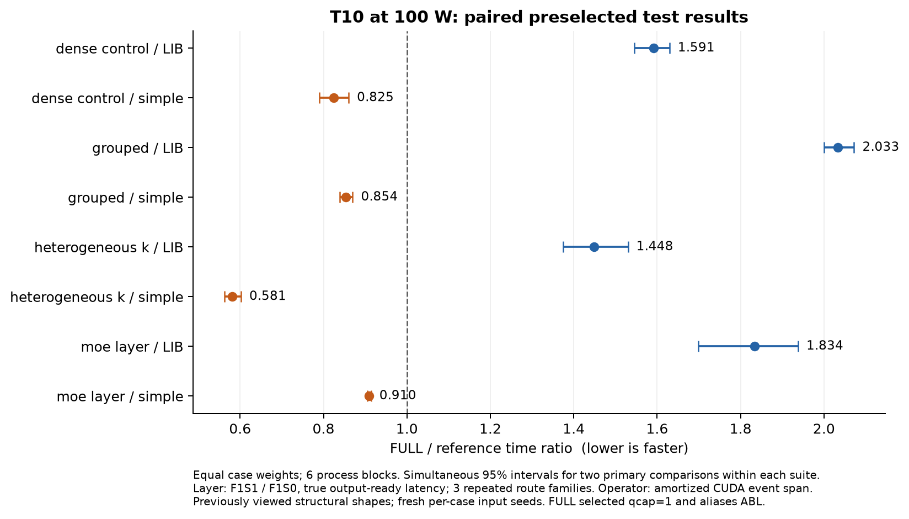
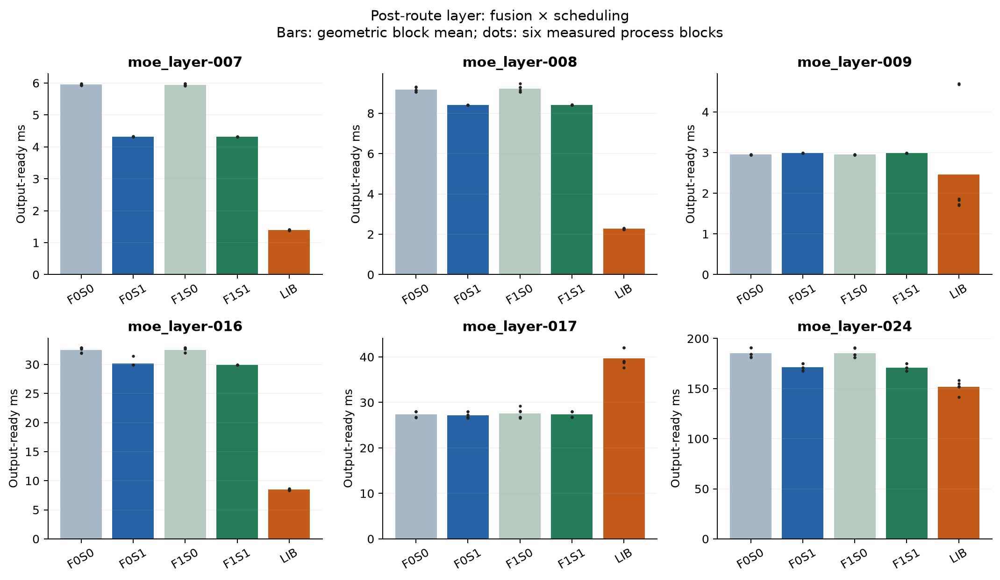

# T10 算子内调度与融合：续实验最终报告

状态：`SAME_CORE_GAIN_ONLY`；主体状态：`MATH_BACKBONE_GAP`。资源阻塞已解除，候选已实现，预登记条件分支已完成。

这次已经真正运行算子内 CORE/BAL/CACHE/FULL/ABL 与四格融合，而非仅测原生库。结果只适用于本机 T10、100 W 上限、当前两种 SM75 数学配方、合成固定描述符/固定 post-route 输入。物理 NUMA、动态路由、完整模型和跨平台泛化没有得到验证。

主 grouped FULL/LIB 时间比为 **2.0335 [2.0006, 2.0721]**，FULL/同体强简单策略为 **0.8536 [0.8392, 0.8699]**。完整 post-route 层 F1S1/LIB 为 **1.8340 [1.6981, 1.9380]**，同融合 F1S1/F1S0 为 **0.9098 [0.9054, 0.9140]**。时间比小于 1 表示更快。

**选择退化：FULL 冻结为 qcap=1，正式测试没有多 tile packet，FULL 与 ABL 是完全相同的配置并去重。开发阶段确实运行了 q>1，但未被全局选中。正式 FULL 的同体正效应予以保留；它不能归因于自适应包长信息，新增包长规则的增量没有被识别。FULL/ABL 的 1.0 与零宽区间来自 alias，不是独立消融的统计证据。**

## 实际完成范围

本轮完成 468 个 case-block、5544 个含锚 phase；其中独立测试/回归比较 288 个 case-block。每组六个独立进程及 payload/weight seed。层的 route 重复三组种子族，不能说有六套独立路由。原结构形状已在旧轮次出现，新输入不构成新结构外推。

开发集 24 个 grouped 形状 × 6 块，比较两种数学体、固定 CACHE q1/2/4、12 个 FULL 配方及两个已装 LIB。按开发数据冻结 recipe=0，CACHE q=4，FULL qcap=1、waves=2，simple=CACHE，LIB=PER_EXPERT_GRAPH。完整层仅在六个开发层选择一次 LIB，最终为 PER_EXPERT_GRAPH；调度参数不再调整。

开发 CORE/LIB 比值为 1.5189。预登记 engineering 阈值为 1.25；因此本次执行 固定 24 grouped + 12 dense + 6 异质 K 控制，以及固定 6 测试层。这不是从测试收益选出来的子集，也不是方法 NO-GO 判据。两种固定数学配方已实际运行，没有为追平库继续改主循环或扩展配方。

## 配对效应

| 范围 | FULL/LIB | FULL/冻结强简单策略 | CORE/LIB |
|---|---:|---:|---:|
| dense_control | 1.5912 [1.5450, 1.6295] | 0.8246 [0.7902, 0.8602] | 1.8214 [1.7703, 1.8752] |
| grouped | 2.0335 [2.0006, 2.0721] | 0.8536 [0.8392, 0.8699] | 2.2651 [2.2450, 2.2931] |
| heterogeneous_k | 1.4481 [1.3742, 1.5301] | 0.5812 [0.5626, 0.6021] | 1.8514 [1.8241, 1.8770] |
| moe_layer | 1.8340 [1.6981, 1.9380] | 0.9098 [0.9054, 0.9140] | 不适用 |

主比较为按 case 等权、先求每 process block 的平均 log ratio，再做 20,000 次固定种子 block bootstrap。两项主比较使用 97.5% 边际区间，Bonferroni 得到各 suite 内同时 95% 区间，控制 suite 也采用这个口径；不宣称所有表格和逐 case 同时覆盖。其余消融及逐 case 区间为探索性 95%。六块样本较少，bootstrap 不能消除时间趋势或同一路由族相关，六轮次序也不保证完全抵消位置和前序影响。

全部逐 case 正例、负例、原始六块绝对毫秒与区间见 `derived/implementation_v1/case_results.json`，没有删除慢 case。

逐 case 探索性 95% 区间中，24 个 grouped 有 1 个快于 LIB（grouped-079）、23 个慢；12 个 dense 控制有 1 个快（dense_control-020）、10 个慢、1 个跨 1；6 个异质 K 控制全部慢。六个层中 moe_layer-017 是局部正例（F1S1/LIB=0.6888），四个层慢于 LIB，moe_layer-009 的区间跨 1。逐 case 区间未做全表多重比较校正；这些正例也不证明 qcap=1 下的新信息增量。

## 四格归因与边界

| 比较 | 时间比及探索性 95% 区间 | 解释 |
|---|---:|---|
| F0S1/F0S0 | 0.9120 [0.9096, 0.9145] | 未加 sideband 时的调度净差 |
| F1S1/F0S1 | 0.9994 [0.9979, 1.0004] | FULL 中 producer sideband 的净差 |
| F1S0/F0S0 | 1.0019 [0.9993, 1.0048] | simple 支付相同 sideband 成本 |
| (F1S1/F1S0)/(F0S1/F0S0) | 0.9975 [0.9932, 1.0009] | 融合与调度的乘性交互 |

新调度在 `src/packet_visitor.h::OpPacketVisitor`；数学体 `OpFusedGemmGrouped::operator()` 与上游逐字节一致。FULL 相比 CACHE 新增总 tile / worker waves 与 K 工作预算限制，BAL 是原 round-robin 及异质 K 的静态排序。同体间全输出逐位相同。q=1 仍可能改遍历顺序，不能把 q=1 的差异解释为多 tile 复用。

F0/F1 使用相同有用 gather pack；F1 在其中额外产出两项总 tile sideband。FULL 的 F1 省去每 CTA 内重复总量规约。没有新增外置调度 kernel，没有热路径 scheduler D2H，没有按 expert CPU 发射，没有算子内部全设备等待。库自己的合法内部节点全部计入。

固定 post-route 层包括 pack、两次 grouped GEMM、SiLU/multiply、unpack、gate multiply 和 reduce；每请求只有输出边界同步。描述符和 route/count 在热计时外准备，不包含 router/count/scan、动态输入 ring、冷权重换层或完整模型。没有可用成熟 attention 内部 adapter，因此本轮 attention 候选为 NA，旧 attention LIB 数据不冒充候选。

内部 scheduler/mainloop/DRAM 成本没有被硬件计数器分离；只支持净时间和同体消融。相邻 tile 的 B 缓存复用是机制意图，未显式跨 tile 保留 fragment，也没有直接测得 L2 命中率变化。不能由本结果推导 SM 间延迟、NUMA 岛或物理亲和。

## 正确性、运行条件与漂移

正式全输出检查摘要 82116 条，全部通过=True，最大 relative Frobenius=0.00028393466。同体 bitwise 失败 0，热身违反 0，测量次数越界 0。原容差为 abs<=.005+.005abs(ref)，relative Frobenius<=.002；资格包含空 expert、尾块、多 packet、65 experts、改输入及全输出 NaN 清除。

有限 CUDA 12.8.93 memcheck 为 0 errors。前两次旧 sanitizer 分别因 injection library 与工具版本启动失败，原日志完整保留，不能算作候选数值或越界失败。最终六个数学 kernel 均含 HMMA 指令；实际二进制、源码哈希和只读执行快照清单可追踪。

遥测共 7761 个约 1 Hz 样本，power limit 集合=[100.0] W，温度范围=[63.0, 77.0] °C，SM 时钟范围=[300.0, 1590.0] MHz。包含初始化/空闲样本，不能把最低频率当作每个正式 phase 的频率。保留原风扇、过温、低转速与 watchdog 保护；100 W 不是锁频。

首尾锚差超过 5% 的 case-block 为 37/468，全部保留。算子 aggregate 50–200 ms 目标外的 phase 为 2328；重复数仍固定在 128–512 边界。CUDA event 测到的是时间跨度，不是硬件 busy time；层为 128 次真实逐请求 ready 测量，不由均值推 p99。

首尾锚敏感性：

| 范围 | 平衡序列内 LIB | 首锚 LIB | 尾锚 LIB | 点估计方向是否变化 |
|---|---:|---:|---:|---|
| dense_control | 1.5912 | 1.5474 | 1.5665 | 否；仍不能排除策略相关频率/顺序影响 |
| grouped | 2.0335 | 2.0344 | 2.0377 | 否；仍不能排除策略相关频率/顺序影响 |
| heterogeneous_k | 1.4481 | 1.4540 | 1.4500 | 否；仍不能排除策略相关频率/顺序影响 |
| moe_layer | 1.8340 | 1.9326 | 1.8094 | 否；仍不能排除策略相关频率/顺序影响 |

层 route-family 敏感性（仅 3 个单位）：F1S1/LIB 1.8340 [1.6535, 1.9351]；F1S1/F1S0 0.9098 [0.9063, 0.9153]。这里只是保守分组敏感性，不增加样本量。

内存余量不合格：算子 0 项，层 0 项。算子峰值包括 FP64/逐位验证存储；层在释放大中间参考后计峰值，但仍持有最终 reference、exact output 和所有共用输入的 Graph，不冒称某一策略独占生产峰值。每 case 原峰值与 margin 状态在 raw。

## 初始化、预算与交付

AOT 编译在 CPU 完成，三次构建日志（含一次 link 参数修复）留存。正式测量不重新编译。weights/data 创建、FP64 reference、静态 descriptor、Graph capture 和 pilot 不进入 steady latency；其合计残差在 `COST_ACCOUNTING.csv`，不能当作部署初始化成本。未分别计时各项启动成本，冷启动/回本次数为未建立，不画虚假交点。

原 16 worker 小时累计使用 **5.4695 小时**，本轮新增 **2.1890 小时**，剩余 **10.5305 小时**。预算包含获锁后准备与运行，旧 62 条记录未清零；CPU 源码实现时间与 worker 时间分开。全部本地运行，未购买算力。

轻量包包含全部本轮原始 case/phase 数据、失败日志、遥测、Graph census、源码、实际二进制、去重的执行快照及复算脚本；不含旧轮全部 raw、重复 vendor checkout、工具链、权重和激活。`PACKAGE_SCOPE.json` 和 SHA 清单说明边界。旧报告和旧包仍保留。

本轮已完成可支持的候选实验；没有保证论文创新性或可发表性。后续首先要解决主体相对库的差距、候选相对固定 CACHE 的真实增量、q 退化域及动态生产路径，而不是把已有库结果或遍历顺序收益改名成物理 NUMA 优化。
