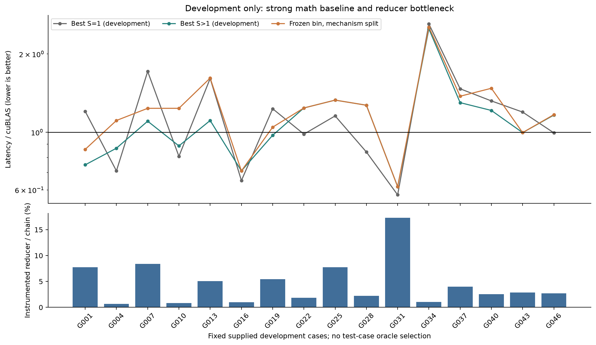
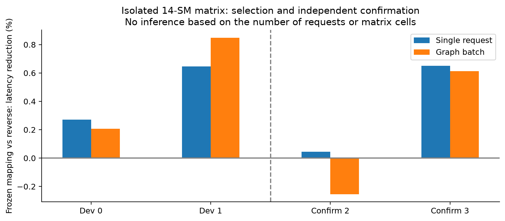
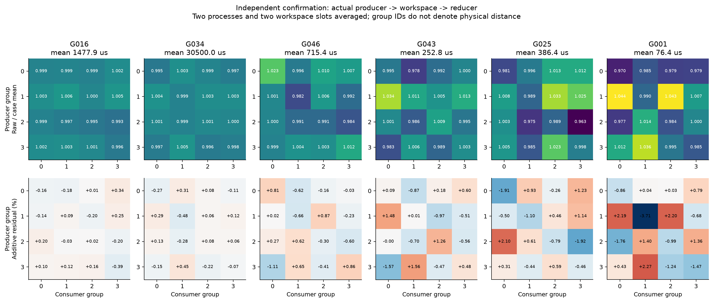
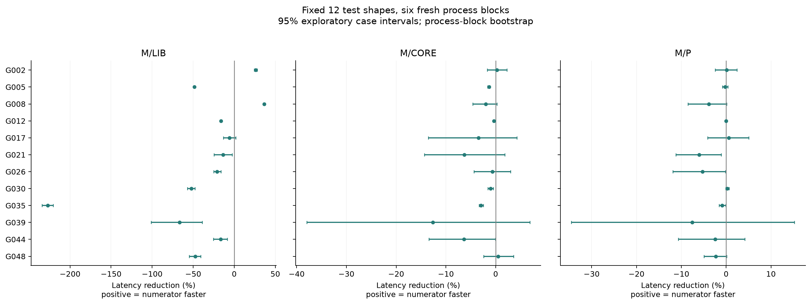
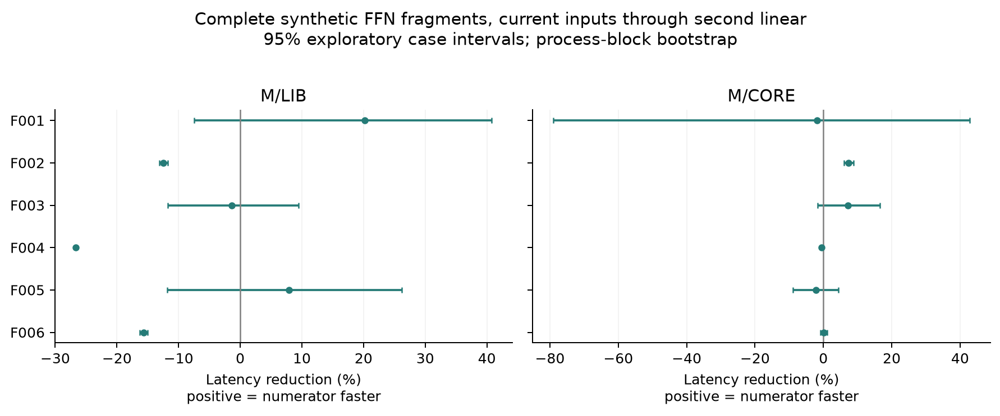
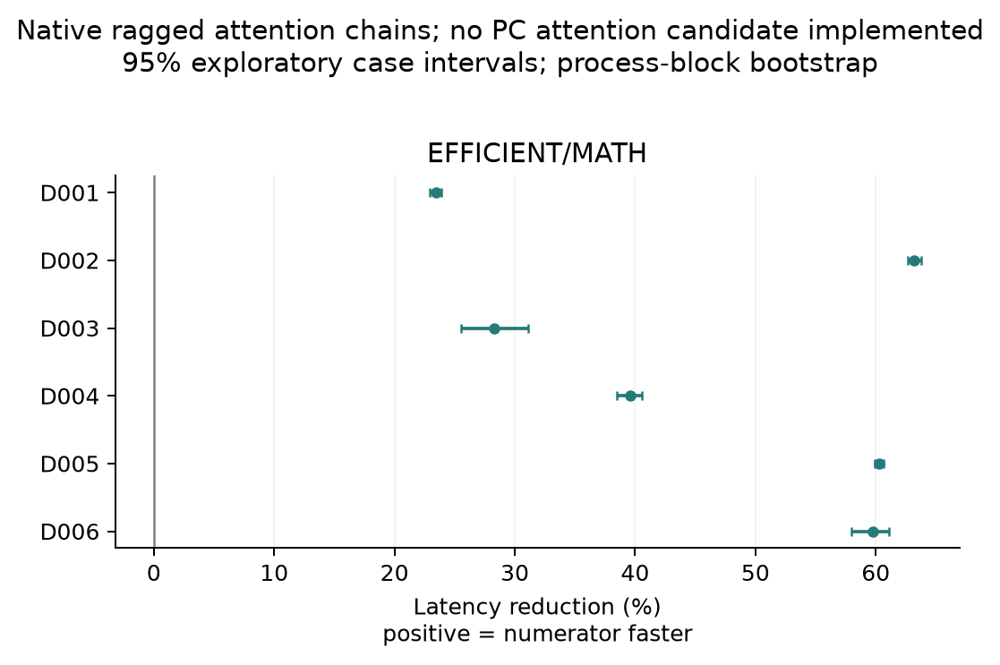
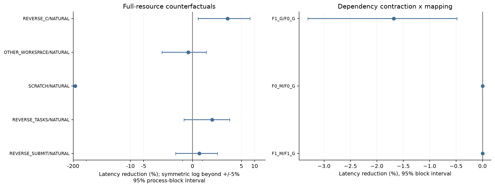
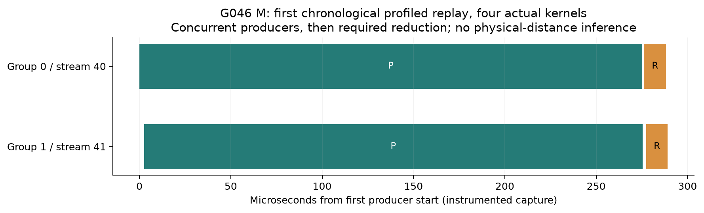

# T10 PC handoff：完整实验报告

本轮：`T10_PC_HANDOFF_LLM_20261016`；本地运行目录 `/home/ubuntu/文档/ChatGPT/numa_gpu/pc-handoff-t10/runs/20261016T112633Z`。原始日志保留，旧 q1/0x33 实验未覆盖。新增付费 0；GPU-worker 实际记账 **2.676 小时 / 24 小时上限**。本文只讨论本轮真实 partial 生产与归并。

## 1. 一页结论

**已完成本机可执行的冻结方案和预定弱结果分支。主算子是实际的 CUTLASS Tensor Core split-K GEMM，生产者每次重新计算 partial，归并器消费本轮结果。Attention 只完成原生库和真实计算链对照；PC split-KV 方法仍为 `ADAPTER_MISSING`，不能称两个算子的方法验证都完成。**

在固定 12 个未用于调参的测试形状、6 个新进程块上，匹配策略 M 相对 cuBLAS 的完整 GPU 请求延迟变化为 **-26.42% [-28.65, -24.45]**；相对相同数学体 CORE 为 **-2.97% [-5.15, -1.06]**；相对反向安排 P 为 **-2.28% [-5.34, +0.66]**。百分比为 `100×(1−T_M/T_reference)`，正数才表示提速。两项预定主比较 M/LIB、M/G 使用 97.5% 边际区间，其余为 95% 探索性区间。

冻结规则选择 **partition 1, pi=0**，即生产者与自己的归并器留在同一资源组。它与简单基线 G 是同一个执行图，因此 **M/G=+0.00% [+0.00, +0.00]（同一实现的精确别名）**。这是结构恒等，不是“测到了恰好零收益”；本轮没有证明学习映射比简单同组规则增加任何信息。我们也没有以默认另一组划分作独立部署比较，不能把组划分选择本身的收益算作已证明。

6 条完整 FFN 片段（第一线性层→SiLU/FP16→第二线性层）中，M/LIB 为 **-3.48% [-12.21, +4.97]**。这些使用真实算子、动态输入和合成权重，属于 `LLM_SHAPED_OPERATOR_CHAIN`，不是完整模型生成，不是端到端 tokens/s。

证据定位：**NO_STABLE_INCREMENTAL_HANDOFF_GAIN / ATTENTION_IMPLEMENTATION_LIMITED**。有无局部配对差异与有无生产净收益是两个问题。物理 NUMA、地址 home、互连距离和 SM 裁剪因果均未建立；任何位置热图都不足以单独证明这些。

## 2. 实现、数学合同和实际执行图

复用本地 CUTLASS commit `f7b19de32c5d1f3cedfc735c2849f12b537522ee`。P 的 Sm75 TensorOp 主循环、FP16 输入/FP32 累加保留；R 保留有序 split 求和。alpha/beta 在归并后只应用一次。矩阵 B 用列主序视图（宿主保存 N×K），各对照输入、数学配方、S 和归并次序相同。源码 patch、源 hash 和 SASS 均附包。冻结的输入计划里`measured=false`/`DESIGN_ONLY`是原设计元数据，执行状态以raw phase、完成标记和最终audit为准，未反写原计划来伪造历史。

正式两组版本按 `tile_id % 2` 分配完整输出 tile，所有 split partial 属于同一 owner。slab 地址按 owner 连续放置，直接由 P 写入最终位置，R 直接读出；没有新查询表、pack/transpose、router kernel、每 tile 启动或自制跨 CTA 自旋。每组最多 P、R 各一个 kernel；Green Context 仅用公开资源 API 创建两个长期组。SM ID 的数值不解释为几何相邻。

生产路径在映射选择前作了有记录的几何修正：stride-2 所有权使所有供给 GEMM shape 的有效工作均分；R 网格只覆盖有效行，去掉边界空 CTA。此修正依据覆盖/字节数，不依据候选速度。隔离 P×C 矩阵仍用冻结旧 cubin、原网格，所有四个进程一致。完整两组桥接和正式测试统一用经过重新资格确认的生产 cubin，故矩阵与部署数据不能当成同一执行体混算。

实际 DAG 示例（从 CUDA Graph 反查，完整参数和边保存于 `derived/dag_examples.json`）：

| 阶段 | 策略 | 实际 kernel 节点 | body 总节点 |
|---|---|---|---|
| E3 | LIB | 1 | 1 |
| E3 | CORE | 2 | 2 |
| E3 | M | 4 | 4 |
| E3 | P | 4 | 4 |
| E3 | LIB | 2 | 2 |
| E3 | LIB | 1 | 2 |
| E5_GEMM_CHAIN | LIB | 3 | 3 |
| E5_GEMM_CHAIN | CORE | 4 | 4 |
| E5_GEMM_CHAIN | M | 6 | 6 |
| E5_GEMM_CHAIN | LIB | 4 | 4 |
| E5_GEMM_CHAIN | CORE | 5 | 5 |
| E5_GEMM_CHAIN | M | 7 | 7 |

原生 split-K 是 P→R 两个数学节点；受控布局是 P0/P1→全局 P 完成→R0/R1，通常四个数学节点，额外两个节点已计入完整 makespan。计时外壳另有起止事件及 child graph。FFN 再接 SiLU 转换和第二线性层，库实际内部 kernel 数以记录为准，不能把一次库调用等同一个 kernel。Attention 的实际 Graph 节点/边通过公开 driver API保存为JSON；早期PyTorch debug_dump虽发出调用提示却未生成DOT，原记录标明缺失，后续显式保留原Graph、初始化exec后再导出元数据。早期原生attention的48项元数据另行重新捕获（46项成功、2项按原内存规则NA）；这不是当时计时图的原始导出，不替换原计时。E5 attention链则在各自phase中直接保存实际图。补充资格检查验证该导出，未改变数学或计时范围；请求时的 Q/KV/长度更新在图外但在单请求计时范围内。

DIAG0 cubin 含真实 HMMA 指令，全部正式数学函数不含 SMID/CLOCK 诊断指令。658 项生产资格检查、alpha/beta、尾块、零值/抵消/极小值、raw-bit 对照和边界 memcheck 已通过。正式 phase 对完整输出和固定 FP64 子块检查，规模允许时用全 FP64；FFN 另检查最终输出。同 S 同数学体的位置/布局对照比较原始 uint32 bits，而不是只用浮点近似相等。Attention 增补批内 ragged、空遮罩行和大 logit 的独立小例 FP64 检查。详细不同容差留在 `derived/correctness.jsonl`，不把大例抽样说成全量 FP64。

## 3. 形状、自然 split 与瓶颈

开发集 16 个形状 × 4 个成熟配方 × S∈{1,2,4,8,16} × 2 个新进程，加 LIB 锚点，共 704 个 phase。最多 6 个 bin；输入包的所有 N>4096 形状都在测试集，因此宽 N 的规则在测试前固定继承同 M 的窄 N 规则，未用测试赢家重选。

以下“最佳 S=1/最佳 split”只是在开发集内描述既有算法可用性，不是测试集 oracle。完整冻结 bin 的性能另列。

| case | M,N,K | 最佳 split S | split / 最佳 S1 | 冻结 split / LIB | R/链（诊断） | bin 是否强制 split |
|---|---|---|---|---|---|---|
| G001 | 1,1024,4096 | 16 | 0.622 | 0.859 | 7.76% | True |
| G004 | 1,4096,16384 | 2 | 1.222 | 1.110 | 0.65% | True |
| G007 | 8,1024,4096 | 8 | 0.644 | 1.236 | 8.39% | True |
| G010 | 8,4096,16384 | 2 | 1.097 | 1.236 | 0.84% | True |
| G013 | 32,1024,4096 | 4 | 0.689 | 1.616 | 5.07% | False |
| G016 | 32,4096,16384 | 2 | 1.090 | 0.710 | 0.97% | False |
| G019 | 128,1024,4096 | 4 | 0.791 | 1.046 | 5.44% | False |
| G022 | 128,4096,16384 | 2 | 1.261 | 1.240 | 1.83% | False |
| G025 | 512,1024,4096 | 2 | 1.150 | 1.329 | 7.76% | True |
| G028 | 512,4096,16384 | 2 | 1.513 | 1.270 | 2.22% | True |
| G031 | 2048,1024,4096 | 2 | 1.075 | 0.618 | 17.28% | True |
| G034 | 2048,4096,16384 | 4 | 0.957 | 2.537 | 1.05% | True |
| G037 | 3,1536,8192 | 2 | 0.884 | 1.376 | 4.01% | True |
| G040 | 17,1536,8192 | 2 | 0.919 | 1.476 | 2.52% | False |
| G043 | 65,1536,8192 | 2 | 0.834 | 0.997 | 2.88% | False |
| G046 | 257,1536,8192 | 2 | 1.171 | 1.169 | 2.69% | True |

M≤8 与 M>128 的 bin 生产选择为 S1，本轮为检验 handoff 在这些 bin 采用开发中最快的 S>1，明确属于强制 split 机制例。8<M≤128 的 bin 选择 S2。不能因为 forced-split 对照存在就假称成熟库本来需要该分解；也不能用受控版本未胜库断言所有高效分解都无价值。低配额隔离矩阵与全资源链的并发、占用率及功耗状态也不同，所以必须用桥接实测，不能直接迁移微测百分比。

代表点由普通链中 R span/chain 比例排序，低/中/高三段各取两个中位点，不看位置收益：G016=0.97%, G034=1.05%, G046=2.69%, G043=2.88%, G025=7.76%, G001=7.76%。至少 12 个开发点分别测 P-only、真实 P→R、R-only 复用，共 36 个 scope。R-only 改变了缓存状态，不能把独立 P+R 减完整链解释为纯互连延迟。P 包括数学、加载和 partial 写出，未独立测出纯写出成本。

## 4. P×C×W：选择、独立确认和全资源桥接

6 个代表 ×4P×4C×2 个 workspace 地址×4 随机轮次×4 个独立进程 = **3072 个完整链 episode**。前两个进程只用于在三种均分和两种方向中选一个固定规则；后两个进程独立确认，不重新命名赢家。每次 P 真实重算 partial，C 读当次 partial；位置诊断在单独 DIAG1 资格 replay 中确认实际 SM 集、owner 和 generation。两块 W 都在同次分配中，地址干预不等于已知物理内存域干预。

固定映射相对反向的等形状加权结果（隔离矩阵，每次只用一个 14-SM 生产组和一个 14-SM 消费组）：

| 进程 | 用途 | 单请求 gain | 批量 gain |
|---|---|---|---|
| 0 | 开发 | +0.271% | +0.207% |
| 1 | 开发 | +0.647% | +0.849% |
| 2 | 独立确认 | +0.044% | -0.254% |
| 3 | 独立确认 | +0.651% | +0.613% |

同时保存原始 4×4 格、log 双中心残差、以微秒计算的加性双中心残差。固定分区的 match/reverse 平衡对比具有相同的 P/C 边际，因此加性均值差消去“某 P 组或 C 组整体更快”的主效应。log(total) 即使由加性阶段成本构成也可能产生交互，故不单凭 log 热图作因果结论。只有 2 个确认进程，轮次和 16 个格不膨胀成独立样本量。逐 case、W、进程差异见 `pc_contrasts.jsonl`。

逐代表保留两个独立确认进程及两个W地址的符号，避免总体平均掩盖翻转：

| case | 确认2 gain | 确认3 gain | 确认2 W0/W1 | 确认3 W0/W1 |
|---|---|---|---|---|
| G001 | +2.299% | +1.217% | +1.685%/+2.910% | +1.115%/+1.320% |
| G016 | -0.189% | +0.120% | -0.243%/-0.135% | +0.111%/+0.128% |
| G025 | -0.704% | +1.604% | -0.212%/-1.198% | +0.816%/+2.386% |
| G034 | -0.150% | +0.133% | -0.099%/-0.202% | +0.083%/+0.184% |
| G043 | -1.182% | -0.401% | +0.732%/-3.133% | +0.212%/-1.018% |
| G046 | -1.646% | +0.987% | -1.001%/-2.296% | +1.366%/+0.607% |

全设备两分支桥接单独使用统一生产实现、两组各 28SM，4 个新进程：

| 比较 | 完整 GPU 请求 gain（95%） | 批量 gain（95%） |
|---|---|---|
| M/LIB | -4.83% [-14.29, +3.84] | -13.89% [-20.17, -10.38] |
| M/G | +0.00% [+0.00, +0.00]（同一实现的精确别名） | +0.00% [+0.00, +0.00]（同一实现的精确别名） |
| M/P | -0.93% [-2.38, +0.49] | +0.38% [-0.28, +1.08] |

桥接不把两格隔离延迟相加代替实际 makespan；真实执行包括两组生产、全局依赖、两组归并和收尾。是否真的重叠仅由 E6 的代表性 CUPTI trace 回答，不能由“两个 stream”推断。

## 5. 固定测试集与强基线

alias合并后的三个真实执行候选采用六种排列，在6块中使每种策略各占每个顺序位置两次；这一修正在任何E3测试之前保存，未改变方法参数。按预先冻结的弱结果分支执行固定 12 个测试 shape ×6 进程块：CORE、M、反向 P、简单 G，加首尾 LIB。M/G 完全相同只计时一次，别名明确保留，不人为制造两个噪声样本。主参考用同 case 同 block 的首尾 LIB 几何均值。32 shape×8块全分支没有启动，理由是冻结规则没有超过简单 G；不是看完测试后删掉不利点。

| 比较 | 单请求 GPU gain | 批量 gain | CPU-ready gain |
|---|---|---|---|
| M/LIB | -26.42% [-28.65, -24.45] | -39.01% [-43.55, -35.24] | -26.45% [-28.66, -24.40] |
| M/G | +0.00% [+0.00, +0.00]（同一实现的精确别名） | +0.00% [+0.00, +0.00]（同一实现的精确别名） | +0.00% [+0.00, +0.00]（同一实现的精确别名） |
| M/CORE | -2.97% [-5.15, -1.06] | -0.23% [-1.48, +1.46] | -2.85% [-5.06, -0.91] |
| M/P | -2.28% [-5.34, +0.66] | -0.99% [-1.48, -0.26] | -1.69% [-5.00, +1.46] |
| CORE/LIB | -22.78% [-24.47, -21.09] | -38.69% [-41.65, -35.79] | -22.94% [-24.81, -21.10] |

统计先取每个 phase 的请求均值，再形成同 case/block 的 log 比值，块内 case 等权，最后按整个进程块 bootstrap（50,000 次，固定种子 20261016）。64 个 replay 不是 64 块独立硬件样本；同一台 T10、同一实验时段也不是跨设备泛化。逐 case 区间是探索性的，没有作多 case 发现率校正；所有负例和异常锚点都保留。

## 6. 动态 LLM 形状计算链与 attention 缺口

六条 FFN 片段使用 M∈{1,16,128}，两组 hidden/FFN 为 1024/3584 与 4096/11008。第一组尺寸取自本地 Qwen35 GGUF 元数据，权重仍为可复现合成 FP16；尺寸来源不代表完整复现该模型的SwiGLU或整层结构；GGUF 量化权重没有假称转换成真实半精度模型。每个正式 phase 64 个请求轮换 4 份当前输入，计时从已有设备输入开始，到第二线性层完成，所有策略同合同。不是从未来 token 确定计划。

| 比较 | FFN 完整请求 gain（95%） | 批量 gain（95%） |
|---|---|---|
| M/LIB | -3.48% [-12.21, +4.97] | -8.62% [-13.97, -3.82] |
| M/CORE | +1.77% [-9.57, +12.25] | -0.98% [-11.24, +8.06] |
| M/G | +0.00% [+0.00, +0.00]（同一实现的精确别名） | +0.00% [+0.00, +0.00]（同一实现的精确别名） |

本地没有 FlashInfer/Flash-Decoding/vLLM 可修改 split-KV P→W→merge 路径，已有 PyTorch efficient attention 与 math reference 不等于可改 split-KV。按许可缺口分支完成开发和固定测试 native 对照，以及 6 条 attention block×6 进程块；candidate CORE/G/M 留 NA，不把大量原生 phase 算作方法验证。GQA efficient 路径需要 repeat_interleave，放在计时图内，不能隐去其物化开销。

六条 attention 链包含当前 Q 复制、各序列 KV 追加、长度更新/遮罩、attention、输出投影和非零 residual。长度按 `choices[(request+batch_index)%3]` 从 {L/4,L/2,L} 选择，B>1 时同一请求内为 ragged；每个 phase 重置初始 KV，确保所有库对照消费同样的修改序列。该长度循环表示不同长度的合成请求，并非同一真实序列逐token单调增长的轨迹。每次请求只使用当前长度；图重放批量指标不含逐请求输入更新，明确不是 ITL。

| native 现有库比较 | 完整请求 EFFICIENT/MATH gain（95%） | 解释 |
|---|---|---|
| E4_NATIVE_TEST | +74.45% [+73.32, +75.16] | 只比较现有 backend；不是 PC 方法收益 |
| E5_ATTENTION_CHAIN | +48.11% [+47.78, +48.54] | 只比较现有 backend；不是 PC 方法收益 |

超过事先声明内存余量估计的 native MATH shape 记录 `NA_MEMORY_HEADROOM`，没有为吞吐结果换精度/删减输入；全部 NA 在 phase summaries 中。配对分析只能使用两者均有结果的 case，覆盖范围明列，不把缺项记零。

## 7. 消融、workspace、初始化和功耗

本轮按任务书 docs/03 第7节允许的二选一，完成了 F0/F1 的**依赖收缩**四格：F0 等所有生产者完成后才启动任一归并，F1 每组只依赖自己的生产者。没有把 SiLU 融入 R，也没有减少数学 kernel 数；因此不能宣称完成了所有 epilogue 融合路径的否证。G/M 在每个等级相同，四格按 exact alias 处理。布局四格比较 planar/slab × neutral/learned；固定映射等于 neutral，同样不能凭布局改善宣称位置学习增益。

| 消融 | 完整请求 gain（95%） |
|---|---|
| F1_G/F0_G | -1.68% [-3.31, -0.48] |
| F0_M/F0_G | +0.00% [+0.00, +0.00]（同一实现的精确别名） |
| F1_M/F1_G | +0.00% [+0.00, +0.00]（同一实现的精确别名） |
| LAYOUT1_NEUTRAL/LAYOUT0_NEUTRAL | -0.52% [-2.09, +1.35] |
| LAYOUT1_LEARNED/LAYOUT1_NEUTRAL | +0.00% [+0.00, +0.00]（同一实现的精确别名） |

在三种归并比例各一个代表上，测 S2/S8 × M/P ×4 进程；这是 split 数与 workspace 大小的联合干预，不是只改变缓存容量的独立实验。只有同 S 下的 M/P 对照隔离消费者安排。生产 slab 含边界 padding，逻辑有效 partial 字节与物理分配字节分别保存，不能将理论读写字节说成实测 DRAM 流量。

| 同 S 位置控制 | 完整请求 gain（95%） |
|---|---|
| M/P_S2 | +2.23% [+1.02, +3.43] |
| M/P_S8 | +0.54% [-4.18, +3.38] |

这里也有一个应如实保留的局部正结果：三个代表、S2 的 M/P 为 +2.23% [+1.02, +3.43]；但 S8 不确定，E3 固定测试 M/P 也没有稳定优势。反过来，早期桥接反事实轮次中 REVERSE_C/NATURAL 为 +3.58% [+0.56, +7.80]，方向与 S2 控制相反。这些使用不同 split/轮次/形状集合，不能混成同一个估计量，也没有随机隔离出时钟、缓存或并发中的唯一原因。它说明安排效应依赖条件，不能用一个正结果覆盖全部部署负例。依赖收缩 F1 本轮慢约 1.68%，slab 相对 planar 的区间跨零；没有得到稳定的普通融合/布局净收益。

缓存/顺序控制均保留原数学：改变 C、换 W、插入 128MiB scratch 读取、反向 P 任务遍历、反向提交顺序。scratch 是可测的额外工作，不保证彻底 flush；扣掉测得 scratch span 只是诊断，额外等待和缓存变化仍无法消除，不能充当真实无成本速度。

| 条件 / NATURAL | 完整请求 gain（95%） |
|---|---|
| REVERSE_C/NATURAL | +3.58% [+0.56, +7.80] |
| OTHER_WORKSPACE/NATURAL | -0.44% [-3.13, +1.41] |
| SCRATCH/NATURAL | -178.96% [-188.29, -172.12] |
| REVERSE_TASKS/NATURAL | +2.01% [-0.88, +3.81] |
| REVERSE_SUBMIT/NATURAL | +0.69% [-1.74, +2.56] |

初始化在 3 个新进程中轮转策略顺序，对 4 个代表建立全新资源/分配/图。原生模式不创建 Green，部署模式仅 2 个；CUDA 进程公共初始化、输入生成、资源与 Graph 成本分别列出。部分 workspace 使用最低实际所需大小，不把研究夹具的两块 W/诊断 scratch 算成部署必需。

| case | extra setup 中位数 ms | steady batch 节省中位数 us | 有限回本点估计次数 /3 |
|---|---|---|---|
| G001 | -1.891 | -15.039 | 0 |
| G016 | 164.834 | +426.265 | 3 |
| G034 | 8.882 | -26013.762 | 0 |
| G046 | 8.143 | -83.501 | 0 |

初始化结果也有明显次序/首次使用噪声：G016 的 extra setup 在三个进程中约为 −222、+165、+173ms，对应回本点 1、387、381 次。负差额表示本次测量中库的初始化更贵，不表示资源创建有负成本；三个点不足以建立稳健冷启动保证。G034/G046/G001 的三个进程均无正稳态节省。无正的稳态节省时回本请求数为 NA，不能靠多跑把亏损摊薄。有正值的单点回本估计只适用于已初始化 CUDA 的计算 scope，未计一次性映射研究成本，不承诺生产 SLA；M/G 恒等时无需伪造回本。

100W 为 requested/enforced 上限，不是恒定耗电或恒定 SM 频率。保留风扇与过温保护；E1–E5 正式性能扫描/测试进程先做至少60s有用计算 conditioning；正式 phase 至少32次且100ms warmup，E2矩阵按独立cell合同固定32次且不要求100ms。初始化、资格和profiler进程不属于上述60s稳态扫描合同。1Hz telemetry 的主条件峰值温度为 78°C。桌面进程仍在，主机不是独占GPU；时钟没有锁定。不能拿1Hz采样给每个微秒 kernel 做频率校正。`phase_state_windows.jsonl`仅对齐包含准备/检查/warmup的粗phase时间窗，有时没有样本，按NA处理。首尾 LIB 的 GPU 均值变化超过5%的 case-block共有 47 个，均保留并在 `anchor_drift.jsonl` 标记。125W 因本轮已有非交互管理入口不可用记 `NA_PRIVILEGED_ENTRY_UNAVAILABLE`，没有要求/尝试密码或移除保护。

## 8. profiler、因果解释和论文价值

使用本机已有 PyTorch Kineto/CUPTI 活动记录，最多 8 次：三组代表 M/P 共6、一个LIB、一个含输入更新的 ragged attention 完整链。没有安装工具，没有网络。记录结果：

| capture | 状态 | 真实 kernel events | P重叠样本 |
|---|---|---|---|
| G016_M | CAPTURED | 32 | 8 |
| G016_P | CAPTURED | 32 | 8 |
| G046_M | CAPTURED | 32 | 8 |
| G046_P | CAPTURED | 32 | 8 |
| G046_LIB | CAPTURED | 8 | 0 |
| G001_M | CAPTURED | 32 | 8 |
| G001_P | CAPTURED | 32 | 8 |
| ATTENTION_NATIVE_EFFICIENT_CHAIN | CAPTURED | 136 | 0 |

八次 capture 均得到实际 kernel events；六个 M/P capture 各有 8 个生产者重叠样本，所有样本的重叠覆盖较短生产者时长至少 93%。所以两组生产者确实同时执行，不能把部署负结果全部归咎于未发生并行。插桩时 M/P 的瞬时时长不可替代随机配对的正式结果。CUPTI 的重叠只证明这些插桩代表运行中的实际并发，不代表每个未插桩正式请求都完全一样。没有可用硬件 DRAM/L2/互连计数，故“某安排减少远程流量”“物理本地/远端”“SM裁剪导致绕远”均为未知。绝不能用 workload bytes 或时间差代替实际流量计数。

直白地说，测到局部交付差异，只证明特定资源安排会影响这段计算；它没有保证差异足以支付整个生产算子成本。本轮还存在三层约束：成熟 cuBLAS 与当前 CUTLASS 配方的数学效率差距；两分支四节点及依赖成本；六个按规则选出的代表中归并占比约1%～8%（全部开发例还有更高的点，见完整瓶颈表）。最关键的新事实是学习规则退化成简单同组规则，论文不能靠重新命名同一执行图获得增量。

下一步最有信息价值的工作，应先获得一条已接近生产库性能且可改的 split-KV/现成 continuation 路径，在同等融合等级下检验 frozen mapping 是否增加信息；然后才考虑跨运行、跨设备与地址/服务域的独立干预。本轮证据适合形成可复现的机制边界与阴性结果，尚不能支撑“通用 GPU NUMA 调度显著加速 LLM”主张。无需继续围绕同一热图扩大参数搜索。

## 9. 失败、缺项、预算与恢复

构建与资格失败保留：早期链接方式/CUDA header 不匹配；捕获事件未使用 external timing；cuBLAS capture 分配不适合 child graph，改用初始化时预分配64MiB workspace；边界R空CTA与owner均分修正；两次 host注释错误；最初 sanitizer 指向目录未启动GPU。数值错误数据没有进入正式速度比较。开发 block0 的固定256重放对大 GEMM 偏长，block1按LIB目标时长调整；原始数据与每phase重放数均保留。另有一次终端启动器收到SIGTERM，bridge1子进程自行继续完成；恢复程序根据完整54项phase和明确完成标记接管记账，退出码不可得，约末段的telemetry存在记录空隙。该块保留，未重跑挑优；恢复观测等待计入保守worker账本。此后队列脱离终端会话，子进程继承GPU锁，包装器收到SIGTERM会结算并停止子进程。所有更改见 `ENGINEERING_NOTES.jsonl` 与 build日志。

| 阶段 | worker小时 | 上限小时 |
|---|---|---|
| E0 | 0.017 | 1 |
| E1 | 0.494 | 4 |
| E2 | 1.123 | 4 |
| E3 | 0.270 | 6 |
| E4 | 0.232 | 4 |
| E5 | 0.538 | 3 |
| E6 | 0.001 | 1 |

最终恢复核对：**PASS_UNCHANGED_100W_PROTECTION_ACTIVE**。本轮未更改功耗/保护文件，四项原配置 SHA256 逐一核对；风扇和功耗服务状态、100W readback 及结束进程状态见 `reports/FINAL_POWER_READBACK.json`。CPU 编译、分析、作图不伪称GPU-worker时间。

未完成/不适用项逐一列明：可修改 split-KV attention adapter；硬件访存计数；125W 次条件；已资格 SM75 Stream-K 可运行强基线；未选用的 reducer epilogue/activation 融合替代路线（本轮F1已按允许分支完成依赖收缩）；完整模型与真实生成轨迹。Stream-K generic header 本地存在，但所附示例为 Sm80 四阶段，不能把文件存在说成已经资格的 T10 实现，也不能说 SM75 Stream-K 不可能。以上限制使本轮不能否证这些未实现路线。

## 10. CONTRIBUTION_CARD

| 已有工作/能力 | 本轮新增与验证范围 | 尚未满足 |
|---|---|---|
| CUTLASS parallel split-K | 复用成熟Tensor Core数学；真实partials的PC×W受控矩阵 | split/reducer本身不是贡献；当前math配方不保证生产最优 |
| Stream-K | 同等S/数学顺序的短规则、两组资源与layout对照 | 未移植第三执行器；不能宣称胜过已优化continuation |
| Flash-Decoding / FlashInfer | 原生attention与6条动态ragged链，保留adapter缺口 | 没有可改split-KV方法证据 |
| Die scaling / topology已有论文 | T10上公开资源控制、冻结规则、独立确认、全资源桥接 | 无物理地址域证据，无SM裁剪独立干预 |
| 本轮候选M vs简单G | 诚实保存精确别名与全部负例 | 没有额外mapping信息增益；不足以主张新调度算法胜出 |

文献范围：实验离线，以下是任务包提供的第一手来源线索；本轮核对了本地 CUTLASS 源码，未重新联网审阅所有论文全文，不作正式新颖性保证。[CUTLASS efficient GEMM](https://docs.nvidia.com/cutlass/latest/media/docs/cpp/efficient_gemm.html)、[Stream-K](https://arxiv.org/abs/2301.03598)、[Flash-Decoding](https://pytorch.org/blog/flash-decoding/)、[FlashInfer](https://github.com/flashinfer-ai/flashinfer)、[Dissecting How Die Scaling Breaks GPU Fine-grained Scheduling](https://arxiv.org/html/2609.24270v1)。

## 11. 交付与复算

`derived/phases.jsonl` 包含所有 phase summaries 与 NA；`paired_values.jsonl` 保存每个 case/block 的原始分子、分母和 log 比值；`comparisons.json`/`case_comparisons.json` 保存区间；PC raw格/残差/独立确认另存。代码、patch、冻结配置、实际DAG、SASS、代表samples、真实GPU输出快照及失败记录随小包交付。完整 raw 仍在文首路径，不重复打包本地模型和CUDA/CUTLASS依赖。

解压后 CPU 复算：`python3 src/recompute.py data/run`（需已有 NumPy）。它从所有 phase summaries 重建配对/区间，逐字节比较结果，并对保存的实际 GPU 输出快照独立重做 FP64 数学检查。快照来自早期 `qualify_host_attention` 资格例（65×196×512），早于生产 R 网格/所有权几何修正，保留旧 cubin 及对应源版本；它不是最终生产版本的新 GPU 重跑或独立重执行。最终生产版本的正确性另由重新资格、边界 memcheck 和正式 phase 数值记录支持。该验证是可复算性检查，不冒充重新跑GPU。GPU执行入口、精确环境和源依赖在 `README_REPRODUCE.md`；同一硬件新跑应创建新run，不能覆盖这些raw。
