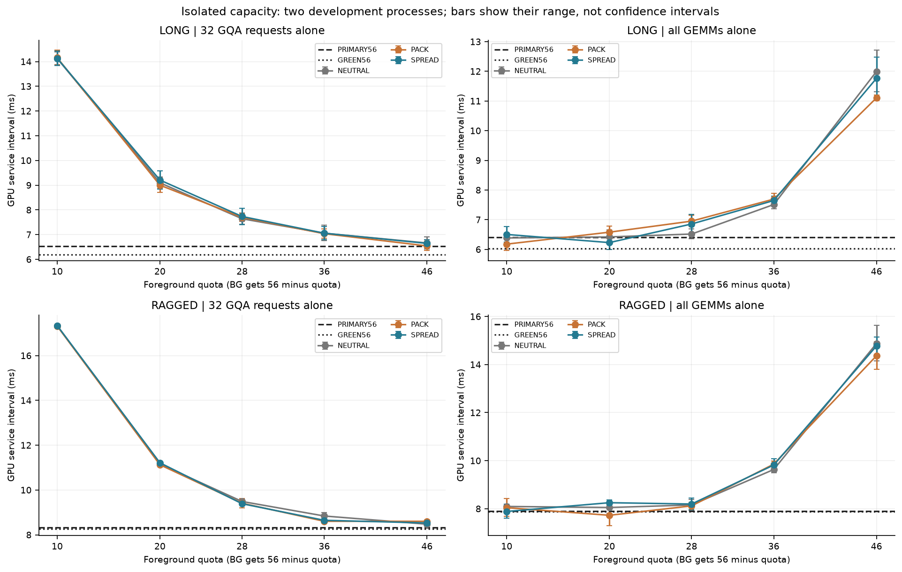
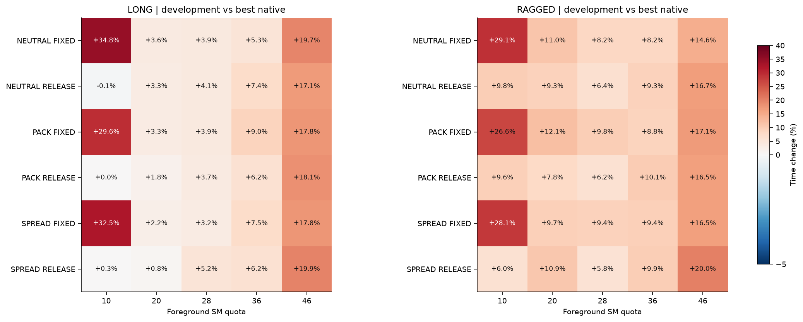
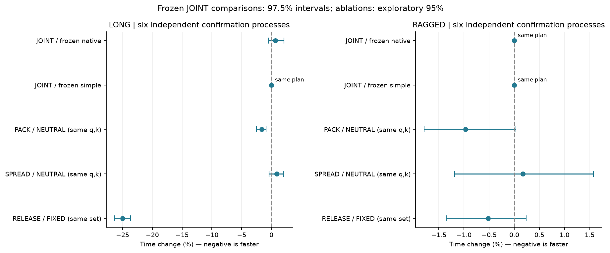
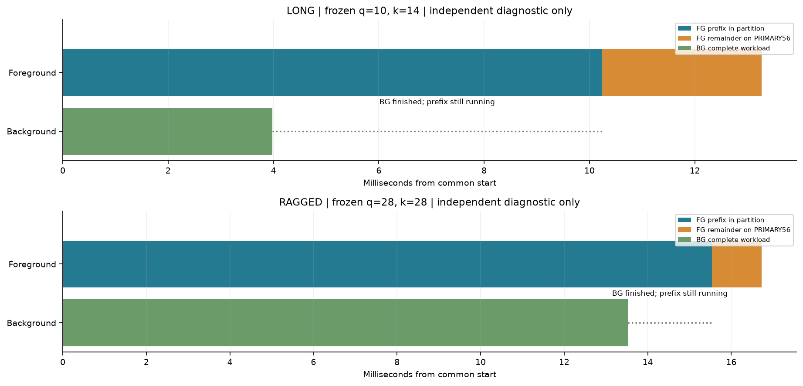

# T10 资源份额、尾部释放与拓扑增量：收束报告

运行 `20261019T064852Z`。本机一张T10；采用20261019附件的限定方案。**既定测量与审计已完成；没有证明冻结的拓扑动作池胜过强原生／简单方案，因此按本轮规则暂停这一T10、这对负载、静态共置切入点的自动论文扩展。**

## 直接结论

1. **尾部释放有工程作用，但“胜过差一些的并发”不等于“胜过最强简单执行”。** LONG冻结的普通NEUTRAL 10/46、k=14 RELEASE，相对相同集合的FIXED耗时下降24.972%，相对SHARED56下降10.188%；相对开发期冻结的最佳串行，却增加0.633%，97.5%区间为[−0.504%, +2.105%]，未分辨出净优势。
2. **更大的拓扑候选池没有得到不同的最终主方案。** LONG的JOINT_POOL与Q_ONLY完全相同；RAGGED的Q_ONLY、SIMPLE_SPREAD、JOINT_POOL全部选择SERIAL_GEMM_FIRST。这些是执行计划alias，不是两次独立测试恰好相等。
3. **局部正结果保留。** LONG在固定q=10、RELEASE、k=14后，PACK比NEUTRAL快1.601%，95%探索性区间[−2.529%, −0.902%]，6/6块方向一致。但PACK对冻结最佳串行仅−0.979%，区间[−2.558%, +0.414%]；再加上明显状态波动、有限成员轮换，它还不足以成为已确认的部署净加速。不能在确认集上改选PACK，再回写冻结主张。
4. 背景翻倍后，LONG冻结方案相对冻结最佳串行为−0.871%，95%区间[−2.721%, +0.561%]，仍未分辨；RAGGED仍是串行alias。没有按这个结果重算k或改背景量。

这不是证明所有GPU、配额或调度器都没有价值。它限定了这张卡、这两个算子工作量、五个预定份额、这条静态切点公式和三种布局规则的证据边界。保留现有N19/E56快核与全部有效正负结果，不自动扩展q、shape、mask、时钟或选择器。

## 口径与完成范围

指标为`T_candidate/T_reference`，表中时间变化`100×(r−1)`：**负数快、正数慢**。每phase平均16个完整job，再按进程块配对。5000次整块bootstrap；每个主job的JOINT_POOL对冻结BEST_NATIVE／BEST_SIMPLE使用97.5%边际区间，其余95%探索性。没有对历史全部探索做统一多重校正，也不把16重放、32请求、SM或同一计划的标签当独立硬件样本。

| 阶段 | 方案标签数 | 实际独立计时phase | 说明 |
|---|---|---|---|
| S1 | 136 | 136 | 2开发块；两个任务分别单跑 |
| S2 | 132 | 132 | 2开发块；33动作×2job |
| S3 | 120 | 84 | 6确认块；72主比较标签+36位置消融+12模式消融 |
| 比例留出 | 48 | 28 | 4新块，背景调用翻倍，规则不变 |

436个预定标签全部有数据／明确alias，对应380个实际主phase；另有128个短锚点/A-A，共508个有效phase、6592条原始计时。各主phase为两个8-job扫次，第一轮按冻结种子打乱，第二轮逆序；每段同节奏暖身至少2个job且50ms。四槽按全局请求编号连续轮换。所有计划与数值参考先构建，正式段后只对照缓存的参考输出，不在方法之间重建FP64参考。

初始S1块0在汇总写出前发生重复`task`字段异常，尚未产生可用phase文件，内存中的计时未能恢复；错误日志和11.294秒预算仍保留。修复元数据汇总后，以相同预定块重跑，之后才计算k和选择。不能把这次失败称为“原始计时全部保存”。有效正式样本没有按快慢删除。

## 硬件、资源与同体约束

新RM读取及最终复读一致：物理GPC0/1/2/3/4/5为10/12/12/10/0/12SM。可选私有GET仍有权限缺项，未用于猜测屏蔽原因；没有SET、驱动修改、设备重置或保护修改。公开2SM资源合并与实际SM探测核对了12块×15集合的前景／互补背景，共360份资源名单；primary实际资源属性为56SM。完整TPC均保留，无遗漏、重叠或占位CTA。

新轮次直接复用上一轮E56两份二进制及数学源码，哈希一致；原N19保留，S0进行了有限原生回归和数值对照。GQA保持16B加载、W、CTA/block/shared、原DIRECT/BLIND、页表、归并、合法末位更新与复位；LONG为BLIND/W32，RAGGED为DIRECT/W16，二者均为原非融合两核路径。新变化在宿主构造的资源集合和完整请求之间的device依赖，不新增调度kernel、GPU路由表或中间CPU等待。

每job仍为32个变化Q/newKV的固定长度append+Attention；背景1024×2048×4096 FP16输入、FP32计算/输出，alpha=1、beta=0，64MiB workspace。LONG为7次GEMM，RAGGED为9次；留出改为14/18次。FG与BG所有可写/输入区间核对不重叠。不是逐token增长、动态KV生命周期或整模型SLA。

捕获的所有正式GEMM图中均为 `turing_s1688gemm_fp16_256x128_ldg8_stages_32x1_nn`，grid=8×8×2、block=256、shared=16384字节；math mode和调用参数一致。GemmEx接口没有提供可用内部算法ID，记NA。同名同几何不能保证一切执行行为相同，不能由此唯一归因GPC共享总线。

各suite预先创建要用的计划，未选的Green对象空闲存活。因此开发池与更小确认池的上下文环境也不同；这是明确的作用域限制，不把孤立曲线机械预测为真实并发。

## S1：孤立容量与46SM异常

下表单位ms，列出两个开发块的完整工作GPU区间；56端点各自全资源单跑。对于Qq，前景使用q SM，背景使用56−q SM。没有dummy负载，没有用串行第二任务的“从job起点完成时间”当纯服务时间。

### LONG

| 资源条件 | 32次FG：块0/1 ms | 全部BG：块0/1 ms | 冻结k |
|---|---|---|---|
| PRIMARY56 | 6.3177 / 6.7314 | 6.1224 / 6.6879 | NA |
| GREEN56 | 5.8846 / 6.5126 | 6.1004 / 5.9415 | NA |
| NEUTRAL_Q10 | 13.8690 / 14.3834 | 6.2185 / 6.5549 | 14 |
| PACK_Q10 | 13.8582 / 14.4591 | 5.9570 / 6.4033 | 14 |
| SPREAD_Q10 | 13.8365 / 14.4263 | 6.2533 / 6.7622 | 15 |
| NEUTRAL_Q20 | 8.8623 / 9.3341 | 6.1940 / 6.6522 | 23 |
| PACK_Q20 | 8.7134 / 9.2932 | 6.3758 / 6.7882 | 23 |
| SPREAD_Q20 | 8.8440 / 9.5835 | 6.4658 / 5.9981 | 22 |
| NEUTRAL_Q28 | 7.4113 / 7.8743 | 6.3536 / 6.6824 | 27 |
| PACK_Q28 | 7.5391 / 7.8582 | 6.7614 / 7.1463 | 29 |
| SPREAD_Q28 | 7.4099 / 8.0689 | 6.5462 / 7.1782 | 28 |
| NEUTRAL_Q36 | 6.7483 / 7.3796 | 7.3616 / 7.6622 | 31 |
| PACK_Q36 | 6.8469 / 7.2292 | 7.5040 / 7.8869 | 31 |
| SPREAD_Q36 | 6.7964 / 7.3255 | 7.4989 / 7.7947 | 31 |
| NEUTRAL_Q46 | 6.4246 / 6.9017 | 12.7112 / 11.3174 | 31 |
| PACK_Q46 | 6.3513 / 6.7385 | 11.0145 / 11.1955 | 31 |
| SPREAD_Q46 | 6.4939 / 6.7983 | 11.0833 / 12.4852 | 31 |

### RAGGED

| 资源条件 | 32次FG：块0/1 ms | 全部BG：块0/1 ms | 冻结k |
|---|---|---|---|
| PRIMARY56 | 8.3206 / 8.3192 | 8.0270 / 7.7682 | NA |
| GREEN56 | 8.2048 / 8.3340 | 8.0010 / 7.7499 | NA |
| NEUTRAL_Q10 | 17.2993 / 17.3619 | 8.1735 / 8.0149 | 15 |
| PACK_Q10 | 17.2850 / 17.3467 | 8.4294 / 7.6759 | 15 |
| SPREAD_Q10 | 17.3332 / 17.3442 | 8.1826 / 7.5999 | 15 |
| NEUTRAL_Q20 | 11.0709 / 11.2422 | 8.3034 / 7.8051 | 23 |
| PACK_Q20 | 11.0661 / 11.1861 | 7.3014 / 8.1764 | 22 |
| SPREAD_Q20 | 11.1688 / 11.2582 | 8.3657 / 8.1370 | 24 |
| NEUTRAL_Q28 | 9.3994 / 9.5761 | 8.3933 / 7.9260 | 28 |
| PACK_Q28 | 9.2035 / 9.6199 | 8.2725 / 7.9658 | 28 |
| SPREAD_Q28 | 9.3962 / 9.3761 | 8.4349 / 7.9619 | 28 |
| NEUTRAL_Q36 | 8.9969 / 8.6832 | 9.7688 / 9.4981 | 31 |
| PACK_Q36 | 8.5730 / 8.6323 | 9.9825 / 9.7314 | 31 |
| SPREAD_Q36 | 8.5733 / 8.7212 | 10.0844 / 9.5593 | 31 |
| NEUTRAL_Q46 | 8.4146 / 8.5313 | 15.6423 / 14.1474 | 31 |
| PACK_Q46 | 8.6540 / 8.5502 | 14.9451 / 13.8091 | 31 |
| SPREAD_Q46 | 8.5288 / 8.5276 | 15.1384 / 14.4196 | 31 |

LONG单独背景：PRIMARY56为6.122/6.688ms，GREEN56为6.100/5.941ms，SPREAD对应GREEN46为6.253/6.762ms；RAGGED对应7.599～8.183ms等量级。**单跑46SM并没有复现上一轮共置时约减半的背景时间。** LONG primary与green全资源也有块间差异，但只有两个开发块，不能据此建立稳定上下文优势。

同体资源量和并发执行历史仍有交互；本轮四份独立活动采集保留了BG_PRIMARY56/BG_GREEN46以及SHARED/RELEASE。没有锁频对照或流量计数，不能把差异唯一解释为功耗、cache、互连或计时bug。单跑曲线不严格按SM数线性缩放；不强行拟合单调模型。

## S2：固定池选择与完整开发值

k只来自两个孤立块GPU服务区间的几何平均，`clamp(floor(32×T_bg/T_fg32+0.5),1,31)`；分子分母都是整份工作，不混入单次时间。此指标在联合测量前冻结。S2按完整job主机output-ready选型，两个块几何平均；完全平手按原生、较少准备、固定索引优先。

Q_ONLY池13动作，SIMPLE_SPREAD池13动作，JOINT_POOL池33动作。PC_STAR是开发最佳分区动作，即使原生更快仍做消融；它不等同生产启用。

| job | Q_ONLY | SIMPLE_SPREAD | JOINT_POOL | PC_STAR | BEST_NATIVE | BEST_SIMPLE |
|---|---|---|---|---|---|---|
| LONG | NEUTRAL_Q10_RELEASE | SERIAL_GEMM_FIRST | NEUTRAL_Q10_RELEASE | NEUTRAL_Q10_RELEASE | SERIAL_GEMM_FIRST | NEUTRAL_Q10_RELEASE |
| RAGGED | SERIAL_GEMM_FIRST | SERIAL_GEMM_FIRST | SERIAL_GEMM_FIRST | SPREAD_Q28_RELEASE | SERIAL_GEMM_FIRST | SERIAL_GEMM_FIRST |

### LONG：全部33动作

| 动作 | k（FIXED不使用） | 块0 ms | 块1 ms | 几何平均ms |
|---|---|---|---|---|
| SERIAL_GQA_FIRST | 32 | 13.6250 | 14.4202 | 14.0170 |
| SERIAL_GEMM_FIRST | 32 | 13.2087 | 14.7548 | 13.9603 |
| SHARED56 | 32 | 14.0291 | 15.5553 | 14.7725 |
| NEUTRAL_Q10_FIXED | 14 | 18.2768 | 19.3775 | 18.8191 |
| NEUTRAL_Q10_RELEASE | 14 | 13.3526 | 14.5709 | 13.9484 |
| PACK_Q10_FIXED | 14 | 17.9016 | 18.2993 | 18.0993 |
| PACK_Q10_RELEASE | 14 | 13.5496 | 14.3880 | 13.9625 |
| SPREAD_Q10_FIXED | 15 | 18.5486 | 18.4407 | 18.4946 |
| SPREAD_Q10_RELEASE | 15 | 13.4967 | 14.5167 | 13.9974 |
| NEUTRAL_Q20_FIXED | 23 | 13.8696 | 15.0934 | 14.4686 |
| NEUTRAL_Q20_RELEASE | 23 | 13.7655 | 15.0996 | 14.4171 |
| PACK_Q20_FIXED | 23 | 13.7378 | 15.1393 | 14.4215 |
| PACK_Q20_RELEASE | 23 | 13.5853 | 14.8652 | 14.2108 |
| SPREAD_Q20_FIXED | 22 | 13.5657 | 15.0188 | 14.2738 |
| SPREAD_Q20_RELEASE | 22 | 13.4441 | 14.7150 | 14.0652 |
| NEUTRAL_Q28_FIXED | 27 | 13.9188 | 15.1232 | 14.5085 |
| NEUTRAL_Q28_RELEASE | 27 | 13.7853 | 15.3085 | 14.5269 |
| PACK_Q28_FIXED | 29 | 13.8520 | 15.2018 | 14.5112 |
| PACK_Q28_RELEASE | 29 | 13.7968 | 15.1838 | 14.4737 |
| SPREAD_Q28_FIXED | 28 | 13.8542 | 14.9947 | 14.4132 |
| SPREAD_Q28_RELEASE | 28 | 14.0237 | 15.3772 | 14.6848 |
| NEUTRAL_Q36_FIXED | 31 | 14.0314 | 15.3891 | 14.6946 |
| NEUTRAL_Q36_RELEASE | 31 | 14.3610 | 15.6431 | 14.9884 |
| PACK_Q36_FIXED | 31 | 14.1051 | 16.4217 | 15.2194 |
| PACK_Q36_RELEASE | 31 | 14.2984 | 15.3682 | 14.8237 |
| SPREAD_Q36_FIXED | 31 | 14.2801 | 15.7647 | 15.0041 |
| SPREAD_Q36_RELEASE | 31 | 14.3365 | 15.3212 | 14.8207 |
| NEUTRAL_Q46_FIXED | 31 | 15.6182 | 17.8671 | 16.7049 |
| NEUTRAL_Q46_RELEASE | 31 | 15.7394 | 16.9670 | 16.3417 |
| PACK_Q46_FIXED | 31 | 15.7361 | 17.1750 | 16.4398 |
| PACK_Q46_RELEASE | 31 | 15.8513 | 17.1626 | 16.4939 |
| SPREAD_Q46_FIXED | 31 | 15.7742 | 17.1360 | 16.4410 |
| SPREAD_Q46_RELEASE | 31 | 15.9335 | 17.5757 | 16.7345 |

### RAGGED：全部33动作

| 动作 | k（FIXED不使用） | 块0 ms | 块1 ms | 几何平均ms |
|---|---|---|---|---|
| SERIAL_GQA_FIRST | 32 | 17.3594 | 17.7451 | 17.5512 |
| SERIAL_GEMM_FIRST | 32 | 17.2960 | 17.7843 | 17.5384 |
| SHARED56 | 32 | 17.6668 | 18.0628 | 17.8637 |
| NEUTRAL_Q10_FIXED | 15 | 22.5797 | 22.6957 | 22.6376 |
| NEUTRAL_Q10_RELEASE | 15 | 19.1017 | 19.4193 | 19.2598 |
| PACK_Q10_FIXED | 15 | 21.6103 | 22.8106 | 22.2023 |
| PACK_Q10_RELEASE | 15 | 19.3268 | 19.1160 | 19.2211 |
| SPREAD_Q10_FIXED | 15 | 22.3857 | 22.5605 | 22.4729 |
| SPREAD_Q10_RELEASE | 15 | 18.2837 | 18.9187 | 18.5985 |
| NEUTRAL_Q20_FIXED | 23 | 19.6869 | 19.2398 | 19.4621 |
| NEUTRAL_Q20_RELEASE | 23 | 18.7572 | 19.5980 | 19.1730 |
| PACK_Q20_FIXED | 22 | 20.0273 | 19.2851 | 19.6527 |
| PACK_Q20_RELEASE | 22 | 18.7593 | 19.0712 | 18.9146 |
| SPREAD_Q20_FIXED | 24 | 19.2823 | 19.1801 | 19.2311 |
| SPREAD_Q20_RELEASE | 24 | 19.4533 | 19.4589 | 19.4561 |
| NEUTRAL_Q28_FIXED | 28 | 18.6756 | 19.2983 | 18.9844 |
| NEUTRAL_Q28_RELEASE | 28 | 18.4562 | 18.8521 | 18.6531 |
| PACK_Q28_FIXED | 28 | 18.9923 | 19.5224 | 19.2555 |
| PACK_Q28_RELEASE | 28 | 18.5057 | 18.7307 | 18.6178 |
| SPREAD_Q28_FIXED | 28 | 18.9262 | 19.4396 | 19.1812 |
| SPREAD_Q28_RELEASE | 28 | 18.1878 | 18.9292 | 18.5548 |
| NEUTRAL_Q36_FIXED | 31 | 18.8205 | 19.1394 | 18.9793 |
| NEUTRAL_Q36_RELEASE | 31 | 18.8220 | 19.5109 | 19.1634 |
| PACK_Q36_FIXED | 31 | 18.5627 | 19.6102 | 19.0792 |
| PACK_Q36_RELEASE | 31 | 19.1166 | 19.5114 | 19.3130 |
| SPREAD_Q36_FIXED | 31 | 18.6566 | 19.7296 | 19.1856 |
| SPREAD_Q36_RELEASE | 31 | 19.3521 | 19.1963 | 19.2740 |
| NEUTRAL_Q46_FIXED | 31 | 19.9306 | 20.2669 | 20.0981 |
| NEUTRAL_Q46_RELEASE | 31 | 20.0807 | 20.8588 | 20.4661 |
| PACK_Q46_FIXED | 31 | 20.5924 | 20.4812 | 20.5368 |
| PACK_Q46_RELEASE | 31 | 20.1397 | 20.7116 | 20.4236 |
| SPREAD_Q46_FIXED | 31 | 20.6959 | 20.1560 | 20.4242 |
| SPREAD_Q46_RELEASE | 31 | 21.0099 | 21.0825 | 21.0462 |

| job | 模式 | 本开发池该模式最低动作 | 完整job ms | 相对开发最佳原生 |
|---|---|---|---|---|
| LONG | FIXED | SPREAD_Q20_FIXED | 14.2738 | +2.246% |
| LONG | RELEASE | NEUTRAL_Q10_RELEASE | 13.9484 | -0.085% |
| RAGGED | FIXED | NEUTRAL_Q36_FIXED | 18.9793 | +8.216% |
| RAGGED | RELEASE | SPREAD_Q28_RELEASE | 18.5548 | +5.795% |

这里只是在预定有限池内的开发排名，不是已知全局最佳份额。孤立GQA增加份额通常更快，低SM背景代价增大；但联合曲线不能由这些孤立值简单相加或取max预测。

## S3：冻结计划的新块确认

下面均为六个新进程。绝对时间取块均值的几何平均，单位ms；前后台完成时间从同一job起点计，所以串行第二方包含等待第一方。比例不是单请求p99。

### LONG

| 策略 | 整项就绪ms | 前景完成ms | 背景完成ms |
|---|---|---|---|
| SERIAL_GQA_FIRST | 14.5813 | 8.3934 | 14.5686 |
| SERIAL_GEMM_FIRST | 14.5609 | 14.5477 | 6.2332 |
| SHARED56 | 16.3152 | 16.3030 | 8.4031 |
| Q_ONLY | 14.6530 | 14.6252 | 4.4180 |
| SIMPLE_SPREAD | 14.5609 | 14.5477 | 6.2332 |
| JOINT_POOL | 14.6530 | 14.6252 | 4.4180 |

| JOINT_POOL参照 | 整项时间变化 | 前景完成变化 | 背景完成变化 |
|---|---|---|---|
| SERIAL_GQA_FIRST | +0.492% [-0.369, +1.560]；3/6块快 | +74.246% [+72.488, +76.417]；0/6块快 | -69.675% [-69.967, -69.314]；6/6块快 |
| SERIAL_GEMM_FIRST | +0.633% [-0.458, +1.936]；2/6块快 | +0.533% [-0.663, +1.944]；2/6块快 | -29.122% [-29.954, -28.071]；6/6块快 |
| SHARED56 | -10.188% [-14.191, -5.998]；6/6块快 | -10.291% [-14.289, -6.107]；6/6块快 | -47.425% [-50.366, -44.216]；6/6块快 |

| 冻结主检验 | 97.5%边际区间 |
|---|---|
| FROZEN_BEST_NATIVE → SERIAL_GEMM_FIRST | +0.633% [-0.504, +2.105]；2/6块快 |
| FROZEN_BEST_SIMPLE → Q_ONLY | 同一执行计划（alias） |

### RAGGED

| 策略 | 整项就绪ms | 前景完成ms | 背景完成ms |
|---|---|---|---|
| SERIAL_GQA_FIRST | 18.0937 | 9.6685 | 18.0816 |
| SERIAL_GEMM_FIRST | 18.1378 | 18.1269 | 8.4695 |
| SHARED56 | 18.5172 | 18.5058 | 10.7069 |
| Q_ONLY | 18.1378 | 18.1269 | 8.4695 |
| SIMPLE_SPREAD | 18.1378 | 18.1269 | 8.4695 |
| JOINT_POOL | 18.1378 | 18.1269 | 8.4695 |

| JOINT_POOL参照 | 整项时间变化 | 前景完成变化 | 背景完成变化 |
|---|---|---|---|
| SERIAL_GQA_FIRST | +0.243% [-0.416, +0.755]；1/6块快 | +87.483% [+86.239, +88.443]；0/6块快 | -53.160% [-53.484, -52.906]；6/6块快 |
| SERIAL_GEMM_FIRST | 同一执行计划（alias） | 同一执行计划（alias） | 同一执行计划（alias） |
| SHARED56 | -2.049% [-2.400, -1.483]；6/6块快 | -2.048% [-2.396, -1.484]；6/6块快 | -20.897% [-21.202, -20.384]；6/6块快 |

| 冻结主检验 | 97.5%边际区间 |
|---|---|
| FROZEN_BEST_NATIVE → SERIAL_GEMM_FIRST | 同一执行计划（alias） |
| FROZEN_BEST_SIMPLE → SERIAL_GEMM_FIRST | 同一执行计划（alias） |

## 同份额位置消融与尾部释放

LONG固定q10、RELEASE、k14；RAGGED固定q28、RELEASE、k28。NEUTRAL/PACK/SPREAD共用该job的同一个k。相反模式只在PC_STAR同一SM集合执行，FIXED运行完整32请求，RELEASE总请求数仍32。

| job | 比较 | 完整job变化95% |
|---|---|---|
| LONG | ABLATE_PACK/ABLATE_NEUTRAL | -1.601% [-2.529, -0.902]；6/6块快 |
| LONG | ABLATE_SPREAD/ABLATE_NEUTRAL | +0.877% [-0.394, +2.056]；2/6块快 |
| LONG | ABLATE_NEUTRAL/ABLATE_OTHER_MODE | -24.972% [-26.313, -23.644]；6/6块快 |
| RAGGED | ABLATE_PACK/ABLATE_NEUTRAL | -0.970% [-1.793, +0.030]；5/6块快 |
| RAGGED | ABLATE_SPREAD/ABLATE_NEUTRAL | +0.169% [-1.189, +1.573]；3/6块快 |
| RAGGED | ABLATE_SPREAD/ABLATE_OTHER_MODE | -0.520% [-1.350, +0.240]；3/6块快 |

LONG PACK的局部正效应没有被删去；但它不是开发冻结的JOINT方案。对最佳串行的描述性比较为−0.979%且区间跨零；RAGGED PACK对同一个串行反而慢6.673% [5.082%, 8.110%]。更大的池并没有在独立确认上带来额外净收益。完整消融对三种原生的前后台、总时长也在COMPARISONS.json，带`DESCRIPTIVE_ABLATION_VS_NATIVE_NOT_SELECTED`标签，不能当成新选择结果。

## 为什么静态k没有消除长尾

RELEASE以device事件依赖等待前缀和全部背景都结束，再在已准备好的PRIMARY56上执行剩余请求。没有迁移活跃kernel，也没有在线扩容Green对象。正式前缀完成事件仅用于依赖、禁用计时；下面前缀/后缀时间来自独立诊断，不能替代正式主结果。

| job | q/k | 背景完成ms | 前缀完成ms | 后缀开始ms | 后缀跨度ms |
|---|---|---|---|---|---|
| LONG | 10/14 | 3.9769 | 10.2368 | 10.2395 | 3.0297 |
| RAGGED | 28/28 | 13.5256 | 15.5347 | 15.5377 | 1.1896 |

LONG的背景大约4ms完成，k14前缀却到约10ms才完成；这不是“背景完成就立即释放”，而是预定合法请求边界的双依赖。按单跑速度预测的前缀/背景平衡，在并发时失配。RAGGED的k28只给全资源后缀留下4个请求，RELEASE/FIXED差异较小且区间跨零。此处说明服务时间代理有偏差；没有事后扫描k来补正结果。

代表RELEASE的CUPTI中，前缀与背景确有重叠，后缀与背景重叠为0；128个GQA kernel节点与14个GEMM节点对应两份完整job。S0切点1/6/31检查及实际32请求图覆盖、KV边界检查通过。正式计时依赖代价全部计入，不使用诊断时间线证明正式速度。

## 背景倍增留出

四个新块，LONG背景14次、RAGGED18次。q、家族、模式、k、选择和冻结强参照一律不变。

### LONG

| 策略 | 整项就绪ms | 前景完成ms | 背景完成ms |
|---|---|---|---|
| SERIAL_GQA_FIRST | 20.2501 | 8.1425 | 20.2378 |
| SERIAL_GEMM_FIRST | 20.1886 | 20.1763 | 12.0768 |
| SHARED56 | 21.9031 | 21.8916 | 16.1270 |
| Q_ONLY | 20.0129 | 20.0008 | 11.9257 |
| SIMPLE_SPREAD | 20.1886 | 20.1763 | 12.0768 |
| JOINT_POOL | 20.0129 | 20.0008 | 11.9257 |

| JOINT_POOL参照 | 完整job变化95% |
|---|---|
| SERIAL_GQA_FIRST | -1.172% [-2.881, +0.672]；3/4块快 |
| SERIAL_GEMM_FIRST | -0.871% [-2.721, +0.561]；3/4块快 |
| SHARED56 | -8.630% [-9.214, -8.038]；4/4块快 |

### RAGGED

| 策略 | 整项就绪ms | 前景完成ms | 背景完成ms |
|---|---|---|---|
| SERIAL_GQA_FIRST | 26.6294 | 9.7257 | 26.6154 |
| SERIAL_GEMM_FIRST | 26.5502 | 26.5367 | 16.9219 |
| SHARED56 | 27.9604 | 27.9474 | 22.9346 |
| Q_ONLY | 26.5502 | 26.5367 | 16.9219 |
| SIMPLE_SPREAD | 26.5502 | 26.5367 | 16.9219 |
| JOINT_POOL | 26.5502 | 26.5367 | 16.9219 |

| JOINT_POOL参照 | 完整job变化95% |
|---|---|
| SERIAL_GQA_FIRST | -0.298% [-2.349, +1.742]；2/4块快 |
| SERIAL_GEMM_FIRST | 同一执行计划（alias） |
| SHARED56 | -5.044% [-9.865, -1.903]；4/4块快 |

## 状态波动与敏感性

不删异常/慢值，不做时钟回归。短锚点各4job，主phase16job，不能将锚点的波动程度直接当作每个配对比较的误差条，但必须揭示它。LONG确认首个A/A平均变化−12.973%，尾部A/A为+4.730%；某些状态变化显著大于1%级位置差异。

| 阶段 | job | 锚点比值 | 变化95% |
|---|---|---|---|
| S3 | LONG | AA_HEAD/ANCHOR_HEAD | -12.973% [-24.298, -1.330]；4/6块快 |
| S3 | LONG | ANCHOR_TAIL/ANCHOR_HEAD | -9.260% [-21.538, +3.988]；4/6块快 |
| S3 | LONG | AA_TAIL/ANCHOR_TAIL | +4.730% [-6.099, +22.257]；3/6块快 |
| S3 | RAGGED | AA_HEAD/ANCHOR_HEAD | -0.354% [-1.328, +0.945]；4/6块快 |
| S3 | RAGGED | ANCHOR_TAIL/ANCHOR_HEAD | -0.352% [-1.627, +1.239]；4/6块快 |
| S3 | RAGGED | AA_TAIL/ANCHOR_TAIL | -0.227% [-2.237, +2.132]；3/6块快 |
| HOLDOUT | LONG | AA_HEAD/ANCHOR_HEAD | -0.459% [-4.607, +2.693]；1/4块快 |
| HOLDOUT | LONG | ANCHOR_TAIL/ANCHOR_HEAD | -0.039% [-4.059, +4.149]；2/4块快 |
| HOLDOUT | LONG | AA_TAIL/ANCHOR_TAIL | +3.591% [-0.761, +8.134]；1/4块快 |
| HOLDOUT | RAGGED | AA_HEAD/ANCHOR_HEAD | +0.659% [-0.766, +1.966]；1/4块快 |
| HOLDOUT | RAGGED | ANCHOR_TAIL/ANCHOR_HEAD | +0.011% [-2.111, +2.180]；2/4块快 |
| HOLDOUT | RAGGED | AA_TAIL/ANCHOR_TAIL | +8.714% [-0.577, +27.440]；1/4块快 |

| job | 比较 | 第一扫次变化 | 逆序扫次变化 |
|---|---|---|---|
| LONG | JOINT_POOL/SERIAL_GEMM_FIRST | -0.328% | +1.598% |
| LONG | ABLATE_PACK/ABLATE_NEUTRAL | -0.645% | -2.552% |
| LONG | ABLATE_SPREAD/ABLATE_NEUTRAL | +1.842% | -0.077% |
| RAGGED | JOINT_POOL/SERIAL_GEMM_FIRST | +0.000% | +0.000% |
| RAGGED | ABLATE_PACK/ABLATE_NEUTRAL | -0.449% | -1.471% |
| RAGGED | ABLATE_SPREAD/ABLATE_NEUTRAL | +2.114% | -1.717% |

两扫次都保留。LONG主方案对最佳串行由第一扫次−0.328%变为逆序扫次+1.598%；PACK/NEUTRAL分别为−0.645%、−2.552%。这削弱了对细小效应的稳健性和唯一因果解释，不能因为六块bootstrap区间很窄而忽略顺序/状态偏差。没有据此再开状态搜索。

## 资源暴露限制

本轮不是上一轮五PACK/五SPREAD严格同50SM等频设计。下表为六个确认块中，各份额和家族的前景SM暴露次数合计；每个块的实际SM/TPC名单在freeze/resource_sets.json。GPC编号不是空间坐标，有限轮换不能唯一隔离物理距离或共享总线。

| q | 家族 | GPC0 | GPC1 | GPC2 | GPC3 | GPC5 |
|---|---|---|---|---|---|---|
| 10 | NEUTRAL | 12 | 12 | 12 | 12 | 12 |
| 10 | PACK | 10 | 10 | 20 | 10 | 10 |
| 10 | SPREAD | 12 | 12 | 12 | 12 | 12 |
| 20 | NEUTRAL | 24 | 24 | 24 | 24 | 24 |
| 20 | PACK | 18 | 22 | 32 | 26 | 22 |
| 20 | SPREAD | 24 | 24 | 24 | 24 | 24 |
| 28 | NEUTRAL | 34 | 34 | 32 | 34 | 34 |
| 28 | PACK | 26 | 30 | 42 | 34 | 36 |
| 28 | SPREAD | 34 | 32 | 34 | 34 | 34 |
| 36 | NEUTRAL | 44 | 44 | 42 | 42 | 44 |
| 36 | PACK | 34 | 40 | 50 | 42 | 50 |
| 36 | SPREAD | 42 | 42 | 44 | 44 | 44 |
| 46 | NEUTRAL | 52 | 60 | 58 | 50 | 56 |
| 46 | PACK | 50 | 52 | 62 | 50 | 62 |
| 46 | SPREAD | 54 | 54 | 56 | 56 | 56 |

## 准备、选型与回本

最初S4成本的首个原生动作承担首次E56内核加载，形成不一致模块状态；原记录保留。正式成本代数使用独立`S4_costs_warm_control`：两种primary数学路径统一预热后，逐方案新建资源/Graph对象，计公共资源枚举及完整计划构造。输入与参考准备单列排除；代码已驻留，因此不是进程冷启动。构造包含研究所需位置核对及capture前置执行，也不是生产最低成本。不能将一次测得的准备差额当精确部署模型。

H=1/100/1000列为 **实测准备 + H×确认期稳态均值的代数估计**，没有真实运行这些H，也不含以前的选型费用。

| job | 策略 | 准备ms | 稳态job ms | H1估计ms | H100估计ms | H1000估计ms |
|---|---|---|---|---|---|---|
| LONG | SERIAL_GQA_FIRST | 127.751 | 14.5813 | 142.332 | 1585.877 | 14709.012 |
| LONG | SERIAL_GEMM_FIRST | 133.681 | 14.5609 | 148.242 | 1589.767 | 14694.540 |
| LONG | SHARED56 | 121.863 | 16.3152 | 138.179 | 1753.386 | 16437.091 |
| LONG | Q_ONLY | 158.209 | 14.6530 | 172.862 | 1623.510 | 14811.214 |
| LONG | SIMPLE_SPREAD | 133.681 | 14.5609 | 148.242 | 1589.767 | 14694.540 |
| LONG | JOINT_POOL | 158.209 | 14.6530 | 172.862 | 1623.510 | 14811.214 |
| RAGGED | SERIAL_GQA_FIRST | 130.879 | 18.0937 | 148.973 | 1940.253 | 18224.615 |
| RAGGED | SERIAL_GEMM_FIRST | 137.089 | 18.1378 | 155.227 | 1950.867 | 18274.868 |
| RAGGED | SHARED56 | 131.901 | 18.5172 | 150.418 | 1983.621 | 18649.109 |
| RAGGED | Q_ONLY | 137.089 | 18.1378 | 155.227 | 1950.867 | 18274.868 |
| RAGGED | SIMPLE_SPREAD | 137.089 | 18.1378 | 155.227 | 1950.867 | 18274.868 |
| RAGGED | JOINT_POOL | 137.089 | 18.1378 | 155.227 | 1950.867 | 18274.868 |

| job | JOINT参照 | 稳态节省ms/job | 额外准备ms | 有支持的代数回本job数 |
|---|---|---|---|---|
| LONG | SERIAL_GQA_FIRST | -0.0717 | +30.458 | NA：无分辨出的正节省或alias |
| LONG | SERIAL_GEMM_FIRST | -0.0921 | +24.528 | NA：无分辨出的正节省或alias |
| LONG | SHARED56 | +1.6622 | +36.346 | 22 |
| RAGGED | SERIAL_GQA_FIRST | -0.0440 | +6.210 | NA：无分辨出的正节省或alias |
| RAGGED | SERIAL_GEMM_FIRST | +0.0000 | +0.000 | NA：无分辨出的正节省或alias |
| RAGGED | SHARED56 | +0.3794 | +5.189 | 14 |

两job完整有效开发worker耗时215.166秒，另有初始失败11.294秒。包含所有候选构造、资格和采样，是共享研究选型成本，不冒充单个生产计划最低费用；13/13/33候选池的规模差必须披露。CPU冻结规则计算未独立计时，记NA。只比较稳态或H代数不能声称选型免费。

对更强串行没有稳定正节省，就没有得到有限回本点；不能靠无限H救成净加速。相对SHARED的回本只针对这个较弱参考，不解决原生串行已相当或更好的问题。

## 验证、预算和剩余缺口

共3968条正式/资格数值检查记录通过。DIRECT沿用原raw-bit资格，LONG BLIND沿用原容差与非确定性说明；没有放宽数学合同。新旧E56源码与二进制哈希一致。4次CUPTI活动采集；有限memcheck/synccheck均0错误，覆盖LONG/RAGGED在k1/k31的完整释放任务，不声称每次正式请求都做过sanitizer。

GPU-worker 8.611/90分钟，计入失败与所有诊断；加上一轮账本为27.120/180分钟，未清零历史。保守墙时从06:40 UTC开始，硬截止10:40 UTC；无须花满额度。100W、82°C worker保护与原有风扇/过温策略保持；未锁频、未停止桌面或其他GPU客户端。新下载/安装/SSH/付费/驱动/屏蔽修改为0。

缺口包括：内存/互连硬件流量、内部cuBLAS算法ID、精确物理home、跨日/跨卡复验、专用decode强后端、真实在线动态KV生命周期。部分阶段计时只在独立诊断提供。这里既不能宣布物理NUMA，也不能证明严格无差异。

本轮最实在的工程结果是可复查的合法尾部释放路径及其边界：普通阶段安排能修复固定10/46的一部分长尾，但冻结方案尚未胜过最强简单参考。局部PACK正结果、弱/负留出结果和实现错误全部记录。按预设收束条件，暂停自动扩大这一论文切入点，保留可用快核及证据。

## 文件与CPU复算

- `derived/MEASURED_PHASES.json`：508个实际phase。
- `derived/EXPANDED_LABELS.json`：436个标签与alias来源，不能当436次独立计时。
- `derived/COMPARISONS.json`：全部主比较、前后台、消融与明确标记的描述性对照。
- `derived/EXTRA_ANALYSIS.json`：六块绝对时间、扫次/锚点敏感性、GEMM图、成本代数。
- `freeze/PREFIX.json`、`freeze/SELECTION.json`：切点和选型及完整开发源值。
- `raw/`：全部有效请求、资源/图/数值/遥测，以及失败日志。原失败内存计时未写出，这个缺口如实保留。
- `reports/FINAL_AUDIT.json`、`ENGINEERING_NOTES.json`：审计及工程修复。

`recompute.py`只做CPU复算与哈希核对，不启动GPU，不执行附件中的历史命令。
