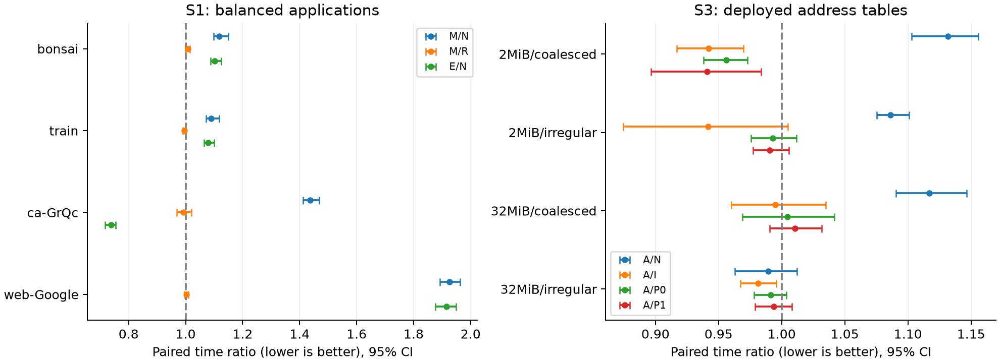
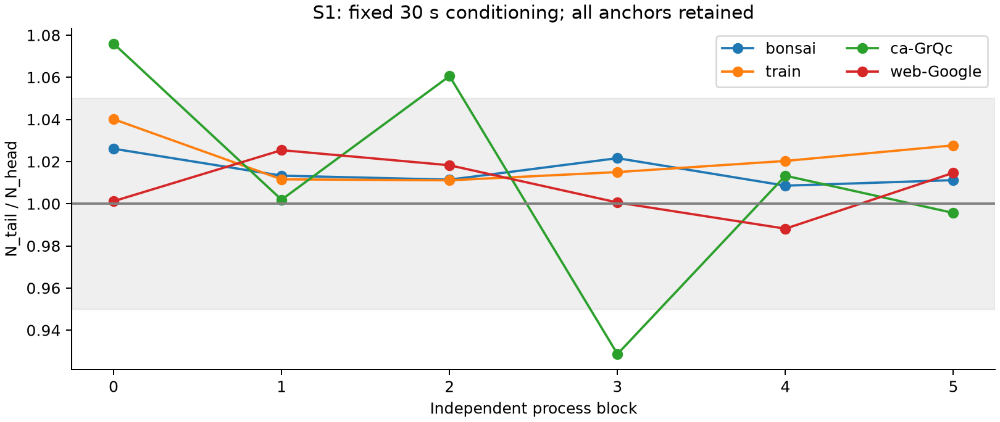
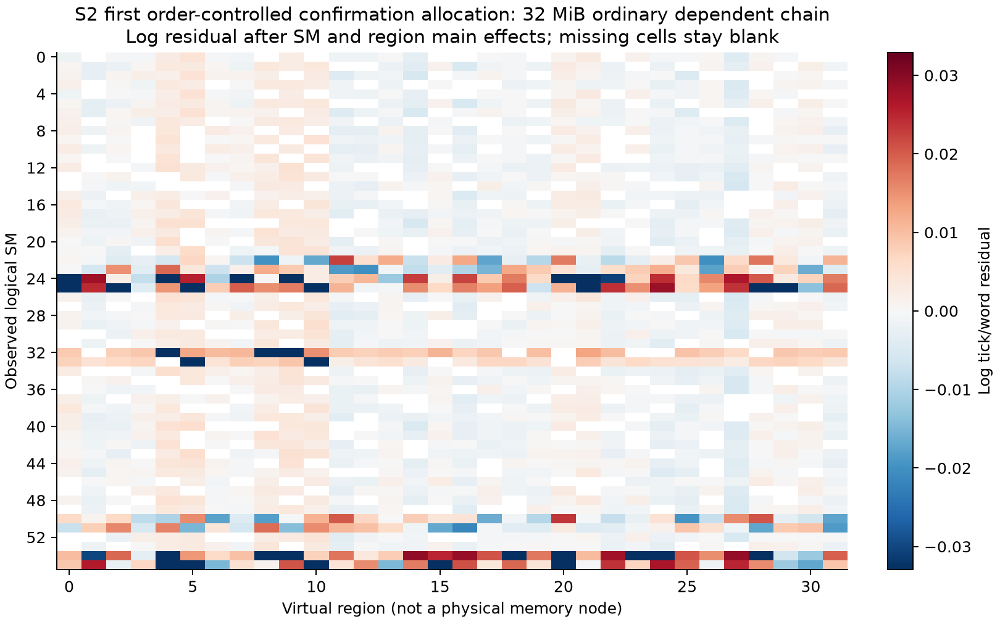
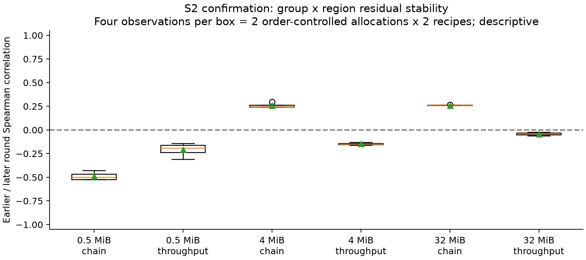

# T10 补充实验与论文定位

完成时间：2026-10-15T05:31:44.551757+00:00。本报告独立于原 E0–E4；旧 CSV、固定 M/R 表和旧统计未修改。比值均为时间比，低于 1 才是更快；区间未特别说明时为 20,000 次进程块配对 bootstrap 的 95% 描述区间，seed=2026101503。W1/W2不池化为跨程序部署结论。

## 结论

计算主线：**CAPACITY_RESULT_CONFIRMED**。地址支线：**CAUSAL_AFFINITY_NO_NET_GAIN**。本轮没有满足既定 S4 部署门槛，因此不进入新的渲染快照或动态场景实验。旧 M 没有因这次补充被重新训练或改表；旧最终状态保留，限于当前静态容量方案和当前执行条件。

状态中的 CAUSAL_AFFINITY 只指“在本执行器内受控换表观察到的经验匹配作用”，**不代表已确认SM到物理内存的亲和因果机制**。局部的缓存、任务顺序和执行组织解释仍然成立。

这是对“原负载是否错过 SM—地址差异”的有界实测回答：原 K2 确实未检验这件事；本轮增加了同地址跨实际 Green 组/SM 的依赖链与吞吐测量，并实际部署了一张初始化匹配表。是否存在可重复局部相关，与它能否产生完整成本收益分别报告。不能从这里证明 T10 不存在 NUMA，也不能把公开组命名为物理 GPC 或显存域。

## 1. 完成范围与记录

S0只读复核完成；S1共24个新进程块、120个session，每个512帧/请求（61,440条）；S2共6个独立进程/分配、72个配置、432个固定轮次；S3共24块、144个phase、每phase128个epoch（18,432条）。前3个S2分配开发，后3个原定确认；其中首个确认在顺序修正前完成，仅作有混杂的初始证据，最后2个确认才有轮换控制。开发轮次在两种窗口布局间分配，未扩成额外配置矩阵。资格与sanitizer单列，不混入正式统计。

补充 worker 总计 **1664.812 秒（27.75 分钟）**，上限21,600秒；该时长包含worker中的CPU初始化与参考计算，不是GPU busy time。原worker 1910.479秒另计。按用户本地资源说明，租赁0元，电费未计。没有联网、安装、SSH、驱动/时钟/功耗设置修改。

运行和失败列表、实际预算、未执行理由、源文件与每个process路径在 `T10_SUPPLEMENT.json`。`derived/t10_supplement/*_sessions.csv`把结果追溯到run/phase；原完整每帧数据保留在对应runs目录。

## 2. S1：加入E_FULL与首尾Native后

每输入固定原sequence0，6块恰好覆盖E/R/M六种中间顺序。每进程先做30秒有用Native路径conditioning；每phase独立至少128次且1秒预热。参考N定义为头尾均值的几何平均；这个定义不保证消除非线性漂移。W2生产N仍为cuSPARSE，E采用与R/M相同rows_per_task和同kernel。W1 E采用同mapped tile body/CTA/occupancy倍数，在普通primary stream执行。

| 输入/程序 | M/N | M/R | E/N | R/E | M/E |
|---|---:|---:|---:|---:|---:|
| bonsai | 1.1179 [1.0990, 1.1495] | 1.0071 [0.9998, 1.0141] | 1.1015 [1.0885, 1.1248] | 1.0078 [1.0026, 1.0135] | 1.0149 [1.0075, 1.0226] |
| train | 1.0889 [1.0719, 1.1182] | 0.9953 [0.9907, 1.0004] | 1.0791 [1.0644, 1.0996] | 1.0139 [1.0075, 1.0219] | 1.0090 [0.9997, 1.0198] |
| ca-GrQc | 1.4366 [1.4114, 1.4688] | 0.9917 [0.9687, 1.0195] | 0.7392 [0.7173, 0.7546] | 1.9597 [1.9103, 2.0190] | 1.9434 [1.8839, 2.0428] |
| web-Google | 1.9262 [1.8916, 1.9634] | 1.0022 [0.9946, 1.0100] | 1.9152 [1.8766, 1.9495] | 1.0035 [0.9971, 1.0096] | 1.0057 [0.9981, 1.0111] |
| W1 | 1.1033 [1.0873, 1.1252] | 1.0012 [0.9969, 1.0055] | 1.0903 [1.0786, 1.1053] | 1.0108 [1.0065, 1.0156] | 1.0120 [1.0060, 1.0186] |
| W2 | 1.6635 [1.6418, 1.6876] | 0.9969 [0.9840, 1.0110] | 1.1899 [1.1696, 1.2074] | 1.4024 [1.3841, 1.4243] | 1.3980 [1.3753, 1.4339] |

数值上，W1的M/N=1.1033，而E/N=1.0903，说明原生到mapped执行组织已解释大部分整体差距；M相对R没有独立增量。W2必须分输入看：ca-GrQc的E/N=0.7392，原生全设备自写同体核可以更快，但分区后M/N=1.4366；web-Google的E/N=1.9152与M/N=1.9262接近，主要差距已出现在自写内核对cuSPARSE的比较中，不能都归咎于分配。

E/N反映原生到table-loop组织的差距；R/E、M/E还包含分区和静态所有权成本。它们是控制比较，不把E提升成最强生产基线，也不能把全部差距归因于某条内存指令。

首尾偏差超过事前5%描述线的块：**3/24**；全部保留，没有剔除、补跑、时钟回归校正。程序聚合的M/N头锚、尾锚敏感性：

| 程序 | M/N_head | M/N_tail | N_tail/N_head |
|---|---:|---:|---:|
| W1 | 1.1133 [1.0953, 1.1378] | 1.0935 [1.0791, 1.1126] | 1.0181 [1.0137, 1.0232] |
| W2 | 1.6716 [1.6363, 1.7090] | 1.6554 [1.6383, 1.6724] | 1.0097 [0.9893, 1.0289] |

设备低频轨迹范围（含等待/CPU工作时刻）为 {"temperature.gpu": [38.0, 80.0], "clocks.current.sm [MHz]": [300.0, 1590.0], "power.draw [W]": [14.06, 147.82], "utilization.gpu [%]": [0.0, 100.0]}。监控中的性能限制reason按原样保存，不能由温度快照反推每个phase的限频原因。每块四个进程时间点分开记录；flock串行执行，不把排队重叠当GPU并发。每phase有墙时边界、每帧有完整CPU-ready耗时；没有为旧数据补造不存在的轨迹。

原W1/W2总表还包含sequence1；本轮只重复sequence0，跨轮变化不是同一时间环境下的新随机对照。原K2、组去重、类校准组成、率表、M/R重合率和旧逐块设备快照见 `T10_EVIDENCE_ADDENDUM.md`。

## 3. S2：真正依赖链和同一数据跨位置

固定实际消费0.5/4/32MiB，普通load与.cg，依赖链和有限吞吐分开。每region由虚拟窗口条带组成；依赖链是runtime初始化的全region随机单环，下一次地址取自刚读出的值。每段1024次读取，段间状态延续，整epoch访问全部region。8个重复CTA扩大位置采样但不增加唯一消费集合。所有输入word、虚拟32B sector和128B line计数有数学覆盖证明与footprints记录；每个组消费同一完整集合。分配32MiB与小档只消费0.5MiB分列。

确认采用开发阶段冻结的 **64KiB 虚拟窗口**；选择规则只用开发覆盖与分轮相关，确认结果未参与选择。但初始实现遗漏CTA任务顺序轮换，开发高相关可能混入固定调度位置；修正生效前allocation3已完成，全部保留为受限证据，allocation4/5采用预先固定的逐轮permutation。没有为凑齐3个修正后确认而突破72配置上限。这是S2的一次有依据修正，故不能把初始相关宣称为已复现物理亲和。经过任务顺序轮换的确认24个size/recipe/access/分配单元（2个独立分配）最小设备SM覆盖 **56/56**，单region最少覆盖 **41个实际SM**。组×region缺格总数 **0**，SM×region缺格总数 **3083**（保留缺格，不填零）。

| 消费集合 | 类型 | 确认早/晚轮Spearman：中位数 [最小,最大] | group×region交互log RMS中位数 |
|---|---|---:|---:|
| 0.5 MiB | 依赖链 | -0.500 [-0.524, -0.429] | 0.00362 |
| 0.5 MiB | 吞吐 | -0.190 [-0.310, -0.143] | 0.00284 |
| 4 MiB | 依赖链 | 0.247 [0.243, 0.299] | 0.00611 |
| 4 MiB | 吞吐 | -0.148 [-0.160, -0.130] | 0.00849 |
| 32 MiB | 依赖链 | 0.259 [0.257, 0.265] | 0.00312 |
| 32 MiB | 吞吐 | -0.040 [-0.061, -0.025] | 0.00990 |

固定CTA顺序的首个“确认”分配，各条件相关的中位数约0.979；加入逐轮任务置乱后的两个确认分配中位数分别约−0.081、−0.102。这不构成“只由顺序引起”的严格同分配消融，但足以否定把初始高相关直接作为稳定地址亲和证据的做法。原始数据和实现修正均保留，不丢弃不利结果。

这里的相关在每个新分配内比较前后轮，不跨分配把相同region号当作相同物理地址。log交互去除了组/SM整体快慢与区域整体快慢；原始ticks与主效应仍保留。依赖链是同一线程的局部clock差；吞吐ticks/word只是CTA完成时间按工作量归一化，**不是单load latency**。微实验分段、准备遍历和局部时钟都不能换算成渲染帧收益。本轮测的是SM/组到数据的访问，不是SM间通信或DSM延迟。

普通/.cg没有证明L1/L2/DRAM实际命中；32MiB大于L2也不是物理域识别。没有收集硬件cache命中/DRAM事务计数。热图只画首个具有顺序控制的确认分配、大档普通依赖链，不能用图的观感替代稳定性或部署对照。

## 4. S3：实际匹配表、盲表与两置乱

所有条件均做一次完整闭环，不以S2局部效应太小为由省略。2/32MiB×合并/固定索引不规则访问，各6新进程。task固定4KiB、128线程、8次task内完整读取；不规则索引是task内双射，uint64完整CPU结果严格一致。固定50/50配额，同一kernel/launch/join。每个分配重新交叉标定同task在两组的耗时；A按去组主效应的区域相对cost排序，I为盲平衡表，P0交换A两组，P1预定平衡置换。组内始终升序，无每epoch重规划。新A与旧容量M不是同一候选。

每phase32warmup+128测量。位置资格独立于正式测量，逐task记录实际SM与exactly-once；正式kernel关闭位置计数。原始两置乱分别保留，没有挑最慢置乱作参考。

| 条件 | A/N | A/I | A/P0 | A/P1 |
|---|---:|---:|---:|---:|
| 2MiB/coalesced | 1.1316 [1.1028, 1.1558] | 0.9422 [0.9168, 0.9696] | 0.9560 [0.9379, 0.9728] | 0.9408 [0.8965, 0.9839] |
| 2MiB/irregular | 1.0862 [1.0751, 1.1010] | 0.9418 [0.8746, 1.0050] | 0.9931 [0.9757, 1.0116] | 0.9905 [0.9774, 1.0055] |
| 32MiB/coalesced | 1.1168 [1.0906, 1.1464] | 0.9950 [0.9599, 1.0348] | 1.0044 [0.9687, 1.0416] | 1.0103 [0.9906, 1.0318] |
| 32MiB/irregular | 0.9892 [0.9629, 1.0121] | 0.9814 [0.9673, 0.9958] | 0.9913 [0.9783, 1.0036] | 0.9935 [0.9789, 1.0081] |

2MiB/coalesced 是局部正例：A/I≈0.9422、A/P0≈0.9560、A/P1≈0.9408，在本条件四比较的98.75%区间下均低于1；但A/N≈1.1316，仍慢13.2%，无法部署获益。该结果支持“某些表与该执行组织更匹配”，未排除普通cache/顺序效应。四种条件之间没有再做全族显著性保证，不把这个局部正例包装成普遍硬件规律。

S3也存在测量背景限制：32MiB/coalesced 的N_tail/N_head≈1.2088 [1.1984,1.2186]，尾锚比头锚慢约20.9%。该条件的A/N_head≈1.2278，而A/N_tail≈1.0157，必须结合首尾敏感性阅读；保留全部6块，未据此校正或补跑。它对I/P0/P1也没有稳定优势，故不能只用launch开销解释。

表为95%描述区间；S4进入判断使用每条件四比较Bonferroni调整后的98.75%边际区间、至少3%对N净时间收益和leave-one-block-out同方向。门槛只是本轮投入规则，不是论文成立标准。完整各块比值、调整区间和门槛判定在 `S3_statistics.json`、`S4_gate.json`。所有条件均未通过，不能只以CPU launch解释候选未胜同机制控制的结果。

初始化成本：

| 条件 | 总初始化ms中位数 | 其中标定ms中位数 | 建表ms中位数 | 单表bytes |
|---|---:|---:|---:|---:|
| 2MiB/coalesced | 265.125 | 2.868 | 0.363 | 2048 |
| 2MiB/irregular | 241.606 | 3.134 | 0.349 | 2048 |
| 32MiB/coalesced | 331.101 | 36.101 | 5.405 | 32768 |
| 32MiB/irregular | 347.298 | 41.143 | 5.624 | 32768 |

这些成本不算零。phase表另存每次上传时间；总初始化还含CPU期望、资源创建及独立资格，不冒称全部都是候选独有开销。稳态表没有收费初始化摊销；缺少对N的稳定收益时，不能用延长生命周期自动制造回本。A若只在个别同机制对比中占优，也不足以证明当前控制粒度下的部署增量。

## 5. 渲染适配与论文判断

本轮没有触发S4，故没有新增真实tile属性地址枚举、单home混合度、快照重放、scene级A_addr或动态验证。这些格子是NOT_RUN，不填零，也不把S3结果直接套到3DGS。原列表长度分类仍不等于地址亲和。此前“渲染负载可能不适合”的质疑被收窄为可测试命题，尚不能据现有证据断言渲染一定适合或一定不适合。

当前已具备：公开资源组的实际位置证据；同body/同粒度执行组织控制；平衡顺序及首尾锚；同一数据的交叉地址测量；开发/确认分离；实际表部署和同机制盲表/两置乱；完整成本、初始化与正确性证据。仍缺：已确认物理域/裁剪因果机制、可靠且可持续的匹配增量、超越同信息简单基线的新方法、真实动态pipeline净收益、外部强基线及独立器件泛化。本轮没有重新做文献查新，不能主张新颖性已确立。

这批结果可以支撑有界的测量方法、执行成本和负结果分析；**当前不能承诺一项新GPU NUMA优化论文已经成立**。若局部现象只能由缓存/顺序/执行组织解释，应按该层级命名。T10单卡不能反推全部floorsweeping或5070Ti行为。交接仅提供可复用源码和协议，见 `T10_5070TI_HANDOFF.md`。

## 6. 可追溯性与限制

旧索引523行前缀逐字节不变，全部旧M/R哈希不变。新run均有独立目录、编译产物/源码记录和stdout/stderr；原失败不抹除。原程序数值体复用，新增地址kernel的小用例经本地memcheck/synccheck；5次sanitizer均为0 errors，全部正式微诊断单段最大0.655488ms，未超过2ms目标；实际进程执行时间窗无重叠，详细结果见 environment/supplement_final_checks.json 及原日志。未使用新验证框架、特权SM掩码、clock锁定或抢任务runtime。

S2的区域是虚拟地址规则；CUDA分配返回的新进程地址并不保证新物理页。校准local ticks可能受并发、cache、任务顺序及状态影响；正式关闭诊断后计时机制不同，S3正是检验其可部署外推。普通负结果按既定规模收尾，没有补跑寻找赢家。CPU-ready计时包含提交和等待；Green组事件分别展示，max(group_event)从未作为整段makespan。

复现与原始二进制记录格式见 `supplement/REPRODUCE_SUPPLEMENT.md`。全部结果需与范围和缺项一起引用。
