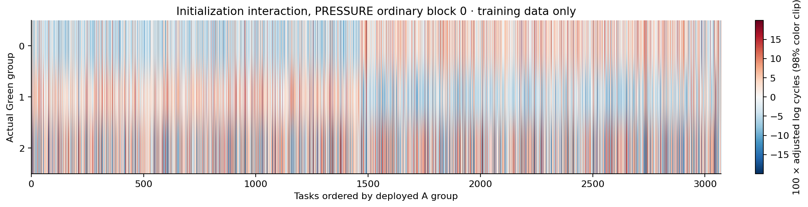
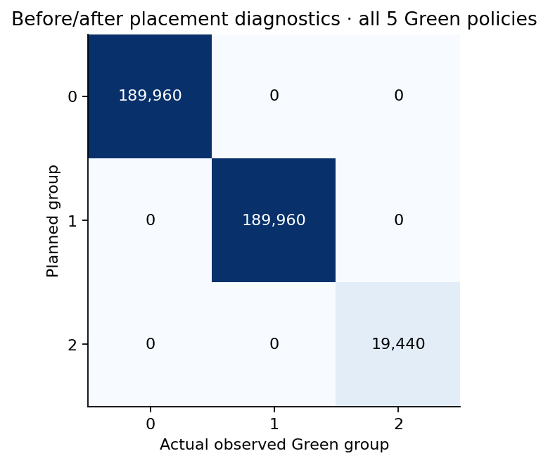
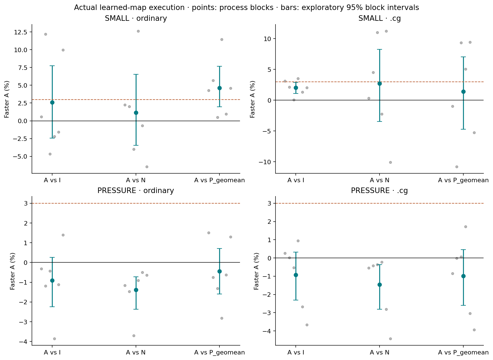
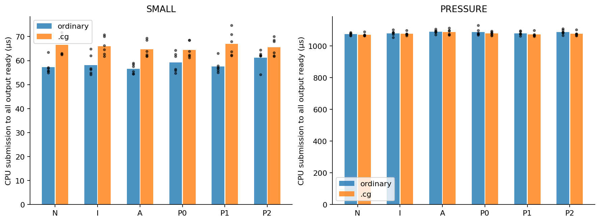

# Static affinity causal completion — RTX 5080

Completed 2026-10-13, run `static-affinity-causal-5080`.

**Final state: NO_DEPLOYABLE_GAIN_ON_TESTED_GROUPS**, independently for SMALL/PRESSURE and ordinary/`.cg` loads. All 144 formal sessions ran; the maps were actually used by the same Green executor. The 192 MiB ordinary-load candidate was **1.388% slower than Native**, a mean **14.941 µs** extra per epoch, and slower in all six process blocks. The corresponding `.cg` result was 1.455% slower / 15.662 µs extra, also six of six.

There are positive small-workload comparisons: ordinary A beats the geometric permutation aggregate by 4.644%, and `.cg` A beats blind I by 2.034%. However, neither small stratum consistently beats all three required references: I, the permutation aggregate and Native. These positives are retained; “no deployable gain” does not mean every effect is zero. No renderer, physical NUMA or paper-level conclusion follows.

## Direct answers

| Question | Result |
|---|---|
| Actual consumer sizes and window? | Exactly 16 MiB and 192 MiB of unique words, virtual 32-byte sectors and 128-byte lines per complete epoch; 64 KiB per task. |
| Large set, cache pressure, DRAM? | ACCESS_SET_QUALIFIED for both sizes. Cache pressure has capacity/behavior indications but is not unambiguously established; DRAM service was not measured. No local ncu binary was available. |
| Learning equals executable groups? | Yes: this run calibrates the actual 40/40/4 Green groups, preserving fixed quotas and remainder tasks. The prior 42/41 learned clusters are not used. |
| Map actually deployed? | Yes. Before/after diagnostics contain 399,360 Green task placements, all in their planned groups. Formal launches use those same immutable tables with diagnostics compiled out. |
| A versus I, P and Native? | Full paired percentages, µs differences, intervals and six-block values below and in PAIRED_EXECUTION_RESULTS.csv. No stratum satisfies the complete success rule. |
| Formal non-diagnostic result? | 18,432 timed epochs with no SM reads, clock sampling or ownership atomics in the formal kernels; every epoch's complete uint2 output passes CPU comparison outside timing. |
| Residual and initialization costs? | Table loads, index arithmetic, three launches/context selections and joins are timed. Calibration + all-plan construction averaged 5.244 ms SMALL and 64.586 ms PRESSURE; precise deployment-only C_extra is not isolated. |
| Valid scope and unknowns? | This uniform disjoint-region gather, 24 fresh processes, six per stratum; physical-page independence, actual cache service and scene lifecycle remain unknown. |
| Proceed to rendering? | No under the frozen decision rule. This bounded follow-up is complete; the current RTX 5080 implementation route stops without another algorithm, card or scene search. |

## Contract and prior-result preservation

The user explicitly chose “Execute the bounded follow-up.” The attached review was used as the proposed protocol, not as new raw evidence. Its manifest hashes verified and its input-report hash matches the prior local report. The earlier 0.331% timing prediction, 3% actionability rule, raw data and reports were preserved unchanged. This is a new four-hour maximum account, not a reopened confirmation set or a repair to old results.

F0 checked the old access unions, group membership, submission order and diagnostics. The old learned map intersects Green group 0 as 24/16 members of learned groups 0/1, Green group 1 as 17/23, and the remainder as 1/2 plus missing SM 79. These partitions are not interchangeable. Old Green code submits every independent group before joining, but its formal task body writes SM positions; that write is absent from this campaign's formal kernel.

The contract froze workloads, calibration, quotas, permutation seeds, a six-order Latin design, process order, main comparisons and decision criteria before GPU qualification. The final executable was separately frozen after qualification and before all 24 formal processes. Each invocation records source and binary hashes. Source, binary, frozen contract, policy table and expected-output hashes are supplied. Initial engineering failures remain in the archive.

## F1: exact consumption, not allocation padding

Each logical task owns a disjoint 64 KiB region (16,384 uint words). A 128-thread CTA performs 128 loads per thread. Its source index i = 128j + lane visits 0…16,383 exactly once. A runtime-seeded odd affine multiplier and offset permute these indices modulo 2^14, so every word in the region is read exactly once in an epoch. Input values are independently runtime-initialized from the process seed and global logical word index. Values contribute to both a sum and an index-weighted sum; they cannot be replaced with a small repeated chain or unread padding.

The CPU reference traverses logical words in ascending address order and uses the inverse affine permutation to compute weights. It compares both uint outputs for every task, not just a subset or one terminal digest. This reference is algorithmically different from the GPU gather loop; it is still a finite integer check, not a formal proof against all checksum collisions. The intended output is the complete pair of reductions for every task.

| Scope | Tasks | Epoch words | Virtual 32B sectors | Virtual 128B lines | Group tasks | Group consumer MiB |
|---|---:|---:|---:|---:|---|---|
| SMALL | 256 | 4,194,304 | 524,288 | 131,072 | 121 / 121 / 14 | 7.5625 / 7.5625 / 0.875 |
| PRESSURE | 3,072 | 50,331,648 | 6,291,456 | 1,572,864 | 1,462 / 1,462 / 148 | 91.375 / 91.375 / 9.25 |

There is zero address overlap between tasks. Source-level same-sector access-gap proxies for representative task 0 of every process are in CONSUMER_FOOTPRINT.json. Those count scalarized source accesses; they are not hardware reuse distances or actual interleaving traces. Within-task sector reuse, multiple resident CTAs, task scheduling and L1 behavior can matter. Each Native epoch is one grid; each Green epoch is three independent group submissions, all queued before any join. No segmentation change was needed. Temporal overlap of the three kernels was not directly profiled, and the whole union is not asserted simultaneously resident.

The 192 MiB epoch and each 91.375 MiB equal-group union exceed the device's nominal 64 MiB L2. Per-byte CPU-ready time is also higher than for SMALL. These facts support a capacity-pressure interpretation but do not isolate cache causality: task count, scheduling, local reuse and host overhead also change. Accordingly, CACHE_PRESSURE_SUPPORTED is not asserted unambiguously and DRAM_SERVICE_OBSERVED is NOT_MEASURED. The label PRESSURE denotes the qualified access-set design. Neither ordinary loads nor `.cg` guarantees DRAM service.

Actual disassembly shows ordinary `LDG.E` and `.cg`'s `LDG.E.STRONG.GPU`. Formal versions of both kernels contain no `SR_VIRTUALSMID`, clock reads or atomic additions. Diagnostic versions contain these operations. Formal variants use 16 registers; diagnostic variants use 18; both report zero stack bytes and 1,056 bytes shared storage. Compiler declarations are not measured occupancy/traffic.

## F2: initialize a map in the real control space

Every process allocates fresh owned data, creates the actual 40/40/4 Green groups and calibrates all its tasks on each group. Four rounds use randomized 128-task batches and rotated group order. Batch inputs and diagnostic resets are explicitly synchronized in the primary context before Green use. Every calibration record includes task, group, round, clocks, begin/end observed SM and work count, bound to process/seed through the run index.

The method averages log task cycles, removes group and task main effects, then ranks the group-0 minus group-1 interaction over exchangeable tasks. It assigns exactly the fixed quota to each equal 40-SM group. Remainder tasks are selected by the blind plan and stay identical in I/A/P. All tasks have the same 16,384 loads and arithmetic count. Group 2 participates in calibration and executes meaningful work; its small capacity is not silently discarded.

Initialization batches are isolated per group and do not reproduce concurrent full-epoch contention. Group-order rotation over four rounds is not perfectly balanced over three groups. Main-effect removal handles a uniform service difference but cannot remove every cache/order interaction. This is one frozen empirical heuristic, not an oracle or a demonstration of physical memory domains. All task/group cells have four samples; all formal processes observe 40/40/4 distinct SMs without overlap after the repair.

This heatmap is training data, ordered by the deployed A group. Its visible split is partly a consequence of selecting homes from these measurements; the independent formal execution supplies the causal comparison.

## F3: same work, deployed A and all three permutations

N uses an ordinary full-device grid and logical task order, with no plan-table load. I uses a topology-blind fixed quota split. A uses the initialized map. P0 swaps A's two equal groups; P1/P2 use two pre-fixed balanced shuffles of A's exchangeable slots. Every Green policy keeps the same remainder tasks, quota, sorted task-ID order within each group, table format, kernel, launch/context operations and joins. Only assignment contents differ. Exact plans and per-process table hashes are retained. Mapping changes can still alter cache reuse and within-group ordering, so differences are controlled empirical assignment effects, not proof of a specific physical NUMA cause.

Before and after each policy, a diagnostic kernel specialization checks complete output, exactly-once ownership and observed placement. All 479,232 task records including Native passed; all 399,360 Green task records matched their planned groups. All 84 SMs were represented by the process-level group audits. Formal launches do not trace SMs; evidence for their placement is the identical context/table binding, supported by surrounding diagnostics, rather than a measurement of every formal task's physical execution position.

The six policies occupy every order position once across six blocks in each stratum. Process order is independently shuffled and frozen. All 24 formal processes use fresh allocations and mutually distinct input seeds; fresh allocations do not guarantee different physical pages. Each policy has 32 same-policy full-size warmup epochs and 128 measured epochs. No special cache flush or profiler replay is inserted. Warmup is the common preparation contract, not a promise of identical final cache contents across maps.

**Input-holdout deviation:** final auditing found that four PRESSURE seeds also occurred in qualification: ordinary blocks 0/1 share an eight-task prefix with small sanitizer inputs, and `.cg` blocks 0/1 share full-size qualification inputs. The qualifying recipes sometimes differ, but the input values still overlap. Qualification checked correctness/duration and did not choose a performance winner or alter the frozen mapping rule; every formal process still recalibrated a fresh allocation. Nevertheless, these four blocks are not wholly unseen-input holdouts. INPUT_HOLDOUT_AUDIT.json lists all overlaps. All 144 sessions are retained without post-result replacement or excess-session reruns; the remaining four ordinary and four `.cg` pressure blocks are also slower than Native. No independent-input generalization claim is made from the overlapping blocks.

CPU timing starts immediately before submission and ends after all outputs are ready through the actual device/stream joins and primary-context restoration. Table reads, addressing, three Green launches, context changes, error checks and joins are inside timing. No per-epoch map upload, planner, task queue or extra scheduling kernel exists. Full CPU output copies/checks are outside timing after every epoch and common across policies; they can still perturb the next epoch. The 32 warmups also use the full workload. No CUDA Graph, persistent cross-epoch kernel, busy wait or hidden schedule preparation is used.

GPU events are used only in qualification, within each event's own context. No elapsed time is computed across incompatible contexts. Thus the primary result is CPU submission-to-ready time, not GPU busy time or a renderer frame.

## Results and statistical unit

The independent unit is the process/allocation block. First compute its policy mean, then paired A/reference ratios. P's main reference is the geometric mean of P0/P1/P2 within the same block. The reported ratio is the geometric mean across blocks. Bootstrap intervals resample the six paired blocks 20,000 times (seed 2026101314); they are exploratory, without multiplicity correction. No replay is counted as an independent block and no block was excluded or rerun to change its sign.

In the next tables, **positive percentage means A is faster**; **positive µs means A takes longer**. Brackets are exploratory 95% intervals. The frozen success criterion requires upper ratio interval below one and A faster in at least four of six blocks against each of I, P aggregate and N. A net gain of at least 3% would then qualify as a practical microtask opportunity; smaller qualifying gains would be retained as weak causal gains.

| Stratum | Comparison | A faster % [95% interval] | A minus reference µs [95% interval] | A faster blocks |
|---|---|---:|---:|---:|
| SMALL ordinary | A/I | +2.599% [-2.443, +7.751] | -1.607 [-4.771, +1.372] | 3/6 |
| SMALL ordinary | A/N | +1.149% [-3.464, +6.542] | -0.695 [-3.995, +1.941] | 3/6 |
| SMALL ordinary | A/P_geomean | +4.644% [+1.990, +7.688] | -2.756 [-4.692, -1.154] | 6/6 |
| SMALL .cg | A/I | +2.034% [+1.106, +2.915] | -1.355 [-1.933, -0.734] | 6/6 |
| SMALL .cg | A/N | +2.742% [-3.463, +8.272] | -1.858 [-5.696, +2.247] | 4/6 |
| SMALL .cg | A/P_geomean | +1.422% [-4.696, +7.032] | -0.915 [-4.750, +3.043] | 3/6 |
| PRESSURE ordinary | A/I | -0.909% [-2.239, +0.255] | +9.775 [-2.708, +23.838] | 1/6 |
| PRESSURE ordinary | A/N | -1.388% [-2.363, -0.723] | +14.941 [+7.810, +25.352] | 0/6 |
| PRESSURE ordinary | A/P_geomean | -0.438% [-1.600, +0.710] | +4.737 [-7.753, +17.228] | 2/6 |
| PRESSURE .cg | A/I | -0.929% [-2.308, +0.313] | +10.067 [-3.389, +24.855] | 3/6 |
| PRESSURE .cg | A/N | -1.455% [-2.816, -0.370] | +15.662 [+3.969, +30.181] | 0/6 |
| PRESSURE .cg | A/P_geomean | -0.992% [-2.597, +0.457] | +10.764 [-4.907, +27.921] | 2/6 |

All individual permutations are retained rather than choosing the slowest comparator:

| Stratum | Comparison | A faster % [95% interval] | A minus reference µs [95% interval] | A faster blocks |
|---|---|---:|---:|---:|
| SMALL ordinary | A/P0 | +4.500% [-0.961, +9.459] | -2.749 [-5.855, +0.493] | 4/6 |
| SMALL ordinary | A/P1 | +1.789% [-1.993, +6.382] | -1.054 [-3.886, +1.130] | 3/6 |
| SMALL ordinary | A/P2 | +7.557% [+3.946, +10.481] | -4.683 [-6.517, -2.434] | 5/6 |
| SMALL .cg | A/P0 | -0.438% [-6.789, +5.448] | +0.286 [-3.668, +4.305] | 3/6 |
| SMALL .cg | A/P1 | +3.243% [-3.421, +10.235] | -2.253 [-7.308, +2.202] | 3/6 |
| SMALL .cg | A/P2 | +1.427% [-5.443, +7.606] | -0.945 [-5.177, +3.427] | 3/6 |
| PRESSURE ordinary | A/P0 | -0.216% [-1.768, +1.574] | +2.205 [-17.624, +18.975] | 3/6 |
| PRESSURE ordinary | A/P1 | -0.941% [-2.119, +0.423] | +10.142 [-4.547, +22.616] | 1/6 |
| PRESSURE ordinary | A/P2 | -0.159% [-1.325, +0.987] | +1.703 [-10.791, +14.248] | 2/6 |
| PRESSURE .cg | A/P0 | -0.715% [-2.213, +0.788] | +7.783 [-8.462, +23.813] | 2/6 |
| PRESSURE .cg | A/P1 | -1.347% [-3.223, +0.746] | +14.490 [-8.132, +34.427] | 1/6 |
| PRESSURE .cg | A/P2 | -0.915% [-2.536, +0.394] | +9.897 [-4.299, +27.239] | 2/6 |

Absolute CPU-ready means, µs (equally weighted process means):

| Stratum | N | I | A | P0 | P1 | P2 |
|---|---:|---:|---:|---:|---:|---:|
| SMALL ordinary | 57.243 | 58.155 | 56.548 | 59.297 | 57.603 | 61.231 |
| SMALL .cg | 66.523 | 66.020 | 64.665 | 64.379 | 66.918 | 65.610 |
| PRESSURE ordinary | 1074.360 | 1079.526 | 1089.301 | 1087.096 | 1079.160 | 1087.598 |
| PRESSURE .cg | 1070.409 | 1076.003 | 1086.071 | 1078.287 | 1071.580 | 1076.174 |

All six block ratios are shown below; values below 1 favor A. The machine-readable paired file also includes every absolute delta and all individual P comparisons.

| Stratum | Block | A/I | A/N | A/P geometric mean |
|---|---:|---:|---:|---:|
| SMALL ordinary | 0 | 0.99421 | 0.97741 | 0.95733 |
| SMALL ordinary | 1 | 0.87780 | 0.97987 | 0.94299 |
| SMALL ordinary | 2 | 1.04681 | 1.04003 | 0.99509 |
| SMALL ordinary | 3 | 1.02205 | 0.87385 | 0.88551 |
| SMALL ordinary | 4 | 1.01566 | 1.00696 | 0.99056 |
| SMALL ordinary | 5 | 0.90039 | 1.06450 | 0.95405 |
| SMALL .cg | 0 | 0.96871 | 0.99667 | 1.00992 |
| SMALL .cg | 1 | 0.97879 | 0.95494 | 1.10782 |
| SMALL .cg | 2 | 0.99957 | 0.88997 | 0.90663 |
| SMALL .cg | 3 | 0.96464 | 1.02225 | 0.94916 |
| SMALL .cg | 4 | 0.98694 | 0.88784 | 0.90569 |
| SMALL .cg | 5 | 0.97971 | 1.10090 | 1.05239 |
| PRESSURE ordinary | 0 | 1.00317 | 1.01157 | 0.98495 |
| PRESSURE ordinary | 1 | 1.01188 | 1.01463 | 1.00746 |
| PRESSURE ordinary | 2 | 1.00436 | 1.03705 | 1.01308 |
| PRESSURE ordinary | 3 | 1.03857 | 1.00901 | 1.02818 |
| PRESSURE ordinary | 4 | 1.01123 | 1.00499 | 1.00621 |
| PRESSURE ordinary | 5 | 0.98607 | 1.00637 | 0.98705 |
| PRESSURE .cg | 0 | 0.99746 | 1.00549 | 1.00854 |
| PRESSURE .cg | 1 | 0.99983 | 1.00430 | 1.00010 |
| PRESSURE .cg | 2 | 1.00526 | 1.00360 | 0.99935 |
| PRESSURE .cg | 3 | 0.99063 | 1.00233 | 0.98277 |
| PRESSURE .cg | 4 | 1.02676 | 1.02805 | 1.03043 |
| PRESSURE .cg | 5 | 1.03658 | 1.04424 | 1.03943 |

SMALL ordinary meets the exploratory criterion against P aggregate, but A beats I and N in only three of six blocks and their intervals cross zero benefit. SMALL `.cg` beats I in all six blocks, but its comparisons with Native and P aggregate remain unresolved. PRESSURE has no stable A advantage over I/P, and A is slower than Native in every block for both load recipes. The selected final state therefore applies to all four strata. Favorable partial comparisons are not erased or promoted to general gains.

## Initialization, overhead and amortization

Mean measured harness components across the 12 processes per size, milliseconds:

| Scope | CUDA/Green setup | Allocate/initialize | CPU reference | Calibration | Build/upload all plans |
|---|---:|---:|---:|---:|---:|
| SMALL | 111.294 | 0.201 | 2.513 | 5.063 | 0.181 |
| PRESSURE | 123.331 | 0.380 | 31.038 | 62.764 | 1.822 |

Calibration includes copies, synchronization, diagnostics and CSV recording. Plan time builds and uploads all six comparison tables, not only A. CUDA/Green setup includes shared process/runtime startup; it is not isolated incremental Green cost. These are actual costs of this research harness, not a validated renderer deployment model. The fixed-source build took 2.487 CPU wall seconds; no runtime compilation occurs in a measured epoch.

There are 6 × tasks × 4 bytes of allocated plan tables (6 KiB SMALL, 72 KiB PRESSURE), although a deployment needs only its chosen policy table. Per-plan sizes are 1 KiB and 12 KiB. Data plus all explicit tables/output/trace/hit/batch buffers total 16,791,040 bytes SMALL and 201,486,848 bytes PRESSURE, below 512 MiB. CUDA context/runtime allocations were not individually attributed; the guard also retained max(2 GiB, 15% device memory) free headroom. Diagnostic buffers stay allocated in formal runs but are not written by the formal kernel.

I minus N in the same workload describes the combined instrumented executor difference: SMALL ordinary +0.912 µs; SMALL `.cg` −0.503 µs; PRESSURE ordinary +5.166 µs; PRESSURE `.cg` +5.594 µs, using arithmetic mean block deltas. This comparison combines assignment/order, resource scheduling and host work; it does not isolate each table/context instruction or prove zero overhead when a mean is negative. A/P use the same kernel and mechanics, so their differences are the tighter assignment control.

No reliable finite deployment break-even is established. For PRESSURE, A's slower steady-state mean cannot amortize any nonnegative extra initialization under that observed mean. For SMALL, net intervals include a loss and deployment-only C_extra is not separately measured. Calibration-plus-all-plan time is not silently substituted for production C_extra, and no fictitious lifecycle curve is produced.

## Qualification failure, repair and audit

The initial large `.cg` qualification stopped before formal timing when the remainder-group calibration contained stale group-0 positions. Output reductions still matched because each group computes the same logical task, demonstrating why output correctness alone was insufficient. The source lacked an explicit primary-device completion fence after pageable table uploads before independent Green-stream use; diagnostic resets had the same ordering concern. This is the likely synchronization cause, not a proven hardware topology change.

The preserved failing source/binary and REPAIR.json document the fix: explicit primary synchronization after input/table uploads and trace/hit resets, sentinel-filled calibration traces, and distinct volatile SM observations at start/end. This changes qualification/initialization; it does not add a per-epoch planner or diagnostic operation to formal timing. No GPU fault or Xid occurred. There was no performance result before the repair to mix with the final binary.

The fixed binary passed memcheck for both load recipes, synccheck and racecheck on bounded small cases, then both full sizes and load recipes. All 24 formal runs share its frozen hash. Their separate same-context event checks reached at most 1.251 ms; the 20 ms guard was never reached. Every formal output and all placement/ownership diagnostics passed. Final recovery action is None and the readable kernel journal contains no new Xid. Small sanitizer coverage is finite qualification, not an exhaustive correctness proof.

## Budget, provenance and disposition

Reserved GPU-worker time was **0.091 hours of the separate four-hour cap**, from 2026-10-13T20:18:16.034825+08:00 through 2026-10-13T20:23:43.410450+08:00, including intervening engineering/idle time. CPU implementation/analysis/packaging are separately outside that interval. Paid spend: zero. No network, SSH, download, install, driver/clock/power/permission change, new GPU, renderer or scene work occurred.

This run used local CUDA headers/API behavior, preserved source and actual measurements. The review's external documentation references were retained as provenance, not treated as retrieved counter evidence or independently verified literature. No physical address or memory-domain interface was used. The result limits this workload, initialization heuristic and actual controllable groups; it does not exclude finer-grained affinity or all GPU memory nonuniformity.

F0–F4 are complete. The causal execution gap is filled for this frozen microtask design, and the large consumer set is genuinely read. Counter-level cache/DRAM attribution and application value remain unmeasured. There is no current evidence satisfying the agreed criterion to enter 3DGS development or claim a new scheduling method. The current implementation route stops here.

## Recompute and evidence

- [Contract](CAUSAL_COMPLETION_CONTRACT.json) and [binary freeze](BINARY_FREEZE.json).
- [Consumer proof](CONSUMER_FOOTPRINT.json), [calibration records](GROUP_REGION_CALIBRATION.csv), [assignment audit](EXECUTED_ASSIGNMENT_AUDIT.json).
- [All paired results](PAIRED_EXECUTION_RESULTS.csv), [process means](results/derived/PROCESS_MEANS.csv), [statistical summary](results/derived/SUMMARY.json), [initialization costs](INIT_COSTS.json).
- [Command ledger](results/raw/commands.jsonl), [failed-run repair](results/raw/f1_pressure_full_cg/REPAIR.json), [final health](results/derived/FINAL_HEALTH.json), [budget](BUDGET.json).
- [Source](src/causal.cu), [CPU analysis](tools/analyze.py), [README](README.md), FILE_MANIFEST.json and FINAL_AUDIT.json.

All decisive raw CSVs, output binaries, source, final executable, failed-run evidence and derived results are included in the compact archive. No old giant raw tree, toolchain or model asset is duplicated. The original data inputs are exactly reconstructable from the frozen generator and per-process seeds.
