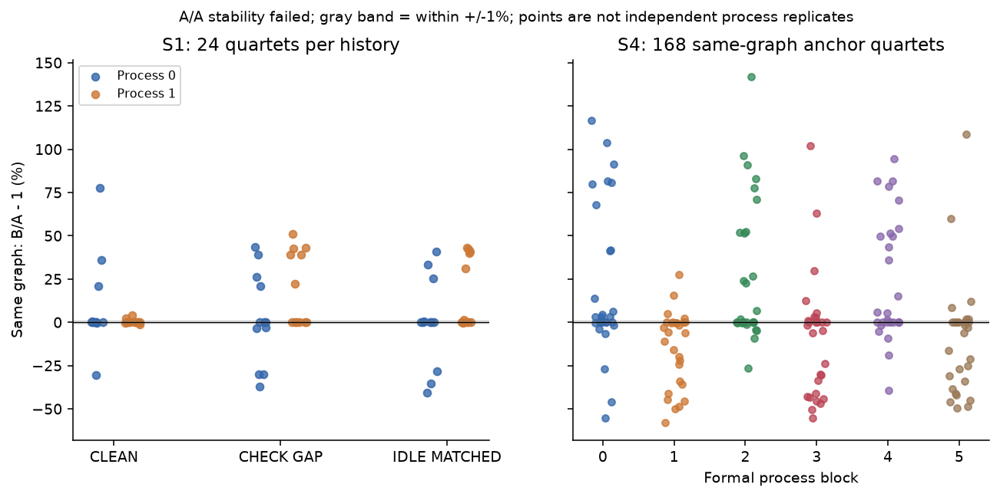
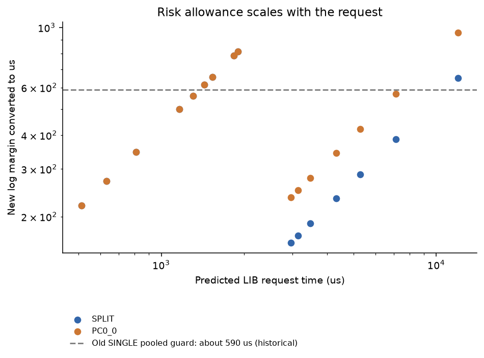
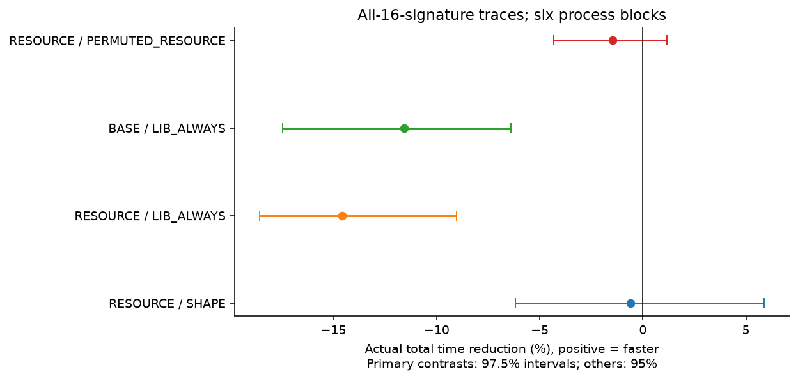
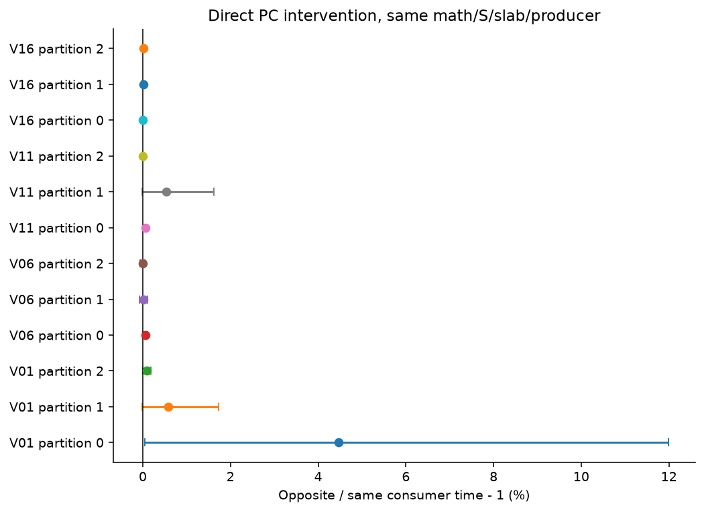
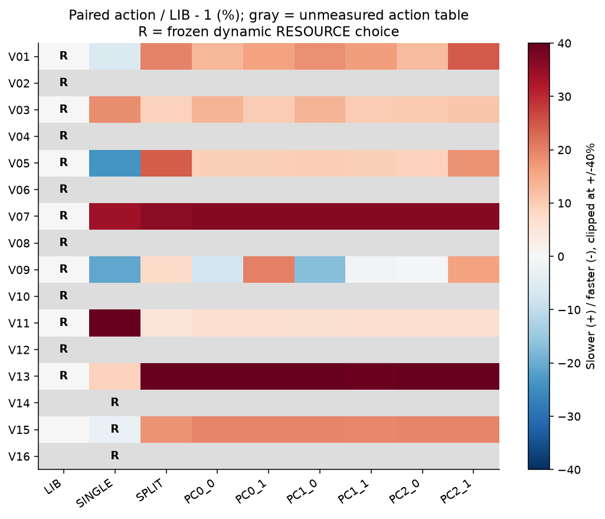
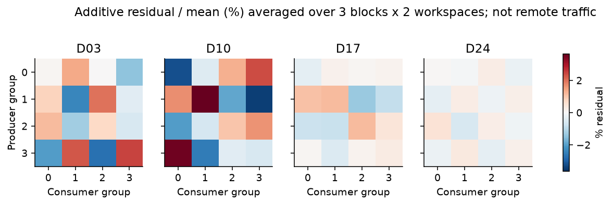
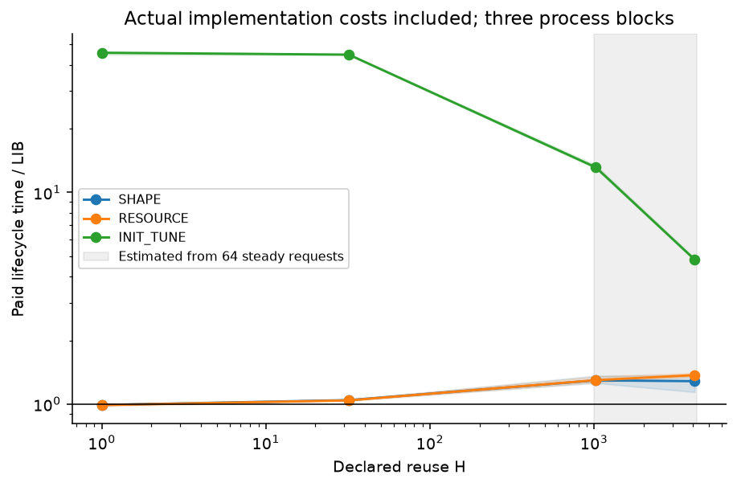

# T10 选择性重排修复 V2 实验报告

日期：2026-10-17。输入为 `T10_SELECTIVE_REORDER_REPAIR_V2_20261017.zip`，SHA256 `ab08555388c51933984cc299abc936821a8f664f0836c11369c1f6d5a3c93484`。本轮独立目录、run 和分支；旧轮数据未改写。

## 先说结果

**测量稳定性没有修复成功。** 正式同Graph A/A有 **102/168** 个相邻quartet偏移超过5%；CPU比值范围 **0.420–2.417**，GPU span也有103个偏移超过5%。本轮按任务书继续完成全部有限部署，但不能宣称建立了1%级分辨率。下面的区间描述本次进程块样本，不会自动消除状态偏差。

三条覆盖全部16个新签名的真实请求序列中，RESOURCE 相对 SHAPE 的请求段总完成时间减少（不含初始化）**-0.588% [-6.194, +5.886]**；相对 LIB 为 **-14.601% [-18.582, -9.024]**。这两项使用六进程块、97.5%边际区间。正值表示时间减少，负值表示更慢。BASE 相对 LIB 为 **-11.590% [-17.476, -6.394]**（95%）。

RESOURCE 与 SHAPE 在新V的动态入口有 **0/16** 个动作分歧；置乱资源身份改变了 **0/16** 个 RESOURCE 动作。普通SINGLE/SPLIT选择收益与PC位置/方向的额外收益分开报告。

RESOURCE与SHAPE实际提交的动作相同。它们分时测出的时间差包含宿主入口成本与状态波动，不能解释成资源信息帮助选出了更好的动作。

结论标签：`PRECISION_LIMITED`, `MODEL_OR_ACTION_POOL_LIMITED`。这些标签不等于物理NUMA已建立，也不等于已经具备论文录用所需证据。

直白地说：相对误差、无分配选择和冻结部署已经实现，但这版选择器没有交付额外的资源信息收益。A/A失败使细微位置效应仍不可辨识；新V的跨块免费搜索参考也没有显示加入PC优于普通动作池。当前实际请求流与FFN反而退化，不能用某个连续序列或某个短寿命点替代整体结果。

## 执行范围与预算

新增GPU-worker **170.61分钟**；旧账本70.171806分钟保留。上限min(240,330−70.171806)=240分钟；阶段预算亦分别检查。该报告审计时总墙时 **182.78分钟**，包括开发/分析，不仅GPU。最终打包QA结束时间见交付记录。

S4 采用了任务书预定缩减。冻结时按新开发扫描的总成本估算完整S4需要 102.49 GPU-worker分钟，S4上限75分钟；选择范围时没有使用候选输赢。完整动作池覆盖：`V01, V03, V05, V07, V09, V11, V13, V15, R_G002, R_G008, R_G017, R_G039`。

未扫描完整动作池、因而不进入oracle/regret的输入：`V02, V04, V06, V08, V10, V12, V14, V16, R_G005, R_G012, R_G021, R_G026`。V01/V06/V11/V16的直接PC对照仍全做；所有16个V仍完整进入三条实际trace。不能将本轮说成24个评价shape的全动作矩阵全部完成。

|证据单位|实际数量|口径|
|---|---:|---|
|A/A episode|24|4形状×3历史×2进程；第二锁频状态NA|
|开发quartet|1152|24形状×8候选×3块×2轮|
|资源卡episode|384|4代表×16P/C×2W×3块|
|正式quartet|1152|范围按冻结scope|
|直接PC方向quartet|144|4固定V×3分区×6块×2轮|
|正式首尾A/A quartet|168|包括仅做直接对照的额外case|
|FFN实际phase|30|相同静态动作别名不另测|
|FFN别名|66|各自初始化成本仍记录|
|生命周期phase|72|6输入×4策略×3块|
|生命周期逐H原始记录|288|每条请求CPU/GPU数组保留|
|S5_BINDING|12|实际执行的phase|
|S5_OOD|36|实际执行的phase|
|S5_TRACE|90|实际执行的phase|

quartet含4个window，每window含8–128个实际请求；这些请求不是独立进程样本。不存在按快慢删样本或拿新值覆盖旧值。完整数值检查、构图、读回和大日志均在quartet之外。

## 测量到底修到了什么程度

|历史|quartet|中位绝对log差|绝对log差90分位|偏移>1%|偏移>5%|B/A范围|
|---|---:|---:|---:|---:|---:|---|
|CLEAN|24|0.001189|0.272211|7|4|0.696–1.775|
|CHECK_GAP|24|0.195676|0.360479|15|13|0.630–1.513|
|IDLE_MATCHED|24|0.010902|0.357059|12|11|0.595–1.432|

CLEAN在典型对照上接近相等，但尾部仍有明显偏移。部分偏移在GPU span中也出现，不能仅归因于Python/JSON。CHECK_GAP调用原数值函数，IDLE_MATCHED使用事先记录的同形状检查耗时；两者都可能改变运行历史，不能将差别直接命名为纯温度或缓存因果。仅两个A/A进程，描述区间不构成1%等价检验。

旧轮119/144首尾LIB偏移超过5%，与本轮相邻短quartet时间间隔和流程不同。历史锚、受控CHECK_GAP和CLEAN不能被混成同条件“提速”。固定100W也不等于固定频率。支持频率及现状已保存，但 `sudo -n` 不具备非交互管理权限，因此锁频分支明确NA，没有猜口令、关闭保护或补造第二状态。

正式首尾A/A共168个短quartet，其中125个偏移>1%，102个偏移>5%；|log比值|90分位为0.638959。这些只检验预先噪声估计能否外推，不回写训练阈值。窗口A/B的时间重心和时距原值保留；ABBA不保证消除非线性或动作相关漂移。

## 相对模型和真正的冻结

每动作拟合 log(T_action/T_LIB)，每shape先块内聚合再等权形成24行；SINGLE也在同一新配对协议重测。SHAPE与RESOURCE共用基础动作模型、旧固定配方/S和所有训练标签。RESOURCE只在PC项多4个连续资源特征。标准化ridge λ=1，完整shape LOSO，若留出的形状是资源代表，该fold同时排除它的卡，距离标准化仅用该fold训练形状。

单侧残差是 observed−predicted log ratio；按OOF预测基础时长的<250、250–2000、≥2000us三桶取90分位，独立形状不足6个时用pooled无量纲分位。q=max(0,模型残差分位,A/A floor)，没有机械相加，也没有恢复旧590–1193us全局绝对门槛。经验90分位不保证有限样本90%覆盖或所有候选无退化。

|预测时长桶|A/A floor log|S1 quartet/独立shape|来源|
|---|---:|---|---|
|<250us|0.272211|0/0|pooled_clean_AA_absolute_log_q90|
|250–2000us|0.356696|12/2|bucket_clean_AA_absolute_log_q90|
|>=2000us|0.001613|12/2|bucket_clean_AA_absolute_log_q90|

动态选择成本采用开发CPU测得的1000调用批次均值之95分位：**1.628312us**，不是单请求p95。固定AOT入口稳态选择成本为0，初始化仍实际计费。H未知按1。setup按每bin/action实际测量，未拿缺项填0；单次setup测量不等于稳健冷启动分布。

`FREEZE_SEAL.json`封存模型、OOF、卡、AA、setup、代码和全部V/G/O选择；`EXECUTION_FREEZE.json`在正式计时前封存实际宿主/CUDA二进制。Python/C++在52形状×5策略×6H×静态/动态共3120项检查预测、动作与风险score，实际部署宿主再等价核对。旧选择器1560项保行为检查通过，原1152次C++分配变为0；新选择器allocator hook结果见 `NEW_ALLOCATOR_CHECK.json`。

## 新输入选择与实际请求

|新case|BASE动态|SHAPE动态|RESOURCE动态|置乱动态|RESOURCE固定AOT|
|---|---|---|---|---|---|
|V01|LIB|LIB|LIB|LIB|LIB|
|V02|LIB|LIB|LIB|LIB|LIB|
|V03|LIB|LIB|LIB|LIB|LIB|
|V04|LIB|LIB|LIB|LIB|LIB|
|V05|LIB|LIB|LIB|LIB|LIB|
|V06|LIB|LIB|LIB|LIB|LIB|
|V07|LIB|LIB|LIB|LIB|LIB|
|V08|LIB|LIB|LIB|LIB|LIB|
|V09|LIB|LIB|LIB|LIB|LIB|
|V10|LIB|LIB|LIB|LIB|LIB|
|V11|LIB|LIB|LIB|LIB|LIB|
|V12|LIB|LIB|LIB|LIB|LIB|
|V13|LIB|LIB|LIB|LIB|LIB|
|V14|SINGLE|SINGLE|SINGLE|SINGLE|SINGLE|
|V15|SINGLE|SINGLE|SINGLE|SINGLE|SINGLE|
|V16|SINGLE|SINGLE|SINGLE|SINGLE|SINGLE|

三条128请求trace均覆盖全部16个V，每个策略×6个新进程块实际执行，共90个phase。当前宿主签名决定预绑定图，动态返回动作与实际提交动作逐请求核对；输入槽轮换，P→W→R重新计算。每trace/进程共用一次纯输入池，逐策略单独建选中资源/partial/图；共享输入成本与每策略计划成本单列，不重复加五份。

SHIFT_ALL16_OOD还包含任务书预设的范围外请求。因此三条trace的合计是预定混合请求流的总体时间，不是仅对V逐shape等权求均值；纯V动作表与独立OOD测试另列。

|实际trace比较|总时间减少及区间|区间|最差单序列/块时间比|
|---|---|---|---|
|RESOURCE / SHAPE|-0.588% [-6.194, +5.886]|97.5%|1.469 (SHIFT_ALL16_OOD, block 4)|
|RESOURCE / LIB_ALWAYS|-14.601% [-18.582, -9.024]|97.5%|1.296 (MIX_ALL16, block 1)|
|BASE / LIB_ALWAYS|-11.590% [-17.476, -6.394]|95.0%|1.296 (MIX_ALL16, block 1)|
|SHAPE / LIB_ALWAYS|-13.931% [-18.157, -9.155]|95.0%|1.295 (MIX_ALL16, block 1)|
|RESOURCE / BASE|-2.699% [-8.800, +3.648]|95.0%|1.404 (SHIFT_ALL16_OOD, block 3)|
|RESOURCE / PERMUTED_RESOURCE|-1.482% [-4.334, +1.166]|95.0%|1.295 (SHIFT_ALL16_OOD, block 4)|

按预定序列拆开的探索性诊断如下。该拆分汇总在采集到第4块、观察到请求顺序差异后追加；未改变原定整体主比较、选择器或采集。每项使用六进程块的95%探索区间，不作多项同时覆盖保证。GPU span之和仅作诊断，不等于总墙时。

|序列|比较|请求段总完成时间减少|GPU span之和减少|
|---|---|---|---|
|BURST_ALL16|RESOURCE / SHAPE|+1.675% [-2.038, +5.482]|+1.680% [-2.034, +5.488]|
|BURST_ALL16|RESOURCE / LIB_ALWAYS|+0.329% [-4.012, +5.065]|+0.397% [-3.916, +5.121]|
|BURST_ALL16|BASE / LIB_ALWAYS|-1.459% [-6.187, +1.924]|-1.395% [-6.108, +1.992]|
|MIX_ALL16|RESOURCE / SHAPE|+0.266% [-0.077, +0.648]|+0.327% [-0.010, +0.689]|
|MIX_ALL16|RESOURCE / LIB_ALWAYS|-28.913% [-29.367, -28.373]|-28.846% [-29.271, -28.382]|
|MIX_ALL16|BASE / LIB_ALWAYS|-29.196% [-29.412, -28.952]|-29.207% [-29.402, -28.995]|
|SHIFT_ALL16_OOD|RESOURCE / SHAPE|-3.715% [-23.707, +12.660]|-3.715% [-23.808, +12.718]|
|SHIFT_ALL16_OOD|RESOURCE / LIB_ALWAYS|-14.439% [-22.236, -2.091]|-14.437% [-22.249, -2.045]|
|SHIFT_ALL16_OOD|BASE / LIB_ALWAYS|-3.370% [-17.339, +8.558]|-0.608% [-17.070, +13.637]|

请求顺序下的差异不能自动归因于某一个缓存、时钟或SM通信机制；这些机制没有在本轮分别隔离。孤立同shape配对的动作表与真实混合请求流也不能互相替代。

主trace的H=1024是调用者声明的预期复用，不代表这里已执行1024次；实际每trace128请求。请求计时排除输入/计划初始化、数值资格和暖身。另将一份实测共享输入成本、各策略实际Plan成本和实际请求段相加，得到以下计费情景；这不是另跑一遍整进程冷启动：

- RESOURCE / SHAPE，含上述已知初始化项：-0.021% [-0.177, +0.183]。

- RESOURCE / LIB_ALWAYS，含上述已知初始化项：-0.380% [-0.483, -0.225]。

- BASE / LIB_ALWAYS，含上述已知初始化项：-0.308% [-0.464, -0.167]。

分歧见证：冻结的V/G中无SHAPE/RESOURCE/PERMUTED动作分歧，因此按规则不执行见证序列；不能将仅入口差异解释为硬件信息作用。

## 同体PC作用和免费搜索空间

|固定case/partition|opposite相对same的时间减少及95%区间|
|---|---|
|V01 / 0|-4.459% [-11.991, -0.050]|
|V01 / 1|-0.588% [-1.730, +0.022]|
|V01 / 2|-0.092% [-0.184, +0.001]|
|V06 / 0|-0.055% [-0.113, -0.002]|
|V06 / 1|-0.008% [-0.105, +0.076]|
|V06 / 2|+0.001% [-0.048, +0.055]|
|V11 / 0|-0.066% [-0.112, -0.023]|
|V11 / 1|-0.540% [-1.621, +0.015]|
|V11 / 2|+0.004% [-0.012, +0.023]|
|V16 / 0|+0.003% [-0.029, +0.031]|
|V16 / 1|-0.015% [-0.054, +0.030]|
|V16 / 2|-0.017% [-0.056, +0.012]|

该对照固定S、slab、producer和数学次序，仅改变consumer归属。12项均为探索性95%区间，未作12重同时覆盖保证；不能从一项好看结果推导物理NUMA。

多数直接方向差异很小，须与严重的A/A波动一起解释；窄bootstrap区间本身不能证明已排除运行状态混杂。方向间存在差别也不等于该PC动作优于最好的普通动作。

|集合|免费搜索参考|时间减少及95%区间|
|---|---|---|
|new_confirmation (n=8)|BASE_POOL|+6.152% [+2.662, +9.018]|
|new_confirmation (n=8)|FULL_POOL|+5.313% [+2.228, +8.204]|
|M224_extrapolation (n=2)|BASE_POOL|-2.767% [-9.564, +3.608]|
|M224_extrapolation (n=2)|FULL_POOL|-2.767% [-9.564, +3.608]|
|regression (n=4)|BASE_POOL|-3.061% [-5.264, -0.903]|
|regression (n=4)|FULL_POOL|-4.514% [-6.872, -2.057]|
|new_confirmation (n=8)|FULL_VS_BASE_INCREMENT|-0.894% [-2.706, +0.000]|
|M224_extrapolation (n=2)|FULL_VS_BASE_INCREMENT|+0.000% [+0.000, +0.000]|
|regression (n=4)|FULL_VS_BASE_INCREMENT|-1.410% [-4.291, +0.000]|

每个留出进程块的oracle动作由其余块选择，再在该块评价；仍是假设免费搜索的参考，不是可部署的新方法。普通BASE池和额外PC空间不能相加冒充总体可回收收益。未完整扫描的shape不参与该表。

## 模型误开、误关与卡的稳定性

|V动态策略|PC开启|点估计误开|点估计误关|最大事后regret(us)|
|---|---:|---:|---:|---:|
|BASE|0/8|0|0|204.475|
|SHAPE|0/8|0|0|204.475|
|RESOURCE|0/8|0|0|204.475|
|PERMUTED_RESOURCE|0/8|0|0|204.475|

RESOURCE动态已选动作相对LIB的逐case结果（仅完整动作池已测输入；95%探索区间）：

|case|实际选中|相对LIB时间减少及区间|非原生动作确认更慢|
|---|---|---|---|
|V01|LIB|+0.000% [+0.000, +0.000]|False|
|V03|LIB|+0.000% [+0.000, +0.000]|False|
|V05|LIB|+0.000% [+0.000, +0.000]|False|
|V07|LIB|+0.000% [+0.000, +0.000]|False|
|V09|LIB|+0.000% [+0.000, +0.000]|False|
|V11|LIB|+0.000% [+0.000, +0.000]|False|
|V13|LIB|+0.000% [+0.000, +0.000]|False|
|V15|SINGLE|+2.682% [-16.630, +17.985]|False|

“确认更慢”指该动作相对LIB的探索性95%区间完全落在退化一侧，并不提供多case同时覆盖保证。PC误开另相对共享BASE检查；SINGLE/SPLIT误选不隐藏在PC开启率为0的结论里。

这些误判标签相对于有噪声的事后动作均值，并非已知真实赢家；逐case区间和绝对损失均保留。raw_argmin、共享base、模型q、AA、setup/H、范围原因见 `choices_before_timing.json` 和 `margin_scale_and_closures.json`。margin=0只作CPU解释，未部署或重训。

regret的微秒值由归一化动作比值与该case的LIB时长换算，是重构估计；不同候选各有自己的相邻LIB参考，并非全部动作在同一时刻直接互测。

新V的RESOURCE原始预测第一名分布为 `{'LIB': 8, 'SINGLE': 8}`。对共享BASE的96个PC候选比较中，原始预测更快0个，被风险上界关闭0个，通过风险但被初始化/选择成本关闭0个。这是候选比较次数，不是独立shape数量；原始预测排名也需与实测动作池对照，不能把PC未开启只归因于保护门槛。

资源卡为384个真实P→W→R episode；两个workspace、三个进程分别保留。汇总complete-link类别为 `[[0], [1], [2], [3]]`；三进程分别为 `[[[0], [1], [2], [3]], [[0], [1], [2], [3]], [[0], [1], [2], [3]]]`。阈值 0.010000，归一化变化尺度 0.004678。类别相同也仅代表这组经验服务特征，没有物理home/remote流量或SM屏蔽因果证据。

P/R阶段span另行加事件测量，不与无阶段事件的chain强行相加；加性残差不是已证明的远端访问延迟。连续卡特征才用于模型，分类仅描述。一致重命名负对照保留；PERMUTED只置乱卡身份，不改实际动作或重新训练。

## 固定绑定、OOD、FFN与计费生命周期

**S5_BINDING**：

- RESOURCE_BOUND / RESOURCE_DYNAMIC：+1.050% [-0.192, +3.095]；最差单phase比值 1.006（BURST_ALL16，block 0）。

**S5_OOD**：

- RESOURCE / SHAPE：-1.300% [-4.544, +2.007]；最差单phase比值 1.199（O02，block 2）。

- RESOURCE / LIB_ALWAYS：+3.377% [-1.764, +12.787]；最差单phase比值 1.192（O02，block 2）。

- SHAPE / LIB_ALWAYS：+4.616% [-0.293, +11.001]；最差单phase比值 1.025（O01，block 1）。

**S5_FFN**：

- RESOURCE / SHAPE：+0.000% [+0.000, +0.000]；最差单phase比值 1.000（F1，block 0）。

- RESOURCE / LIB_ALWAYS：-28.149% [-29.576, -26.780]；最差单phase比值 1.431（F4，block 5）。

- BASE / LIB_ALWAYS：-28.149% [-29.576, -26.780]；最差单phase比值 1.431（F4，block 5）。

- SHAPE / LIB_ALWAYS：-28.149% [-29.576, -26.780]；最差单phase比值 1.431（F4，block 5）。

- RESOURCE / BASE：+0.000% [+0.000, +0.000]；最差单phase比值 1.000（F1，block 0）。

绑定/动态对照两边固定使用同一个动态规则动作，仅改变每请求是否再次执行选择，以免把动作改变误算为入口开销。真正AOT零稳态选择成本的动作另在冻结表和FFN/生命周期测量。OOD结构直达仍须看实际时间；没有Green/PC workspace不等于已证明零性能开销。

FFN为合成权重的GEMM→SiLU/FP16→GEMM；第二层本轮统一固定LIB。静态动作对相同则性能别名只计一次，各自初始化实际建Plan并计时。没有中间CPU等待；Graph不是数学融合，也未宣称完整模型收益。

|H|策略相对LIB|总生命周期时间减少及95%区间|性质|
|---:|---|---|---|
|1|SHAPE|+0.812% [+0.469, +0.985]|MEASURED_H|
|1|RESOURCE|+0.961% [+0.031, +2.147]|MEASURED_H|
|1|INIT_TUNE|-4455.800% [-4502.683, -4367.402]|MEASURED_H|
|32|SHAPE|-4.544% [-4.746, -4.299]|MEASURED_H|
|32|RESOURCE|-4.244% [-5.220, -3.662]|MEASURED_H|
|32|INIT_TUNE|-4361.578% [-4386.177, -4347.861]|MEASURED_H|
|1024|SHAPE|-29.545% [-36.239, -25.896]|ESTIMATED_H_FROM_64_STEADY_REQUESTS|
|1024|RESOURCE|-29.867% [-35.157, -26.724]|ESTIMATED_H_FROM_64_STEADY_REQUESTS|
|1024|INIT_TUNE|-1210.242% [-1241.064, -1194.650]|ESTIMATED_H_FROM_64_STEADY_REQUESTS|
|4096|SHAPE|-28.410% [-37.061, -14.147]|ESTIMATED_H_FROM_64_STEADY_REQUESTS|
|4096|RESOURCE|-37.163% [-40.250, -34.807]|ESTIMATED_H_FROM_64_STEADY_REQUESTS|
|4096|INIT_TUNE|-381.134% [-388.771, -375.554]|ESTIMATED_H_FROM_64_STEADY_REQUESTS|

图中彩色带为95%区间，右侧灰区标示估算的H；它们并非四个H都完整运行后的实测曲线。

H=1/32实际执行新建Plan的冷请求，CUDA进程已初始化；不是操作系统/整设备冷启动。H=1024/4096以新建Plan暖身后64个真实请求的均值代数扩展，均标ESTIMATED。INIT_TUNE付九动作资源/配对搜索/释放、重建胜者和独立输入的成本；实现中的30秒conditioning也实际计费，数值资格开销单列。没有独立稳态优势时不承诺回本。

H=1约1%的点优势来自包含输入与计划初始化的总账，不能称为1%的GPU计算提速，更不能称为资源信息增量；H=32及长H估算也没有给出一致的生命周期收益。

离线拟合流程墙时（含读数/序列化）为6.877s，卡CPU汇总为0.056s；宿主编译记录分别为 `[9.364999254990835, 9.749106939008925]`s。完整GPU-worker墙时包含科学资格与计量诊断，不能全部算成生产建卡成本。第一个校准进程未分离数值检查CPU耗时，整进程冷启动也未完全拆解，因此**完整fresh-device/model计费总数为NA**；已有可测组件逐项列在 `offline_cost_components.json`，没有按0补齐。缓存模型下的真实部署和生命周期总数仍可复算。

## 正确性、源码、状态与剩余证据

原始审计通过：749624条配对请求、8352次同数学逐位检查；生命周期全部288条逐H记录都保留请求数组。本轮不再沿用旧生命周期前两块缺逐请求数据的记录方式。数学源、adapters和cubin与旧轮SHA一致；无新planner、D2H决定、每tile查询表或调度kernel。

四个预定V的CUPTI捕获独立于主计时，实际节点和数值结果见 `S6_profiles/profiles.json`。若驱动API未由Kineto导出，循环中的发射/等待次数仅由源码证明，不冒充独立CUPTI计数；没有硬件内存counter就不编造DRAM或remote百分比。

1Hz遥测记录的硬状态异常样本数为0。普通100W软件功率限制属于声明的动态状态，未按速度删样本。温度、时钟范围、requested/enforced功耗、风扇及保护原因在原始CSV；未用这些稀疏记录回归“修正”微秒性能。自己改变的系统设置为空，恢复项也为空；终态检查另存。

剩余限制包括：单设备、合成输入、固定旧配方池、有限开发形状、A/A尾部状态波动、研究夹具与lazy实际部署的差别、经验风险余量无覆盖保证、物理NUMA/home与remote流量未识别。测得位置作用、可用动作空间、模型能否选对、初始化是否回本是不同问题，不能用选择器全LIB直接否定NUMA，也不能用普通BASE提速证明NUMA优化。

宿主干扰披露：S4第一进程期间执行过一次CPU复算预检（资源卡与小规模ridge/LOSO重建），结果通过，但未单独记录CPU进程的精确起止。保守包围时段、四逻辑CPU环境和限制已写入ENGINEERING_NOTES；不能完全排除宿主竞争。没有并发GPU实验，没有删掉或替换该块；后续重CPU分析均留到GPU采集结束。

## 文件与复算

精简包包含本轮原始数据、逐worker代码快照、冻结模型/选择、完整当前源码、原输入、构建哈希和图。`python3 recompute.py`只用CPU复算；无需Torch/CUDA或联网。包外SHA和fresh-extract QA记录与压缩包一起交付。`README_REPRODUCE.md`列出准确执行入口，旧继承脚本仅作来源，不应覆盖V2冻结选择器。
