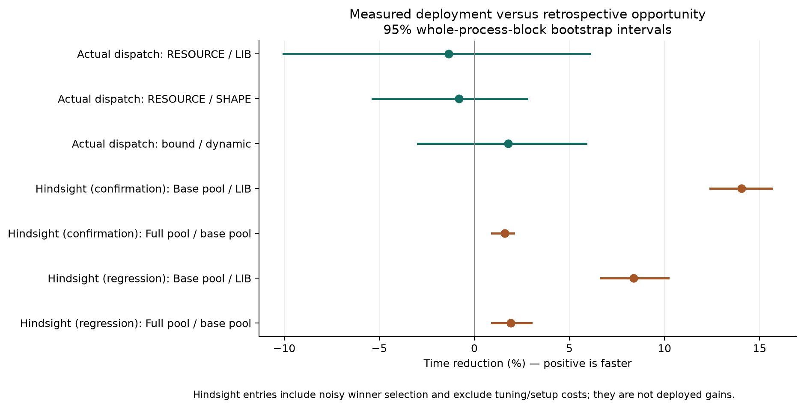
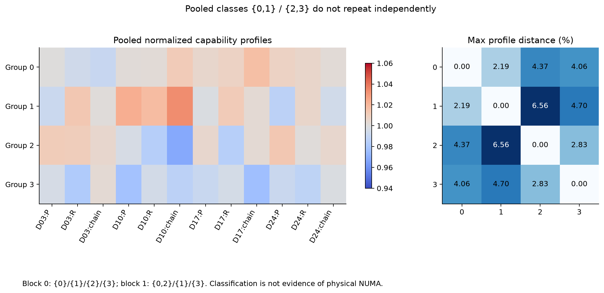
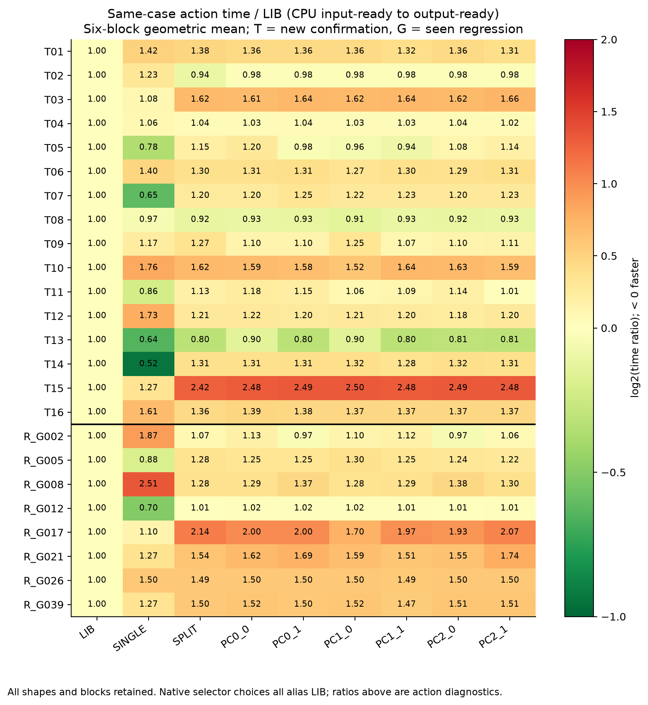
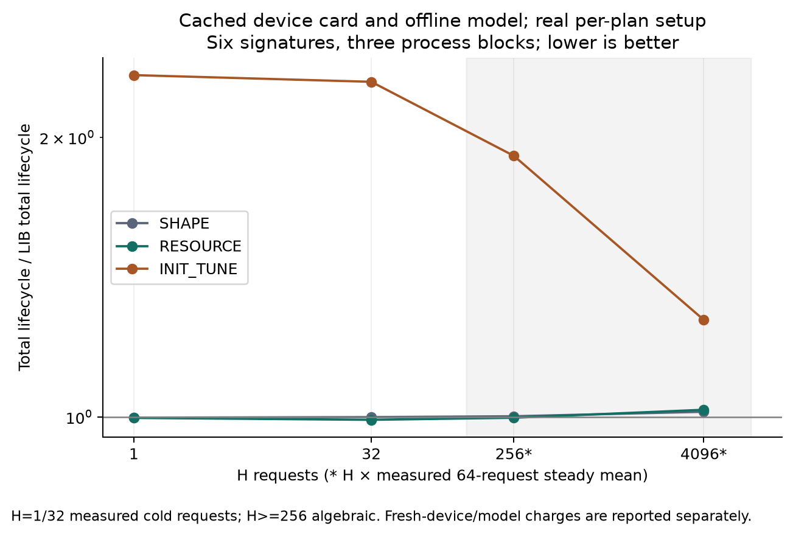
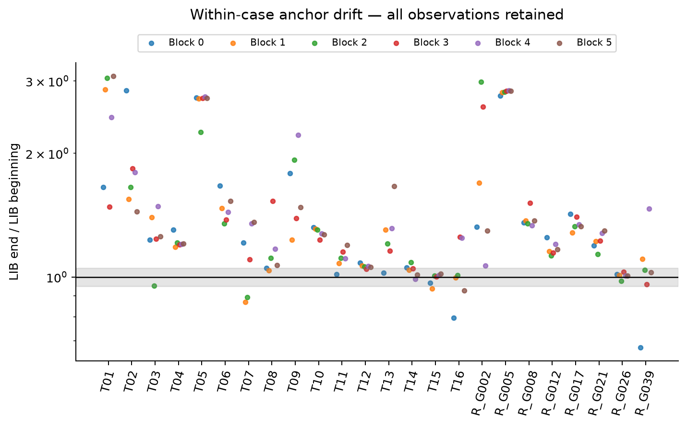

# T10 选择性静态重排实验报告

本轮已完成任务包规定的完整矩阵和真实部署验证，没有按结果删减形状。**冻结的 BASE、SHAPE、RESOURCE 在 H=1024 的全部正式形状上均选择 LIB；这轮没有建立资源关系信息带来额外部署提速的证据。** 原生退出路径确实避免了强制分区，但规则也放弃了部分普通实现选择机会。

执行日期：2026-10-17（Asia/Shanghai）；运行目录 `20261016T170348Z`。截至最终审计，连续墙时 96.32 分钟、GPU-worker 70.17 分钟，分别低于 510 分钟目标/540 分钟硬上限和 330 分钟 GPU 上限。只使用本机 T10，离线运行，无下载、安装或其他 GPU。100W 请求上限与实际 enforced 上限保持一致，风扇/温控保护服务与配置哈希未改。100W 是上限，不是恒定功耗或锁频。

## 结果该怎样理解

这次解决了“不要为了重排而重排”的工程问题：不合适时可以直接走库，既不枚举 SM 资源，也不创建 Green context 或 partial 缓冲。科学结论则更有限：当前资源卡不够稳定，预测误差保护阈值较大，规则最终几乎不干预。不能把“没有选重排”写成“重排必然无效”，也不能把事后全表的赢家当成已经实现的选择器收益。

16个新确认形状：若事后知道每个块中的赢家，普通 LIB/SINGLE/SPLIT 池相对 LIB 的经验节省是 14.05% [12.41, 15.65]；加入六个位置动作后，相对普通池额外的经验节省是 1.60% [0.93, 2.07]。这些数字有选最小值的乐观偏差、没有初始化和搜索费用，并受显著状态漂移影响，只是机会诊断。

8个已见回归形状：若事后知道每个块中的赢家，普通 LIB/SINGLE/SPLIT 池相对 LIB 的经验节省是 8.38% [6.64, 10.20]；加入六个位置动作后，相对普通池额外的经验节省是 1.92% [0.92, 2.99]。这些数字有选最小值的乐观偏差、没有初始化和搜索费用，并受显著状态漂移影响，只是机会诊断。

资源卡平均值分成两类，但两个独立进程得到的类别分别是四类和三类，分组成员也不一致。这里不成立“稳定物理 NUMA 域”的结论。也没有测得能归因于 SM 间传输延迟或缓存拓扑的因果作用。

## 完成量、来源与冻结边界

| 项目 | 实际完成 | 说明 |
| --- | --- | --- |
| 基础配方/S 校准 | 720 phase / 2进程块 | 24开发形状，六个新 bin |
| 共同动作校准 | 576 phase / 3进程块 | LIB、SPLIT、六个 PC |
| 四组资源关系卡 | 256 cell episode / 2进程块 | 4代表形状 × 2 workspace × 4×4 |
| 初始化成本 | 54样本 | 6 bin × 9动作；每格一次 |
| 正式动作 | 1296主 phase + 288首尾锚 = 1584 | 24形状 × 6独立进程块；完整固定次序 |
| 真实请求序列 | 102实际 phase | 72主策略 + 12置乱卡 + 18固定绑定 |
| FFN | 96逻辑 phase；24实际计时 + 72明确别名 | 四策略动作相同，未伪造96份独立计时 |
| OOD | 36实际 phase | 4形状 × 3块 × 3入口 |
| 生命周期 | 72 phase；每phase四个H | 6形状 × 3块 × 4策略 |
| 代表性CUPTI trace | 3份 | 原生、置乱卡实际PC绑定、FFN |
| 数值与资格 | 全部通过 | FP32完整参考、FP64子块、raw-bit、placement、memcheck |
| CPU规则一致性 | 1560项 | 52形状 × 5策略 × 6个H |

输入包 SHA256：`906c9a20cdd79fb43d1ff18824a1fce6e5ca345fddc86fdcbd04bda21976200e`。52个形状包括24开发、16新确认、8已见回归、4 OOD；M=320 是预声明外推子集。历史重合审计扫描20份本地计划/形状索引，没有发现新确认形状的完全相同 MNK；这不是对全部历史文件的无限制穷举。输入为固定种子的合成 FP16 数据/权重、FP32输出，不是预训练LLM。

生产 CUTLASS 提交 `f7b19de32c5d1f3cedfc735c2849f12b537522ee`。数学内核、两个 adapter 和 DIAG0/DIAG1 cubin 与上一轮 production 逐字节一致；本轮新增的是惰性资源、计划绑定与固定选择规则。正式计时执行 DIAG0，无 SMID/clock 指令；DIAG1 只用于资格/roster，不把其计时当正式结果。生产源/二进制哈希见 `freeze/production_origin.json`、各构建 `build.json` 和逐worker manifest。

哈希封存时间：2026-10-16T17:29:01.687863+00:00；规则 SHA256：`499fa0631223fdbc997987b5d5387f771cfb004938d6f614f6639c3e8070d93c`。所有正式 case 的选择在其测量前写入；测试后未重拟合、改阈值、替换形状或选择更好的一次重跑。旧实验目录保持原状。

## 方法、动作与保护阈值

| 动作 | 执行内容 |
| --- | --- |
| LIB | cuBLAS 全设备库调用；库可自行选择 split-K，不能按名字假定为单kernel |
| SINGLE | 现成 CUTLASS S=1 全设备实现 |
| SPLIT | 现成全设备 split-K 生产→归并 |
| PCp_q | p∈{0,1,2}三种二分；q∈{0,1}同向/互换消费者；同一配方/S和直接slab寻址 |

| bin（M层,N层） | SINGLE recipe | SPLIT/PC recipe | S |
| --- | --- | --- | --- |
| 0_0 | 0 | 0 | 4 |
| 0_1 | 2 | 0 | 4 |
| 1_0 | 0 | 2 | 4 |
| 1_1 | 2 | 2 | 8 |
| 2_0 | 2 | 2 | 4 |
| 2_1 | 2 | 3 | 2 |

M层为 ≤8、≤64、>64；N层为 ≤4096、>4096。新 bin 只从开发数据选择，未继承旧强制 split 表。BASE 只在前三种动作中选择；SHAPE 与 RESOURCE 共享九种动作、训练行、固定 ridge λ=1 和逐整形状留一验证，RESOURCE 额外使用资源卡连续特征。资源卡类别用于可重复性诊断，未据此更改真实 SM 分区。

624条训练行：LIB/SPLIT/六PC来自相同的3个动作块；SINGLE 的48条来自较早2个基础块中的已选配方。两个选择器用完全相同的数据，但 SINGLE 与其余动作不在同一校准时段；不能把这一时段差异当成配对因果效应。

CPU选择器测试前冻结的成本是1000次决策batch平均值的95分位（不是单请求p95尾延迟）：1.0159 μs。BASE 相对库的保护余量：SINGLE 589.57 μs、SPLIT 585.88 μs；RESOURCE 的PC成对误差余量范围为 739.32–1192.60 μs，另计初始化摊销和选择费用。绝对误差保护对短请求尤其严格。它防止冒险，也会错过收益；这是冻结方法本身的结果。

开发/正式/OOD 的 BASE、SHAPE、RESOURCE 全选 LIB。唯一不同：PERMUTED_RESOURCE 在 T12 选 PC0_1。置乱固定为 [2,0,3,1]，只改资源卡身份，不改实际动作和输入。前后一致重命名的负对照特征差异 <1e-12；同一确定性模型因此保持相同预测。留一预测误差与逐动作表见 `derived/loso_diagnostics.json`、`development_action_table.json`。

使用逐整形状留一预测和最终全局LOSO误差保护进行决策诊断，SHAPE与RESOURCE同样24/24选LIB，错误开启0；平均相对开发观测赢家的regret为 152.59 μs。这是阈值校准诊断，阈值本身用到了全局LOSO误差，不是嵌套CV或新的独立泛化验证。

## 资源关系卡与稳定性

| 组 | 实际SM编号 |
| --- | --- |
| 0 | 0, 1, 2, 3, 10, 11, 12, 13, 22, 23, 34, 35, 44, 45 |
| 1 | 4, 5, 14, 15, 24, 25, 26, 27, 36, 37, 38, 39, 46, 47 |
| 2 | 6, 7, 8, 9, 16, 17, 28, 29, 40, 41, 48, 49, 50, 51 |
| 3 | 18, 19, 20, 21, 30, 31, 32, 33, 42, 43, 52, 53, 54, 55 |

代表形状 D03/D10/D17/D24；每组14 SM。卡按当前生产几何采集完整 P→R 和独立阶段仪器化P/R，阶段和残差不替代整链主指标。每个代表内先按组均值归一化 P/R/chain 谱，采用最大分量差距离、complete-link 合并，阈值=max(1%,2×噪声中位数)；本次为 3.0814%，来自 1.5407% 噪声中位数的两倍。合并均值得到 {0,1}/{2,3}；块0为 {0}/{1}/{2}/{3}，块1为 {0,2}/{1}/{3}。

完整矩阵、workspace/process复本、残差、距离及类成员保存在 `freeze/RESOURCE_CARD.json`。新形状只以开发集标准化 log(M,N,K) 距离插值最近两个代表；无测试计时输入、D2H决策、任意SM mask搜索。当前卡说明测量存在差别，但尚未证明这种差别能稳定预测最佳资源配对。

| 代表 | P span μs | R-after-P μs | 完整chain μs | R/chain |
| --- | --- | --- | --- | --- |
| D03 | 812.56 | 5.07 | 812.07 | 0.62% |
| D10 | 659.40 | 12.66 | 655.00 | 1.93% |
| D17 | 1346.80 | 38.24 | 1434.82 | 2.66% |
| D24 | 9414.74 | 102.18 | 8819.99 | 1.16% |

P/R插桩来自另外的阶段样本，有的P均值甚至高于未插桩chain，不能把这些列相加当精确分解。R/chain约0.6%–2.7%，只表示显式归并阶段；生产者写partial、间隙与缓存事务没有分离，不能把它解释成全部通信比例。每形状的FLOPs、逻辑输入/输出/partial字节、实际slab、CTA、尾部比例和kernel资源声明见 `derived/bottleneck_geometry.json`；逻辑bytes不是DRAM事务。

## 正式全动作与冻结选择

以下时间降低率定义为 100×(1−时间比)，正数更快。每个形状先求块内请求均值，再对整进程块配对 log 比；整体形状等权。5000次整块 bootstrap；新确认 RESOURCE/SHAPE、RESOURCE/LIB 的边际区间为97.5%，其他探索性比较95%。六个块是进程重复，不是六块GPU。

| 形状组 | RESOURCE/LIB | RESOURCE/SHAPE | BASE/LIB |
| --- | --- | --- | --- |
| 新确认16 | 0.00% [0.00, 0.00] | 0.00% [0.00, 0.00] | 0.00% [0.00, 0.00] |
| 已见回归8 | 0.00% [0.00, 0.00] | 0.00% [0.00, 0.00] | 0.00% [0.00, 0.00] |
| M320外推4 | 0.00% [0.00, 0.00] | 0.00% [0.00, 0.00] | 0.00% [0.00, 0.00] |
| M范围内确认12 | 0.00% [0.00, 0.00] | 0.00% [0.00, 0.00] | 0.00% [0.00, 0.00] |

上表是**冻结选择查全动作表**：由于都选同一个 LIB，0%及[0,0]来自结构别名，不是测出了统计等效，更不是独立部署提速。真实入口开销在后面的S5单独测量。完整九动作的CPU/GPU/batch三口径、六块原值见 `derived/formal_action_table.json` 和附表。

| 组 | 固定旧M(PC1_0)/LIB节省 | 普通池事后包络/LIB | 全池事后包络/普通池 |
| --- | --- | --- | --- |
| 新确认 | -23.75% [-28.70, -19.81] | 14.05% [12.41, 15.65] | 1.60% [0.93, 2.07] |
| 回归 | -35.57% [-44.97, -27.59] | 8.38% [6.64, 10.20] | 1.92% [0.92, 2.99] |
| M320外推 | -41.87% [-55.19, -31.61] | 23.97% [20.03, 27.52] | 0.00% [0.00, 0.00] |

| 资源身份消融（动作表查表） | RESOURCE/PERMUTED降低率 |
| --- | --- |
| 新确认16 | 1.13% [1.02, 1.25] |
| 回归8 | 0.00% [0.00, 0.00] |

T12是唯一被卡置乱改变动作的确认形状；保持LIB相对置乱后PC0_1的动作表时间降低率为 16.68% [15.11, 18.22]。它显示这次置乱导致一次误开，不能仅凭一个形状证明真实卡在独立部署上有普遍增量。

固定旧M列只是本轮同配方/S、partition1/pi0 的无条件位置动作参考，不把不同历史功耗或旧配方的毫秒直接移入本轮。所有PC与SPLIT以同配方/S保持数值语义；这比“资源名不同”更接近受控动作比较，但时钟/顺序漂移依然限制因果解释。

| 组 | 策略 | 错误开启(case×block) | 平均regret μs | 错失普通池 μs | 错失PC μs | 最坏单case/block退化 |
| --- | --- | --- | --- | --- | --- | --- |
| 新确认 | RESOURCE | 0 | 336.01 | 316.72 | 87.32 | 0.00% |
| 新确认 | PERMUTED_RESOURCE | 6 | 392.33 | 316.72 | 87.32 | 24.03% |
| 回归 | RESOURCE | 0 | 140.52 | 136.61 | 10.92 | 0.00% |
| 回归 | PERMUTED_RESOURCE | 0 | 140.52 | 136.61 | 10.92 | 0.00% |

错失普通池和错失PC是各自相对所选基础动作的机会，**不能相加**。这些机会及 regret 使用带噪声的同块事后赢家，未计搜索费用，不能把大 regret 直接当成现实可得收益。逐case与每块原值保存在 `regret.jsonl`、`paired_values.jsonl`、`case_comparisons.json`。

## 真实请求、FFN与OOD

| 实际请求比较 | 总完成时间降低率及95%CI |
| --- | --- |
| BASE/LIB_ALWAYS | 1.02% [-6.79, 6.07] |
| SHAPE/LIB_ALWAYS | -0.53% [-7.41, 5.45] |
| RESOURCE/LIB_ALWAYS | -1.34% [-10.05, 6.09] |
| RESOURCE/SHAPE | -0.81% [-5.37, 2.76] |
| RESOURCE/BASE | -2.39% [-7.45, 2.06] |
| RESOURCE/PERMUTED_RESOURCE | -2.33% [-8.92, 5.50] |
| RESOURCE_BOUND/RESOURCE | 1.78% [-2.97, 5.88] |

只支持本轮host已知签名与预准备输入槽；没有新增GPU-only动态shape适配或逐请求D2H读取shape，也未声称集成完整模型服务。

三条序列均为128个按给定顺序执行的当前请求，六个独立进程块。每个签名预建四个真实输入槽和相应图；C++处理当前签名、调用冻结规则并提交绑定图，没有每请求Python/JSON查表。总时间是实际序列完成时间，包含请求循环/选择和结果边界等待；按每块所有共同序列的实际时间之和求比，不用形状等权几何均值冒充。每条序列绝对总 μs、逐请求值及初始化费用均保留。

实际trace里四主策略的GPU动作也全部是同一个LIB。因此上表的非零计时差不能来自资源重排；它混合了CPU入口、运行次序和状态波动。即使某个区间为正，也不能据此宣称RESOURCE硬件信息带来加速。固定绑定与动态入口的差同样只给实测观察，不把它全部解释为规则计算成本。

MIXED/BURST只含 T01/T06/T11/T16；SHIFT_AND_FALLBACK另含四个OOD。它们**不含T12**，所以置乱卡虽然在T12改变选择，在两条实际置乱序列里仍执行同样LIB。RESOURCE/PERMUTED表项只汇总BURST和SHIFT两条，其余主比较汇总三条。实际 RESOURCE/PERMUTED 的耗时差不能证明资源身份信息有因果价值；T12置乱选择已通过独立绑定资格和代表性trace，但没有增加任务外性能分支。序列属于多签名调度压力测试，不是自然LLM token分布。

| FFN | M×hidden×intermediate | 第一/第二层动作 |
| --- | --- | --- |
| F1 | 4×8192×3072 | LIB / LIB（四策略一致） |
| F2 | 24×16384×8192 | LIB / LIB（四策略一致） |
| F3 | 80×8192×3072 | LIB / LIB（四策略一致） |
| F4 | 320×16384×8192 | LIB / LIB（四策略一致） |

FFN实际执行 GEMM→已有SiLU/FP16→第二GEMM，当前activation换槽、权重固定，没有中间CPU等待。四条链的第二层签名均超出训练范围，独立选择共享LIB回退；当前实现对非LIB第二层会明确拒绝，不声称已经实现任意双重排FFN。相同静态动作对去重，24实际计时+72逻辑别名，别名不增加独立样本；初始化/选择另由生命周期实测。

| OOD真实入口比较 | CPU完成时间降低率及95%CI |
| --- | --- |
| RESOURCE/LIB_ALWAYS | -10.03% [-17.34, -3.71] |
| SHAPE/LIB_ALWAYS | -2.01% [-7.13, 5.80] |

OOD主指标仍观察到RESOURCE入口约10.03%的退化，95%探索区间未跨0；GPU span也约慢10.09%，而另测的紧密batch口径反而约快16.03%。这些是3块、同LIB动作的不同状态/计时观察，不能用更好看的batch替换CPU主指标，也不能把全部差值归因于一个CPU范围判断。资源旁路成立，但本轮不能宣称OOD性能零回退。

36个OOD实际phase全部通过：资源枚举0、Green context 0、诊断模块0、PC partial workspace 0。这里的“0”是检查的资源计数，性能仍为实测。LIB有自身64MiB cuBLAS工作区和普通输入/输出，不能说原生执行完全不占workspace。

| 真实序列（LIB） | 输入/计划setup中位ms | 不含输入的计划中位ms | 已计GPU张量+库workspace MiB |
| --- | --- | --- | --- |
| BURST | 2838.45 | 5.05 | 857.91 |
| MIXED | 2849.13 | 5.84 | 857.91 |
| SHIFT_AND_FALLBACK | 5841.74 | 10.84 | 1764.69 |

上表包含为声明签名准备四个输入槽的成本；上下文和图内部allocator元数据未逐项计量，不能把张量+显式库workspace说成全部显存。初始化不混入稳态序列时间，单独展示并在生命周期中计费。

## 初始化、INIT_TUNE和寿命

| 策略 | H=1 | H=32 | H=256* | H=4096* |
| --- | --- | --- | --- | --- |
| SHAPE | 0.19% [-0.10, 0.63] | 0.05% [-1.77, 1.30] | -0.16% [-1.82, 1.90] | -1.27% [-3.84, 2.70] |
| RESOURCE | 0.26% [-0.38, 0.82] | 0.73% [-0.52, 1.49] | 0.22% [-0.99, 1.67] | -1.78% [-5.56, 3.23] |
| INIT_TUNE | -133.36% [-137.00, -129.54] | -129.52% [-134.38, -125.95] | -91.04% [-95.10, -85.02] | -27.19% [-34.35, -15.58] |

上表是每形状 init+请求 总成本相对LIB的降低率，三进程块，95%探索区间。H=1/32真正执行冷启动请求；带*的H以重新绑定该H后的64次稳态测量作 H×mean 代数估计，**不是执行了4096次请求**。包括输入生成/传输、所选资源、图、workspace、必要warmup；每个策略独立建计划。CUDA进程导入的完整冷启动、allocator/driver残留缓存的影响未被单独隔离。

INIT_TUNE在当前初始化真实扫描九动作，每动作8次pilot、共同预热；准备/创建/释放/扫描全部归它，科学数值验证时间单独记录并扣除。赢家用新输入种子重建并验证，不反馈给冻结模型。这个有限扫描并非证明全局最优，且8次pilot也会受漂移影响。实际赢家、pilot值和成本见各生命周期worker的 `tuner_pilots.jsonl`。

上表的设备卡与离线模型已缓存，未将它们免费隐去：本轮实现实际共享动作校准、CPU拟合、规则导出/编译/验证墙时间隔和最终host编译总计 627.18 秒，RESOURCE额外设备卡worker 170.94 秒。新设备/模型分析在六签名模型上只收一次共享成本和一次资源卡费用，不对每签名重复收六遍；逐块/H账本见 `derived/fresh_model_lifecycle.json`。这些实际实验worker包含conditioning和科学校验，是当前实现的保守成本，不是优化后生产profile的最小成本。其中最终host编译9.34秒，规则导出/编译/验证的观测墙时间隔10.27秒，分项在JSON中；卡的纯CPU聚合和完整冷进程导入未单独计时，标为未知，不填零。因此这不是覆盖全部未知费用的精确冷启动总账。

18次真实初始化扫描选中动作：{'LIB': 15, 'SPLIT': 1, 'PC1_1': 1, 'PC1_0': 1}；调优准备与扫描成本中位 1.127 秒，范围 0.301–2.362 秒。这六个预定形状上，有限autotune没有展示计费后收益；不能把该子集结论推广到所有形状。

| 六签名模型，H=4096* | 缓存卡/规则总秒，中位 | 加本轮已测离线构建费用后总秒，中位 |
| --- | --- | --- |
| LIB_ALWAYS | 52.03 | 52.03 |
| SHAPE | 53.36 | 680.54 |
| RESOURCE | 53.50 | 851.62 |
| INIT_TUNE | 63.64 | 63.64 |

这一表按六签名实际总时间求和再取三块中位，和前表等权形状log比是不同聚合口径。带*的请求部分仍为代数估计，离线费用含实验conditioning/校验且仍有已注明未知项。

| 动作 | plan初始化中位 μs | 范围 μs | 样本量 |
| --- | --- | --- | --- |
| LIB | 879.26 | 733.04–32419.25 | 6 |
| SINGLE | 704.85 | 589.45–1047.23 | 6 |
| SPLIT | 805.97 | 690.71–854.71 | 6 |
| PC0_0 | 5525.19 | 3573.27–34534.40 | 6 |
| PC0_1 | 4615.59 | 3474.86–5798.90 | 6 |
| PC1_0 | 4740.99 | 3583.47–5309.30 | 6 |
| PC1_1 | 5169.76 | 3349.59–5766.68 | 6 |
| PC2_0 | 5084.11 | 3731.80–12705.88 | 6 |
| PC2_1 | 4838.14 | 4036.97–7014.62 | 6 |

上述54个初始化样本用于测试前摊销估计，已初始化CUDA环境，每bin/action仅一份；真实S5按实际签名重新计费。不能把这些样本描述为稳健冷启动分布。完整setup分项含枚举、Green创建、roster、建图与输入成本。

## 执行DAG、launch/copy/wait与数值资格

| 代表trace | 8次提交实际kernel数 | 拷贝事件数 | 动作 |
| --- | --- | --- | --- |
| NATIVE_RESOURCE_EXIT | 16 | 0 | LIB |
| SELECTED_PC_PERMUTED | 32 | 0 | PC0_1 |
| FFN_NATIVE_EXIT | 32 | 0 | LIB |

`sr_run_async`只提交一次已准备body图，内部没有主机同步；调用者在真正结果边界使用 `sr_wait`。正式计时的 `sr_trace`使用统一start/body/end事件包装，并在每个请求的结果边界等待，GPU span与CPU完成时间分别记录。PC图是两个生产分支→各自归并→join，所有权公式和slab直接寻址来自原production；没有独立调度kernel、逐tile域表、D2H选择或额外中间拷贝。FFN图在同一提交内连接第二层。准确节点/边/函数名及CUDA API计数见 `derived/execution_evidence.json` 和CUPTI原trace。

CUPTI实际记录到8次body重放对应的16/32/32个kernel，未记录中间memcpy。本机Kineto导出未包含cuGraphLaunch/cuStreamSynchronize的driver API事件；API表中的cudaDeviceSynchronize是profiler边界。每份轨迹的8次提交/8次调用者等待由实际执行循环与源码审计确认，不能冒称为CUPTI独立测得的driver API计数。

正式全动作原始harness为公平复用持有10个Green并加载诊断模块；不能拿它的原生启动成本代表真实部署。lazy LIB只持有primary/cuBLAS，PC才创建所选2个Green。实验计划保留共同计时包装图/事件用于报告三种时间口径，尚未提供去除全部计时仪器的生产应用集成；异步body入口另有真实CUPTI轨迹。

资格覆盖3种配方、S=2/4、边界/不整齐形状、六种PC方向，受控split/PC上额外验证alpha=.75、beta=.25，逐位比较PC与同配方SPLIT。LIB只验证默认alpha=1、beta=0；不声称测过非默认库epilogue。正式phase尾验证结果，PC与同块SPLIT参考逐位相同；FP64小子块辅助检查，FFN相对相同SiLU/half链。compute-sanitizer实际运行，0 errors。数值验证、D2H参考与日志刷新在请求计时外。

## 状态漂移与结论限制

CPU首尾锚共有 144 对，其中 119 对超过±5%；尾/首比中位数 1.247，范围 0.674–3.083。全部保留，没有删慢块、时钟回归校正或挑好看的区间。1Hz worker遥测最高温度 76°C；SM读数范围 300–1590 MHz（包含worker准备/空闲片段）。频率变化和100W状态相容，但本轮没有识别其对每个微秒请求的因果贡献。

虽然预热、60秒conditioning和次序轮换按规定执行，144组LIB首/中/尾的kernel函数、grid、block和共享内存几何完全一致，仍出现显著漂移。当前锚点漂移仍过大，无法支持把1%级变化解释为稳定硬件亲和。bootstrap只反映本次进程块观测波动，不消除慢漂移、有限次序设计或选赢家偏差；区间跨0不等于证明等效。无预训练LLM、attention、其他GPU/日期重复、硬件缓存/传输计数器或物理拓扑因果证据。

## 工程记录、可复算索引和后续方向

保留实施记录：校准队列首次因导入缺少常量在任何GPU worker之前退出，原日志保留，修正后继续；S5开始前修正SHIFT的实际键名为SHIFT_AND_FALLBACK，使预定两条置乱序列均被执行。S5前补充了phase结束后写出的输入种子/内存元数据，未改计时路径。没有失败后择优重跑正式块。未缩减必做矩阵；FFN相同动作对的别名去重已明确记录。S6 profiler与正式计时分离。完整账本/命令/源哈希/遥测/正确性均随证据包保留。生命周期前两块有一项日志缺口：逐请求数组和相应细粒度时间戳未写盘，但每块96个计划/H聚合值、费用、调优动作均值和数值检查完整；第三块修正了明细保存。所有三块原结果均用于统计，没有重跑替换；CPU复算可核对全部已有明细与均值，但不能恢复前两块已丢失的请求数组。

| 文件/目录 | 作用 |
| --- | --- |
| T10_SELECTIVE_REORDER_REPORT.md | 本报告 |
| FULL_ACTION_TABLE.md | 开发、新确认、回归分表及六块入口 |
| freeze/POLICY_FREEZE.json + POLICY_FREEZE_HASHES.json | 规则、阈值、特征和冻结哈希 |
| src/policy.hpp + policy_api.py | 生成短C++规则及Python等价口径 |
| freeze/RESOURCE_CARD.json | 四组roster、关系卡、类和负对照 |
| derived/*.json / *.jsonl | 动作全表、配对原值、regret、oracle、生命周期 |
| runs/20261016T170348Z/raw/ | 逐请求样本、数值、DAG、状态、失败日志与来源 |
| reports/FINAL_COMPLETENESS_AUDIT.json | 完整性、预算、数学不变性、原生直达审计 |
| reports/FINAL_POWER_READBACK.json | 100W与保护配置最终状态 |
| recompute.py（交付包根目录） | 仅CPU重算统计/核对冻结选择与SHA256，无GPU、无联网 |

下一轮最值得先解决的是测量稳定性与普通实现选择的预测泛化，再谈资源关系的增量：用新的预注册数据检验更局部的误差/回本模型、独立日期的资源卡复现，以及同动作池的真实请求增量。本轮不做这些事后改动。当前成果可作为明确的负结果、工程边界和可复现实验依据；它尚不足以宣称NUMA感知调度获得论文级稳定提速。

