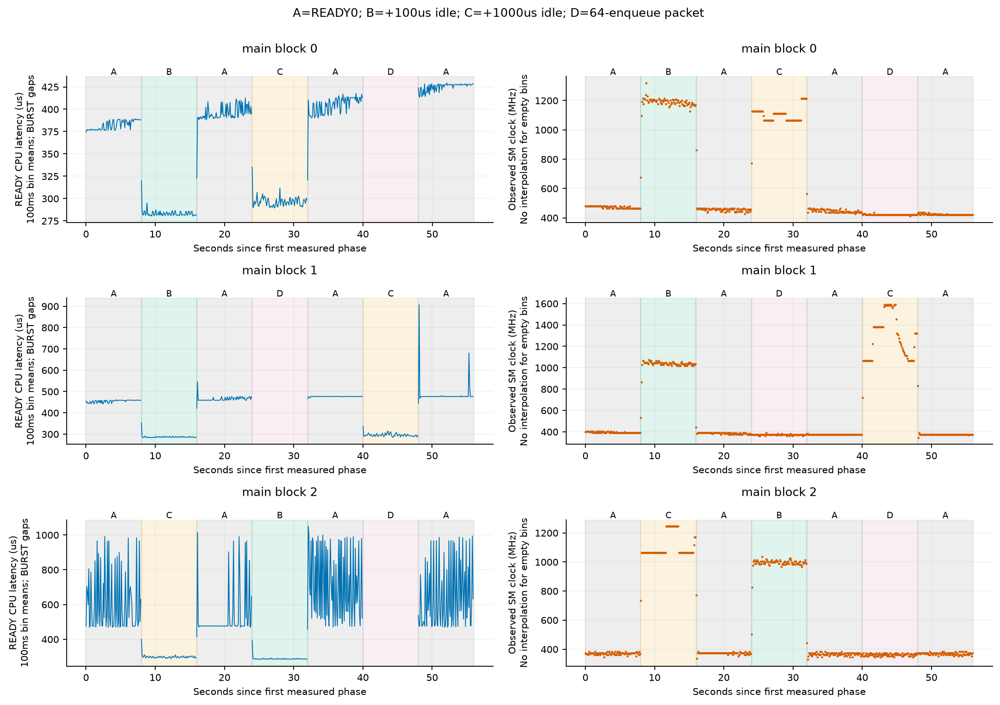
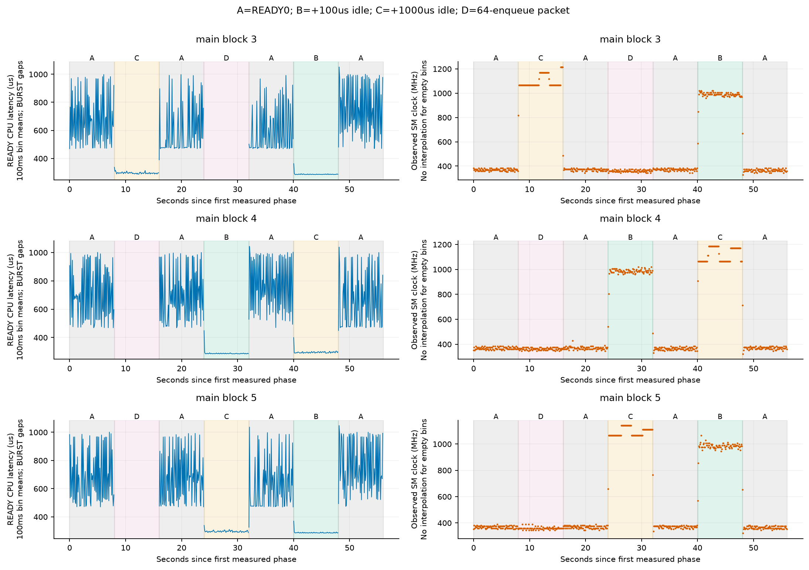
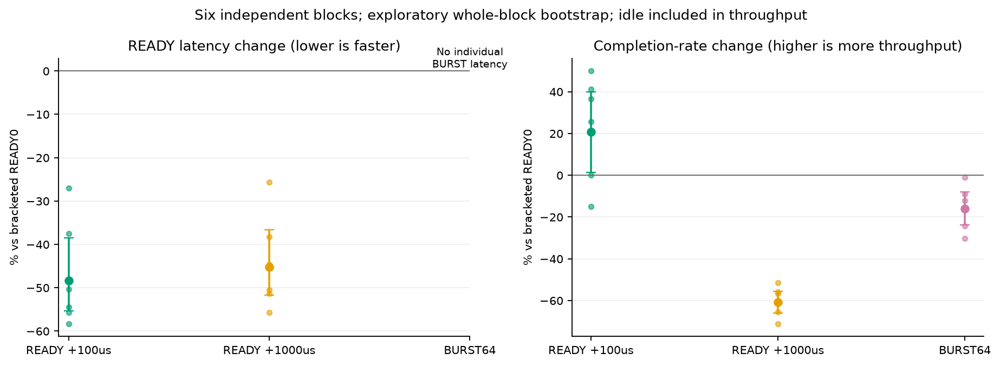
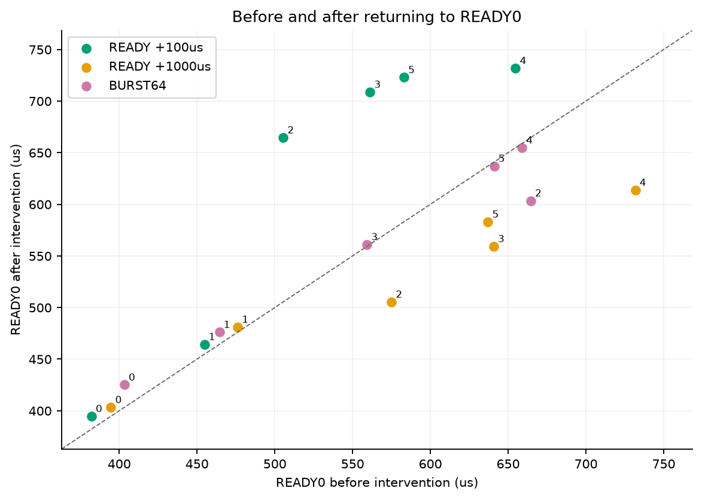
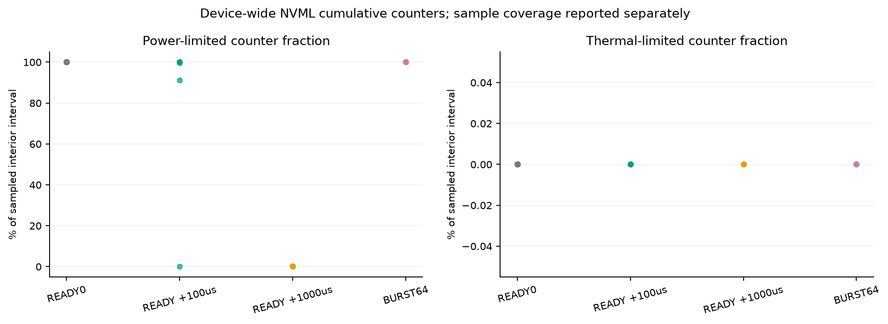
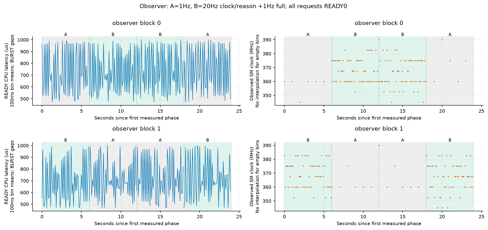
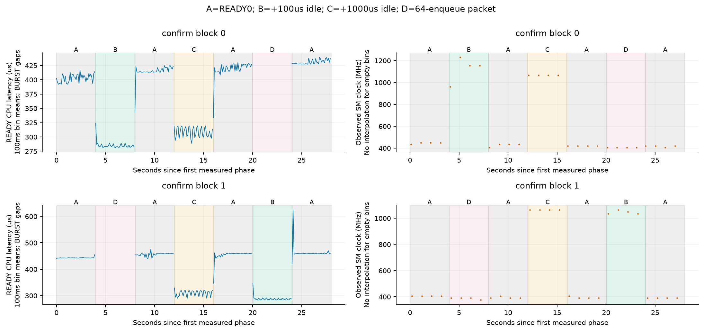
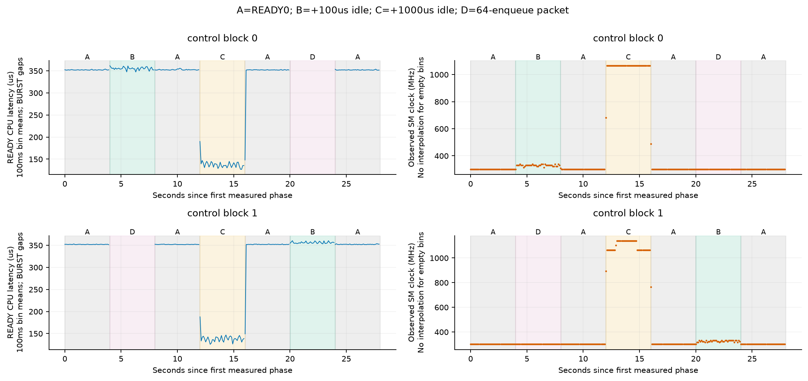
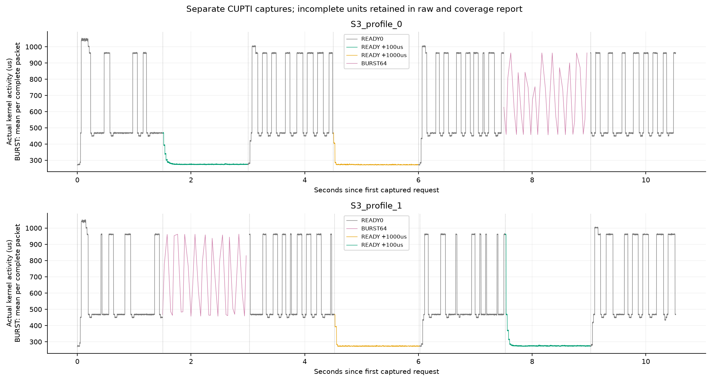

# T10 运行状态与可逆提交节奏诊断

run `20261017T092352Z`；2026-10-17。本轮是继承累计预算中的有限机制诊断，不新增NUMA方法或选择器。

## 直接回答

本轮完成了可执行的请求节奏干预、低频监测复验和独立活动捕获。固定频率与硬件缓存计数器仍受系统权限阻挡，因此不能宣称已排除全部运行状态因素或确认了物理NUMA。

关键结果：同一R_G017算式和LIB图，加入短暂停顿能重复缩短单次耗时；返回连续提交后又回到较慢、部分跳变的状态。独立CUPTI捕获也看到kernel活动时长缩短，因此不能把全部变化解释为宿主计时误差。但固定频率干预没有做成，具体硬件根因仍未关闭。

收益需要分开看：主六块B的单请求延迟几何均值下降48.31%，含等待的完成率增加20.67%；分块完成率从下降14.99%到增加49.94%，其中一块基本持平。1Hz复验两块延迟仍下降30.18%和36.95%，但完成率分别下降10.95%和0.67%，汇总下降5.95%。因此本轮没有得到跨准备状态稳定的净提速。

复验不能用来直接指认20Hz监测造成虚假收益：它的conditioning为10秒而非30秒，阶段为4秒而非8秒，开始前设备已从前一捕获结束的74°C冷却至68°C（主块0启动为63°C），没有进行温度匹配，且处在另一段运行历史中。专门的1Hz/20Hz对照只观察到约-0.51%和-2.32%的延迟变化，方向也不能解释主实验的巨大差异。

先区分两个量：CPU-ready衡量一次请求发出到输出完成；完成率把主动等待、事件读取与全部循环时间算进去。让一次kernel更快，并不保证每秒完成更多工作。BURST只有64请求整包完成时间，没有虚构单请求ready时刻。

|干预，相对相邻两段READY0|单请求CPU-ready变化|实际完成率变化|
|---|---:|---:|
|B|-48.31% [-55.34, -38.53]|+20.67% [+1.34, +39.93]|
|C|-45.17% [-51.67, -36.63]|-60.83% [-66.10, -55.58]|
|D|NA：整包吞吐口径|-16.07% [-23.83, -8.02]|

B=每请求输出完成、读完事件后请求sleep100us；C=sleep1000us；D=连续64次bodyGraph提交、一次包尾等待。实际sleep/间隙以raw时间戳为准，不假设操作系统精确睡到指定微秒。区间仅为6个独立进程块的探索性bootstrap；进程顺序固定、共享设备热历史，没有逐块冷却复位，因此不把它当作已消除时序相关的显著性证明。只有2块的辅助层区间信息更有限。

直白说，B请求sleep100us，实际从ready到下次开始约173–175us，单次处理约283–289us，合起来约459–463us。原来连续提交就很快时，这笔等待成本会让吞吐下降；原来处于600–700us的慢状态时，缩短计算时间可能补回等待成本。C实际间隙约1088–1091us，等待成本更大，六块吞吐全部下降。

上述因果干预能检验“提交方式/请求间隔改变后表现是否改变”；它同时改变设备负载与运行历史，不能单独识别频率、缓存、调度三者谁在起作用。

## 每块原值及返回原方式

六种B/C/D排列各用一次。每块固定30秒READY0 conditioning，然后7段各8秒：A→X→A→Y→A→Z→A。所有阶段真实运行，没有等到平稳才开始或丢掉前缀。输入、权重、输出及四个预建LIB图在块内共用；global request序号连续，槽位按其%4。

|块|干预|前A均值us|干预ready均值us|后A均值us|后A/前A|完成率/相邻A|
|---|---|---:|---:|---:|---:|---:|
|0|B|382.16|283.445|394.70|1.033|0.850|
|0|C|394.70|296.541|403.33|1.022|0.289|
|0|D|403.33|NA|425.08|1.054|0.991|
|1|B|454.74|286.959|464.36|1.021|1.000|
|1|D|464.36|NA|476.16|1.025|0.911|
|1|C|476.16|295.714|481.13|1.010|0.347|
|2|C|575.06|298.833|505.44|0.879|0.389|
|2|B|505.44|287.919|664.61|1.315|1.256|
|2|D|664.61|NA|603.50|0.908|0.837|
|3|C|640.71|296.541|559.24|0.873|0.434|
|3|D|559.24|NA|561.17|1.003|0.697|
|3|B|561.17|287.532|708.83|1.263|1.366|
|4|D|658.91|NA|654.77|0.994|0.878|
|4|B|654.77|288.605|731.78|1.118|1.499|
|4|C|731.78|296.462|613.79|0.839|0.485|
|5|D|641.02|NA|637.06|0.994|0.756|
|5|C|637.06|296.763|583.03|0.915|0.441|
|5|B|583.03|287.908|722.97|1.240|1.411|

原READY0阶段均值范围为382.16–731.78us。第2至5块的请求仍出现约460–480us与约970–1000us两档，慢请求比例随阶段改变。CPU-ready与GPU事件均值只差约6.5–9.7us，事件时间也保留了大幅变化。

A返回后的水平必须与前A一起看。返回相同提交方式不保证返回相同硬件状态；不能仅凭B/C更快就宣布已精确控制快态/慢态。

## 功耗限制与时钟：可测关联、未完成的干预

主条件始终100W。sudo非交互核对需要密码，直接设置1065MHz也返回权限不足；没有更改系统设置。缓存性能计数器由RmProfilingAdminOnly=1限制，当前CapEff=0，本机PATH无ncu/nsys。没有索取或使用历史口令，没有关闭保护。

20Hz仅查询SM时钟与当前降频原因；完整功耗、温度和累计power/thermal violation计数约1Hz。每字段查询起止ns保留。没有在请求之间插NVML；阶段之间也不执行同步NVML查询，以免额外插入几十毫秒间隙。宿主阶段切换实际间隙已记录。

主A/D的power violation计数几乎占满内部采样区间；主C接近零，SM读数也从A的约360–480MHz升至C的约1065–1312.5MHz（阶段中位）。B的时钟中位约990–1185MHz，但多数B阶段power计数仍高，说明不能简单用“有/没有功耗限制”二分状态。主阶段内部采样区间的thermal violation增量均为零；这不等于温度或漏电与功耗预算无关。

还有未解释的残差：A中100ms桶的SM读数中位同为360MHz时，CPU均值仍约556–984us；375MHz时约469–765us。这只是粗粒度同读数比较，不能证明有效频率真的相同，但足以说明当前遥测还不能逐次解释翻倍跳变。没有把这部分归因于NUMA或缓存。

累计计数只按两个实际存在、完整落在阶段内部的样本取差；覆盖时间小于全阶段，不补插值。计数为整卡范围，包含可能的其他客户端；设备实际传感器刷新频率未知。1Hz或20Hz读取频率不等于传感器刷新率。

|模式|阶段数|功耗限制计数占比中位|该计数覆盖阶段比例中位|thermal计数占比最大|SM读数中位数范围MHz|
|---|---:|---:|---:|---:|---|
|A|24|100.00%|87.68%|0.000%|360–480|
|B|6|99.86%|87.68%|0.000%|990–1185|
|C|6|0.00%|87.73%|0.000%|1065–1312|
|D|6|100.00%|87.43%|0.000%|360–420|

NVIDIA说明功耗管理可压低时钟；NVML violationTime单位是ns、referenceTime单位是us，本轮按这两个单位计算差分。参见[时钟事件原因](https://docs.nvidia.com/deploy/nvidia-smi/index.html)、[计数结构](https://docs.nvidia.com/deploy/nvml-api/api/structnvmlViolationTime__t.html)。这些文档说明可能机制，不能代替本机固定频率对照。

## 监测器自身的影响

两块独立进程各固定10秒conditioning，随后6秒×4窗；第0块1Hz/20Hz/20Hz/1Hz，第1块反序。两者都执行READY0，无主动间隔；20Hz组仍只有完整状态1Hz。原始查询耗时与实际采样间隔保留。

|块|顺序|1Hz两个窗均值us|20Hz两个窗均值us|20Hz/1Hz|
|---|---|---|---|---:|
|0|ABBA|675.92, 696.84|673.85, 691.94|0.9949|
|1|BAAB|677.94, 669.14|641.86, 674.38|0.9768|

主阶段NVML快速/完整查询的平均宿主耗时约8ms，99分位约26–30ms；1Hz确认完整查询平均约20ms。查询在独立CPU进程内执行，但不能先验认定零扰动。

仅两块且可能存在状态carryover，不能据此计算一个通用的监测开销扣除项。主六块只能直接代表此20Hz观测条件；以下1Hz确认单独报告，不与主六块合并扩大样本量。

## 1Hz独立确认与R_G002对照

1Hz确认在主结果导出前根据NVML能力探针的查询成本预先登记：两块R_G017，10秒conditioning、七段各4秒，采用第一及最后一种干预排列。R_G002也为两块、同样10秒与4秒，属于较小输入的对照。二者与主六块准备时间不同。

|层|模式|ready变化|完成率变化|
|---|---|---:|---:|
|control|B|+1.83% [+0.83, +2.84]|-33.49% [-34.11, -32.87]|
|control|C|-60.04% [-60.13, -59.95]|-71.73% [-71.76, -71.70]|
|control|D|NA|+1.92% [+1.07, +2.78]|
|confirm|B|-33.65% [-36.95, -30.18]|-5.95% [-10.95, -0.67]|
|confirm|C|-29.03% [-31.95, -25.99]|-69.09% [-70.40, -67.72]|
|confirm|D|NA|-1.05% [-1.79, -0.31]|

## 独立CUPTI窗口

最多两份新捕获。每份先固定30秒conditioning（不捕获），然后进入工具，七段各1.5秒。它们与正式8秒阶段分开，不将被观测的kernel时间替换正式wall time。每个kernel按实际wall/monotonic锚、请求或64包host区间、函数/grid/block核对；不拟合平移。异步请求只在完整包内分析活动总和，缺失条目明确标出。

|捕获|阶段|模式|预计kernel|缺失kernel|未包含于请求/包的活动|完整单位的kernel均值us|
|---|---:|---|---:|---:|---:|---:|
|S3_profile_0|0|A|2768|0|0|529.322|
|S3_profile_0|1|B|3185|0|0|278.943|
|S3_profile_0|2|A|2431|0|0|604.760|
|S3_profile_0|3|C|1068|0|0|275.127|
|S3_profile_0|4|A|2533|0|0|578.943|
|S3_profile_0|5|D|2240|0|0|677.749|
|S3_profile_0|6|A|2521|0|0|583.258|
|S3_profile_1|0|A|2763|0|0|530.019|
|S3_profile_1|1|D|2240|0|0|677.549|
|S3_profile_1|2|A|2604|0|0|563.719|
|S3_profile_1|3|C|1070|0|0|276.229|
|S3_profile_1|4|A|2866|0|0|511.021|
|S3_profile_1|5|B|3162|0|0|281.111|
|S3_profile_1|6|A|2416|0|0|608.480|

实际API导出数量、kernel的context/stream/correlation保存在derived/profiles.json；没有导出的Driver提交关系不补造。采集工具可能改变运行表现，见[NVIDIA CUPTI说明](https://docs.nvidia.com/cupti/main/main.html#cupti-overhead)。

## 对论文方向的判断边界

本轮可以支持对当前T10、已见输入、固定100W下提交节奏与运行历史依赖的描述。主动插入等待是负载干预，不是新的NUMA优化；若延迟改善伴随完成率下降，不能作为应用净收益。

短期最有价值的是澄清受功耗限制时的运行状态和基准比较方法。原NUMA方向仍可保留，但本轮没有给它新增空间因果证据。不能把主六块+20.67%写成已经成立的通用优化：辅助复验净收益没有通过。

仍缺固定频率的独立对照、可访问的缓存/访存计数器，以及隔离其他GPU客户端的完整调度轨迹。因此不能把power限制关联写成唯一根因，也不能由时间跳变推出空间拓扑。旧约1%的优势标签没有因本轮而自动恢复。

下一条有判别力的证据应是：在实际可用的保守锁频下重复同一有限A→X→A协议；如跳变仍在，再结合缓存与调度证据。只有在运行状态可控后，空间映射差异仍可重复且真实负载净收益成立，才支持原NUMA优化命题。运行历史导致选型反转也可形成独立研究问题，但需要可重复机制、有效处理办法与新输入验证，不能只凭一张异常曲线宣称论文贡献。

## 完整性、预算与复算

本轮GPU-worker（包含失败smoke）15.219/20分钟；继承308.734672分钟；累计323.954/330分钟。完成数量：{'smoke': 1, 'main': 6, 'control': 2, 'observer': 2, 'profile': 2, 'confirm': 2}。数值检查128条全部通过。

计入成功worker的raw请求1,532,372条，其中conditioning 607,876、后续阶段924,496。smoke和profile均单列，未混为主六块统计。失败尝试raw另存，不删除。

前置CPU语法检查拦截一处括号错误。第一次smoke子进程已导出raw，父监控器因把快速遥测当完整遥测而读不存在的温度字段失败；修正为取最近完整温度样本后单独retry，失败耗时计账。其余工程说明见ENGINEERING_NOTES.jsonl。

数学cubin、原GPU源码、库调用合同、bins和选择器均保持hash；新增C++仅宿主提交与记录。前一交付包、报告、账本保持hash。未更改系统设置，无需恢复锁频；100W及原风扇保护保留。

解压后运行根目录recompute.py，使用Python+NumPy即可从raw重新生成并核对两份derived JSON，不需要CUDA/Torch、网络或原工程目录。重跑GPU仍依赖原CUDA/CUTLASS环境，且需要新预算与目录。包内不重复整轮旧raw。独立解压QA见外部交付索引。
