# T10 起始瞬态与 F4 退化诊断报告

日期：2026-10-17；run `20261017T063433Z`。全部是已见输入上的机制诊断，无新模型、调参或物理NUMA验证。

## 先回答关键问题

本轮144个计划工作单元全部完成，189,904条窗口请求（含94,952条warmup）均保留并通过复算。计量协议修复未成立，V16和F4的当前SINGLE选择明显退化，V15跨块反转。下述证据可用于解释当前实现，不能证明物理NUMA或恢复约1%的收益标签。

旧raw确认R_G017的BEGIN中间两窗偏慢：6个独立进程块全部中间/外侧>1.05，中位1.882；END中位1.038。较弱对照R_G002不保证稳定，旧END仍有波动。旧warmup逐请求时间没有保存，明确记为MISSING。
已确认旧conditioning只用slot0，而正式测量轮换四槽；新因子实验隔离提交节奏、槽位和夹具。这个实现事实本身不等于全部异常的根因。

|独立复验输入|协议|quartet数|偏移>1%|偏移>5%|绝对log差q90|
|---|---|---:|---:|---:|---:|
|R_G017|BURST_SLOT0|12|9|5|0.5797|
|R_G017|READY_RING4|12|8|8|0.5840|
|R_G002|BURST_SLOT0|12|0|0|0.0019|
|R_G002|READY_RING4|12|0|0|0.0018|

READY_RING4独立新块仍存在>5%的同计算假差异，不能称测量稳定性修复成功。
R_G017在约460–1,010us两档间多次跳变，独立新块直到切换后约1秒仍可出现跳变；不是仅开头几个请求慢。正式也固定slot0的控制仍有7/9个quartet偏移>5%，所以四槽轮换并非这种异常出现的必要条件。R_G002在本轮独立两协议中各12个quartet均未越1%，但不能据此推广到R_G017或历史全部数据。

A/A不能用平均有符号差接近0来判断稳定。下文保留所有请求、头中尾三个quartet及两种时间坐标；没有丢弃前缀。

|实际对象|B/A定义|CPU-ready时间增加与探索95%区间|
|---|---|---:|
|V14直接GEMM|SINGLE/LIB|+31.27% [+13.68, +51.00]|
|V15直接GEMM|SINGLE/LIB|-15.70% [-27.15, +11.78]|
|V16直接GEMM|SINGLE/LIB|+76.14% [+76.00, +76.28]|
|F3 ffn_pair|同LL A/A|-0.17% [-0.78, +0.25]|
|F4 ffn_pair|SL/LL|+36.04% [+35.95, +36.13]|
|F4 ffn_independent|SL/LL|+50.69% [+30.44, +74.09]|

V14各块B/A为0.995–1.601，存在同动作端点漂移；平均+31.27%不能说每块都慢31%。V15第0块慢70.2%，其余五块快约26–28%；第0、2、4块同为ABBA却不同方向，不能把反转简单归因ABBA/BAAB。V16六块都慢约76%，F4六块都慢约36%，这是本轮较稳健的实现选择负结果。

以上负数为更快，正数为更慢。六块或四块的bootstrap只是探索区间，不能消除过程状态偏差。F4的逐层证据来自另行CUPTI，不能拿两个孤立GEMM相加替代整链。

F4的独立CUPTI测量窗中，第一GEMM由8.917ms增为15.481ms；activation均约0.135ms，第二GEMM均约9.20ms。额外约6.56ms主要落在第一层SINGLE的实际kernel活动内，非第二层放大或新增CPU中间等待。这是该profile中的阶段定位，非全硬件根因证明。

## 旧数据直接复核与新计量范围

旧AA按明确quartet_id/anchor/block/window/request/slot恢复，并重新计算每窗均值。三条旧trace共90真测phase、11520请求，signature_ids映射、逐签名贡献和总额闭合均核对。FFN30真测、66别名；别名不增加独立样本。F4各块旧SL/LL总时间比为：1.397, 1.402, 1.368, 1.369, 1.351, 1.431。
旧每请求绝对时间及warmup细节缺失，不能重建精确切换时刻；本轮补齐steady_clock整数ns：请求进入、context就绪、launch返回、输出ready、event读取完成。CPU-ready不含其后的event读取，另报instrumented总段；事件跨度不是纯kernel活跃时间。

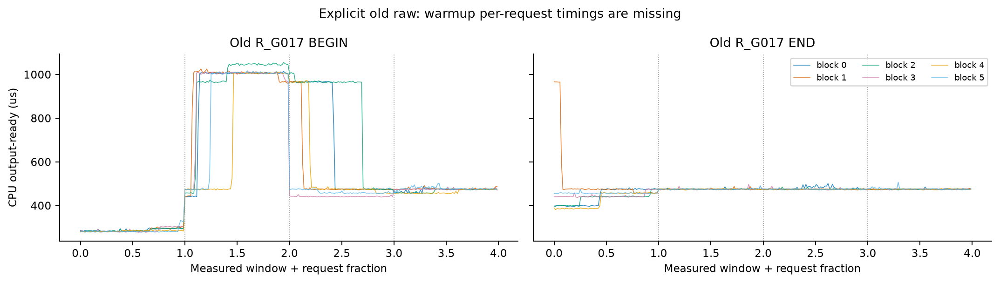

动态trace的begin→context_ready包含原选择器调用和context设置，不能将此区间单独命名为context或selector纯开销。其余宿主间隔还含签名查找、event读取和记录循环。

旧wrapped Graph的start→child-body→end依赖明确；完成同步后读elapsed，逐Job事件独立，未发现必须修改的事件API错误。BODY_CPU_ONLY直接重放同Job的body实例，只去掉外围event包装；数学、库算法和指针合同不变。窗口位置元数据的旧system_clock/double量化不参与CPU耗时计算。

正式数学cubin、tile/S、bins、选择器模型/margin、绑定动作均保持旧hash；旧完整run未修改。新工作目录中的后台改动只有宿主诊断入口，未增加GPU调度kernel。

## 固定因子实验与独立复验

SLOT0控制才是同一Graph、相同输入/输出地址；RING4在四个预建Graph与输入槽间轮换，A/B执行的是相同四图序列，不能统称单图单地址。

48主因子episode=2输入×2提交方式×2槽位方式×2夹具×3块；另6个单槽控制。每种fixture/输入/块是独立进程，四个conditioning按计划顺序在其中执行；三次并非完整carryover平衡，前一profile保存在raw。每次固定30秒，结束后12窗，每窗n热身+n测量，n来自事前一次LIB-only pilot。
BURST_RING4逐次异步提交不同slot，64包尾等一次；READY逐请求完成后读取事件。BURST只报告64包时间，未用反复覆盖的event伪造逐请求GPU时间。READY保存conditioning头64/末128；全部窗口热身与测量均保存。
FULL夹具建既有九动作与Green资源并资格检查，正式只重放LIB；依照不重新感知0x33要求未重新跑SM roster诊断。历史S4曾加载roster诊断模块，因此不能声称FULL复制了旧进程所有历史。

|输入|夹具|conditioning|q50绝对log|q90绝对log|>5%/9|
|---|---|---|---:|---:|---:|
|R_G017|NATIVE_ONLY|BURST_SLOT0|0.0701|0.3372|6/9|
|R_G017|NATIVE_ONLY|BURST_RING4|0.0024|0.3003|2/9|
|R_G017|NATIVE_ONLY|READY_RING4|0.1728|0.4484|7/9|
|R_G017|NATIVE_ONLY|READY_SLOT0|0.0100|0.4020|3/9|
|R_G017|ALL_ACTIONS_RESIDENT|BURST_SLOT0|0.0190|0.2743|4/9|
|R_G017|ALL_ACTIONS_RESIDENT|BURST_RING4|0.0007|0.0028|0/9|
|R_G017|ALL_ACTIONS_RESIDENT|READY_RING4|0.4361|0.5678|8/9|
|R_G017|ALL_ACTIONS_RESIDENT|READY_SLOT0|0.1555|0.4113|8/9|
|R_G002|ALL_ACTIONS_RESIDENT|BURST_RING4|0.0014|0.0028|0/9|
|R_G002|ALL_ACTIONS_RESIDENT|READY_SLOT0|0.0017|0.0026|0/9|
|R_G002|ALL_ACTIONS_RESIDENT|BURST_SLOT0|0.0007|0.0019|0/9|
|R_G002|ALL_ACTIONS_RESIDENT|READY_RING4|0.0008|0.0017|0/9|
|R_G002|NATIVE_ONLY|BURST_RING4|0.0014|0.0020|0/9|
|R_G002|NATIVE_ONLY|READY_SLOT0|0.0011|0.0036|0/9|
|R_G002|NATIVE_ONLY|BURST_SLOT0|0.0006|0.0018|0/9|
|R_G002|NATIVE_ONLY|READY_RING4|0.0010|0.0024|0/9|

D1外围事件观察对照（每模式固定30秒conditioning后12窗；固定先ORIGINAL后BODY，包含运行历史影响，不能当纯事件开销估计）：

|块|ORIGINAL CPU us|BODY CPU us|BODY/ORIGINAL|
|---|---:|---:|---:|
|0|395.36|437.19|1.1058|
|1|457.63|583.86|1.2758|

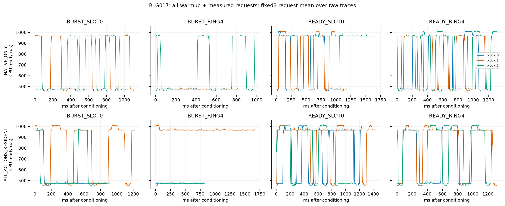

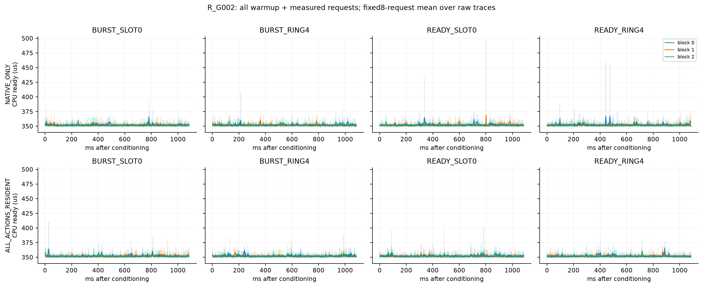

上图浅线为全部raw请求，实线仅为固定8请求均值方便阅读，含所有warmup。横轴是真实切换后毫秒；原始request序号也保留，不能把不同速度的第128请求视作同一时间。GPU、slot、窗口前后半、context/launch/wait/event-read分解在derived/diagnostic_results.json。

D4采用预定READY_RING4与旧提交节奏的原生化BURST_SLOT0，2输入×2协议×4新块，共16episode；理由和源码在D4前冻结，没有根据最小方差选协议。

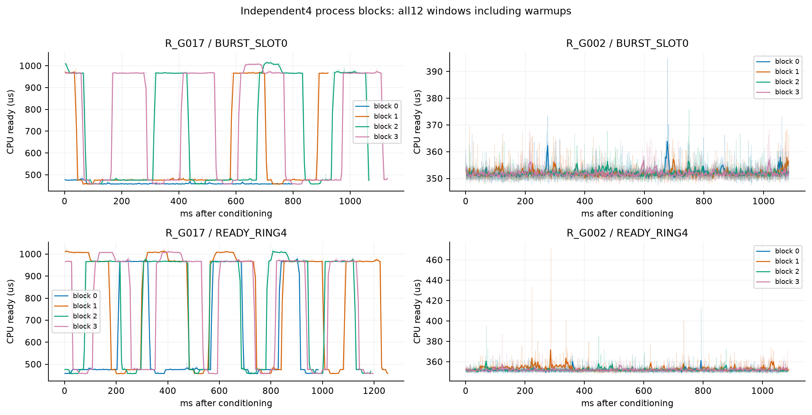

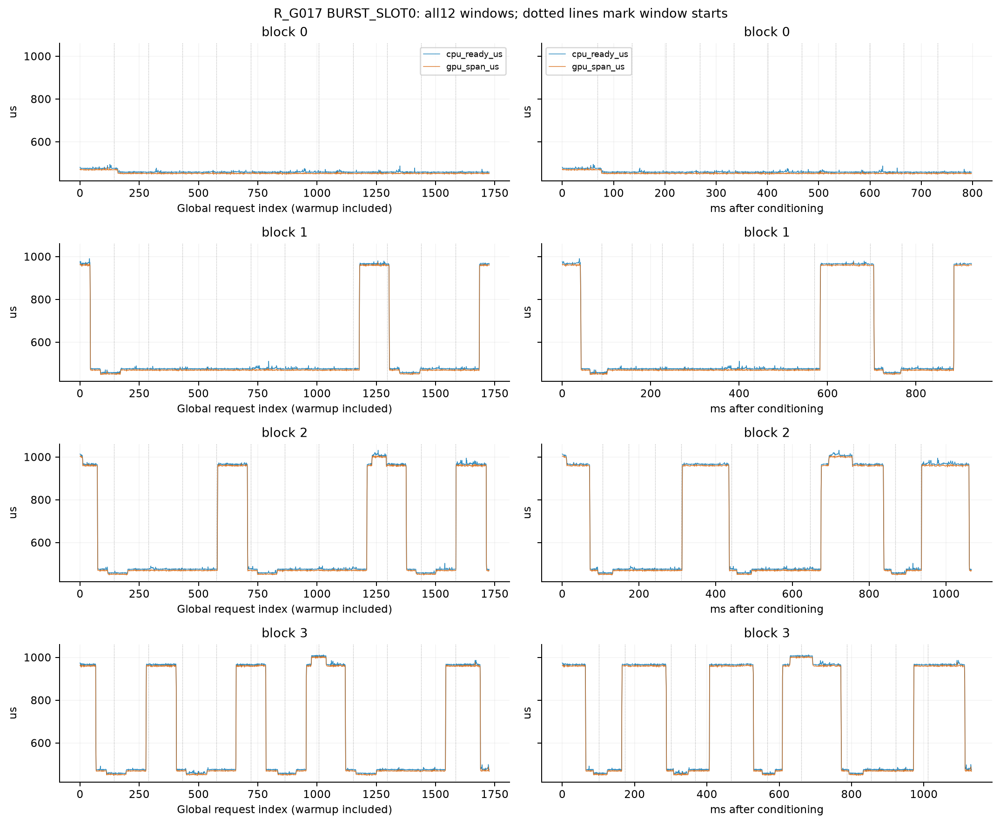

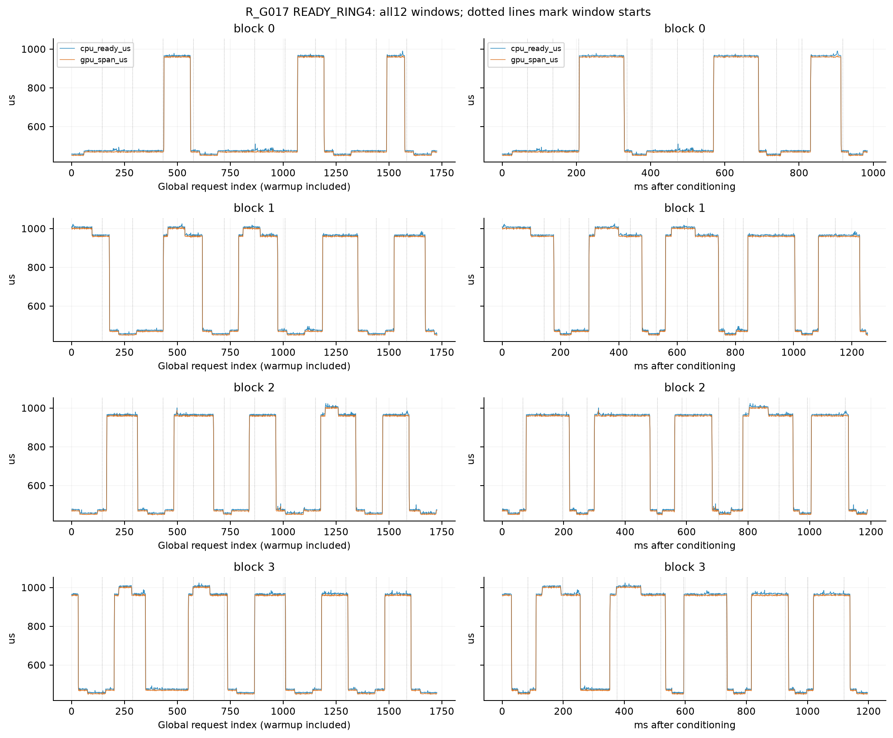

## 独立AA跳变的可复查位置

以下每个episode取全部warmup+测量序列中，相邻固定8请求小段的最大绝对log变化，给出两段的原始索引和实际时间。它只是统一的定位摘要，不是物理状态识别或挑选后的效果估计；所有请求仍参加原统计。CPU与GPU各自完整位置表见derived的transition_locations。

|协议/块|前→后请求索引（含warmup，0起）|前→后窗|后一段距conditioning毫秒|前→后均值us|后/前|
|---|---|---|---|---|---:|
|BURST_SLOT0/0|152–159 → 160–167|1→1|76.57–80.27|475.69→459.67|0.966|
|READY_RING4/0|1568–1575 → 1576–1583|10→10|913.99–917.80|910.52→475.21|0.522|
|READY_RING4/1|1664–1671 → 1672–1679|11→11|1227.46–1231.38|966.37→487.08|0.504|
|BURST_SLOT0/1|1296–1303 → 1304–1311|9→9|704.22–708.69|965.77→557.74|0.578|
|BURST_SLOT0/2|1368–1375 → 1376–1383|9→9|836.99–841.50|965.55→562.74|0.583|
|READY_RING4/2|664–671 → 672–679|4→4|481.71–485.52|957.35→475.81|0.497|
|READY_RING4/3|24–31 → 32–39|0→0|31.00–34.85|966.91→480.08|0.497|
|BURST_SLOT0/3|1112–1119 → 1120–1127|7→7|771.41–775.44|965.92→502.00|0.520|

已提供请求序号和真实毫秒两种坐标，12窗界线明确，所有热身保留。不同速度的相同请求号不可等同为相同运行时间。

## 三个SINGLE签名、F4与真实请求流

V14=(224,2560,20480)，V15=(224,7168,10240)，V16=(224,7168,20480)。每个6新块的LIB/SINGLE四窗配对共用输入、权重、输出地址和Graph机会，沿用旧SINGLE配方。没有选择器重选、Green或PC workspace。
F4每次真实执行GEMM1→SiLU/FP16→GEMM2，第二层固定共享LIB；中间无CPU同步。LL/SL在同Data对象上执行，第一层结果及最终输出有数值校验和预定小样例。跨库FP误差依旧合同判断，不要求bitwise相同。F3是同一LL计划真实A/A，未用alias省略。
D4额外4块F4使用新种子，保留每窗固定n热身，但没有额外30秒conditioning。这是在D1前公开记录的预算口径：D4的16个AA已占8分钟，阶段总上限10分钟。故D4 F4是不同预历史下的有限确认，不能冒称完全相同历史的重复。

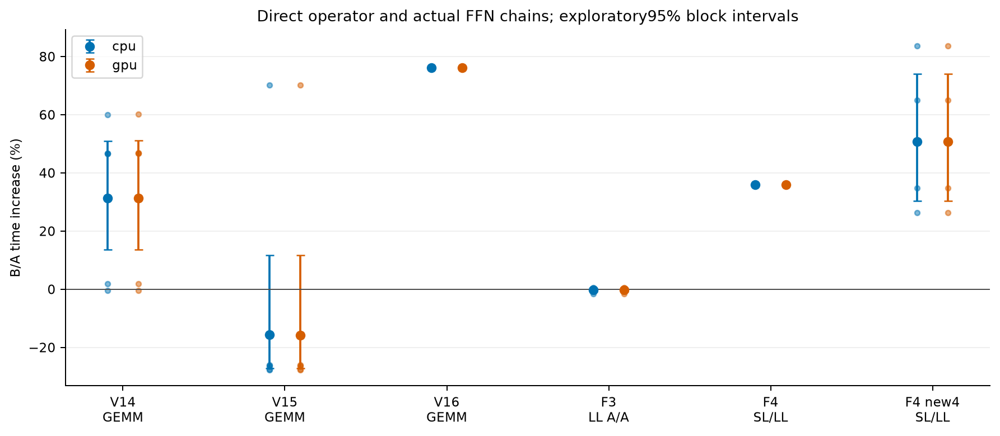

按预设窗口顺序拆分（每顺序仅3个过程块，描述性，不另作稳定性保证）：

|对象|ABBA的B/A几何均值|BAAB的B/A几何均值|
|---|---:|---:|
|V14 single_pair|1.1753|1.4662|
|V15 single_pair|0.9747|0.7290|
|V16 single_pair|1.7614|1.7615|
|F3 ffn_pair|0.9950|1.0017|
|F4 ffn_pair|1.3598|1.3609|

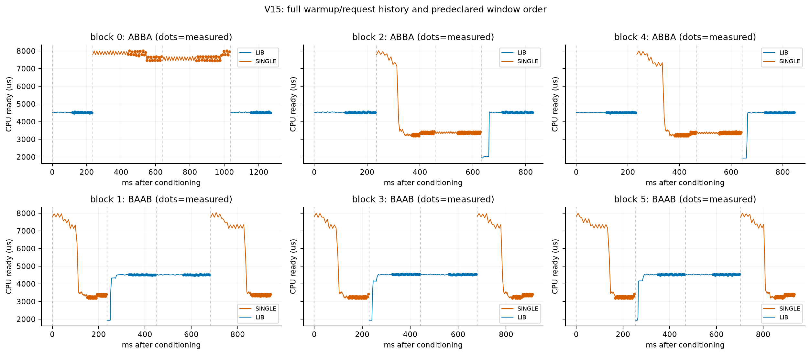

ABBA使B连续处于中间两窗，BAAB使B位于分开的两端；当运行状态与连续执行历史有关时，四窗对称不保证因果消偏。顺序依赖本身是观察，不足以确认温度、频率或缓存机制。

MIX/BURST分别沿用128项完整原序列、相同16签名多重集合与轮换槽位。每块三入口的六种顺序各用一次；同Data池，各入口只建实际选中的计划。正式前恰好一次完整trace热身，热身也保留；这不是进程冷启动。

|请求流|入口 / LIB_ALWAYS_BOUND|正式总完成时间增加，探索95%区间|
|---|---|---:|
|MIX_ALL16|FROZEN_BASE_BOUND|+28.99% [+28.76, +29.15]|
|MIX_ALL16|FROZEN_RESOURCE_DYNAMIC|+29.04% [+28.86, +29.18]|
|BURST_ALL16|FROZEN_BASE_BOUND|+1.31% [-1.52, +3.76]|
|BURST_ALL16|FROZEN_RESOURCE_DYNAMIC|-1.81% [-6.56, +2.60]|

三入口分别为全LIB、旧BASE绑定、旧RESOURCE每请求动态入口；后两者仍13LIB+3SINGLE。动态入口逐请求核对返回动作与实际绑定一致，不增加PC。完整trace总时间=逐请求CPU-ready之和+其余宿主间隔，逐签名与余项差额严格闭合；余项不能全叫选择器成本。
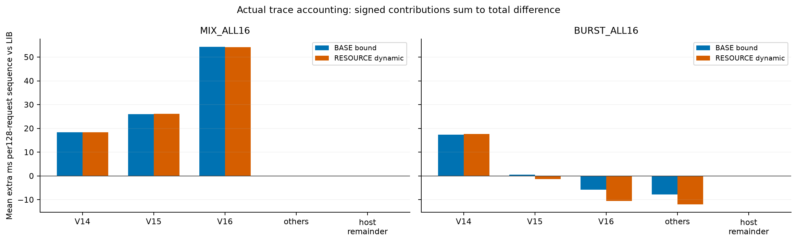

## CUPTI活动与仍未定位的原因

最多6份与正式计时分开的短捕获，在同一个profile工作进程内串行运行，覆盖AA两种节奏、F4 LL/SL与孤立V16 LIB/SINGLE。正式统计不含profile。每份先由自身动作或自身LL/SL链固定30秒conditioning，再进入profiler，记录该入口间隙；正式四窗配对则统一用LIB/LL conditioning，两者历史不同。捕获最终64请求包及后续窗口，前30秒没有活动trace。这一观察工具的进入间隙会改变运行历史，因此不能把profile与正式样本强行逐时间闭合。

|捕获|状态|kernel数|GEMM1 us|activation us|GEMM2 us|内部间隙 us|CPU-ready us|event span us|
|---|---|---:|---:|---:|---:|---:|---:|---:|
|AA_BURST_SLOT0|COMPLETE_CAPTURE_MATCHED|1792|477.84|0.00|0.00|0.00|488.64|481.21|
|AA_READY_RING4|WINDOWS_MATCHED_PREFIX_PARTIAL|1790|502.00|0.00|0.00|0.00|512.85|505.42|
|F4_LL|WINDOWS_MATCHED_PREFIX_PARTIAL|235|8916.65|135.00|9196.89|1.77|18272.44|18261.19|
|F4_SL|COMPLETE_CAPTURE_MATCHED|240|15481.35|134.97|9200.18|1.40|24837.43|24827.32|
|V16_LIB|WINDOWS_MATCHED_PREFIX_PARTIAL|69|8911.31|0.00|0.00|0.00|8922.28|8914.81|
|V16_SINGLE|WINDOWS_MATCHED_PREFIX_PARTIAL|66|15709.73|0.00|0.00|0.00|15721.89|15713.63|

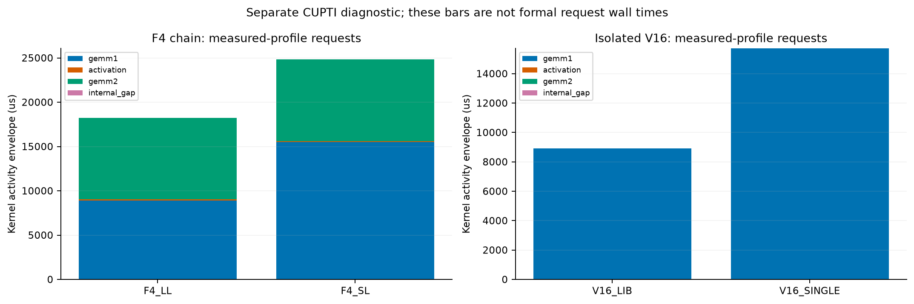

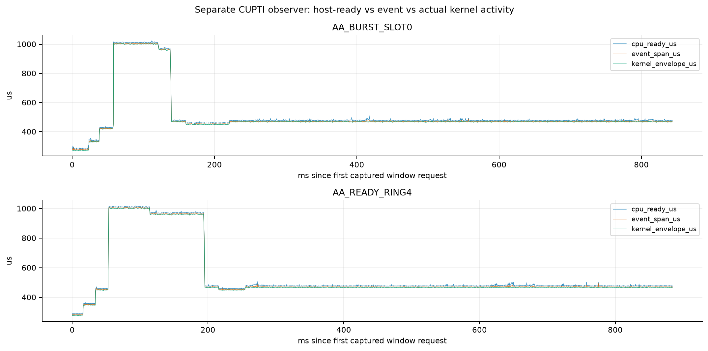

活动通过Chrome epoch与独立记录的wall/monotonic时钟锚换算，严格落入每个request_begin→ready区间，再按该slot实际DAG的function/grid/block核对。没有拟合平移，没有按数量假定漏记位置；保留实际context/stream/correlation，缺失的Driver launch API轨迹不补造。没有硬件cache/memory性能计数器，1Hz时钟也不是每kernel时钟。若某层活动较长，只能定位本次profile的时间花在哪里，不能仅凭相关断言L2、频率或SM通信导致。

AA两份profile中，单个kernel活动时长也随CPU/event出现约0.3→1.0→0.47ms的台阶；故这两次捕获的现象不只是event包装或宿主等候空隙。profiler进入改变历史且每条件仅一次，不能声称已经解释全部正式重复跳变。仍缺受控运行状态干预、完整Driver提交轨迹以及缓存/内存硬件计数器，不能把实际kernel变慢等同于SM访存拓扑。

## CUPTI窗口覆盖与漏记核对

六份捕获共3,520个窗口请求全部匹配（含warmup），对应3,584条kernel活动；未匹配活动均在首个窗口之前。漏记只定位到64请求conditioning前缀，未给缺失kernel补造时间。采用前后独立wall-minus-monotonic锚的整数均值，不拟合额外偏移；严格零容差包含检查，最近边界仍相隔至少3.7us，锚差6–415ns。锚位于前置30秒episode两端，不能排除未观测的时钟突变，但本次没有匹配冲突。
全部六份API导出仅各一条cudaDeviceSynchronize，没有实际Driver launch API对应表。保留工具真实的context/stream/correlation id，不把时钟匹配说成Driver API关联。

|捕获|窗口请求完整匹配|前缀kernel实记/预期|漏记|锚差ns|最小包含余量ns|
|---|---:|---:|---:|---:|---:|
|AA_BURST_SLOT0|1728|64/64|0|80|3716|
|AA_READY_RING4|1728|62/64|2|60|4044|
|F4_LL|16|187/192|5|6|4506|
|F4_SL|16|192/192|0|415|4648|
|V16_LIB|16|53/64|11|225|4509|
|V16_SINGLE|16|50/64|14|366|4701|

## 四级结论卡

1. **观察**：旧BEGIN位置效应经显式raw确认；本轮因子、独立块、SINGLE三签名、完整F4与trace原值全部保留。
2. **对照支持**：提交节奏/槽位/夹具和timer的有限干预，支持对本卡这些输入上的协议依赖进行描述；无跨设备、未见shape或全历史平衡保证。
3. **根因定位**：旧conditioning只触及slot0已由代码和新直方图验证；但未确认事件API错误。是否足以解释所有跳变必须服从独立AA与活动证据；尚缺独立固定运行状态干预、细粒度硬件状态与完整提交活动关联时，不能补写“肯定是频率/缓存”。
4. **原研究含义**：普通SINGLE选择是否迁移，只能按各签名、整链和真实trace分别判断。没有执行新的NUMA候选，也没有恢复资源信息增量证明；不能将计量改进当成新GPU方法。旧有巨大A/A波动的微小优势标签继续受限。本轮不回写选择器。

## 状态、预算、工程问题与恢复

主条件始终100W动态频率。遥测enforced-limit取值：['100000'] mW；温度范围62–77°C，SM采样300–1590MHz。采样不代表同步硬件状态，每字段查询前后ns保存；pilot仍用旧遥测列，后续正式均有逐字段边界。未锁频、未关闭风扇/温控、未重置GPU或修改驱动。无非交互管理入口，一次性命令说明已记录，没有索取或尝试口令。
本轮全部GPU-worker（含失败尝试）67.951分钟；旧账240.783881分钟；累计308.735/330分钟，本轮上限85分钟。阶段实际：D1=4.140min, D2=29.069min, D3=20.686min, D4=9.450min, D5=4.606min。
首次CPU辅助测试从错误目录运行，导入失败后在原任务目录17项通过。D1首块原始CSV已写出后因状态字段重复而落盘失败；完整保留失败worker并计费，修正仅Python元数据，在独立retry重跑。失败数据不混为额外独立正式块。所有其他工程修订见ENGINEERING_NOTES.jsonl。
新数据完整性要求144个计划工作单元全部对应、逐请求单调时钟与均值复算、conditioning数量/槽位核对、trace会计闭合；详见审计。工作单元混合episode/quartet/phase，不合称144个独立实验。只读查询和本轮新文件以外，没有系统设置需恢复；最终readback与kernel journal单列。

## 文件与复算

精简包包含本轮所有测量/热身请求、conditioning边缘/有限包、实际数值小样例、必要CUPTI、源码/构建/冻结、旧focus证据与来源hash。完整旧raw不重复打包。运行根目录recompute.py进行CPU-only复算；该检查不代替重新跑GPU实验。包的独立解压验证结果见交付索引及外置QA记录。

## 算子与FFN每块四窗原值

B/A使用实际标签，A后/前和B后/前显示同动作端点漂移。即使B/A接近1，也可能是不同方向的过程漂移抵消。以下均为CPU-ready微秒，完整GPU对应值在derived中。

|对象|块|顺序|w0|w1|w2|w3|B/A|A后/前|B后/前|
|---|---:|---|---:|---:|---:|---:|---:|---:|---:|
|V14 single_pair|0|ABBA|3885.0|6213.6|6223.1|3882.5|1.6011|0.9994|1.0015|
|V15 single_pair|0|ABBA|4518.1|7735.8|7647.8|4520.4|1.7020|1.0005|0.9886|
|V16 single_pair|0|ABBA|8926.6|15746.9|15705.2|8930.3|1.7613|1.0004|0.9974|
|F3 ffn_pair|0|ABBA|2186.6|2188.4|2187.0|2186.8|1.0005|1.0001|0.9994|
|F4 ffn_pair|0|ABBA|18244.1|24825.0|24829.0|18232.3|1.3613|0.9994|1.0002|
|V14 single_pair|1|BAAB|2558.3|1765.7|1764.5|2621.0|1.4671|0.9993|1.0245|
|V15 single_pair|1|BAAB|3299.9|4513.5|4514.1|3365.4|0.7383|1.0001|1.0198|
|V16 single_pair|1|BAAB|15730.5|8923.6|8924.8|15722.5|1.7622|1.0001|0.9995|
|F3 ffn_pair|1|BAAB|2184.4|2184.0|2183.9|2183.2|0.9999|1.0000|0.9995|
|F4 ffn_pair|1|BAAB|24815.5|18202.1|18238.7|24815.0|1.3619|1.0020|1.0000|
|V14 single_pair|2|ABBA|3752.4|2563.4|2560.8|1766.6|0.9951|0.4708|0.9990|
|V15 single_pair|2|ABBA|4522.6|3327.3|3371.6|4523.8|0.7405|1.0003|1.0133|
|V16 single_pair|2|ABBA|8921.8|15746.8|15741.5|8925.8|1.7643|1.0004|0.9997|
|F3 ffn_pair|2|ABBA|2185.9|2115.5|2186.1|2184.6|0.9841|0.9994|1.0334|
|F4 ffn_pair|2|ABBA|18245.9|24789.9|24796.9|18246.4|1.3588|1.0000|1.0003|
|V14 single_pair|3|BAAB|2549.3|1764.0|1764.6|2626.2|1.4666|1.0003|1.0302|
|V15 single_pair|3|BAAB|3250.3|4537.1|4528.5|3309.5|0.7236|0.9981|1.0182|
|V16 single_pair|3|BAAB|15714.6|8927.8|8920.3|15720.1|1.7612|0.9992|1.0003|
|F3 ffn_pair|3|BAAB|2121.8|2104.4|2101.0|2103.4|1.0047|0.9983|0.9913|
|F4 ffn_pair|3|BAAB|24813.2|18233.7|18235.3|24825.3|1.3611|1.0001|1.0005|
|V14 single_pair|4|ABBA|3597.8|2565.5|2569.1|1764.3|1.0190|0.4904|1.0014|
|V15 single_pair|4|ABBA|4517.7|3275.2|3362.2|4515.1|0.7347|0.9994|1.0266|
|V16 single_pair|4|ABBA|8924.9|15712.3|15680.7|8926.7|1.7586|1.0002|0.9980|
|F3 ffn_pair|4|ABBA|2104.1|2104.5|2106.2|2104.6|1.0005|1.0002|1.0008|
|F4 ffn_pair|4|ABBA|18234.6|24802.2|24777.5|18236.9|1.3594|1.0001|0.9990|
|V14 single_pair|5|BAAB|2560.7|1765.5|1767.2|2614.8|1.4650|1.0009|1.0211|
|V15 single_pair|5|BAAB|3253.5|4526.2|4528.6|3314.6|0.7253|1.0005|1.0188|
|V16 single_pair|5|BAAB|15711.0|8920.7|8919.5|15704.0|1.7609|0.9999|0.9996|
|F3 ffn_pair|5|BAAB|2107.4|2106.3|2105.1|2105.5|1.0004|0.9994|0.9991|
|F4 ffn_pair|5|BAAB|24765.7|18224.4|18237.1|24806.9|1.3596|1.0007|1.0017|
|F4 ffn_independent|0|ABBA|10019.6|24795.5|24839.4|18224.1|1.8366|1.8188|1.0018|
|F4 ffn_independent|1|BAAB|24362.3|18249.1|18242.7|24812.6|1.3475|0.9996|1.0185|
|F4 ffn_independent|2|ABBA|12392.8|24817.0|24800.2|18238.1|1.6502|1.4717|0.9993|
|F4 ffn_independent|3|BAAB|21403.8|18249.7|18244.1|24800.8|1.2627|0.9997|1.1587|

## 原批量调用路径补充复放与忠实性边界

主因子BURST_SLOT0/BURST_RING4在C++中连续重放原body，保留64次提交与单次等待，但省去了旧Job.batch包两端的GPU计时event及Python每包间隙。因此它们是对应提交策略的原生化版本，不能称逐调用完全相同的LEGACY。原Job.batch未改写；实现复核发现此区别后，预先记录理由并在剩余D1预算内做两次原Python jobs[count%4].batch(64)复放，保留两端event、原budget检查和每包调用。
这两次是晚期补充诊断，未混入原144工作单元或D4独立块。正式请求仍用新的完整时间线和新pilot n，也未重做旧roster探测；其差异和真实切换间隙保留。不能借补充样本宣称精确复现旧S4全部状态。

|补充块|condition秒|请求数|切换间隙ms|三组中间/外侧|
|---|---:|---:|---:|---|
|0|30.024|72000|1.428|1.0079, 1.0007, 1.0006|
|1|30.039|65152|1.419|1.0298, 1.0000, 1.0021|

## 可选5Hz观察成本探针

同一进程固定OFF→ON一次配对，二者都有原1Hz遥测，ON额外启用独立5Hz NVML进程。实测轮询间隔中位0.2001s，CPU-ready ON/OFF=1.1304，GPU event ON/OFF=1.1321。这混有固定先后顺序与状态漂移，不能据此给出普遍观察成本或认定传感器5Hz更新；正式样本均未启用5Hz。
